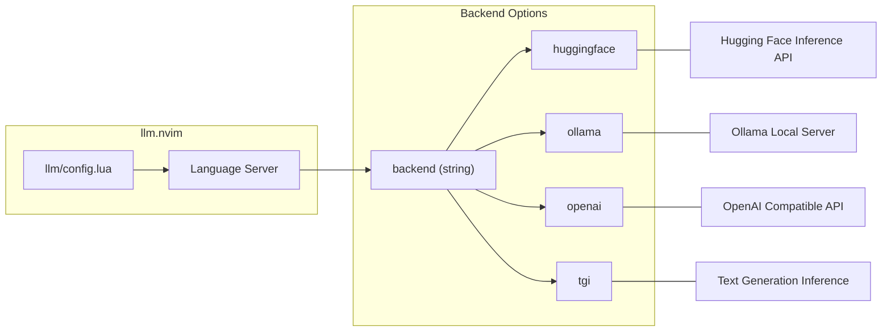
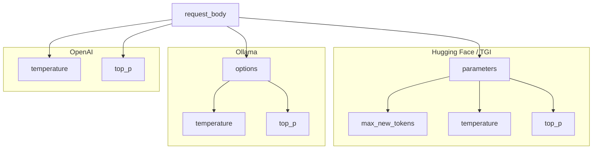
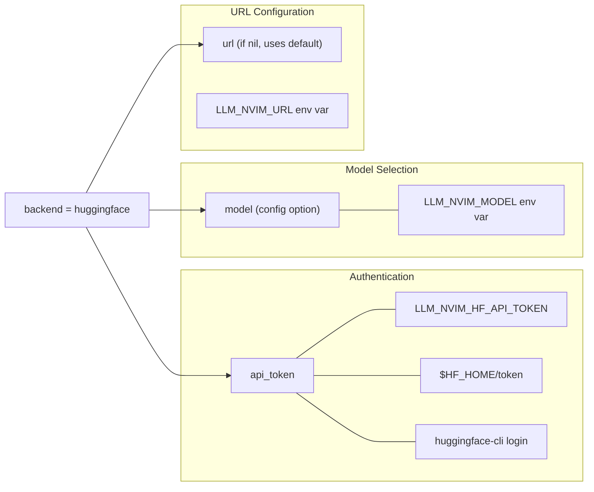
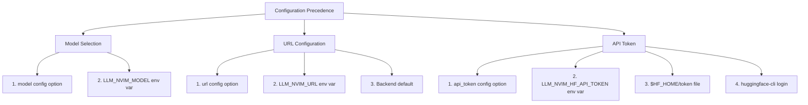

<!-- source: DeepWiki mcp.deepwiki.com · repo huggingface/llm.nvim · page 2.1 Backend Configuration · fetched 2026-10-26 -->

# Backend Configuration

<details>
<summary>Relevant source files</summary>

The following files were used as context for generating this wiki page:

- [README.md](README.md)
- [lua/llm/config.lua](lua/llm/config.lua)

</details>


This page documents how to configure llm.nvim to connect with various Large Language Model (LLM) backends. Backend configuration determines which LLM provider will be used, how to authenticate with it, which model to use, and how requests are formatted. For information about tokenizer settings, see [Tokenizer Configuration](#2.2), and for interface behavior settings, see [Behavior and Interface Settings](#2.3).

## Overview

llm.nvim supports multiple backends for providing LLM-powered completions. Each backend has its own configuration requirements, but they share a common interface within the plugin.



Sources: [README.md:34-38](), [lua/llm/config.lua:3-6]()

## Common Configuration Options

All backends share these common configuration options:

| Option | Type | Description |
|--------|------|-------------|
| `backend` | string | The backend provider to use: "huggingface", "ollama", "openai", or "tgi" |
| `model` | string | The model identifier to use (behavior depends on backend) |
| `url` | string or nil | The HTTP URL of the backend (if nil, uses backend-specific default) |
| `api_token` | string or nil | Authentication token for the backend (required for some backends) |
| `request_body` | table | Parameters to include in requests to the backend |
| `disable_url_path_completion` | boolean | If true, prevents llm-ls from adding API path to the URL |

Sources: [README.md:34-43](), [lua/llm/config.lua:2-7](), [lua/llm/config.lua:40]()

### Request Body Configuration

The `request_body` field lets you configure parameters sent to the LLM:



Sources: [lua/llm/config.lua:8-15](), [lua/llm/config.lua:43-54]()

## Backend-Specific Configuration

### Hugging Face Inference API



The Hugging Face Inference API backend requires:

1. **Authentication**: Your API token can be provided in one of four ways (in order of precedence):
   - Directly in config with `api_token = "your-token"`
   - Through the `LLM_NVIM_HF_API_TOKEN` environment variable
   - From the `$HF_HOME/token` file
   - By using the huggingface-cli to log in

2. **Model Selection**: Choose a model from the [Hugging Face Hub](https://huggingface.co/) by either:
   - Setting the `LLM_NVIM_MODEL` environment variable
   - Setting `model = "model-identifier"` in your configuration

3. **URL Format**: The model ID is appended to the URL as `{url}/models/{model}`

Sources: [README.md:44-63](), [lua/llm/config.lua:60-79]()

### Ollama

To use Ollama as a backend:

```lua
{
  backend = "ollama",
  model = "codellama:7b",
  url = "http://localhost:11434", -- llm-ls uses "/api/generate"
  request_body = {
    options = {
      temperature = 0.2,
      top_p = 0.95,
    }
  }
}
```

Key aspects:
- The `model` value is included in the request body
- The default URL is `http://localhost:11434` (Ollama's default port)
- llm-ls appends `/api/generate` to the URL
- Request parameters should be under the `options` key

Sources: [README.md:64-87](), [lua/llm/config.lua:44-49]()

### OpenAI

To use an OpenAI-compatible API as a backend:

```lua
{
  backend = "openai",
  model = "codellama",
  url = "http://localhost:8000", -- llm-ls uses "/v1/completions"
  request_body = {
    temperature = 0.2,
    top_p = 0.95,
  }
}
```

Key aspects:
- The `model` value is included in the request body
- llm-ls appends `/v1/completions` to the URL
- Request parameters are at the root level of `request_body`

Sources: [README.md:88-105](), [lua/llm/config.lua:50-53]()

### Text Generation Inference (TGI)

To use TGI as a backend:

```lua
{
  backend = "tgi",
  model = "bigcode/starcoder",
  url = "http://localhost:8080", -- llm-ls uses "/generate"
  request_body = {
    parameters = {
      temperature = 0.2,
      top_p = 0.95,
    }
  }
}
```

Key aspects:
- The model identifier can be any model supported by your TGI instance
- llm-ls appends `/generate` to the URL
- Request parameters should be under the `parameters` key

Sources: [README.md:106-129](), [lua/llm/config.lua:8-15]()

## Environment Variables and Configuration Precedence

llm.nvim supports several environment variables to override configuration:



Important environment variables:
- `LLM_NVIM_URL`: Override the backend URL
- `LLM_NVIM_MODEL`: Override the model identifier
- `LLM_NVIM_HF_API_TOKEN`: Set the Hugging Face API token

Sources: [README.md:38](), [README.md:51-56](), [README.md:58-61]()

## URL Path Completion

By default, llm-ls will try to add the correct path to the URL to get completions. For example:
- Hugging Face: appends `/models/{model}`
- Ollama: appends `/api/generate`
- OpenAI: appends `/v1/completions`
- TGI: appends `/generate`

You can disable this behavior by setting `disable_url_path_completion = true`.

Sources: [README.md:42-43]()

## Complete Backend Configuration Example

Here's a complete example of backend configuration in the setup function:

```lua
require('llm').setup({
  backend = "huggingface",                 -- Which backend to use
  model = "bigcode/starcoder2-15b",        -- The model to use
  url = nil,                               -- Backend URL (nil uses default)
  api_token = nil,                         -- API token (nil tries to find one)
  disable_url_path_completion = false,     -- Whether to let llm-ls add API paths
  request_body = {                         -- Parameters for the backend
    parameters = {
      max_new_tokens = 60,
      temperature = 0.2,
      top_p = 0.95,
    },
  },
  tls_skip_verify_insecure = false,        -- Skip TLS verification (not recommended)
})
```

Sources: [README.md:311-349](), [lua/llm/config.lua:2-40]()

---

