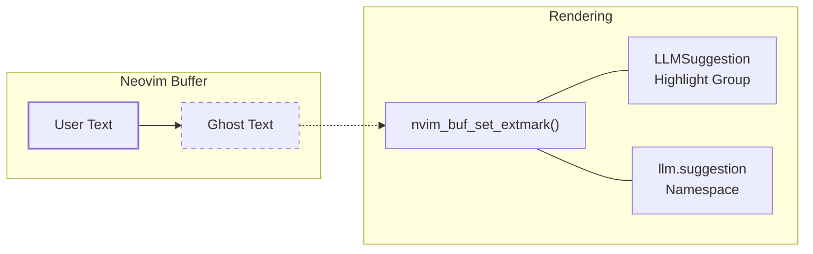
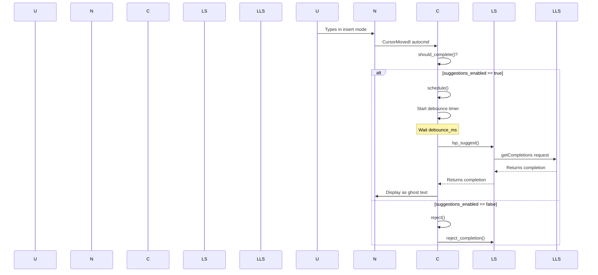
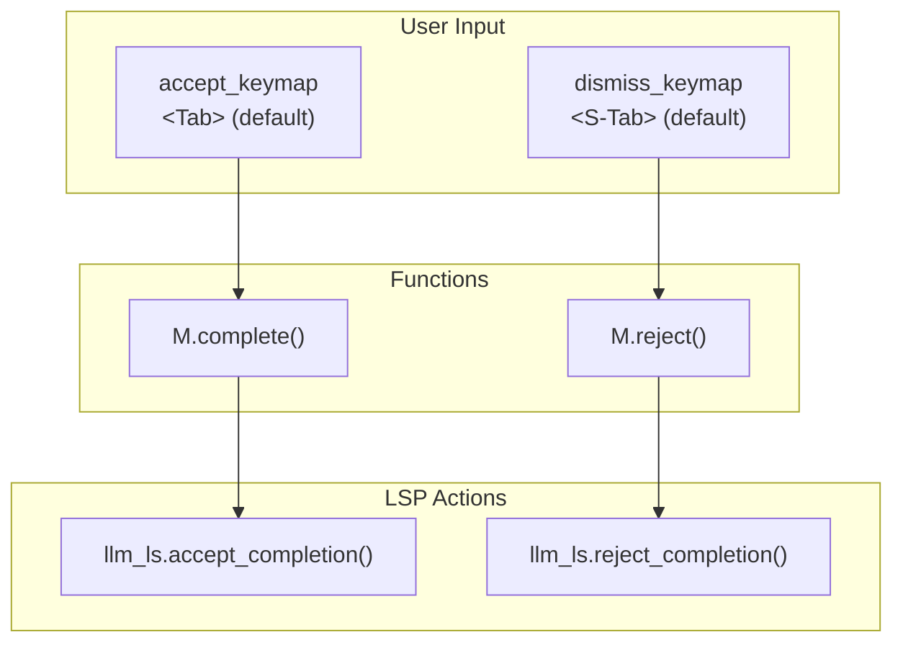
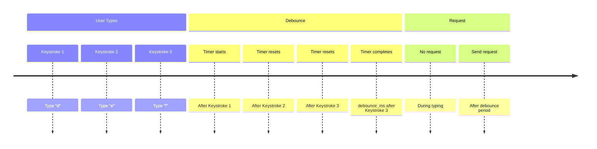
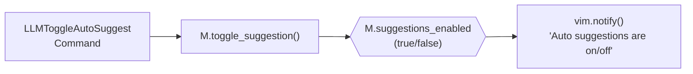
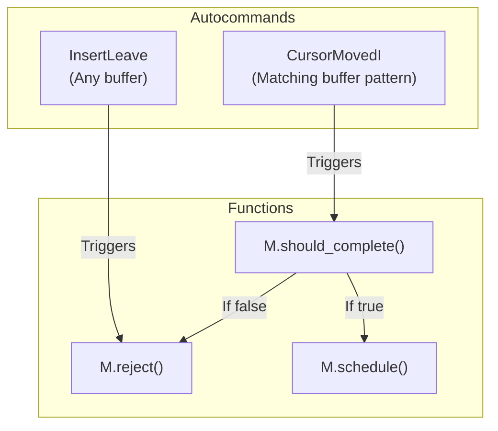

<!-- source: DeepWiki mcp.deepwiki.com · repo huggingface/llm.nvim · page 2.3 Behavior and Interface Settings · fetched 2026-10-26 -->

# Behavior and Interface Settings

<details>
<summary>Relevant source files</summary>

The following files were used as context for generating this wiki page:

- [README.md](README.md)
- [lua/llm/completion.lua](lua/llm/completion.lua)
- [lua/llm/config.lua](lua/llm/config.lua)

</details>


This page documents the behavior and interface settings in llm.nvim that control how the code completion suggestions appear, respond, and interact with the user. These settings determine when and how suggestions are displayed, how they can be accepted or dismissed, and how they behave in different contexts. For backend configuration options, see [Backend Configuration](#2.1), and for tokenizer settings, see [Tokenizer Configuration](#2.2).

## Ghost Text Interface

llm.nvim uses a "ghost text" interface, similar to GitHub Copilot, where suggestions appear as dimmed text ahead of your cursor. This non-intrusive approach allows you to see suggestions without interrupting your workflow.



Ghost text is rendered using Neovim's extmark API, which allows displaying virtual text and virtual lines without modifying the actual buffer content. The suggestion is only inserted into the buffer when explicitly accepted.

Sources: [lua/llm/completion.lua:11-13](https://github.com/huggingface/llm.nvim/blob/main/lua/llm/completion.lua#L11-L13), [lua/llm/completion.lua:84-96](https://github.com/huggingface/llm.nvim/blob/main/lua/llm/completion.lua#L84-L96)

## Suggestion Activation and Control

llm.nvim provides several ways to control when and where suggestions appear:

### Automatic Suggestions

Automatic suggestions are triggered as you type in insert mode, with a configurable delay (debounce) to avoid overwhelming the model with requests.



### Enabling and Disabling Suggestions

The plugin offers several ways to control when suggestions appear:

- **On Startup**: The `enable_suggestions_on_startup` setting determines if suggestions are enabled when Neovim starts
- **Per File Type**: The `enable_suggestions_on_files` setting restricts suggestions to specific file patterns
- **Toggle Command**: The `LLMToggleAutoSuggest` command lets users toggle suggestions on/off during editing

Sources: [lua/llm/config.lua:37-40](https://github.com/huggingface/llm.nvim/blob/main/lua/llm/config.lua#L37-L40), [lua/llm/completion.lua:121-125](https://github.com/huggingface/llm.nvim/blob/main/lua/llm/completion.lua#L121-L125)

### File Pattern Matching

The `enable_suggestions_on_files` setting accepts either a string or a table of strings with glob patterns:

| Pattern | Effect |
|---------|--------|
| `"*"` | Enable on all files (default) |
| `"*.py"` | Enable only on Python files |
| `{"*.py", "*.lua"}` | Enable on both Python and Lua files |
| `"/path/to/project/*"` | Enable on all files in a specific project |

These patterns are passed directly to Neovim's autocmd pattern matching system.

Sources: [README.md:251-254](https://github.com/huggingface/llm.nvim/blob/main/README.md#L251-L254)

## Keymap Settings

llm.nvim provides configurable keymaps for accepting or dismissing suggestions:



### Default Keymaps

| Setting | Default Value | Purpose |
|---------|---------------|---------|
| `accept_keymap` | `<Tab>` | Accept the current suggestion |
| `dismiss_keymap` | `<S-Tab>` | Dismiss the current suggestion |

The keymaps are set up during plugin initialization and can be customized in your configuration.

Sources: [lua/llm/config.lua:24-25](https://github.com/huggingface/llm.nvim/blob/main/lua/llm/config.lua#L24-L25), [README.md:334-335](https://github.com/huggingface/llm.nvim/blob/main/README.md#L334-L335)

## Performance and Timing Settings

### Debounce Timer

To prevent excessive API calls and improve performance, llm.nvim implements a debounce mechanism that delays sending completion requests until after you've stopped typing for a short period:



The `debounce_ms` setting controls this delay, with a default value of 150ms. A higher value reduces the number of requests but increases the delay before suggestions appear, while a lower value makes suggestions more responsive but may increase API usage.

Sources: [lua/llm/config.lua:23](https://github.com/huggingface/llm.nvim/blob/main/lua/llm/config.lua#L23), [lua/llm/completion.lua:60-68](https://github.com/huggingface/llm.nvim/blob/main/lua/llm/completion.lua#L60-L68)

## Token Handling

The `tokens_to_clear` setting specifies special tokens that should be removed from the model's output. These are typically end-of-text markers or other special tokens that might appear in the completions but shouldn't be inserted into your code.

Different models use different special tokens, so this setting should be adjusted based on the model you're using:

| Model | Recommended `tokens_to_clear` |
|-------|------------------------------|
| Starcoder | `{ "<|endoftext|>" }` |
| CodeLlama | `{ "<EOT>" }` |

Sources: [lua/llm/config.lua:7](https://github.com/huggingface/llm.nvim/blob/main/lua/llm/config.lua#L7), [README.md:137](https://github.com/huggingface/llm.nvim/blob/main/README.md#L137), [README.md:159](https://github.com/huggingface/llm.nvim/blob/main/README.md#L159)

## Commands

llm.nvim provides the following commands to control suggestion behavior:

| Command | Purpose |
|---------|---------|
| `LLMToggleAutoSuggest` | Toggle automatic "suggest-as-you-type" behavior on/off |
| `LLMSuggestion` | Manually request a suggestion at the current cursor position |

### Toggle Auto-Suggest Flow



The toggle functionality allows users to temporarily disable suggestions when they want to focus on writing without assistance, and re-enable them when they want suggestions again.

Sources: [README.md:259-263](https://github.com/huggingface/llm.nvim/blob/main/README.md#L259-L263), [lua/llm/completion.lua:121-125](https://github.com/huggingface/llm.nvim/blob/main/lua/llm/completion.lua#L121-L125)

## Complete Configuration Example

Here's a configuration example showing all behavior and interface settings with their default values:

```lua
require('llm').setup({
  -- Suggestion behavior
  enable_suggestions_on_startup = true,
  enable_suggestions_on_files = "*", -- or {"*.py", "*.lua"}
  
  -- Interface settings
  debounce_ms = 150,
  accept_keymap = "<Tab>",
  dismiss_keymap = "<S-Tab>",
  
  -- Token handling
  tokens_to_clear = { "<|endoftext|>" },
  
  -- Other settings (for reference)
  -- ...
})
```

Sources: [README.md:311-348](https://github.com/huggingface/llm.nvim/blob/main/README.md#L311-L348)

## Automatic Buffer Attachment

llm.nvim automatically creates autocmds to handle suggestion behavior based on the `enable_suggestions_on_files` pattern. These autocmds trigger on cursor movement in insert mode and insert leave events.



This system ensures that suggestions are only shown in appropriate contexts and are properly cleaned up when leaving insert mode.

Sources: [lua/llm/completion.lua:127-143](https://github.com/huggingface/llm.nvim/blob/main/lua/llm/completion.lua#L127-L143)

---

