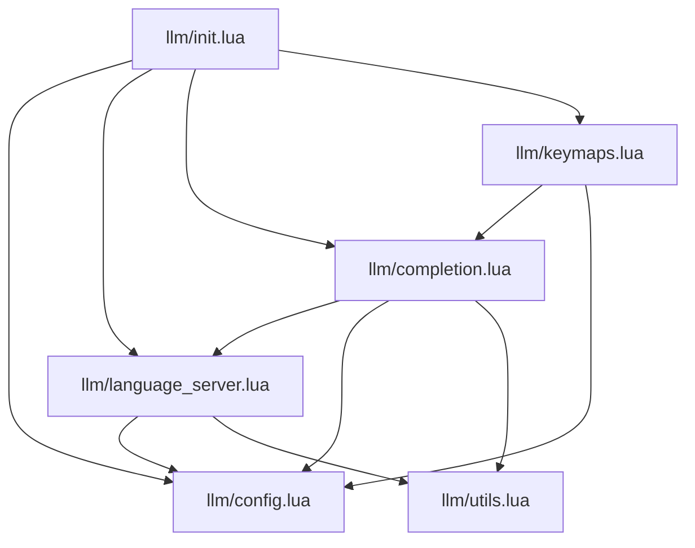
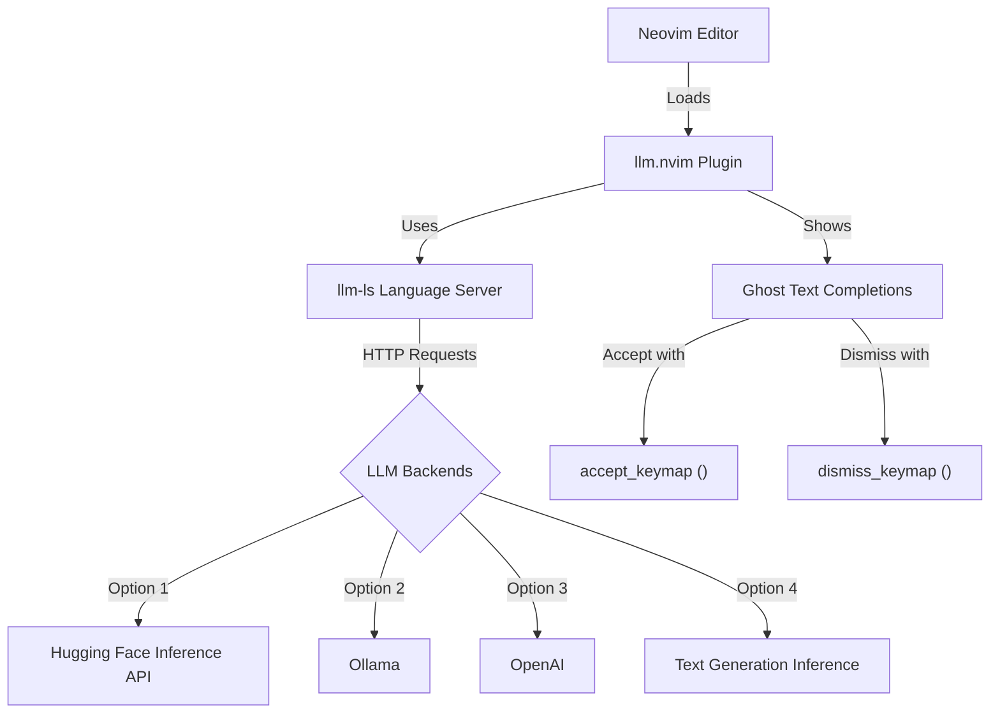
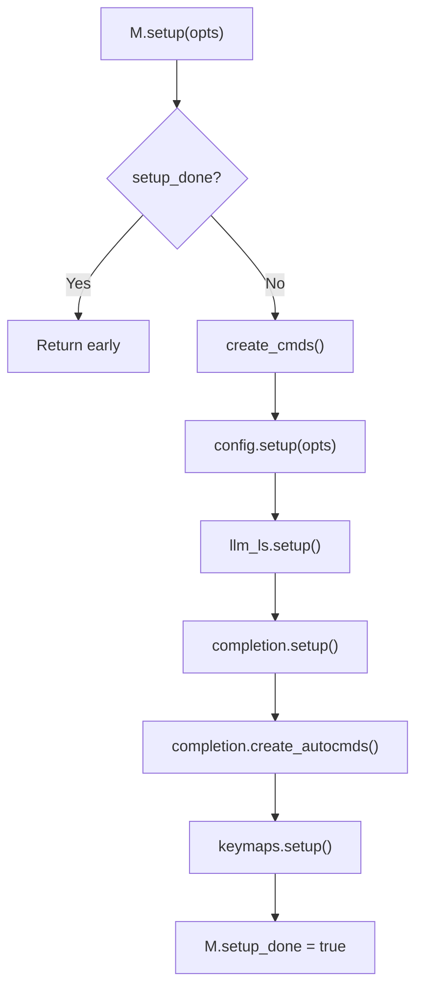
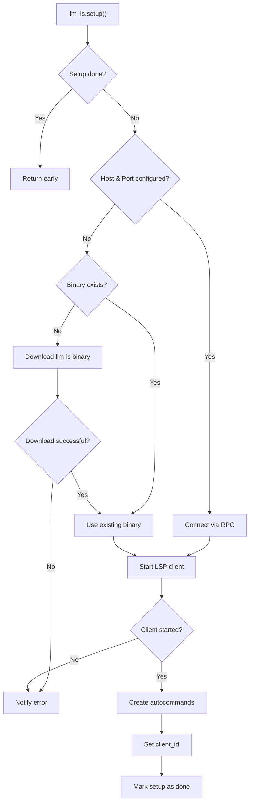
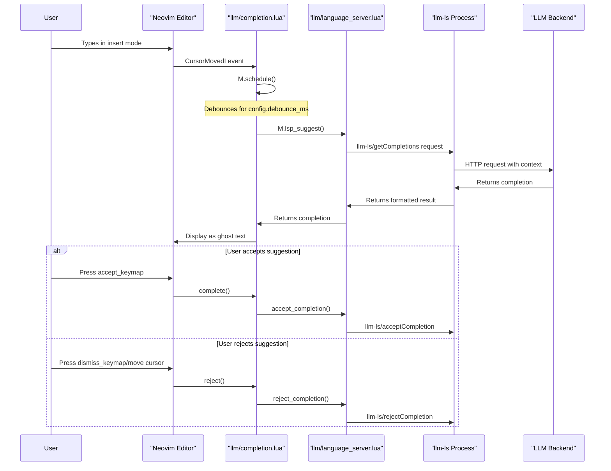
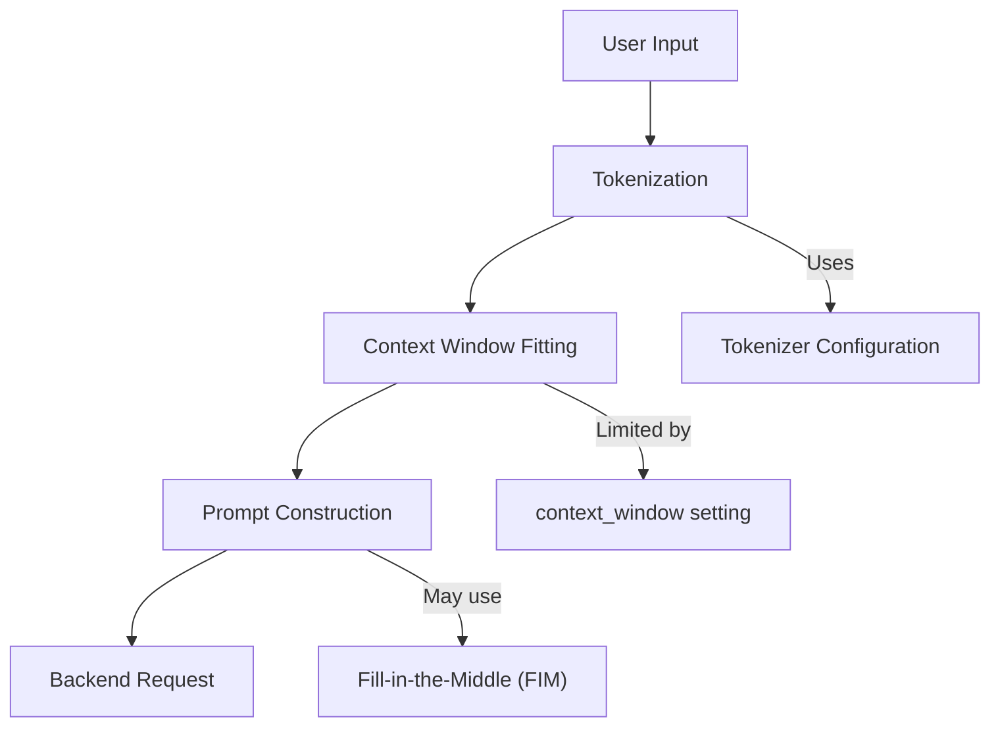

<!-- source: DeepWiki mcp.deepwiki.com · repo huggingface/llm.nvim · page 3 Architecture · fetched 2026-10-26 -->

# Architecture

Relevant source files

The following files were used as context for generating this wiki page:

- [README.md](README.md)
- [lua/llm/init.lua](lua/llm/init.lua)

## Purpose and Scope

This document provides a high-level overview of LLM.nvim's internal architecture, explaining how its components interact with each other and with external systems. The focus is on the core systems, their relationships, and the plugin's integration points with Neovim and language model backends.

For detailed configuration information, see [Configuration](#2). For in-depth explanations of the language server integration and completion system, see [Language Server Integration](#3.1) and [Completion System](#3.2) respectively.

## High-Level System Architecture

LLM.nvim follows a modular architecture with clear separation of concerns. The plugin acts as a bridge between Neovim and various large language model providers through the llm-ls language server.

### Core Component Relationships Diagram

Sources: [lua/llm/init.lua:1-5]()

The plugin is structured around several key modules:

| Module | Responsibility |
|--------|----------------|
| `init.lua` | Entry point and orchestration of plugin setup |
| `config.lua` | Configuration management and validation |
| `language_server.lua` | Integration with llm-ls language server |
| `completion.lua` | Suggestion and completion functionality |
| `keymaps.lua` | Keyboard shortcut handling |
| `utils.lua` | Shared utility functions |

### Integration Architecture

Sources: [README.md:16-26](), [README.md:34-129]()

## Initialization Process

The initialization process begins when the user calls `require('llm').setup(opts)` in their Neovim configuration.

### Setup Flow Diagram

Sources: [lua/llm/init.lua:18-35]()

The setup process:
1. Creates user commands (`LLMToggleAutoSuggest`, `LLMSuggestion`)
2. Initializes configuration with user options
3. Sets up the language server connection
4. Configures the completion system
5. Creates necessary autocommands
6. Sets up keymaps for accepting/dismissing suggestions

### Language Server Setup Process

Sources: [README.md:177-208]()

The language server setup process:
1. Connects to an existing llm-ls instance if host and port are configured
2. Otherwise checks for an existing binary or downloads it
3. Starts the LSP client
4. Creates autocommands for buffer attachment
5. Stores the client ID for future communication

## Completion Request Flow

The completion system is the core functionality of the plugin, responsible for requesting and displaying suggestions.

Sources: [lua/llm/init.lua:1-5](), [README.md:248-255]()

The completion flow:
1. User input triggers the `CursorMovedI` event
2. The completion system debounces rapid input
3. When ready, it requests a suggestion from the language server
4. The language server forwards the request to llm-ls
5. llm-ls communicates with the configured LLM backend
6. The response is processed and displayed as ghost text
7. The user can accept or dismiss the suggestion

## Backend Integration

LLM.nvim supports multiple backend providers through a unified interface handled by llm-ls.

### Supported Backends

| Backend | API Endpoint | Description |
|---------|--------------|-------------|
| `huggingface` | `/model/{model}` | Hugging Face Inference API |
| `ollama` | `/api/generate` | Local LLM server |
| `openai` | `/v1/completions` | OpenAI compatible APIs |
| `tgi` | `/generate` | Text Generation Inference |

Sources: [README.md:34-129]()

### Context Window Management

Sources: [README.md:130-171](), [README.md:209-246]()

The plugin ensures that prompts fit within the model's context window by:
1. Tokenizing content using the configured tokenizer
2. Truncating context to fit within the `context_window` limit
3. Constructing the prompt, potentially with Fill-in-the-Middle support
4. Sending the request to the backend with appropriate parameters

## Command and Keymap Integration

LLM.nvim provides user commands and keymaps to control its behavior:

| Command | Function | Description |
|---------|----------|-------------|
| `LLMToggleAutoSuggest` | `completion.toggle_suggestion()` | Enable/disable automatic suggestions |
| `LLMSuggestion` | `completion.lsp_suggest()` | Manually request a suggestion |

Sources: [lua/llm/init.lua:8-16](), [README.md:257-263]()

Default keymaps are configured in `keymaps.setup()` and are customizable through configuration:
- Accept suggestion: `<Tab>` (configurable via `accept_keymap`)
- Dismiss suggestion: `<S-Tab>` (configurable via `dismiss_keymap`)

## Summary

LLM.nvim follows a modular architecture that separates concerns into distinct components:

1. **Configuration Management**: Handles user settings and defaults
2. **Language Server Integration**: Bridges Neovim and LLM backends
3. **Completion System**: Manages the core suggestion functionality
4. **Keymap Handling**: Controls user interaction with suggestions

This design allows the plugin to adapt to different LLM backends while maintaining a consistent interface for users. The clear separation of responsibilities makes the codebase more maintainable and extensible.

---

