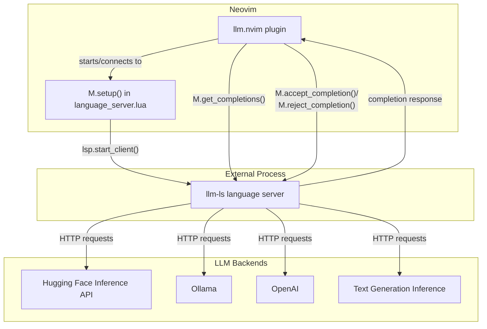
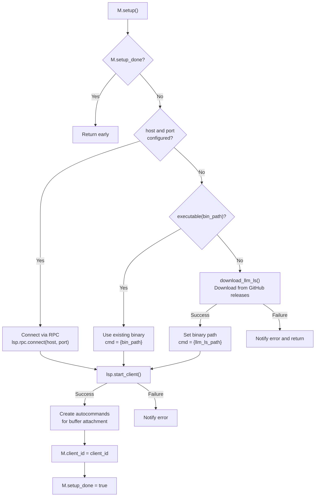
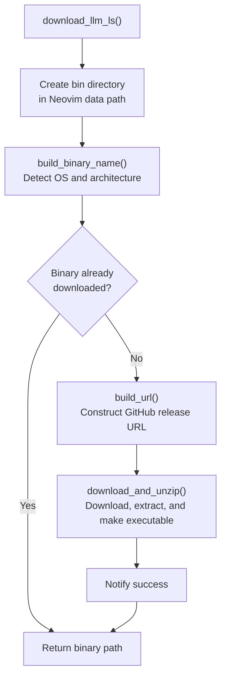
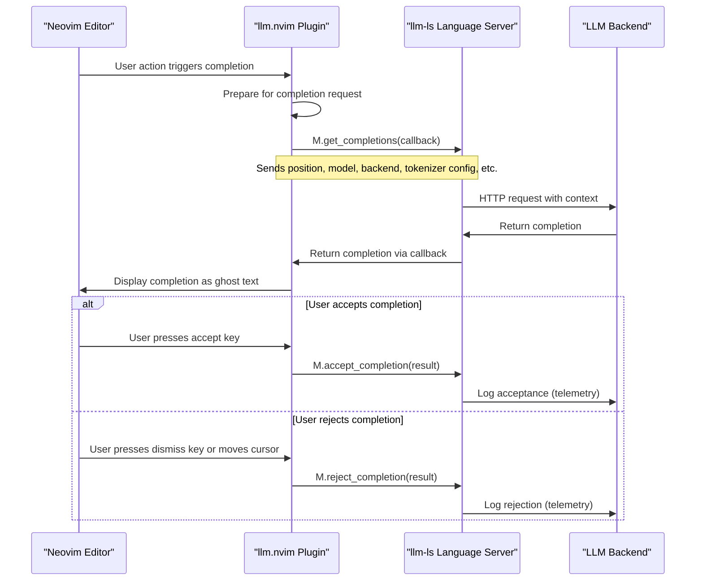
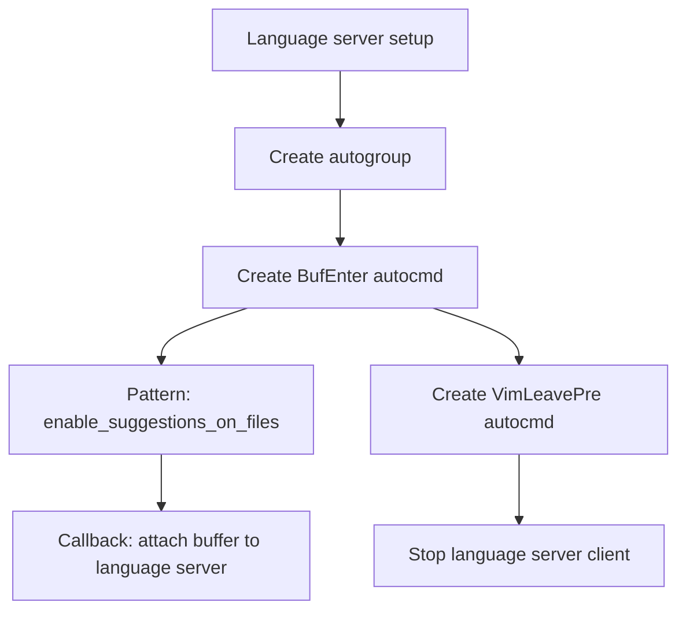

<!-- source: DeepWiki mcp.deepwiki.com · repo huggingface/llm.nvim · page 3.1 Language Server Integration · fetched 2026-10-26 -->

# Language Server Integration

<details>
<summary>Relevant source files</summary>

The following files were used as context for generating this wiki page:

- [README.md](README.md)
- [lua/llm/language_server.lua](lua/llm/language_server.lua)

</details>


This page documents how llm.nvim integrates with the llm-ls language server, which serves as the bridge between Neovim and various LLM backends. The language server handles tokenization, context management, and communication with different LLM providers while presenting a unified interface to the plugin. For information about the completion system itself, see [Completion System](#3.2).

## Architecture Overview



Sources: [lua/llm/language_server.lua:8-13](), [lua/llm/language_server.lua:179-239](), [README.md:177-208]()

The diagram above shows how llm.nvim integrates with the llm-ls language server. The plugin initializes the language server using `M.setup()` in language_server.lua, which either connects to an existing server instance or starts a new one. The plugin communicates with the language server using LSP requests for getting, accepting, and rejecting completions. The language server then communicates with various LLM backends over HTTP.

## Language Server Setup Process



Sources: [lua/llm/language_server.lua:179-239](), [lua/llm/language_server.lua:77-92]()

The language server setup process begins with the `M.setup()` function. If setup has already been done, the function returns early. Otherwise, it determines how to start or connect to the language server:

1. **TCP Connection**: If `host` and `port` are configured, the plugin connects to an existing language server via TCP using `lsp.rpc.connect(host, port)`.

2. **Binary Execution**: If no TCP connection is configured, the plugin looks for the llm-ls binary:
   - If the binary exists at the configured `bin_path` or is available in the system path, it uses that.
   - If not, it downloads the appropriate binary for the current platform from GitHub releases.

3. **Client Initialization**: The plugin starts the LSP client with the appropriate command and configuration.

4. **Autocommands Setup**: If the client starts successfully, the plugin sets up autocommands to attach the language server to buffers matching the configured patterns.

## Language Server Binary Management

When the language server binary is not found at the specified path, llm.nvim automatically downloads the appropriate version for the current platform:



Sources: [lua/llm/language_server.lua:14-92]()

The plugin determines the appropriate binary name based on the operating system and architecture, then downloads it from the GitHub releases page if it doesn't already exist locally. The binary is stored in the Neovim data directory under `llm_nvim/bin`.

## Completion Request Flow



Sources: [lua/llm/language_server.lua:109-177]()

The completion request flow involves several steps:

1. When a completion is requested, the plugin calls `M.get_completions(callback)`, which sends an LSP request to the language server with parameters including the cursor position, model, backend, and configuration.

2. The language server processes the request, tokenizes the context, and sends an HTTP request to the configured LLM backend.

3. When the backend responds, the language server formats the result and returns it to the plugin via the callback.

4. The plugin displays the completion as ghost text in the editor.

5. If the user accepts the completion, the plugin calls `M.accept_completion(result)` to notify the language server.

6. If the user rejects the completion, the plugin calls `M.reject_completion(result)` to notify the language server.

## Language Server API

The language server provides several LSP methods that the plugin uses:

| Method | Description | Parameters | Response |
|--------|-------------|------------|----------|
| `llm-ls/getCompletions` | Request completions for the current position | Position, model, backend, config | Array of completion options |
| `llm-ls/acceptCompletion` | Notify server that a completion was accepted | Request ID, accepted completion index | None |
| `llm-ls/rejectCompletion` | Notify server that completions were rejected | Request ID, shown completions | None |

Sources: [lua/llm/language_server.lua:109-147](), [lua/llm/language_server.lua:149-177]()

## Configuration Options

The language server integration can be configured through several options in the plugin's setup:

```lua
lsp = {
  bin_path = nil,      -- Path to the llm-ls binary (optional)
  host = nil,          -- Host for TCP connection (optional)
  port = nil,          -- Port for TCP connection (optional)
  cmd_env = nil,       -- Environment variables for the llm-ls process
  version = "0.5.3",   -- Version of llm-ls to download
},
```

Sources: [README.md:177-208]()

### Binary Path Configuration

You can configure the path to the llm-ls binary in several ways:

1. **Default Behavior**: By default, llm.nvim downloads and manages the binary automatically, storing it in the Neovim data directory.

2. **Custom Path**: You can specify a custom path to the binary with the `lsp.bin_path` option.

3. **Mason Integration**: If you use Mason package manager, you can install llm-ls with `:MasonInstall llm-ls` and set the path accordingly:

```lua
lsp = {
  bin_path = vim.api.nvim_call_function("stdpath", { "data" }) .. "/mason/bin/llm-ls",
}
```

Sources: [README.md:190-208]()

### TCP Connection Configuration

Instead of starting a new language server process, you can connect to an existing one via TCP:

```lua
lsp = {
  host = "127.0.0.1",  -- or "localhost"
  port = 8080,         -- port number
}
```

This is useful for debugging or when running the language server in a separate process.

Sources: [lua/llm/language_server.lua:185-194]()

### Environment Variables

You can pass environment variables to the language server process using the `cmd_env` option:

```lua
lsp = {
  cmd_env = { LLM_LOG_LEVEL = "DEBUG" }
}
```

This can be useful for debugging or configuring the language server behavior.

Sources: [README.md:343]()

## Buffer Attachment

The plugin creates autocommands to automatically attach the language server to buffers that match the patterns in the `enable_suggestions_on_files` configuration:



Sources: [lua/llm/language_server.lua:215-235]()

This ensures that the language server is attached to the appropriate buffers, allowing completions to be available only in the files you specify.

---

