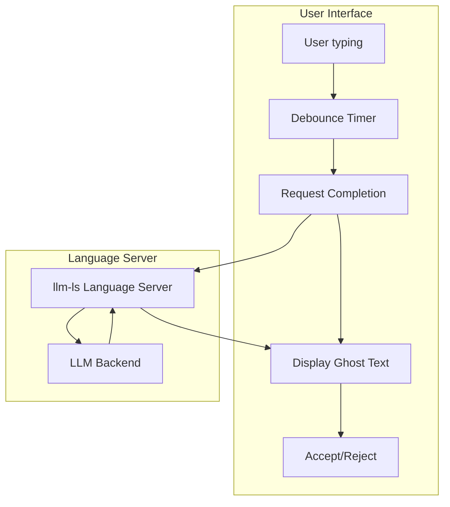
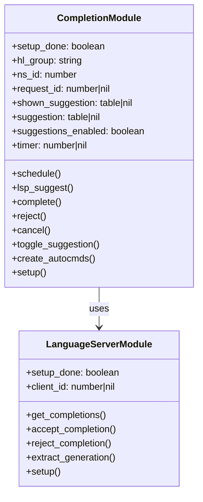
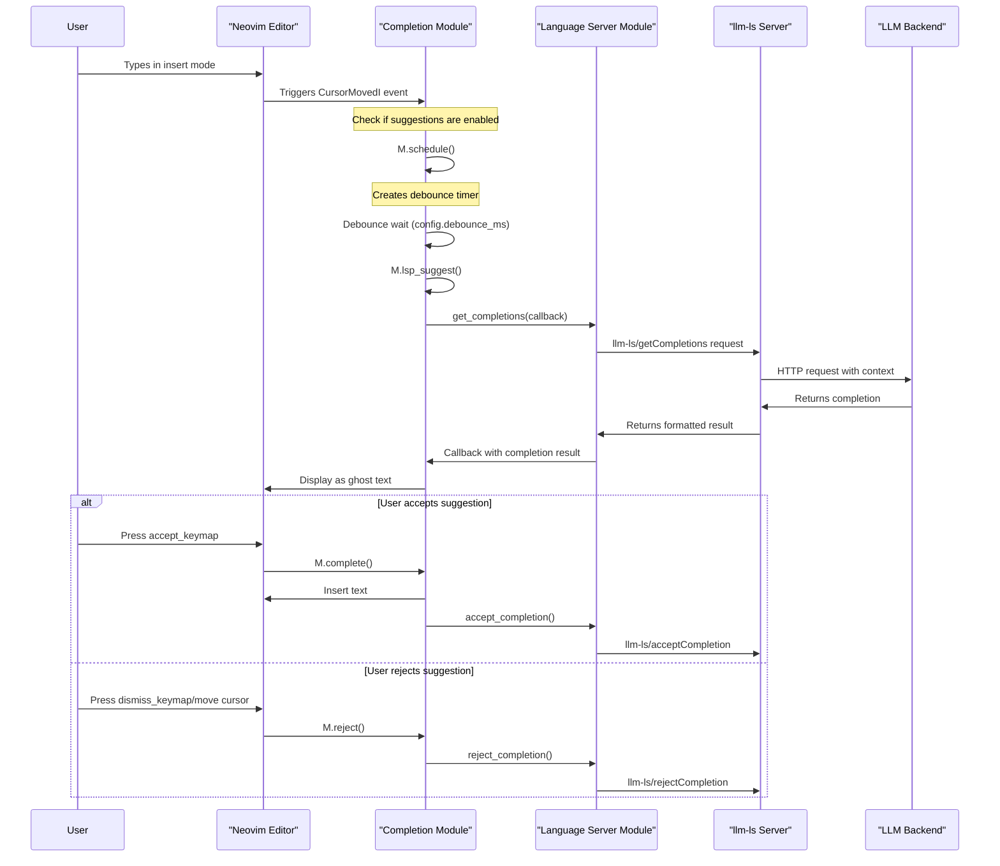
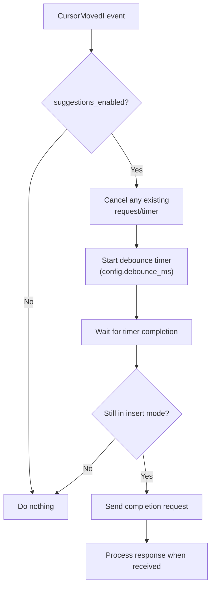
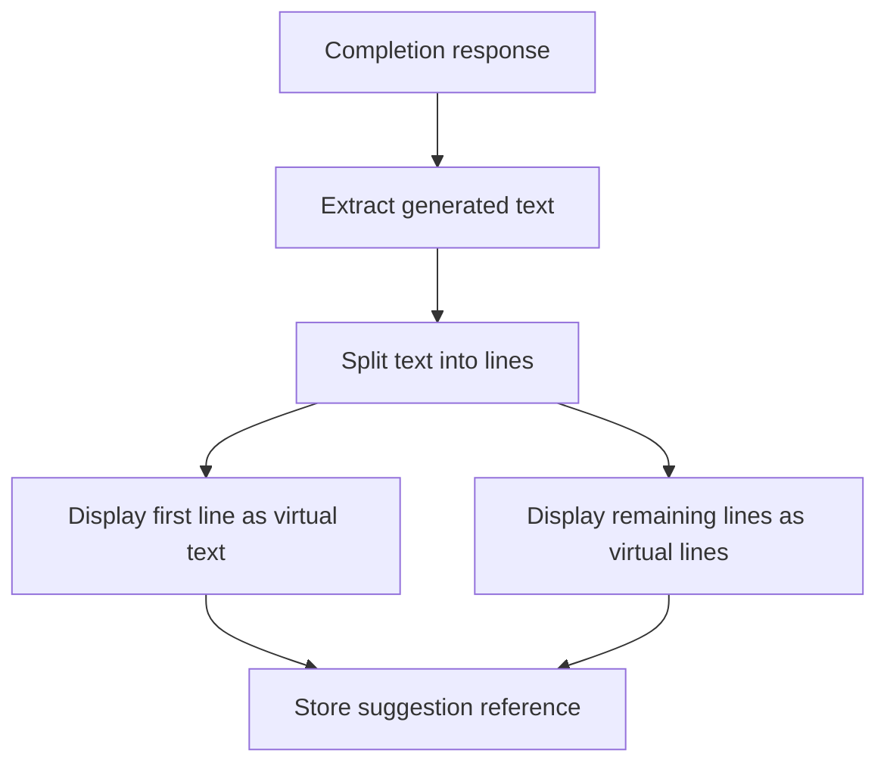
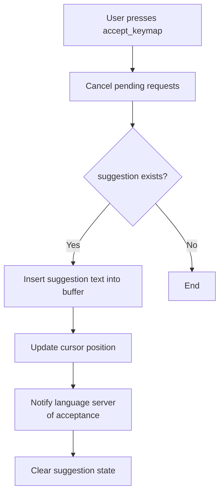
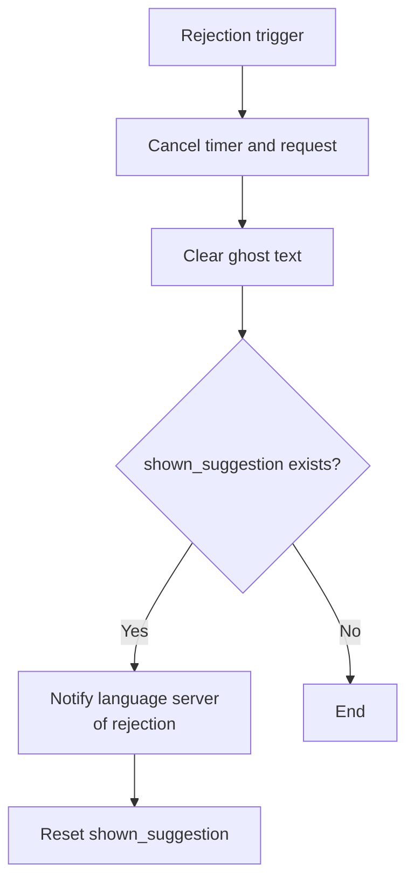
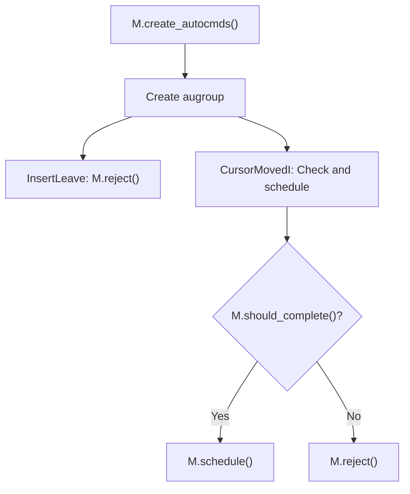
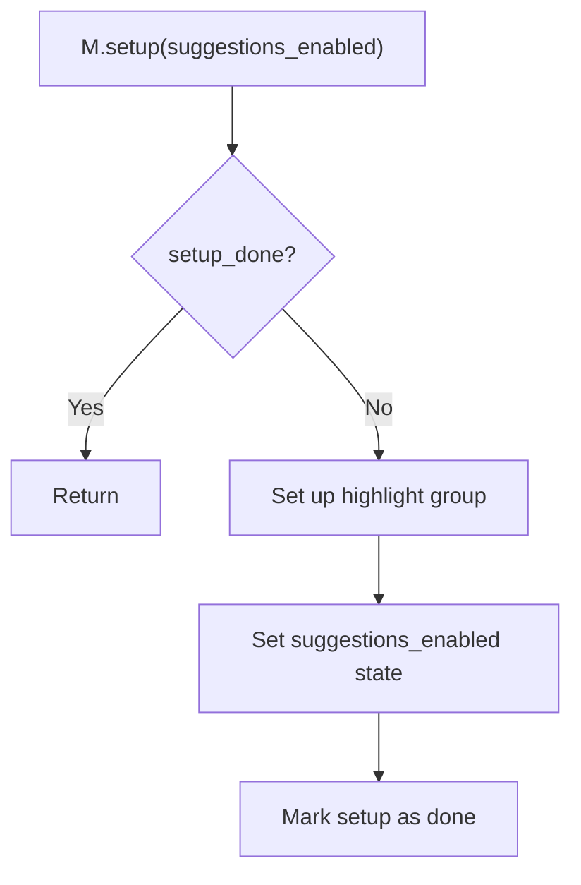
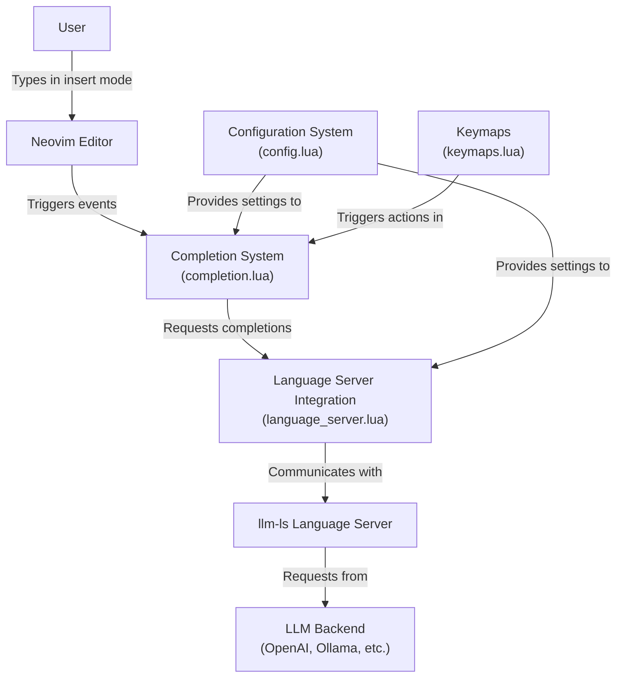

<!-- source: DeepWiki mcp.deepwiki.com · repo huggingface/llm.nvim · page 3.2 Completion System · fetched 2026-10-26 -->

# Completion System

Relevant source files

The following files were used as context for generating this wiki page:

- [lua/llm/completion.lua](lua/llm/completion.lua)
- [lua/llm/language_server.lua](lua/llm/language_server.lua)

The Completion System in llm.nvim is responsible for managing the entire lifecycle of LLM-powered code suggestions. This system handles everything from scheduling requests for completions, to displaying suggestions as ghost text, to allowing users to accept or reject these suggestions. This page provides a detailed explanation of the internal architecture and flows within the completion system.

For information about configuring the completion behavior, see [Behavior and Interface Settings](#2.3).

## Overview

The Completion System bridges Neovim's editing capabilities with LLM backends by providing real-time completion suggestions as the user types. It works by:

1. Detecting when the user is typing in insert mode
2. Gathering context from the current buffer
3. Requesting completions from an LLM through the language server
4. Displaying suggestions as ghost text in the editor
5. Handling user acceptance or rejection of suggestions

Sources: [lua/llm/completion.lua:1-156](), [lua/llm/language_server.lua:1-241]()

## Core Components

The Completion System is primarily implemented in two modules:

Sources: [lua/llm/completion.lua:1-156](), [lua/llm/language_server.lua:8-241]()

### Completion Module (`completion.lua`)

The Completion Module is responsible for:

1. Managing the state of the current suggestion
2. Scheduling completion requests with debouncing
3. Displaying suggestions as ghost text in the editor
4. Handling user actions to accept or reject suggestions

Key state variables include:
- `suggestion`: The current suggestion content
- `shown_suggestion`: Metadata about the current suggestion, including request ID
- `request_id`: ID of the current completion request
- `suggestions_enabled`: Whether suggestions are currently enabled
- `timer`: Debounce timer for completion requests

Sources: [lua/llm/completion.lua:8-18]()

### Language Server Integration (`language_server.lua`)

The Language Server Module handles communication with the llm-ls language server, including:

1. Setting up and connecting to the language server
2. Sending completion requests with appropriate parameters
3. Handling acceptance and rejection of completions
4. Canceling pending requests

Key functions provided by this module include `get_completions()`, `accept_completion()`, and `reject_completion()`.

Sources: [lua/llm/language_server.lua:109-177]()

## Completion Request Flow

The following sequence diagram illustrates the complete lifecycle of a completion request, from user typing to displaying and handling the suggestion:

Sources: [lua/llm/completion.lua:60-114](), [lua/llm/language_server.lua:94-177]()

## Detailed Module Functionality

### Request Scheduling and Debouncing

To avoid sending too many requests as the user types, the system uses a debounce timer:

Sources: [lua/llm/completion.lua:20-68]()

The scheduling logic:
1. When cursor movement is detected in insert mode, any existing request is canceled
2. A new timer is started with the configured debounce time
3. When the timer completes, if still in insert mode, a completion request is sent
4. The system waits for the response and displays it when received

### Completion Request and Parameters

When requesting completions from the language server, the system sends a comprehensive set of parameters:

| Parameter | Description | Source |
|-----------|-------------|--------|
| model | The LLM model to use | utils.get_model() |
| backend | Backend provider (OpenAI, Ollama, etc.) | config.get().backend |
| url | API endpoint URL | utils.get_url() |
| requestBody | Request customization | config.get().request_body |
| tokensToClear | Number of tokens to clear | config.get().tokens_to_clear |
| apiToken | API authentication token | config.get().api_token |
| fim | Fill-in-the-middle mode | config.get().fim |
| tokenizerConfig | Tokenizer configuration | config.get().tokenizer |
| contextWindow | Context window size | config.get().context_window |

Sources: [lua/llm/language_server.lua:109-146]()

### Ghost Text Display

When a completion is received, it's displayed as ghost text in the editor:

1. The completion text is extracted from the response
2. The text is split into lines
3. The first line is displayed as virtual text at the cursor position
4. Additional lines are displayed as virtual lines below

Sources: [lua/llm/completion.lua:70-98]()

The ghost text is displayed using Neovim's extmark API, with a dedicated highlight group (`LLMSuggestion`) that is linked to the `Comment` highlight group by default.

### Accepting Completions

When a user accepts a completion:

Sources: [lua/llm/completion.lua:100-115](), [lua/llm/language_server.lua:149-163]()

The completion process:
1. Cancels any pending requests
2. Gets the current cursor position and line content
3. Inserts the suggestion text into the buffer
4. Updates the cursor position to the end of the inserted text
5. Notifies the language server that the completion was accepted
6. Clears the suggestion state

### Rejecting Completions

Completions are rejected in several scenarios:

1. User explicitly dismisses the suggestion
2. User moves the cursor 
3. User leaves insert mode
4. A new completion request is scheduled

Sources: [lua/llm/completion.lua:42-58](), [lua/llm/language_server.lua:164-177]()

## Autocommands and Events

The completion system sets up several autocommands to manage its behavior:

1. `InsertLeave` - Rejects any active suggestion when leaving insert mode
2. `CursorMovedI` - Schedules a completion request when the cursor moves in insert mode

Sources: [lua/llm/completion.lua:127-143]()

## Initialization and Setup

The Completion System is initialized through its `setup()` function:

Sources: [lua/llm/completion.lua:145-154]()

This sets up the highlight group for ghost text and initializes the system state. The actual autocommands are created separately through `create_autocmds()`.

## Integration with the Overall Architecture

The Completion System is a core component of llm.nvim, interacting closely with the Language Server system and the configuration system. For more details on how it integrates with these systems, see [Language Server Integration](#3.1) and [Configuration](#2).

Sources: [lua/llm/completion.lua:1-156](), [lua/llm/language_server.lua:1-241]()

## Summary

The Completion System is responsible for the core functionality of llm.nvim, enabling real-time code suggestions powered by LLMs. It handles:

1. Scheduling requests with appropriate debouncing
2. Displaying suggestions as ghost text
3. Managing the acceptance or rejection of suggestions
4. Communicating with the language server to process completions

By understanding this system, users and developers can better utilize and extend the plugin's capabilities for LLM-powered code completion in Neovim.

---

