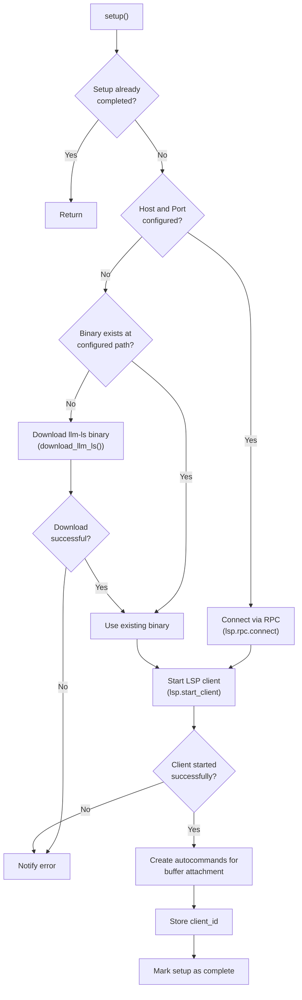
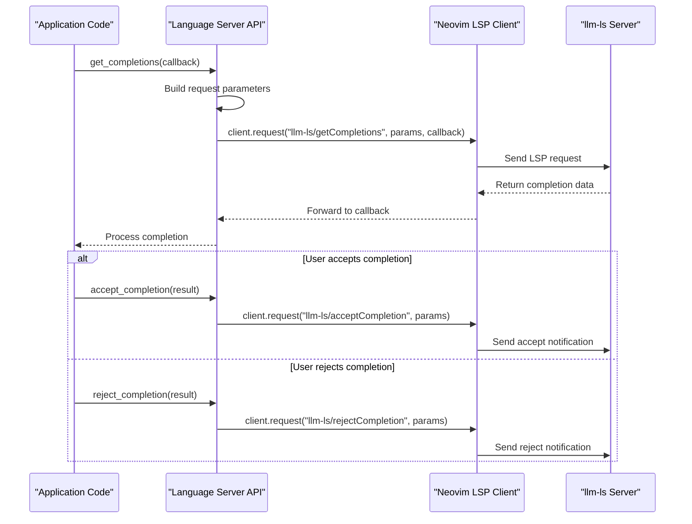
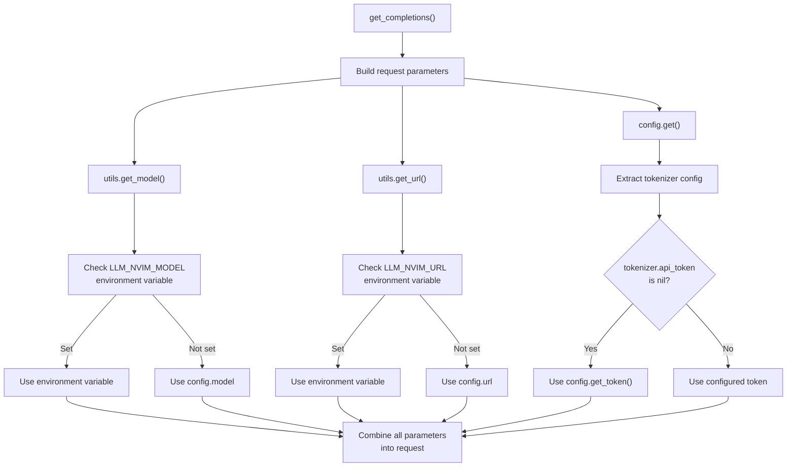
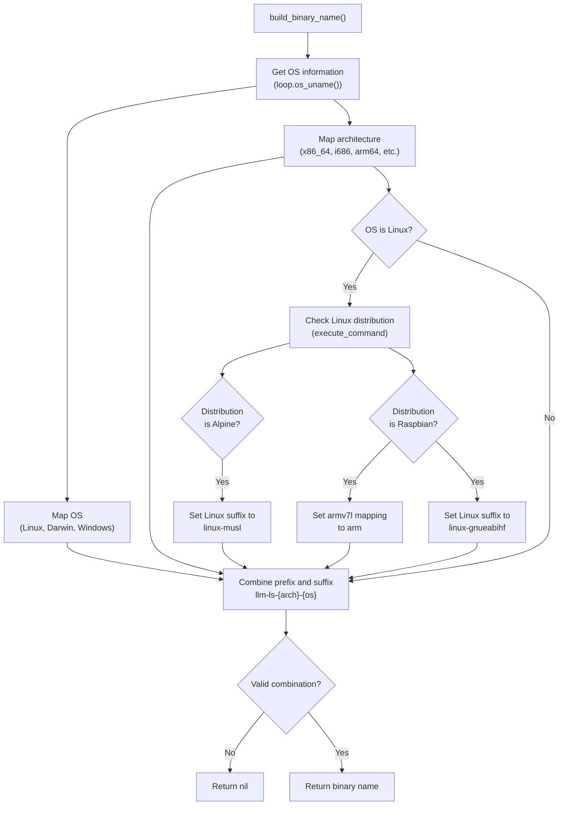
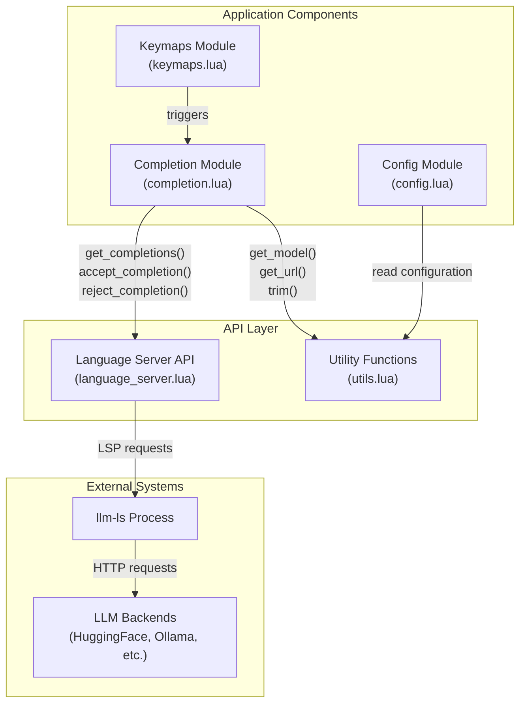

<!-- source: DeepWiki mcp.deepwiki.com · repo huggingface/llm.nvim · page 3.3 API and Helper Functions · fetched 2026-10-26 -->

# API and Helper Functions

<details>
<summary>Relevant source files</summary>

The following files were used as context for generating this wiki page:

- [lua/llm/language_server.lua](lua/llm/language_server.lua)
- [lua/llm/utils.lua](lua/llm/utils.lua)

</details>


This page documents the internal APIs and utility functions used throughout the llm.nvim codebase. It covers two main modules: the Language Server API functions that interface with the LSP backend, and the Utility functions that provide common operations used by various components. For information about the Completion System, see [Completion System](#3.2).

## 1. Language Server API Overview

The Language Server API provides the core interface for interacting with the `llm-ls` language server process. These functions handle communication with the language server using the Language Server Protocol (LSP).

```mermaid
classDiagram
    class "LanguageServerAPI" {
        +setup()
        +get_completions(callback)
        +accept_completion(completion_result)
        +reject_completion(completion_result)
        +cancel_request(request_id)
        +extract_generation(response)
    }
    
    class "LSPInitialization" {
        -build_binary_name()
        -build_url(bin_name)
        -download_and_unzip(url, path)
        -download_llm_ls()
    }
    
    class "NeovimAPI" {
        +lsp.start_client()
        +lsp.buf_attach_client()
        +lsp.get_client_by_id()
    }
    
    "LanguageServerAPI" --> "LSPInitialization" : uses for setup
    "LanguageServerAPI" --> "NeovimAPI" : uses for LSP communication
```

Sources: [lua/llm/language_server.lua:8-241]()

### 1.1 Core API Functions

| Function | Purpose | Parameters | Returns |
|----------|---------|------------|---------|
| `setup()` | Initializes the language server | None | None |
| `get_completions(callback)` | Requests completions from the language server | callback: Function to handle response | request_id: Identifier for the request |
| `accept_completion(completion_result)` | Notifies server that a completion was accepted | completion_result: The completion data | None |
| `reject_completion(completion_result)` | Notifies server that a completion was rejected | completion_result: The completion data | None |
| `cancel_request(request_id)` | Cancels an ongoing completion request | request_id: Identifier for the request to cancel | None |
| `extract_generation(response)` | Extracts generated text from a completion response | response: Raw response data | string: The generated text |

Sources: [lua/llm/language_server.lua:94-177]()

### 1.2 Language Server Setup Process

The `setup()` function handles the initialization of the language server. It follows this process:



Sources: [lua/llm/language_server.lua:179-239]()

### 1.3 Completion Request Flow



Sources: [lua/llm/language_server.lua:94-177]()

## 2. Utility Functions

The `utils.lua` module provides a collection of helper functions used throughout the codebase. These functions handle common tasks like string manipulation, environment checks, and command execution.

```mermaid
classDiagram
    class "StringUtils" {
        +string_after_delim(str, delimiter)
        +split_str(str, separator)
        +trim(s)
        +startswith(str, begin)
        +ends_with(str, ending)
        +insert_at(dst, at, src)
    }
    
    class "EnvironmentUtils" {
        +get_model()
        +get_url()
        +get_cursor_pos()
        +execute_command(command)
    }
    
    class "ConfigModule" {
        +get()
    }
    
    "EnvironmentUtils" --> "ConfigModule" : uses for default values
```

Sources: [lua/llm/utils.lua:1-90]()

### 2.1 String Manipulation Functions

| Function | Purpose | Parameters | Returns |
|----------|---------|------------|---------|
| `string_after_delim(str, delimiter)` | Gets substring after the last occurrence of a delimiter | str: Input string<br>delimiter: Delimiter to find | string: The substring after the delimiter |
| `split_str(str, separator)` | Splits a string by a separator | str: Input string<br>separator: Character to split on | table: List of substrings |
| `trim(s)` | Removes whitespace from start and end | s: Input string | string: Trimmed string |
| `startswith(str, begin)` | Checks if string starts with a prefix | str: Input string<br>begin: Prefix to check | boolean: true if string starts with prefix |
| `ends_with(str, ending)` | Checks if string ends with a suffix | str: Input string<br>ending: Suffix to check | boolean: true if string ends with suffix |
| `insert_at(dst, at, src)` | Inserts text at a specific position | dst: Destination string<br>at: Position to insert at<br>src: String to insert | string: Resulting string |

Sources: [lua/llm/utils.lua:4-77]()

### 2.2 Environment and Config Functions

| Function | Purpose | Parameters | Returns |
|----------|---------|------------|---------|
| `get_cursor_pos()` | Gets current cursor position | None | row, col: Position coordinates |
| `get_model()` | Gets configured model name | None | string: Model name from env var or config |
| `get_url()` | Gets configured endpoint URL | None | string: URL from env var or config |
| `execute_command(command)` | Executes shell command | command: Command to execute | string: Command output |

Sources: [lua/llm/utils.lua:41-88]()

## 3. Using the API

### 3.1 Configuration Parameter Resolution

The Language Server API leverages utility functions to resolve configuration parameters for requests. Below is a diagram showing how parameters are determined for a completion request:



Sources: [lua/llm/language_server.lua:109-133](), [lua/llm/utils.lua:45-59]()

### 3.2 Common Usage Patterns

#### Requesting and Handling Completions

```lua
-- Example of how to use the API to request completions
local language_server = require("llm.language_server")

-- Define a callback to handle the completion response
local function handle_completion(err, result)
  if err ~= nil then
    vim.notify("[LLM] Error: " .. err.message, vim.log.levels.ERROR)
    return
  end
  
  if result ~= nil then
    local generated_text = language_server.extract_generation(result)
    -- Process the generated text
  end
end

-- Request completions
local request_id = language_server.get_completions(handle_completion)

-- Later, if needed, cancel the request
language_server.cancel_request(request_id)
```

#### Binary Resolution for Different Platforms

The language server module includes a sophisticated system for determining the correct binary name based on the operating system and architecture. This is important for automatically downloading the appropriate language server binary.



Sources: [lua/llm/language_server.lua:14-52]()

## 4. Integration Points

The API and helper functions act as the glue between different components of the llm.nvim system. Below is a diagram showing the main integration points:



Sources: [lua/llm/language_server.lua:8-241](), [lua/llm/utils.lua:1-90]()

## 5. Error Handling

The Language Server API includes error handling mechanisms to ensure graceful failure when problems occur. These include:

1. Validating architecture and OS combinations before downloading binaries
2. Checking that the language server client is properly initialized before making requests
3. Verifying that LSP requests were sent successfully
4. Providing error notifications to users when operations fail

For example, the `get_completions` function includes checks to ensure the client is initialized and the buffer is attached before attempting a request:

```lua
-- From language_server.lua:get_completions
if M.client_id == nil then
  return
end
if not lsp.buf_is_attached(0, M.client_id) then
  return
end
```

Sources: [lua/llm/language_server.lua:109-147]()

## 6. Summary

The API and helper functions form the foundation of the llm.nvim plugin, providing:

1. A clean interface to the language server for completion operations
2. Automatic resolution of the correct language server binary for the current platform
3. Utility functions for common operations across the codebase
4. Environment-aware configuration resolution
5. Error handling and reporting

These components enable the higher-level functionality of the plugin, such as the completion system and user interface elements, while abstracting away the complexity of direct LSP communication and platform-specific details.

---

