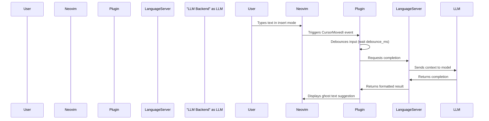
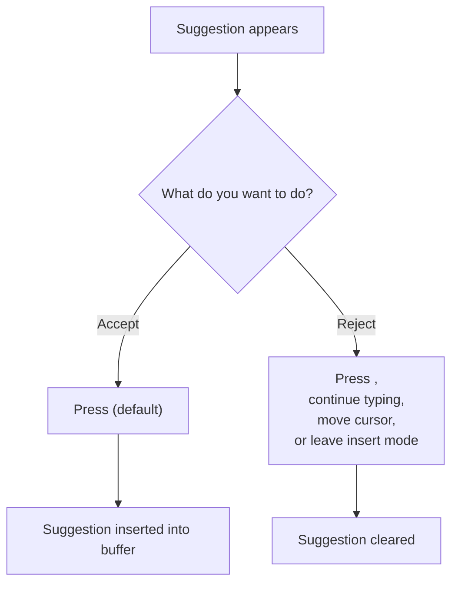
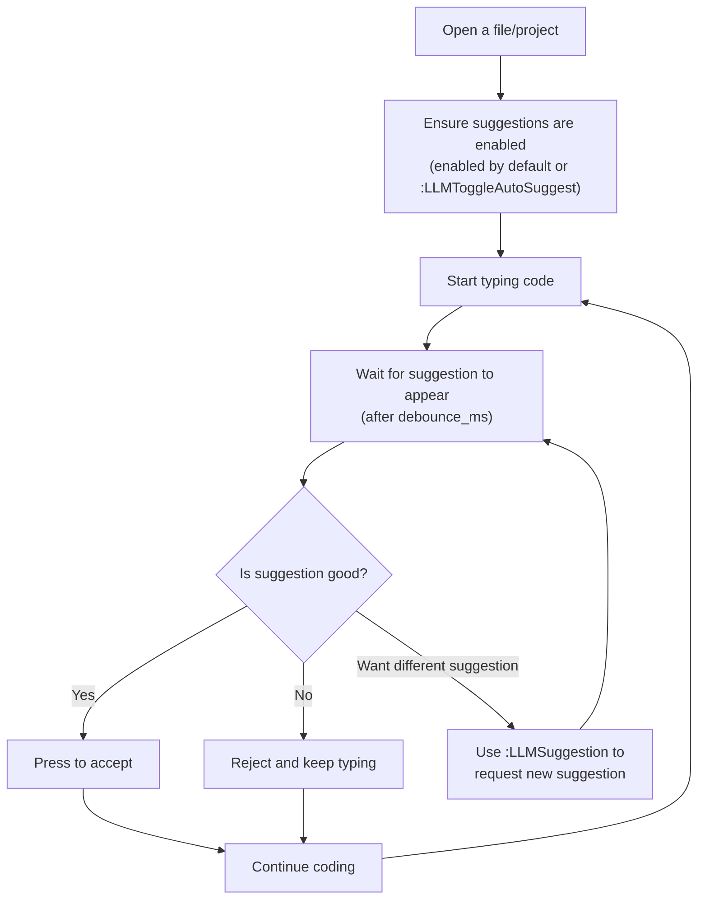
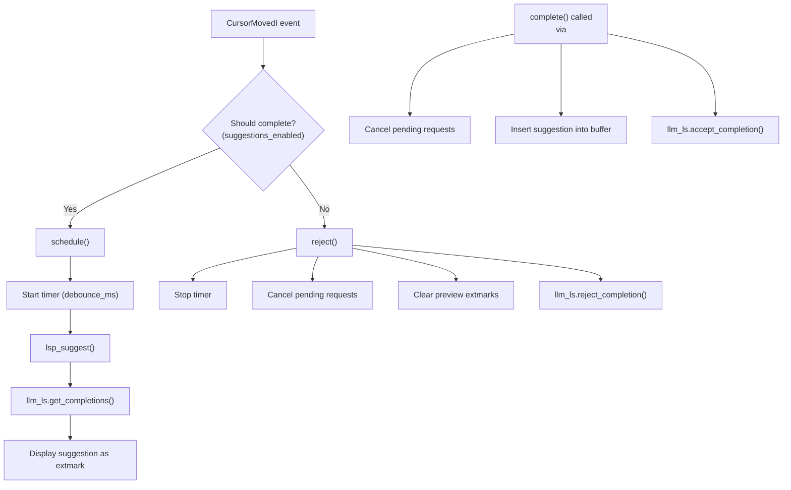
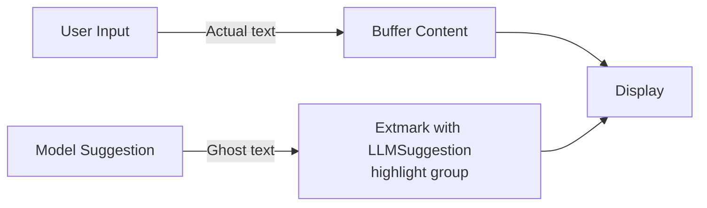

<!-- source: DeepWiki mcp.deepwiki.com · repo huggingface/llm.nvim · page 4 Usage · fetched 2026-10-26 -->

# Usage

<details>
<summary>Relevant source files</summary>

The following files were used as context for generating this wiki page:

- [README.md](README.md)
- [lua/llm/completion.lua](lua/llm/completion.lua)

</details>


This document explains how to effectively use llm.nvim after it has been installed and configured. It covers basic interaction patterns, workflow, and practical examples. For installation instructions, see [Installation](#1.1), and for configuration options, see [Configuration](#2).

## Basic Interaction

Once installed and configured properly, llm.nvim provides code suggestions as you type, similar to GitHub Copilot. The plugin displays suggestions as "ghost text" - dimmed text that appears inline with your cursor but isn't actually inserted into your file until you accept it.

### Automatic Suggestions

By default, llm.nvim will automatically show suggestions as you type in insert mode. The plugin waits for a brief period after you stop typing (controlled by the `debounce_ms` setting) before showing a suggestion.



Sources: [lua/llm/completion.lua:62-68](), [lua/llm/completion.lua:132-142]()

### Accepting Suggestions

When a suggestion appears, you can:

1. **Accept the suggestion** by pressing the accept key (default: `<Tab>`)
2. **Reject the suggestion** by:
   - Pressing the dismiss key (default: `<S-Tab>`)
   - Moving the cursor
   - Continuing to type
   - Leaving insert mode



Sources: [lua/llm/completion.lua:100-115](), [lua/llm/completion.lua:52-58]()

## Commands

The plugin provides the following commands:

| Command | Description |
|---------|-------------|
| `LLMToggleAutoSuggest` | Enables/disables automatic suggestions as you type |
| `LLMSuggestion` | Manually requests a suggestion at the current cursor position |

To use these commands, type `:` followed by the command name in normal mode.

Sources: [README.md:258-263]()

## Keybindings

By default, llm.nvim provides the following key mappings:

| Key | Action |
|-----|--------|
| `<Tab>` (configurable) | Accept the current suggestion |
| `<S-Tab>` (configurable) | Dismiss the current suggestion |

You can customize these keybindings in your configuration. For more detailed information about all available keybindings, see [Commands and Keybindings](#4.1).

Sources: [README.md:333-334]()

## Usage Workflow

The typical workflow when using llm.nvim involves:



Sources: [lua/llm/completion.lua:121-125](), [README.md:258-263]()

## Suggestion Behavior

The suggestion system integrates closely with Neovim's insert mode. Here's how the suggestion system works at a code level:



Sources: [lua/llm/completion.lua:60-114]()

## Practical Examples

### Example 1: Basic Code Completion

1. Open a file in Neovim (e.g., a Python file)
2. Enter insert mode and start typing a function definition:
   ```python
   def calculate_average(numbers):
       # Start typing here
   ```
3. After you type the comment and pause briefly, llm.nvim might suggest:
   ```
   sum = 0
   for num in numbers:
       sum += num
   return sum / len(numbers) if numbers else 0
   ```
4. Press `<Tab>` to accept the suggestion

### Example 2: Toggling Auto-Suggestions

If you want to temporarily disable automatic suggestions:

1. Enter command mode by pressing `:`
2. Type `LLMToggleAutoSuggest` and press Enter
3. A notification will appear confirming that suggestions are turned off
4. To re-enable suggestions, run the same command again

### Example 3: Manual Suggestion Request

If you want to manually request a suggestion:

1. Position your cursor where you want the suggestion
2. Enter command mode by pressing `:`
3. Type `LLMSuggestion` and press Enter
4. Wait for a suggestion to appear
5. Press `<Tab>` to accept or continue typing to reject

## Usage with Different File Types

The plugin can be configured to only show suggestions on specific file types using the `enable_suggestions_on_files` setting. By default, it's set to `"*"` which enables suggestions on all files.

Examples of configuration:
- For all files: `enable_suggestions_on_files = "*"`
- For specific project: `enable_suggestions_on_files = "/path/to/my_project/*"`
- For specific file types: `enable_suggestions_on_files = { "*.py", "*.rs" }`

Sources: [README.md:250-254]()

## Understanding the Suggestion Display

When a suggestion appears, it uses a special highlight group (`LLMSuggestion`) which by default is linked to the `Comment` highlight group, giving it a dimmed appearance distinct from your actual code.



Sources: [lua/llm/completion.lua:11-12](), [lua/llm/completion.lua:150]()

## Advanced Usage Tips

1. **Understand model behavior**: Different models have different strengths and weaknesses. Experiment with various models to find what works best for your programming style and languages.

2. **Adjust debounce time**: If suggestions appear too quickly or too slowly, adjust the `debounce_ms` setting in your configuration.

3. **Combine with other Neovim plugins**: llm.nvim works well alongside other code tools like LSP for static analysis and syntax highlighting.

4. **Model-specific configuration**: For guidance on optimizing settings for specific models, see [Model-Specific Configuration](#4.2).

## Troubleshooting Usage Issues

If you encounter issues while using llm.nvim, check the following:

1. Ensure the plugin is properly configured with a valid model and backend
2. Check that you have appropriate API tokens or access to the configured backend
3. Verify that the plugin is enabled (use `:LLMToggleAutoSuggest` to check/toggle)

For more detailed troubleshooting steps, see the [Troubleshooting](#5) section.

Sources: [README.md:309-348]()

---

