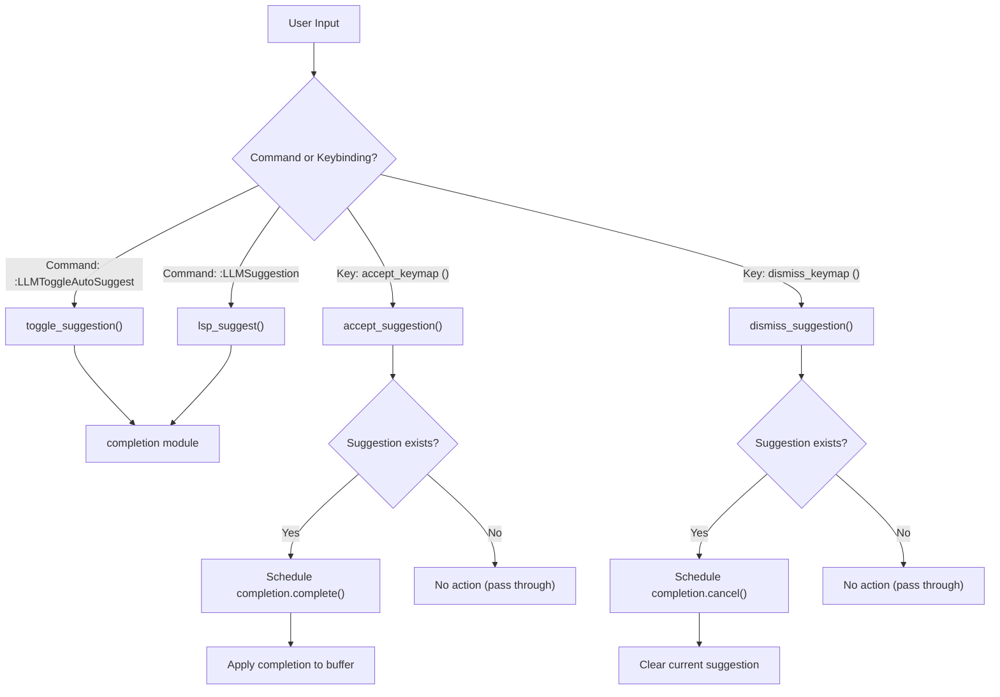
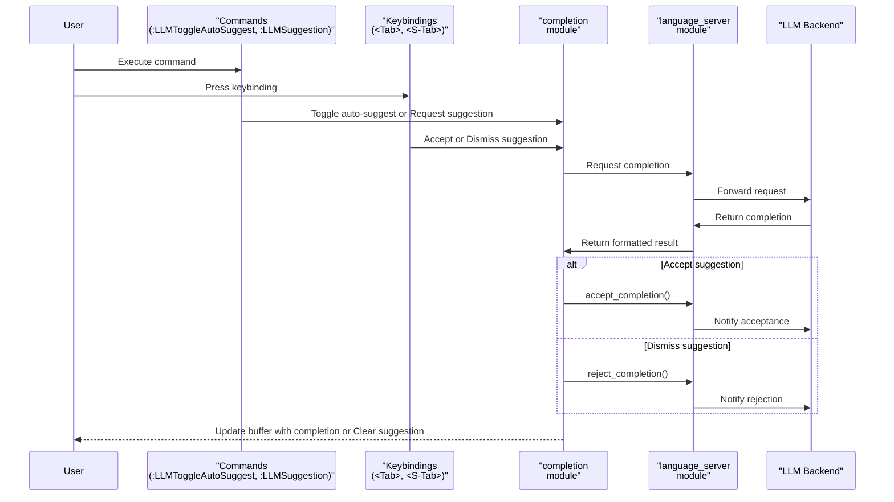

<!-- source: DeepWiki mcp.deepwiki.com · repo huggingface/llm.nvim · page 4.1 Commands and Keybindings · fetched 2026-10-26 -->

# Commands and Keybindings

<details>
<summary>Relevant source files</summary>

The following files were used as context for generating this wiki page:

- [README.md](README.md)
- [lua/llm/init.lua](lua/llm/init.lua)
- [lua/llm/keymaps.lua](lua/llm/keymaps.lua)

</details>


This page documents the commands and keyboard shortcuts available in llm.nvim. These are the primary ways users interact with the plugin to control suggestion behavior, accept completions, and manage the plugin's functionality. For configuration options and setup, see [Configuration](#2).

## Available Commands

llm.nvim provides two main user commands that can be executed from Neovim's command mode:

| Command | Description |
|---------|-------------|
| `LLMToggleAutoSuggest` | Enables or disables automatic "suggest-as-you-type" functionality |
| `LLMSuggestion` | Manually triggers a suggestion request regardless of automatic suggestion settings |

These commands are created during the plugin initialization process and provide direct control over the suggestion system.

Sources: [lua/llm/init.lua:8-16]()

## Default Keybindings

The plugin sets up the following default keybindings:

| Key | Mode | Function |
|-----|------|----------|
| `<Tab>` | Insert, Normal | Accept the current suggestion |
| `<S-Tab>` (Shift+Tab) | Insert, Normal | Dismiss the current suggestion |

These keybindings are only active when a suggestion is present, otherwise they fall through to their normal Neovim behavior.

Sources: [lua/llm/keymaps.lua:33-39](), [README.md:333-334]()

## Command and Keybinding Flow

The following diagram illustrates how commands and keybindings are processed within the plugin:



Sources: [lua/llm/init.lua:8-16](), [lua/llm/keymaps.lua:8-23](), [lua/llm/keymaps.lua:33-39]()

## Interaction with Completion System

This diagram illustrates how the commands and keybindings interact with the completion system:



Sources: [lua/llm/init.lua:8-16](), [lua/llm/keymaps.lua:8-23]()

## Customizing Keybindings

You can customize the keybindings by setting the `accept_keymap` and `dismiss_keymap` options in your llm.nvim configuration:

```lua
require('llm').setup({
  -- other configuration options...
  accept_keymap = "<C-y>",      -- Change to Ctrl+y
  dismiss_keymap = "<C-n>",     -- Change to Ctrl+n
  -- other configuration options...
})
```

The plugin will use these custom keybindings instead of the defaults. These settings are retrieved during plugin initialization and applied to both insert and normal modes.

Sources: [lua/llm/keymaps.lua:30-31](), [README.md:333-334]()

## Command Implementation Details

The commands are implemented in the following way:

1. `LLMToggleAutoSuggest`: Calls `completion.toggle_suggestion()` which toggles the internal state that controls whether suggestions happen automatically as you type.

2. `LLMSuggestion`: Calls `completion.lsp_suggest()` which makes an immediate request to the language server for a suggestion at the current cursor position.

Sources: [lua/llm/init.lua:8-16]()

## Keybinding Implementation Details

The keybinding handlers work as follows:

1. `accept_suggestion()`: 
   - Checks if a suggestion is present
   - If yes, schedules the `completion.complete()` function to apply the suggestion
   - If no, returns nil which causes the key to act normally in Neovim

2. `dismiss_suggestion()`:
   - Checks if a suggestion is present
   - If yes, schedules the `completion.cancel()` function and clears the suggestion
   - If no, returns nil to allow normal key behavior

Both functions are mapped in both insert and normal modes with the `expr = true` option, which evaluates the function as an expression.

Sources: [lua/llm/keymaps.lua:8-23](), [lua/llm/keymaps.lua:33-39]()

---

