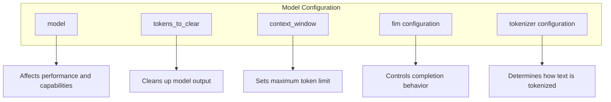
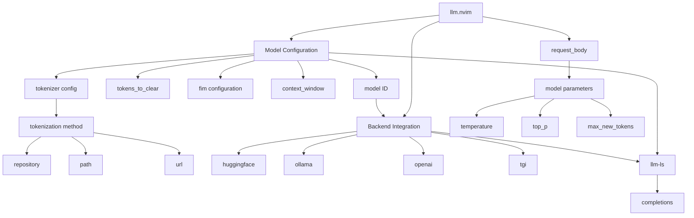
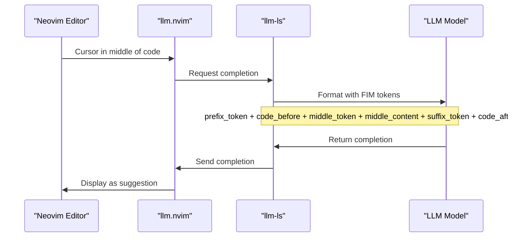
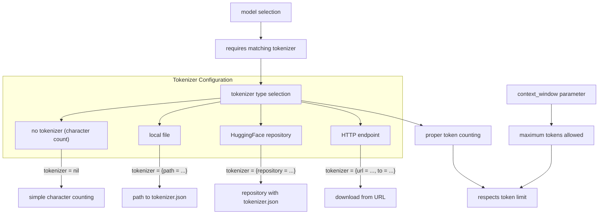

<!-- source: DeepWiki mcp.deepwiki.com · repo huggingface/llm.nvim · page 4.2 Model-Specific Configuration · fetched 2026-10-26 -->

# Model-Specific Configuration

<details>
<summary>Relevant source files</summary>

The following files were used as context for generating this wiki page:

- [README.md](README.md)
- [lua/llm/config.lua](lua/llm/config.lua)

</details>


This page provides guidance on configuring the llm.nvim plugin for specific LLM models. It covers model-specific parameters, tokens, Fill-in-the-Middle (FIM) configurations, and tokenizer settings that optimize each model's performance. For general plugin configuration information, see [Configuration](#2), and for backend-specific setup, see [Backend Configuration](#2.1).

## Model Configuration Components

Model-specific configuration in llm.nvim involves several key components that need to be properly configured based on the specific LLM you're using. Each model has unique requirements for optimal performance.



Sources: [README.md:131-176](), [lua/llm/config.lua:1-41]()

## Configuring Common Models

llm.nvim provides recommended configurations for popular coding models. These configurations can be used as-is or as a starting point for customization.

### Starcoder

[Starcoder](https://huggingface.co/bigcode/starcoder) is the default model in llm.nvim. Its configuration includes:

```lua
{
  tokens_to_clear = { "<|endoftext|>" },
  fim = {
    enabled = true,
    prefix = "<fim_prefix>",
    middle = "<fim_middle>",
    suffix = "<fim_suffix>",
  },
  model = "bigcode/starcoder",
  context_window = 8192,
  tokenizer = {
    repository = "bigcode/starcoder",
  }
}
```

The key model-specific elements are:
- End-of-text token (`<|endoftext|>`) that needs to be cleared from output
- FIM tokens specific to Starcoder
- 8192 token context window
- Matching tokenizer repository

Sources: [README.md:133-149]()

### CodeLlama

[CodeLlama](https://huggingface.co/codellama/CodeLlama-13b-hf) has a different configuration:

```lua
{
  tokens_to_clear = { "<EOT>" },
  fim = {
    enabled = true,
    prefix = "<PRE> ",
    middle = " <MID>",
    suffix = " <SUF>",
  },
  model = "codellama/CodeLlama-13b-hf",
  context_window = 4096,
  tokenizer = {
    repository = "codellama/CodeLlama-13b-hf",
  }
}
```

Notable differences include:
- Different end-of-text token (`<EOT>`)
- Different FIM tokens with spaces (spaces are important here)
- Smaller context window (4096 tokens)

Sources: [README.md:156-171]()

## Configuration Relationships

The following diagram illustrates how model-specific configuration relates to other parts of the llm.nvim system:



Sources: [README.md:32-129](), [lua/llm/config.lua:1-95]()

## Understanding Fill-in-the-Middle (FIM)

Fill-in-the-Middle is a capability of certain models that allows them to complete code within a context (not just at the end). This is particularly useful for code completion in the middle of functions or blocks.



Different models use different tokens for FIM. For example:
- Starcoder: `<fim_prefix>`, `<fim_middle>`, `<fim_suffix>`
- CodeLlama: `<PRE> `, ` <MID>`, ` <SUF>` (note the spaces)

Proper FIM configuration is crucial for accurate in-context code completion.

Sources: [README.md:138-143](), [README.md:160-165](), [lua/llm/config.lua:16-22]()

## Tokenizer Configuration

The tokenizer determines how text is converted into tokens that the model can process. Proper tokenizer configuration ensures that the context fits within the model's context window.



For optimal performance, the tokenizer should match the model being used:
- For Starcoder: `tokenizer = { repository = "bigcode/starcoder" }`
- For CodeLlama: `tokenizer = { repository = "codellama/CodeLlama-13b-hf" }`

Sources: [README.md:210-245](), [README.md:146-148](), [README.md:167-169]()

## Model-Specific Request Body Parameters

Each model and backend combination may require different parameters in the request body to optimize performance.

### Parameter Comparison Table

| Parameter | Typical Range | Effect | Starcoder Default | CodeLlama Recommended |
|-----------|--------------|--------|-------------------|----------------------|
| max_new_tokens | 1-512 | Maximum length of completions | 60 | 60 |
| temperature | 0.0-1.0 | Randomness (higher = more creative) | 0.2 | 0.2 |
| top_p | 0.0-1.0 | Diversity of completions | 0.95 | 0.95 |
| top_k | 1-100 | Restricts to top K likely tokens | - | 50 |
| repetition_penalty | 1.0-2.0 | Reduces repetition | - | 1.1 |

These parameters can be adjusted in the `request_body` section of your configuration:

```lua
request_body = {
  parameters = {
    max_new_tokens = 60,
    temperature = 0.2,
    top_p = 0.95,
    -- other model-specific parameters
  },
}
```

Note that the structure of the request body varies by backend:
- Hugging Face/TGI: Uses `parameters` object
- Ollama: Uses `options` object
- OpenAI: Places parameters at the root level

Sources: [README.md:74-84](), [README.md:100-104](), [README.md:122-127](), [lua/llm/config.lua:8-15](), [lua/llm/config.lua:43-54]()

## Context Window Management

The context window size determines how much text can be processed by the model at once. Different models have different context window sizes:

- Starcoder: 8192 tokens
- CodeLlama: 4096 tokens

To optimize performance, set the `context_window` parameter to match your model's capabilities. This ensures that:
1. The plugin doesn't send more tokens than the model can handle
2. You maximize the available context for better completions

Sources: [README.md:145](), [README.md:166](), [lua/llm/config.lua:36]()

## Comparing Model Configurations

```mermaid
classDiagram
    class "ModelConfiguration" {
        model: string
        tokens_to_clear: string[]
        fim: FimConfig
        context_window: number
        tokenizer: TokenizerConfig
    }
    
    class "StarcoderConfig" {
        model: "bigcode/starcoder"
        tokens_to_clear: ["<|endoftext|>"]
        fim: {enabled: true, prefix: "<fim_prefix>", middle: "<fim_middle>", suffix: "<fim_suffix>"}
        context_window: 8192
        tokenizer: {repository: "bigcode/starcoder"}
    }
    
    class "CodeLlamaConfig" {
        model: "codellama/CodeLlama-13b-hf"
        tokens_to_clear: ["<EOT>"]
        fim: {enabled: true, prefix: "<PRE> ", middle: " <MID>", suffix: " <SUF>"}
        context_window: 4096
        tokenizer: {repository: "codellama/CodeLlama-13b-hf"}
    }
    
    ModelConfiguration <|-- StarcoderConfig
    ModelConfiguration <|-- CodeLlamaConfig
```

Sources: [README.md:133-170]()

## Best Practices for Model Configuration

1. **Match tokenizer to model**: Always use the tokenizer that matches your model to ensure accurate token counting
2. **Set correct context window**: Match the `context_window` parameter to your model's capabilities
3. **Configure FIM properly**: Check if your model supports FIM and use the correct tokens
4. **Customize token clearing**: Different models output different end-of-text tokens that need clearing
5. **Adjust temperature based on needs**: 
   - Lower (0.1-0.3) for deterministic, precise code completion
   - Higher (0.7-0.9) for more creative suggestions
6. **Consider model size**: Larger models may provide better completions but require more resources
7. **Test your configuration**: Different models perform differently on various programming languages

Sources: [README.md:131-176](), [lua/llm/config.lua:1-41]()

## Setting Model-Specific Configuration

To apply a model-specific configuration, pass the settings to the setup function:

```lua
require('llm').setup({
  -- General settings
  model = "codellama/CodeLlama-13b-hf",
  backend = "huggingface", 
  
  -- Model-specific settings
  tokens_to_clear = { "<EOT>" },
  fim = {
    enabled = true,
    prefix = "<PRE> ",
    middle = " <MID>",
    suffix = " <SUF>",
  },
  context_window = 4096,
  tokenizer = {
    repository = "codellama/CodeLlama-13b-hf",
  },
  
  -- Other settings...
})
```

Sources: [README.md:311-348]()

---

