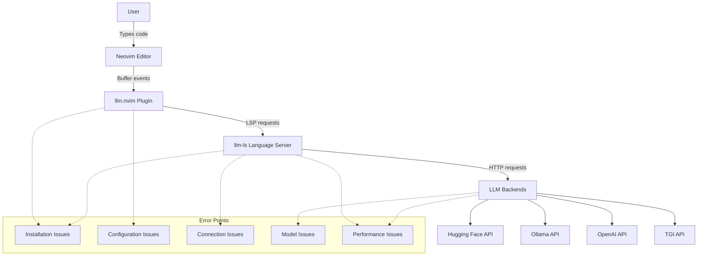
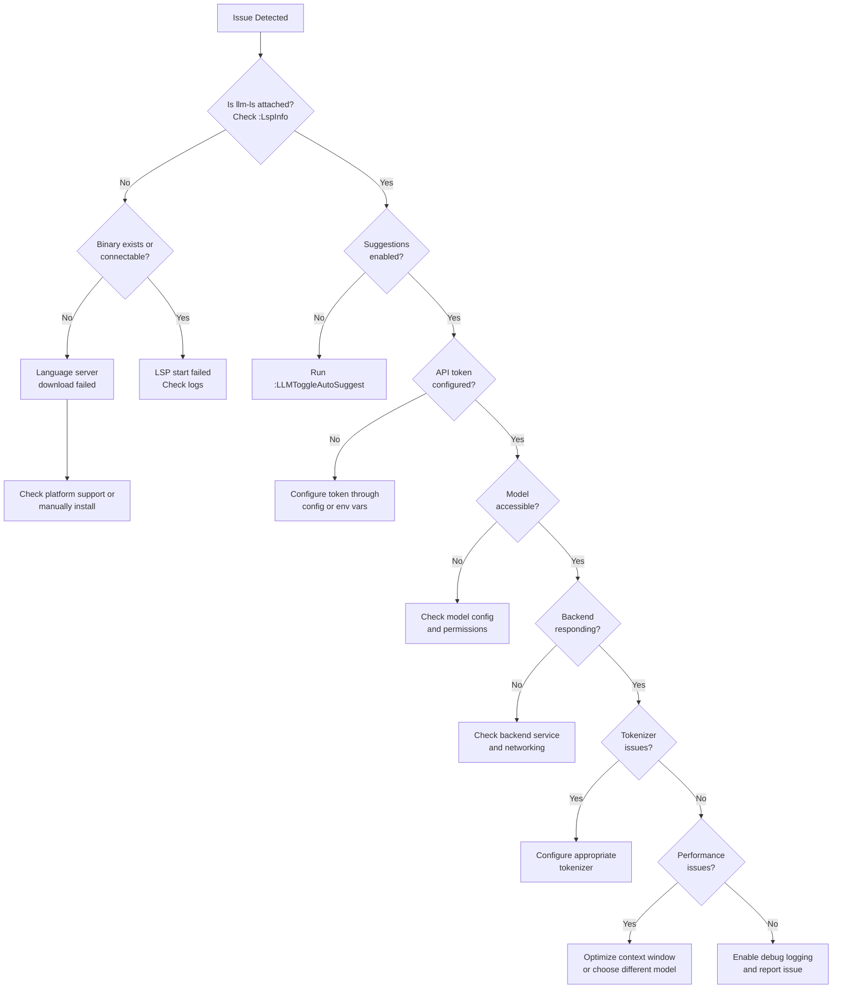

<!-- source: DeepWiki mcp.deepwiki.com · repo huggingface/llm.nvim · page 5 Troubleshooting · fetched 2026-10-26 -->

# Troubleshooting

<details>
<summary>Relevant source files</summary>

The following files were used as context for generating this wiki page:

- [README.md](README.md)
- [lua/llm/language_server.lua](lua/llm/language_server.lua)

</details>


This page provides solutions to common issues encountered when using llm.nvim, a Neovim plugin for LLM-powered code completion. The guide is organized by problem category to help you quickly identify and resolve issues that may arise during setup, configuration, or use of the plugin.

## System Architecture Overview

To understand troubleshooting effectively, it's helpful to first understand the communication flow between components:



Sources: [README.md:1-350]()

## Troubleshooting Process

Follow this flowchart to diagnose and solve common issues:



Sources: [lua/llm/language_server.lua:9-239](), [README.md:176-208]()

## Common Issues and Solutions

### Installation and Setup Issues

#### Language Server Installation Failures

The most common installation issue relates to the `llm-ls` language server:

| Issue | Solution |
|-------|----------|
| Unsupported architecture/OS | Check supported platforms in [lua/llm/language_server.lua:19-29](). If your platform isn't supported, manually compile `llm-ls` or use TCP connection mode. |
| Download failures | Check your internet connection. The plugin attempts to download from GitHub releases. You can manually download and specify the path. |
| Permission issues | Ensure the downloaded binary has execute permissions (`chmod +x`). |
| Binary not found | Set `lsp.bin_path` to the correct path, or install via Mason. |

When automatic installation fails, you'll see an error notification: "[LLM] failed to download llm-ls".

**Using Mason for installation:**

```lua
-- Install with :MasonInstall llm-ls
-- Then configure:
{
  lsp = {
    bin_path = vim.api.nvim_call_function("stdpath", { "data" }) .. "/mason/bin/llm-ls",
  }
}
```

Sources: [lua/llm/language_server.lua:14-92](), [README.md:178-208]()

### Configuration Issues

#### API Token Problems

Authentication failures are common when first setting up the plugin:

| Issue | Solution |
|-------|----------|
| Missing API token | Set up token through one of the methods below, in order of precedence |
| Incorrect token format | Ensure token is provided without any whitespace or quotes |
| Insufficient permissions | Check if your token has access to the model you're trying to use |

**Ways to configure your API token** (in order of precedence):
1. Direct configuration: `api_token = "<your token>"`
2. Environment variable: `LLM_NVIM_HF_API_TOKEN`
3. Token file at `$HF_HOME/token`
4. Via `huggingface-cli login`

Sources: [README.md:46-56]()

#### Backend Configuration Issues

| Issue | Solution |
|-------|----------|
| Incorrect backend type | Set `backend` to one of: "huggingface", "ollama", "openai", or "tgi" |
| Incorrect URL | Verify URL format; check logs for connection attempts |
| Missing model specification | Set `model` or `LLM_NVIM_MODEL` environment variable |
| Request parameters | Check `request_body` configuration for backend-specific requirements |

**Example Ollama configuration:**
```lua
{
  model = "codellama:7b",
  url = "http://localhost:11434", -- llm-ls uses "/api/generate"
  backend = "ollama",
  request_body = {
    options = {
      temperature = 0.2,
      top_p = 0.95,
    }
  }
}
```

Sources: [README.md:34-129]()

### Connection Issues

| Issue | Solution |
|-------|----------|
| Network connectivity | Ensure your network allows connections to the backend URL |
| Local service not running | For Ollama/TGI, verify the service is running (e.g., `curl localhost:11434/api/version`) |
| TLS/SSL issues | For self-hosted services with certificate issues, set `tls_skip_verify_insecure = true` |
| Rate limiting | Check for rate-limit errors in logs, especially with free-tier API access |

**Debug connection with debug logging:**
```lua
lsp = {
  cmd_env = { LLM_LOG_LEVEL = "DEBUG" },
}
```

Sources: [README.md:11-14](), [lua/llm/language_server.lua:94-147]()

### Language Server Issues

| Issue | Solution |
|-------|----------|
| Failed to start | Check the Neovim error log (`:messages`) for startup errors |
| Not attaching to buffers | Verify `enable_suggestions_on_files` pattern matches your files |
| LSP client errors | Inspect with `:LspInfo` to check client status |
| RPC connection failures | If using TCP mode, verify the host and port are correct and accessible |

The plugin tries to connect to the language server in this order:
1. Via RPC if `host` and `port` are configured
2. Using the binary at `bin_path` if it exists
3. Downloading and using a version-matched binary

Sources: [lua/llm/language_server.lua:179-239]()

### Suggestion Display Issues

| Issue | Solution |
|-------|----------|
| No suggestions appearing | Toggle with `:LLMToggleAutoSuggest` |
| Suggestions only in certain files | Check `enable_suggestions_on_files` configuration |
| Delayed suggestions | Adjust `debounce_ms` (default: 150ms) |
| Ghost text not visible | Ensure your colorscheme doesn't hide ghost text |

**File pattern configuration examples:**
```lua
-- All files
enable_suggestions_on_files = "*"

-- Only Python and Lua files
enable_suggestions_on_files = { "*.py", "*.lua" }

-- Only files in specific directory
enable_suggestions_on_files = "/path/to/project/*"
```

Sources: [README.md:250-254]()

### Performance Issues

| Issue | Solution |
|-------|----------|
| Slow suggestions | Reduce `context_window` to send less text to the model |
| High resource usage | Consider using a smaller model or local Ollama instance |
| Unresponsive editor | Increase `debounce_ms` to reduce request frequency |
| Long completion times | Check your network latency to the backend |

**Context window optimization:**
The `context_window` parameter limits how much code is sent to the model. Smaller values reduce request size and improve response time, but may reduce completion quality.

Sources: [README.md:30-31](), [README.md:211-246]()

### Model-Specific Issues

| Issue | Solution |
|-------|----------|
| Special tokens not cleared | Configure `tokens_to_clear` for your model |
| Fill-in-the-Middle not working | Ensure `fim` configuration matches your model's expected format |
| Model not recognized | Verify model name is correct and accessible with your token |

**Model configuration examples:**

For Starcoder:
```lua
{
  tokens_to_clear = { "<|endoftext|>" },
  fim = {
    enabled = true,
    prefix = "<fim_prefix>",
    middle = "<fim_middle>",
    suffix = "<fim_suffix>",
  },
  model = "bigcode/starcoder",
  context_window = 8192,
}
```

For CodeLlama:
```lua
{
  tokens_to_clear = { "<EOT>" },
  fim = {
    enabled = true,
    prefix = "<PRE> ",
    middle = " <MID>",
    suffix = " <SUF>",
  },
  model = "codellama/CodeLlama-13b-hf",
  context_window = 4096,
}
```

Sources: [README.md:133-176]()

## Diagnostic Tools and Reporting Issues

### Enabling Debug Logging

To get detailed diagnostic information:

```lua
lsp = {
  cmd_env = { LLM_LOG_LEVEL = "DEBUG" },
}
```

This will output detailed logs about the language server's operations, including:
- Request and response details
- Tokenization information
- Error messages and stack traces

Sources: [README.md:341-342]()

### Checking Connection Status

1. Use `:LspInfo` to verify that the `llm-ls` client is attached
2. Run `:checkhealth` if you have health-check plugins
3. Check for error notifications in Neovim's message log (`:messages`)

### Common Error Messages and Solutions

| Error Message | Solution |
|---------------|----------|
| "[LLM] request 'llm-ls/getCompletions' failed" | Language server isn't responding correctly. Check configuration and connectivity. |
| "Unsupported architecture or OS" | Your platform isn't directly supported. Consider using TCP mode or building from source. |
| "Error starting llm-ls" | Check if the binary exists and has execute permissions. |
| "failed to download llm-ls" | Network issue or unsupported platform. Try manual installation. |

Sources: [lua/llm/language_server.lua:140-146](), [lua/llm/language_server.lua:47-50](), [lua/llm/language_server.lua:196-198](), [lua/llm/language_server.lua:212-214]()

### Reporting Issues

If you encounter an issue not covered in this guide:

1. Enable debug logging
2. Collect relevant error messages
3. Create an issue on the [GitHub repository](https://github.com/huggingface/llm.nvim/issues) with:
   - Your configuration
   - Error messages
   - Steps to reproduce
   - Neovim and llm.nvim versions

Sources: [README.md:1-7]()

---

