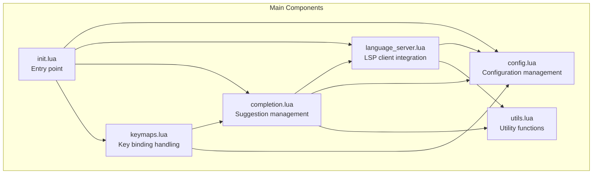
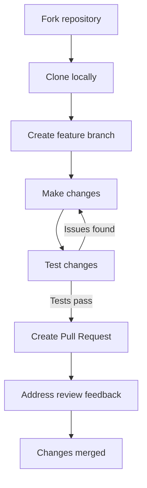
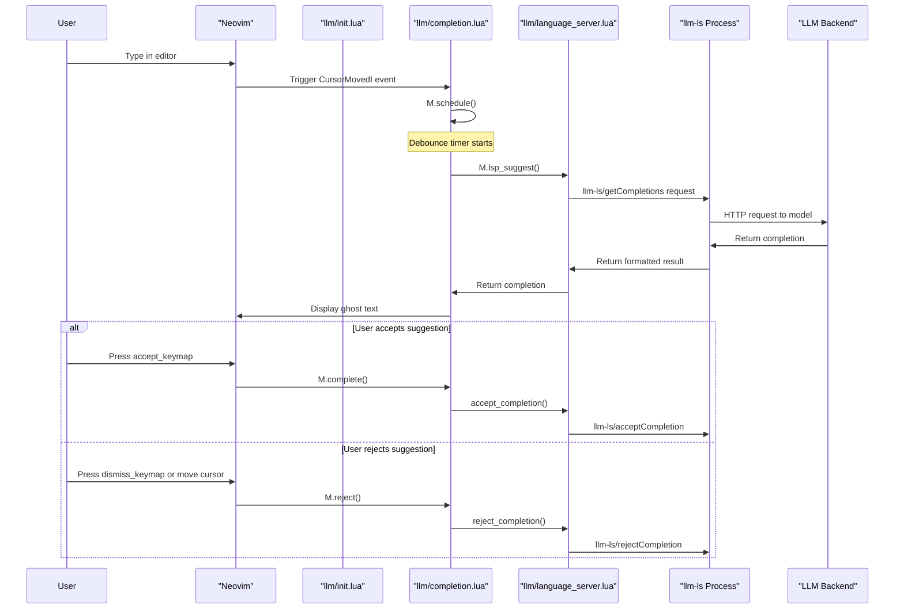
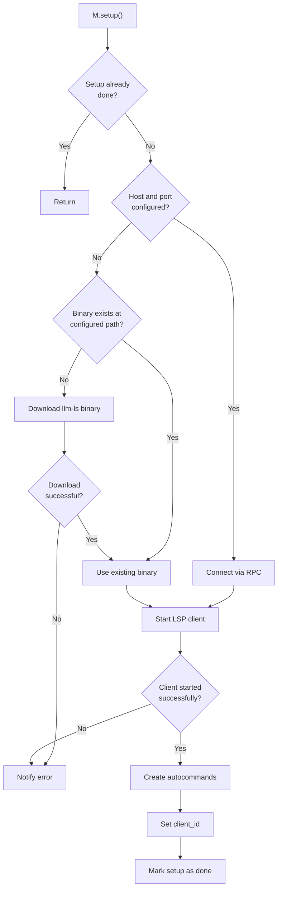
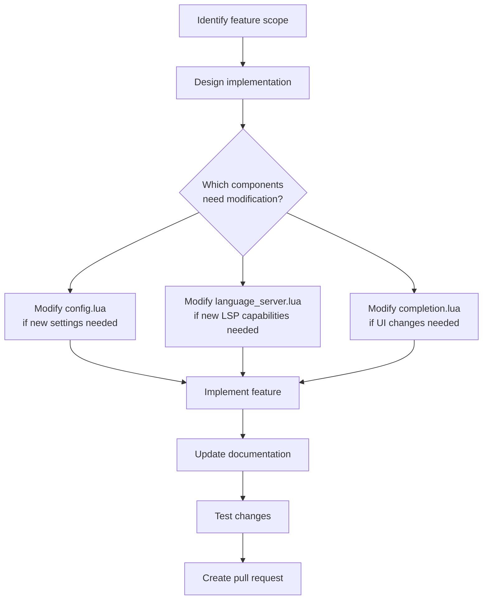

<!-- source: DeepWiki mcp.deepwiki.com · repo huggingface/llm.nvim · page 6 Development Guide · fetched 2026-10-26 -->

# Development Guide

<details>
<summary>Relevant source files</summary>

The following files were used as context for generating this wiki page:

- [README.md](README.md)
- [lua/llm/completion.lua](lua/llm/completion.lua)
- [lua/llm/config.lua](lua/llm/config.lua)
- [lua/llm/init.lua](lua/llm/init.lua)
- [lua/llm/language_server.lua](lua/llm/language_server.lua)

</details>


This guide provides information for developers who want to contribute to or modify the llm.nvim plugin. It covers the project architecture, setup process, workflow recommendations, and best practices for development.

For user configuration options, see [Configuration](#2), and for general usage information, see [Usage](#4).

## Project Structure Overview

The llm.nvim project is organized into logical modules with clear responsibilities:



Sources: [lua/llm/init.lua:1-5](), [lua/llm/language_server.lua:1-6](), [lua/llm/completion.lua:1-6]()

## Development Environment Setup

### Prerequisites

1. Neovim (latest stable version recommended)
2. Lua development tools:
   - luacheck (for linting)
   - busted (for testing)
3. Git

### Local Development Setup

1. Fork the repository on GitHub
2. Clone your fork locally:
   ```bash
   git clone https://github.com/your-username/llm.nvim.git
   cd llm.nvim
   ```
3. Set up the upstream remote:
   ```bash
   git remote add upstream https://github.com/huggingface/llm.nvim.git
   ```

## Development Workflow



### Working with llm-ls

The plugin communicates with the llm-ls language server, which is a separate project. During development, you may want to use a custom build of llm-ls:

1. To use a local build of llm-ls, set the `lsp.bin_path` configuration option to point to your local binary
2. For debugging, you can start llm-ls manually with the `--port` option and connect to it using the `lsp.host` and `lsp.port` settings

```lua
require('llm').setup({
  lsp = {
    bin_path = "/path/to/your/llm-ls",
    -- Alternatively, connect to a running instance:
    -- host = "127.0.0.1",
    -- port = 8080,
  }
})
```

Sources: [lua/llm/language_server.lua:178-239](), [README.md:177-208]()

## Code Architecture

### Component Interaction

The following diagram shows how the main modules interact when processing a completion request:



Sources: [lua/llm/completion.lua:60-114](), [lua/llm/language_server.lua:94-177]()

### Language Server Setup Process

The following diagram illustrates how the language server component is initialized:



Sources: [lua/llm/language_server.lua:179-239]()

## Making Changes

### Code Structure and Modules

| Module | File | Responsibility |
|--------|------|----------------|
| Main entry point | `lua/llm/init.lua` | Initializes all components and sets up commands |
| Configuration | `lua/llm/config.lua` | Handles configuration and provides defaults |
| Language Server | `lua/llm/language_server.lua` | Manages communication with llm-ls |
| Completion | `lua/llm/completion.lua` | Handles suggestion display and interaction |
| Keymaps | `lua/llm/keymaps.lua` | Sets up key bindings for accepting/dismissing suggestions |
| Utilities | `lua/llm/utils.lua` | Provides helper functions used by other modules |

Sources: [lua/llm/init.lua:1-37](), [lua/llm/config.lua:1-116](), [lua/llm/language_server.lua:1-241](), [lua/llm/completion.lua:1-156]()

### Adding New Features

When adding new features to llm.nvim, you should follow this workflow:



### Configuration System

To add new configuration options, you'll need to:

1. Add the option to the default configuration in [lua/llm/config.lua:2-41]()
2. Update the setup function if needed in [lua/llm/config.lua:81-105]()
3. Document the new option in README.md

## Testing Your Changes

To test your changes:

1. Install the plugin locally in your Neovim configuration:
   ```lua
   use { '~/path/to/llm.nvim' }
   ```

2. Test all main functional paths:
   - Plugin initialization
   - Completion suggestions
   - Accepting/rejecting completions
   - Configuration changes

## Common Development Tasks

### Adding a New Backend

1. Update the backend type checking in [lua/llm/config.lua:89-96]()
2. Add default request body format to [lua/llm/config.lua:43-54]() if needed
3. Update documentation about the backend in README.md

### Modifying the Completion Behavior

The completion system is primarily implemented in [lua/llm/completion.lua]() with these key functions:

1. `M.schedule()` - Debounces and schedules completion requests
2. `M.lsp_suggest()` - Sends the request to the language server
3. `M.complete()` - Handles accepting the suggestion
4. `M.reject()` - Handles rejecting the suggestion

Sources: [lua/llm/completion.lua:60-115]()

### Language Server Communication

To modify how the plugin communicates with llm-ls:

1. Update the request parameters in [lua/llm/language_server.lua:109-146]()
2. Handle response processing in [lua/llm/language_server.lua:101-107]()
3. For new LSP methods, add corresponding functions similar to the existing ones

## Debugging Tips

1. Enable debug logs for llm-ls by setting:
   ```lua
   lsp = {
     cmd_env = { LLM_LOG_LEVEL = "DEBUG" }
   }
   ```

2. Check LSP communication using Neovim's built-in LSP logging:
   ```vim
   :lua vim.lsp.set_log_level("debug")
   ```

3. View logs:
   ```vim
   :lua vim.cmd('edit ' .. vim.lsp.get_log_path())
   ```

Sources: [README.md:341-342]()

## Releasing Changes

1. Update version information if applicable
2. Ensure documentation is up-to-date
3. Create a pull request against the main repository
4. Respond to review comments