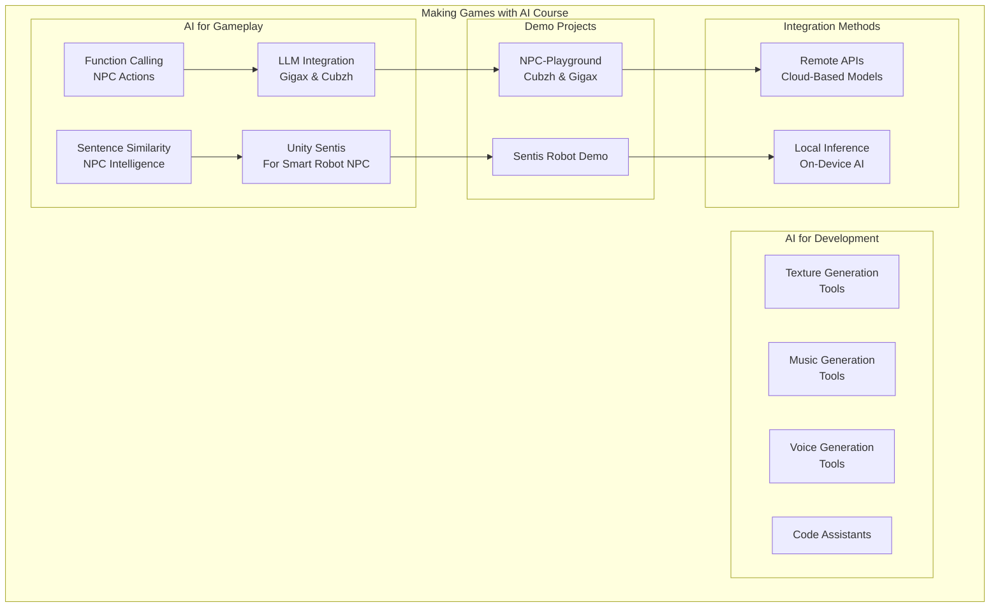
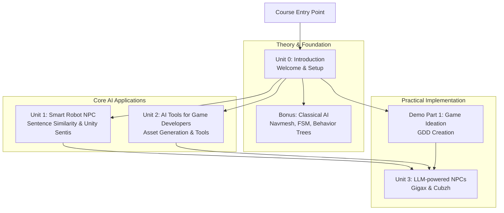
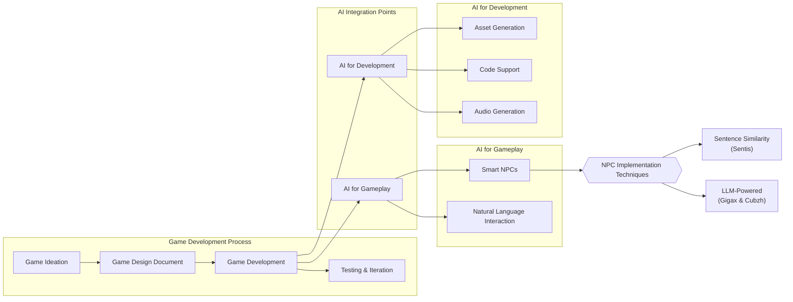
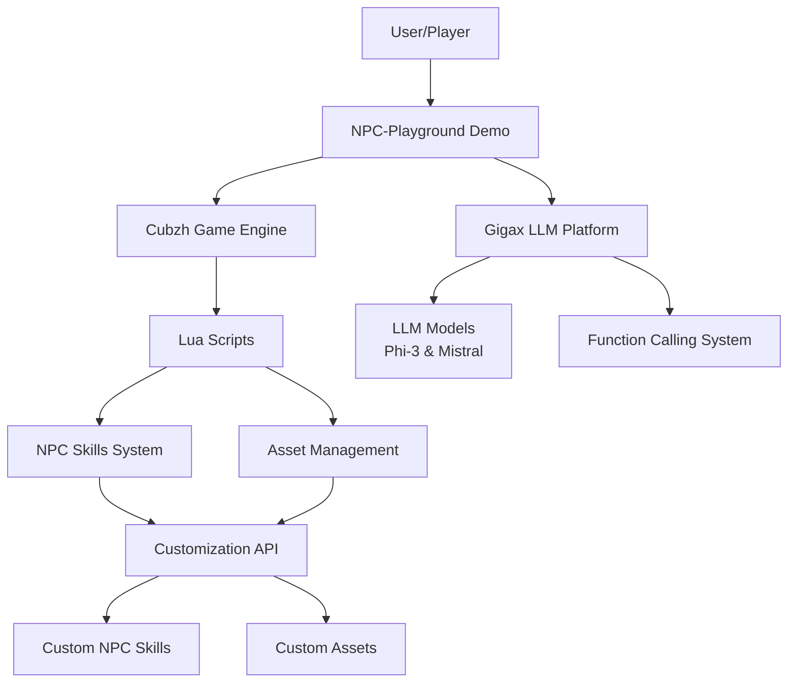
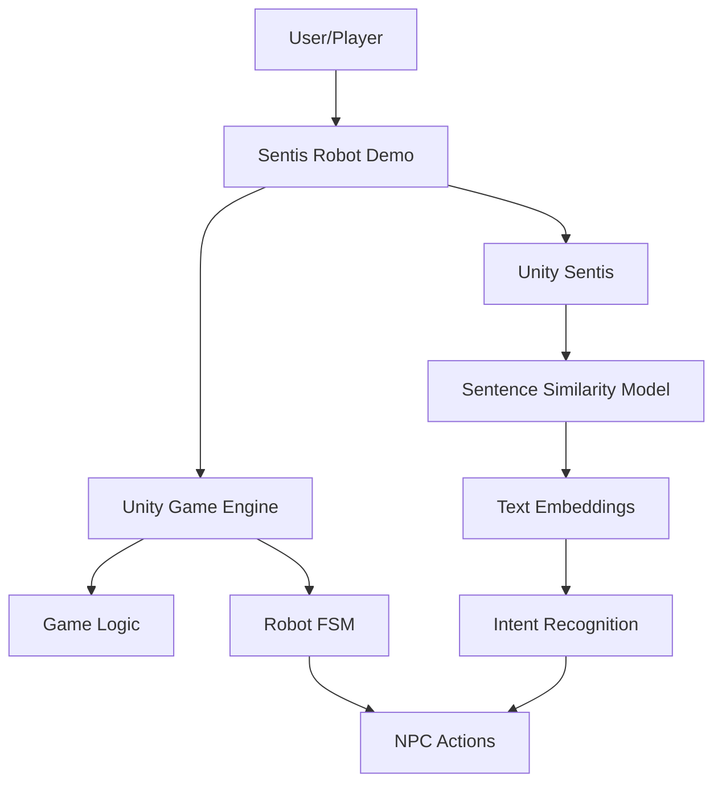

<!-- source: DeepWiki mcp.deepwiki.com · repo huggingface/making-games-with-ai-course · page 1 Overview · fetched 2026-10-26 -->

# Overview

Relevant source files

The following files were used as context for generating this wiki page:

- [README.md](README.md)
- [units/en/_toctree.yml](units/en/_toctree.yml)
- [units/en/unit0/introduction.mdx](units/en/unit0/introduction.mdx)

This document provides a comprehensive guide to the "making-games-with-ai-course" repository, which contains materials for Hugging Face's Machine Learning for Games Course. The repository teaches game developers how to integrate AI models and tools into game development, with a focus on innovative gameplay and development efficiency.

For detailed setup instructions, see [Setup and Onboarding](#1.2). For specifics about course curriculum, see [Course Structure](#1.1).

Sources: [README.md:1-16](), [units/en/unit0/introduction.mdx:1-46]()

## Purpose and Scope

The "making-games-with-ai-course" repository serves two primary purposes:

1. **Teaching AI Integration for Gameplay**: Demonstrating how to implement AI models to create intelligent NPCs and novel gameplay mechanics.
2. **Showcasing AI-Assisted Development**: Illustrating how AI tools can accelerate game development through asset generation, code assistance, and more.

The course focuses on practical implementations, providing hands-on examples and demos that showcase various AI integration approaches within game development.

Sources: [units/en/unit0/introduction.mdx:17-45](), [README.md:8-13]()

## Core Systems Overview

The repository encompasses several core AI systems and integration methods that together provide a comprehensive approach to incorporating AI into games.

Sources: [units/en/_toctree.yml:19-34](), [units/en/_toctree.yml:63-82](), [units/en/_toctree.yml:83-92]()

## Course Structure

The course follows a structured learning path, starting with foundational knowledge and progressing to specific AI implementations and practical projects.

Sources: [units/en/_toctree.yml:1-96]()

## Game Development Workflow with AI

This diagram illustrates how AI technologies integrate into the game development workflow, demonstrating both development-time assistance and runtime gameplay enhancement.

Sources: [units/en/unit0/introduction.mdx:7-16](), [units/en/_toctree.yml:35-46]()

## Major AI Systems

### NPC Intelligence Systems

Two primary approaches to creating intelligent NPCs are covered:

1. **Unity Sentis Robot with Sentence Similarity**: Using on-device inference to create smart NPCs that understand natural language inputs.
2. **LLM-powered NPCs with Gigax and Cubzh**: Leveraging cloud-based language models for more sophisticated character interactions.

These systems demonstrate different integration approaches, performance characteristics, and complexity levels.

Sources: [units/en/_toctree.yml:19-34](), [units/en/_toctree.yml:83-92]()

### Asset Generation Tools

The course covers various AI tools for speeding up game development:

| Asset Type | Technologies Covered |
|------------|----------------------|
| Textures | Unity Muse, Dream Textures |
| Music | Udio, MusicGen |
| Sound Effects | Unity Muse Sound, AudioLDM2 |
| Animation | Muse Animate, Plask.AI |
| Voice | AI Voice Actors |
| 2D Assets | Various generators |

These tools demonstrate how AI can accelerate the asset creation pipeline and enable smaller teams to create higher-quality assets.

Sources: [units/en/_toctree.yml:63-82]()

## Implementation Examples

The repository contains two major implementation examples:

### NPC-Playground (Cubzh & Gigax)

The NPC-Playground demonstrates how to create interactive, intelligent NPCs using the Gigax platform for LLM capabilities and the Cubzh engine for gameplay, with customization options through a Lua scripting interface.

Sources: [units/en/_toctree.yml:83-92]()

### Sentis Robot Demo (Unity & Sentence Similarity)

The Sentis Robot Demo showcases how to implement a smart robot NPC that uses sentence similarity to understand player inputs, running entirely on-device using Unity Sentis for local model inference.

Sources: [units/en/_toctree.yml:19-34]()

## Integration Approaches

The course demonstrates several key integration approaches for AI in games:

1. **Local Model Inference**: Running AI models directly in the game engine (Unity Sentis)
   - Advantages: No internet required, lower latency, no usage costs
   - Limitations: Smaller models, less powerful inference capabilities

2. **Remote API Integration**: Using cloud-based models via API calls
   - Advantages: Access to larger, more powerful models
   - Limitations: Requires internet, potential costs, latency considerations

3. **LLM-Powered Systems**: Specialized platforms for language model integration
   - Examples: Gigax platform for function calling and NPC behavior

These approaches represent a spectrum of complexity, capability, and technical requirements that developers can choose based on their game's needs.

Sources: [units/en/unit0/introduction.mdx:36-40](), [units/en/unit1/local-vs-api]() (referenced in TOC)

## Course Learning Approach

The course follows a hands-on learning approach:

1. **Theory & Foundation**: Understanding AI concepts and possibilities
2. **Exploration of Tools & Techniques**: Learning specific AI technologies
3. **Practical Implementation**: Building actual demos and projects
4. **Customization & Extension**: Adapting examples to personal projects

This approach enables developers to not only understand the concepts but to immediately apply them in practical game development contexts.

Sources: [units/en/unit0/introduction.mdx:33-46](), [units/en/unit0/how-to-get-most]() (referenced in TOC)

## Conclusion

The "making-games-with-ai-course" repository provides a comprehensive introduction to integrating AI into games, focusing on both enhancing gameplay with intelligent NPCs and accelerating development with AI-powered tools. Through structured units, practical demos, and hands-on examples, the course equips game developers with the knowledge and skills needed to leverage AI in their own projects.

Sources: [units/en/unit0/introduction.mdx:31-46](), [README.md:1-16]()

---

