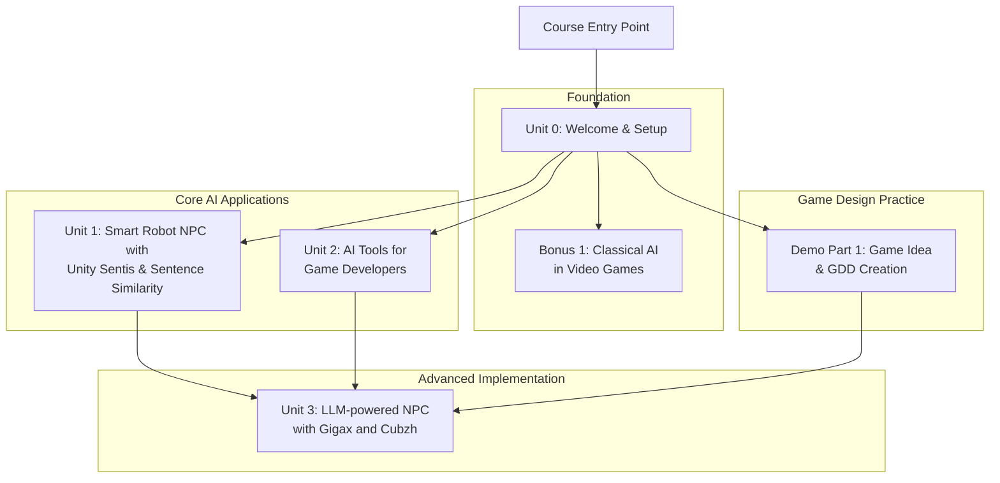
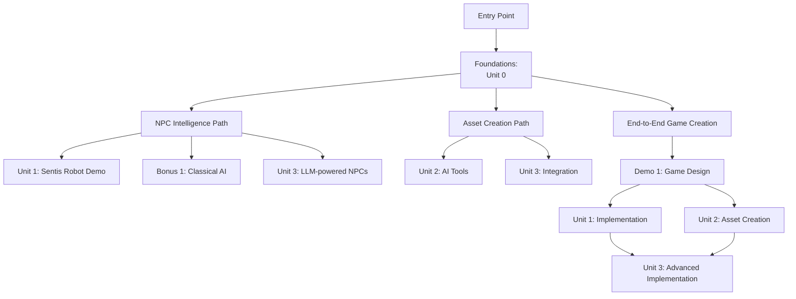
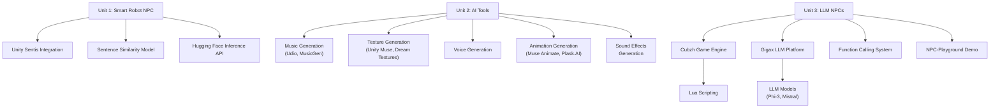
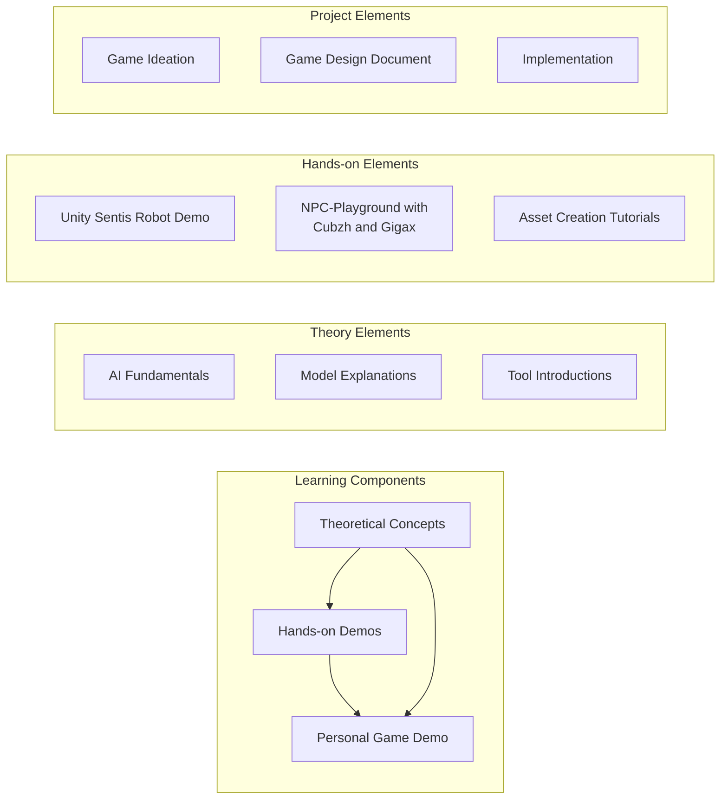
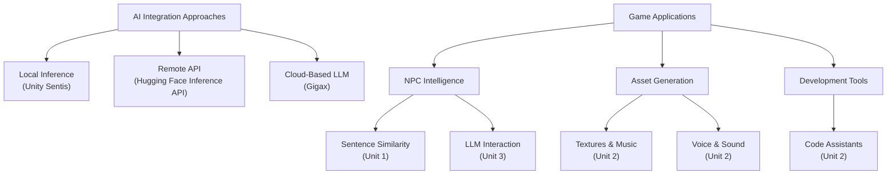

<!-- source: DeepWiki mcp.deepwiki.com · repo huggingface/making-games-with-ai-course · page 1.1 Course Structure · fetched 2026-10-26 -->

# Course Structure

Relevant source files

The following files were used as context for generating this wiki page:

- [units/en/_toctree.yml](units/en/_toctree.yml)
- [units/en/unit0/syllabus.mdx](units/en/unit0/syllabus.mdx)

This document provides a comprehensive overview of the "Making Games with AI" course structure, including unit organization, progression path, and recommended learning approach. The document covers the course's modular design and how different units relate to one another, helping learners navigate through the content effectively. For information about setting up necessary accounts and joining the course community, see [Setup and Onboarding](#1.2).

## Course Organization

The "Making Games with AI" course is structured into several core units, each focusing on specific aspects of AI integration in game development. The course follows a modular approach allowing learners to progress through conceptual foundations to practical implementations.

Sources: [units/en/_toctree.yml:1-96](), [units/en/unit0/syllabus.mdx:10-17]()

## Course Units and Content

The course is divided into distinct units, each with a specific focus and learning objectives:

| Unit | Title | Focus Areas | Key Technologies |
|------|-------|-------------|-----------------|
| 0 | Welcome to the course | Introduction, setup, syllabus | Community tools, environment setup |
| 1 | Smart Robot NPC | Sentence similarity, model integration | Unity Sentis, Hugging Face API |
| Demo Part 1 | Game Idea & GDD | Game ideation, design documentation | Game design methodology |
| Bonus 1 | Classical AI in Games | Traditional game AI techniques | Unity/Unreal AI systems |
| 2 | AI Tools for Game Developers | Asset generation | Music, voice, animation, texture tools |
| 3 | LLM-powered NPC | Advanced NPC interactions | Gigax, Cubzh |

Each unit contains both theoretical explanations and hands-on implementation examples, allowing learners to understand concepts and immediately apply them in practical scenarios.

Sources: [units/en/_toctree.yml:1-96](), [units/en/unit0/syllabus.mdx:19-27]()

## Learning Pathways and Skills Development

The course is designed to build skills progressively, with multiple possible learning pathways depending on the learner's interests and goals.

Sources: [units/en/_toctree.yml:1-96](), [units/en/unit0/syllabus.mdx:10-17]()

## Technical Components and Implementation Focus

The course connects theoretical concepts with practical implementations through various technologies and frameworks. This diagram illustrates how course units relate to specific technical components:

Sources: [units/en/_toctree.yml:19-92]()

## Learning Approach and Components

The course employs a multi-faceted learning approach combining theoretical foundations with practical implementation:

Sources: [units/en/unit0/syllabus.mdx:10-17]()

## Time Commitment and Recommended Pace

The course is designed to be self-paced, with each unit taking approximately one week to complete at the suggested pace.

| Component | Recommended Time | Work Hours |
|-----------|------------------|------------|
| Each unit | 1 week | 3-4 hours |
| Personal demo | 2-4 weeks | Varies by project scope |
| Total course | 6-10 weeks | ~25-40 hours |

The course has no deadlines or time restrictions, allowing learners to progress at their own pace and explore topics in greater depth as desired.

Sources: [units/en/unit0/syllabus.mdx:36-43](), [units/en/unit0/syllabus.mdx:5-8]()

## Implementation Options and Flexibility

The course offers flexibility in how learners can apply AI technologies to game development:

Sources: [units/en/_toctree.yml:19-92](), [units/en/unit0/syllabus.mdx:19-27]()

## Course Prerequisites and Target Audience

The course assumes some prior knowledge and is targeted at specific audience groups:

- **Recommended background**: Basic game development experience with Unity or Unreal
- **Not required**: Detailed machine learning or AI knowledge
- **Ideal for**: Game developers looking to integrate AI into their projects
- **Supplementary resources**: Additional resources are provided for those who want to explore topics in greater depth

Sources: [units/en/unit0/syllabus.mdx:29-34]()

---

