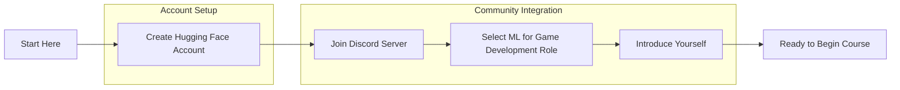
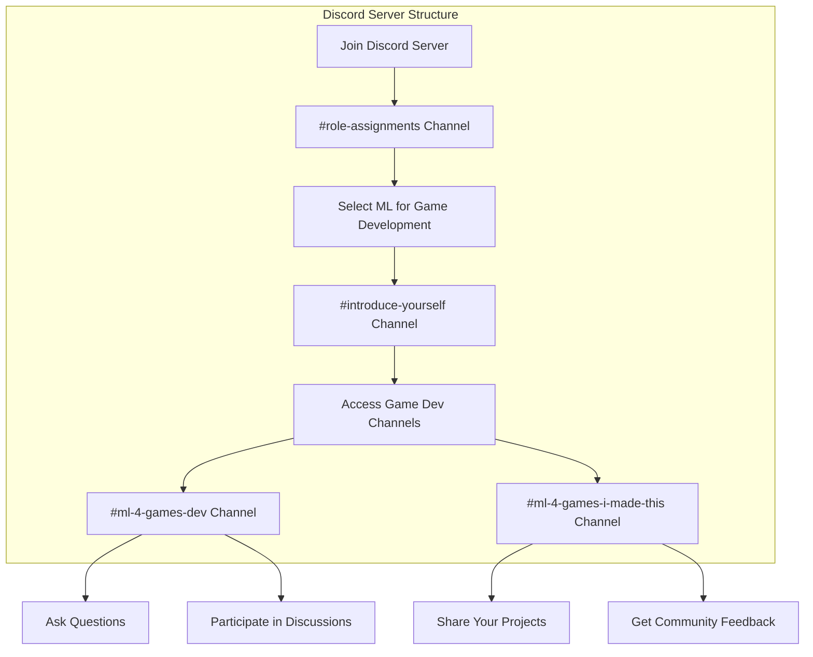
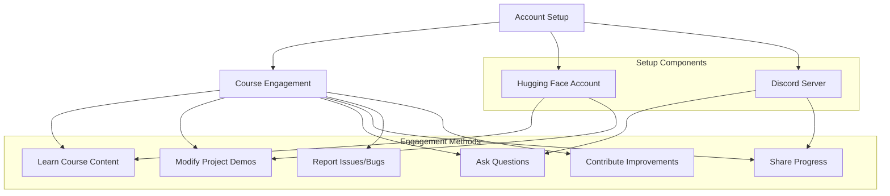

<!-- source: DeepWiki mcp.deepwiki.com · repo huggingface/making-games-with-ai-course · page 1.2 Setup and Onboarding · fetched 2026-10-26 -->

# Setup and Onboarding

<details>
<summary>Relevant source files</summary>

The following files were used as context for generating this wiki page:

- [units/en/unit0/discord101.mdx](units/en/unit0/discord101.mdx)
- [units/en/unit0/how-to-get-most.mdx](units/en/unit0/how-to-get-most.mdx)
- [units/en/unit0/setup.mdx](units/en/unit0/setup.mdx)

</details>


This page provides a detailed guide for setting up the necessary accounts and joining the community to participate in the Making Games with AI course. The setup process focuses on creating your Hugging Face account and joining the course's Discord server, which are essential platforms for accessing course materials and interacting with the community.

## Onboarding Process Overview

The onboarding process consists of two main steps: creating a Hugging Face account and joining the course's Discord server. These platforms serve as the foundation for both accessing course content and engaging with the community of learners and instructors.



Sources: [units/en/unit0/setup.mdx:4-9]()

## Hugging Face Account Setup

If you don't already have one, you'll need to create a Hugging Face account. This account gives you access to:
- Course content and resources
- Model repositories 
- Spaces for deploying interactive demos
- The Hugging Face community

To create your account:
1. Visit [https://huggingface.co/join](https://huggingface.co/join)
2. Complete the registration process
3. Verify your email address

Sources: [units/en/unit0/setup.mdx:10-12]()

## Discord Community Setup

The course's Discord server is the central hub for community interaction, where you can:
- Chat with other course participants
- Ask questions and get help
- Share your projects and progress
- Communicate directly with instructors



### Joining the Discord Server

To join the Discord community:

1. Click the invitation link: [https://discord.gg/hugging-face-879548962464493619](https://discord.gg/hugging-face-879548962464493619)
2. If you don't have a Discord account, you'll be prompted to create one
3. After joining, go to the `#role-assignments` channel
4. Select the "ML for Game Development" role to access course-specific channels
5. Introduce yourself in the `#introduce-yourself` channel

Sources: [units/en/unit0/setup.mdx:14-24](), [units/en/unit0/discord101.mdx:5-13]()

### Course-Specific Channels

Once you've selected the appropriate role, you'll have access to these dedicated channels:

| Channel | Purpose |
|---------|---------|
| `#ml-4-games-dev` | Discussions about ML for game development, asking questions |
| `#ml-4-games-i-made-this` | Sharing your projects, models, and progress |

Sources: [units/en/unit0/setup.mdx:26-29](), [units/en/unit0/discord101.mdx:15-19]()

## Discord Best Practices

To get the most out of the Discord community:

- **Active Participation**: Engage regularly in the channels to meet others interested in AI for games
- **Use Threads**: Start threads for longer conversations to keep discussions organized
- **Markdown Formatting**: Use markdown formatting for code snippets:
  ```
  ```python
  print("Hello Game AI World!")
  ```
  ```
- **Voice Channels**: Use voice channels for real-time discussions when needed
- **Community Guidelines**: Maintain a respectful environment and report any inappropriate behavior to admins

Sources: [units/en/unit0/discord101.mdx:20-26]()

## Course Engagement Model

The following diagram illustrates how the account setup connects to the broader course engagement:



Sources: [units/en/unit0/how-to-get-most.mdx:5-11]()

## Getting Help and Contributing

### Reporting Issues

If you encounter problems with the course:
- For technical bugs: [Open an issue on GitHub](https://github.com/huggingface/making-games-with-ai-course/issues/new/choose)
- For course improvement suggestions: [Open a Pull Request](https://github.com/huggingface/making-games-with-ai-course/compare)

### Getting Help

For general questions:
- Ask in the Discord `#ml-4-game-dev` channel
- Check previous discussions that may have addressed similar questions

Sources: [units/en/unit0/how-to-get-most.mdx:36-45]()

## Next Steps

Once you've completed the onboarding process, you're ready to begin the course. The course structure is designed to guide you through various units covering different aspects of AI in game development. For more details on the course structure and learning path, see [Course Structure](#1.1).

Sources: [units/en/unit0/setup.mdx:31-34]()

---

