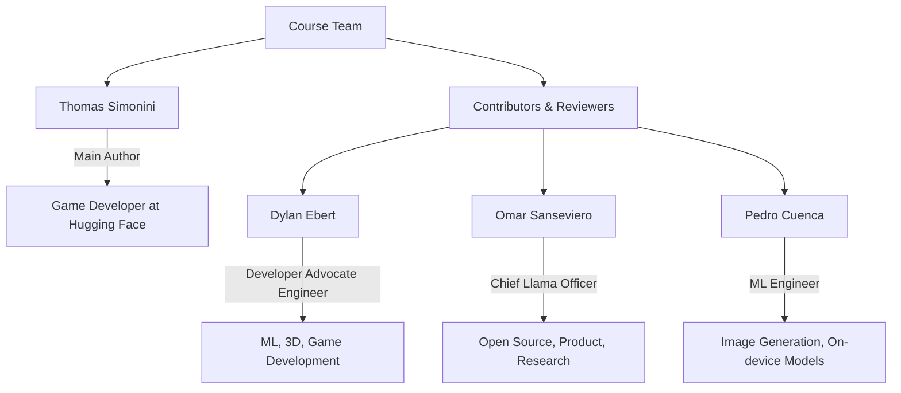
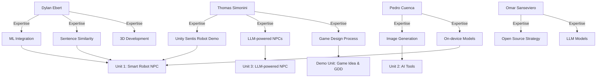
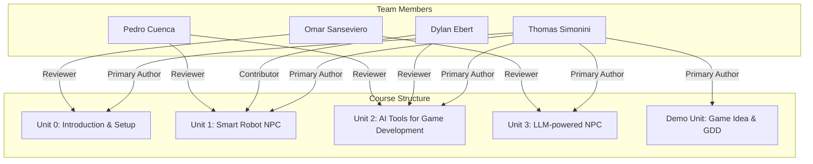

<!-- source: DeepWiki mcp.deepwiki.com · repo huggingface/making-games-with-ai-course · page 1.3 Team and Contributors · fetched 2026-10-26 -->

# Team and Contributors

Relevant source files

The following files were used as context for generating this wiki page:

- [units/en/unit0/who-are-we.mdx](units/en/unit0/who-are-we.mdx)

This document provides information about the team behind the "Making Games with AI Course," including their roles, expertise, and contributions. The team consists of AI specialists and game developers who have combined their knowledge to create this comprehensive educational resource on integrating AI into game development.

## Main Author

### Thomas Simonini

Thomas Simonini is the primary author of the course and a Game Developer at Hugging Face. His work focuses on integrating AI models into games to create new experiences.

Key responsibilities:
- Creating the core course content
- Developing demos and examples
- Creating tutorials and explanations

Thomas also maintains the AI Playbook for Game Developers blog and creates video tutorials on YouTube, exploring the intersection of AI and game development.

**Contact and Social Media:**
- X (Twitter): @ThomasSimonini
- LinkedIn: Thomas Simonini
- YouTube: Thomas Simonini
- Blog: AI Playbook for Game Developers

Sources: [units/en/unit0/who-are-we.mdx:5-17]()

## Contributors and Reviewers

### Dylan Ebert
**Role:** Contributor and Reviewer

Dylan is a Developer Advocate Engineer at Hugging Face with a PhD in Computer Science from Brown University. His expertise lies at the intersection of ML, 3D, and Game Development.

**Contact and Social Media:**
- X (Twitter): @dylan_ebert_
- TikTok: @individualkex
- YouTube: IndividualKex

### Omar Sanseviero
**Role:** Reviewer

Omar is the Chief Llama Officer at Hugging Face. He works at the intersection of Open Source, Product, Research, and technical communities, leading multidisciplinary teams and open source and science collaborations.

**Contact and Social Media:**
- X (Twitter): @osanseviero
- LinkedIn: Omar Sanseviero

### Pedro Cuenca
**Role:** Reviewer

Pedro is a Machine Learning Engineer at Hugging Face, with interests in image generation and on-device models.

**Contact and Social Media:**
- X (Twitter): @pcuenq
- LinkedIn: Pedro Cuenca

Sources: [units/en/unit0/who-are-we.mdx:19-52]()

## Team Structure and Roles

Sources: [units/en/unit0/who-are-we.mdx:5-52]()

## Team Expertise Mapping to Course Systems

Sources: [units/en/unit0/who-are-we.mdx:5-52]()

## Team Contributions to Course Units

Sources: [units/en/unit0/who-are-we.mdx:5-52]()

## Team in Course Development Context

The team's diverse expertise in game development, machine learning, and AI integration has enabled the creation of a comprehensive course that covers multiple aspects of AI in games. Thomas Simonini serves as the main driving force behind the course content, while the contributors and reviewers provide specialized knowledge in areas such as:

1. **NPC Intelligence Systems** - Expertise in implementing both on-device AI (Unity Sentis) and cloud-based LLM solutions (Gigax)
2. **Asset Generation** - Knowledge of image generation, texture creation, and on-device model implementation
3. **Educational Content Development** - Creation of accessible learning materials for complex AI concepts

For further information about the specific AI systems covered in the course, see [AI Systems for Games](#2).

The team's collective expertise covers the full spectrum of AI integration methods taught in the course, from local inference using Unity Sentis to remote API calls with Hugging Face services to LLM-powered NPCs using Gigax and Cubzh.

Sources: [units/en/unit0/who-are-we.mdx:5-52]()

---

