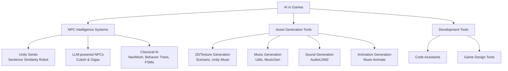
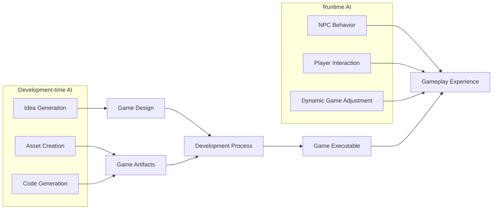
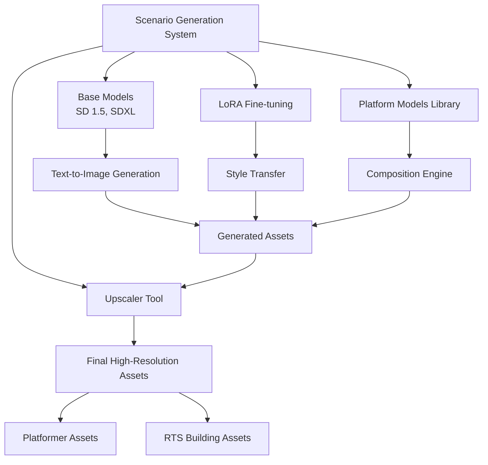
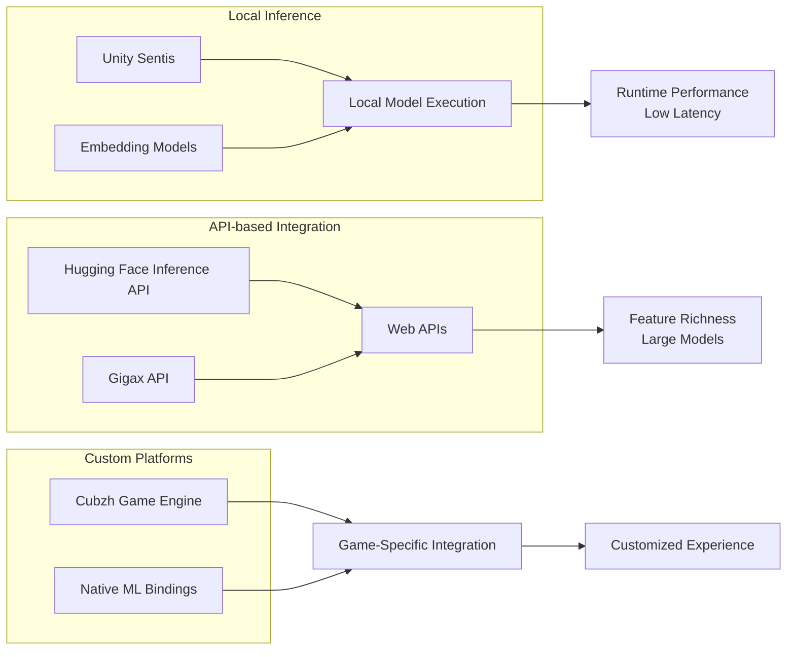

<!-- source: DeepWiki mcp.deepwiki.com · repo huggingface/making-games-with-ai-course · page 2 AI Systems for Games · fetched 2026-10-26 -->

# AI Systems for Games

Relevant source files

The following files were used as context for generating this wiki page:

- [units/en/unit2/2d-generation.mdx](units/en/unit2/2d-generation.mdx)
- [units/en/unit2/introduction.mdx](units/en/unit2/introduction.mdx)
- [units/en/unit2/music-generation.mdx](units/en/unit2/music-generation.mdx)
- [units/en/unitbonus1/introduction.mdx](units/en/unitbonus1/introduction.mdx)

## Purpose and Scope

This document provides a technical overview of the major AI systems and technologies covered in the Making Games with AI course. It introduces the primary categories of AI technologies applied to game development, their relationships, and integration approaches. For detailed information about specific implementation examples, see [Implementation Examples](#3).

Sources: [units/en/unit2/introduction.mdx:5-16](), [units/en/unitbonus1/introduction.mdx:1-17]()

## Major AI Systems Overview

The course addresses three main categories of AI systems for game development:

Sources: [units/en/unit2/introduction.mdx:5-16]()

## Primary Use Cases

AI technologies in game development serve two distinct purposes:

1. **Development-time AI** - Tools that assist developers during the creation process
2. **Runtime AI** - Systems that operate within the game during gameplay

Sources: [units/en/unit2/introduction.mdx:5-16]()

## NPC Intelligence Systems

NPC Intelligence systems provide methods for creating more believable and interactive non-player characters in games. The course covers three main approaches:

### Sentence Similarity with Unity Sentis

Uses embedding models to understand player input, allowing NPCs to respond to natural language based on semantic similarity.

### LLM-powered NPCs with Cubzh & Gigax

Leverages large language models to create NPCs capable of complex, contextual conversations and decision-making.

### Classical AI Techniques

Traditional game AI approaches including navigation meshes, behavior trees, finite state machines, and goal-oriented action planning.

For more detailed information on these systems, see [NPC Intelligence Systems](#2.1).

Sources: [units/en/unitbonus1/introduction.mdx:1-17]()

## Asset Generation Tools

Asset generation tools use AI to create or assist in creating visual, audio, and other game assets.

### 2D Asset Generation

Tools like Scenario enable developers to generate high-quality 2D assets with consistent style through text-to-image models and fine-tuning capabilities.

Sources: [units/en/unit2/2d-generation.mdx:1-62]()

### Music Generation

AI-based music generation tools create game soundtracks that match specific moods or scenes.

#### Available Tools:

| Tool | Type | Features |
|------|------|----------|
| Udio | Proprietary, Paid | Instrumental and lyric-based music generation, 600 daily generations, music extension |
| MusicGen | Open-source, Free | 15-second music clips from text prompts, style control via sound files |

Sources: [units/en/unit2/music-generation.mdx:1-34]()

### Other Asset Generation

Additional tools covered in the course include sound effect generation and animation generation, which follow similar AI-assisted workflows.

For more detailed information on asset generation tools, see [Asset Generation Tools](#2.2).

## Integration Approaches

The course teaches several technical approaches to integrate AI systems into games:

Sources: [units/en/unit2/introduction.mdx:5-16](), [units/en/unitbonus1/introduction.mdx:1-17]()

## Implementation Considerations

When implementing AI systems for games, developers must consider several technical factors:

1. **Computational Requirements**:
   - Local inference requires device-compatible models and optimization
   - Remote APIs need stable internet connectivity and latency management

2. **Model Size and Complexity**:
   - Embedding models (used for sentence similarity) can often run locally
   - Large language models typically require API access

3. **Update Frequency**:
   - Asset generation tools frequently update with new capabilities
   - Runtime AI typically requires stability and consistency

4. **Development vs. Runtime Use**:
   - Development-time AI has different integration requirements than runtime AI
   - Asset generation tools integrate with content pipelines rather than the game executable

For detailed implementation examples, see [Implementation Examples](#3).

## Tool Classification System

The course uses a consistent classification system for AI tools:

| Symbol | Meaning |
|--------|---------|
| 🤗 | Open-source |
| 🔒 | Closed-source (proprietary) |
| 💸 | Paid tool (often with a free tier) |
| 🆓 | Free tool |

Sources: [units/en/unit2/introduction.mdx:16-27]()

## Conclusion

AI systems for games span a wide range of applications from development assistance to in-game intelligence. The technologies covered in this course provide game developers with tools to enhance both the development process and the player experience. For specific implementations of these systems, refer to the dedicated pages on [NPC Intelligence Systems](#2.1), [Asset Generation Tools](#2.2), and [Development Tools](#2.3).

---

