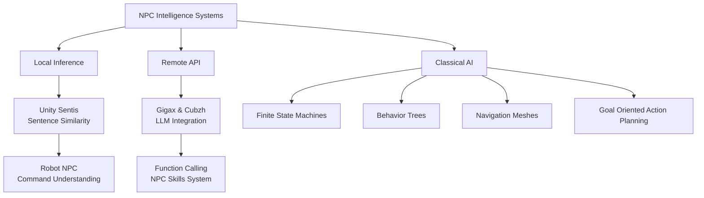
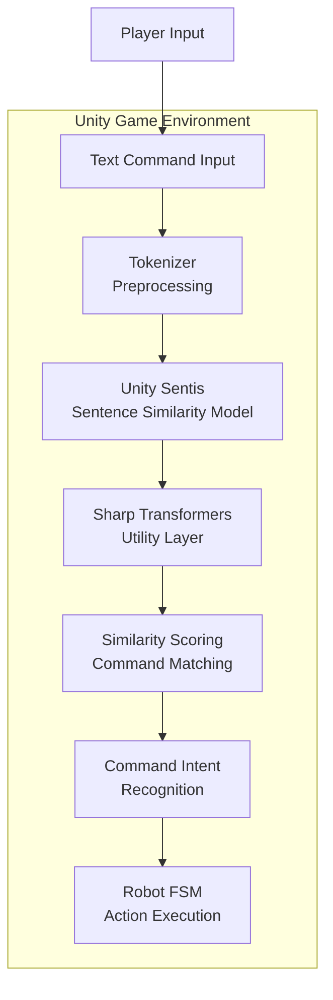
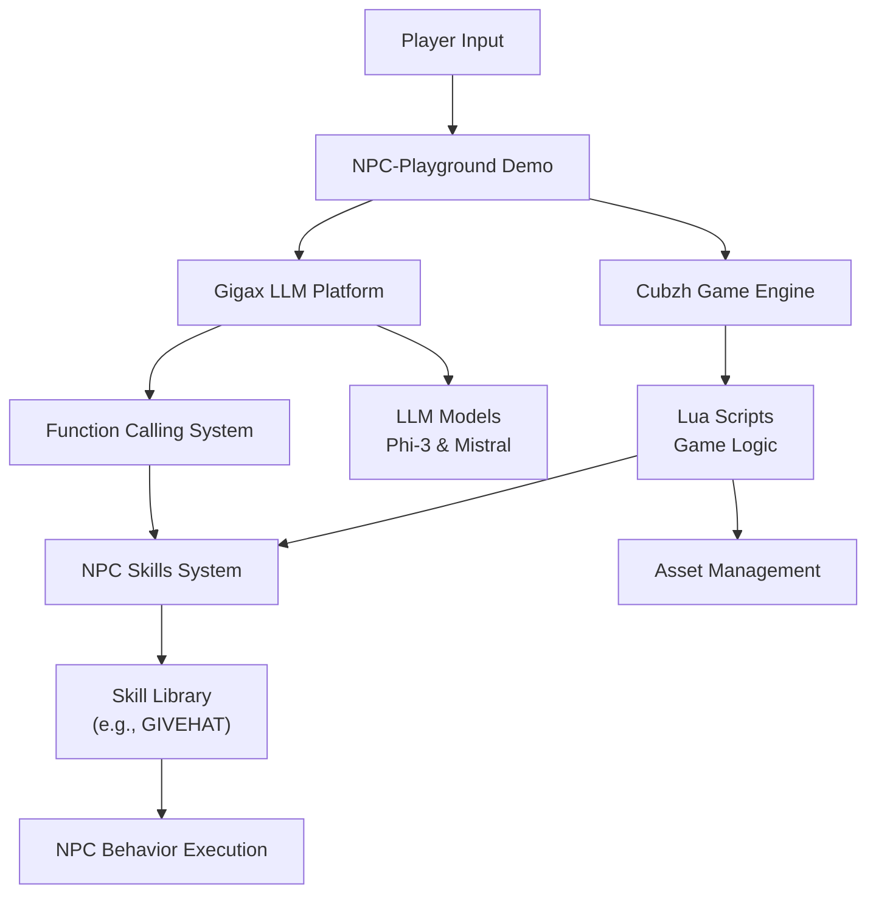
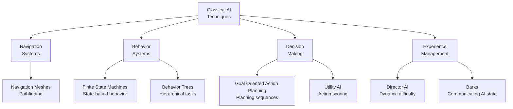
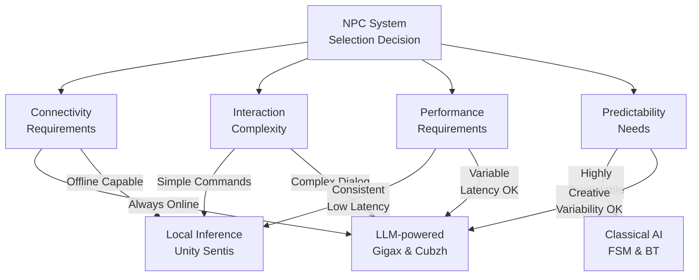

<!-- source: DeepWiki mcp.deepwiki.com · repo huggingface/making-games-with-ai-course · page 2.1 NPC Intelligence Systems · fetched 2026-10-26 -->

# NPC Intelligence Systems

<details>
<summary>Relevant source files</summary>

The following files were used as context for generating this wiki page:

- [units/en/unit1/introduction.mdx](units/en/unit1/introduction.mdx)
- [units/en/unit3/customize.mdx](units/en/unit3/customize.mdx)
- [units/en/unit3/introduction.mdx](units/en/unit3/introduction.mdx)
- [units/en/unitbonus1/ai-and-games.mdx](units/en/unitbonus1/ai-and-games.mdx)

</details>


This document provides an overview of the different approaches to creating intelligent Non-Player Characters (NPCs) in games as covered in the Making Games with AI course. It focuses on the technical architectures, implementation methods, and trade-offs between various NPC intelligence systems. For information about AI asset generation tools, see [Asset Generation Tools](#2.2).

## Overview of NPC Intelligence Approaches

NPC intelligence systems in modern game development span from classical rule-based approaches to advanced AI-driven solutions. The course covers three primary approaches to creating intelligent NPCs:

1. **Local Inference with Unity Sentis** - Running ML models directly in-game for sentence similarity
2. **LLM-powered NPCs** - Using Large Language Models through Cubzh & Gigax for sophisticated dialog
3. **Classical AI Methods** - Including Finite State Machines, Behavior Trees, and Navigation Meshes



Sources: [units/en/unit1/introduction.mdx:9-16](), [units/en/unit3/introduction.mdx:7-10](), [units/en/unitbonus1/ai-and-games.mdx:23-96]()

## Local Inference with Unity Sentis

Unity Sentis provides a framework for running machine learning models directly within a Unity game without requiring an internet connection or external API calls. This approach is ideal for simpler models like sentence similarity that need predictable response times and don't require frequent updates.

### System Architecture



Sources: [units/en/unit1/introduction.mdx:25-32]()

### Implementation Details

In the Unity robot demo, players can issue natural language commands to a robot character. The system:

1. Takes the player's text input
2. Processes it through a sentence similarity model using Unity Sentis
3. Matches the input against predefined commands
4. Executes the corresponding robot behavior

Key components include:
- Unity Sentis: Neural network inference library for running models in-game
- Sharp Transformers: Unity plugin with utilities for transformer models
- Preprocessing pipeline for text input
- Finite State Machine for robot behavior execution

This approach enables smart robots that can understand variable phrasings of commands without requiring internet connectivity.

Sources: [units/en/unit1/introduction.mdx:17-20](), [units/en/unit1/introduction.mdx:52-56]()

## LLM-powered NPCs with Cubzh & Gigax

For more sophisticated NPC interactions, the course covers using Large Language Models (LLMs) through the Cubzh game engine and Gigax LLM platform. This approach enables NPCs to have complex contextual conversations, understand intent, and perform a wide range of actions.

### System Architecture



Sources: [units/en/unit3/introduction.mdx:7-14](), [units/en/unit3/customize.mdx:15-24]()

### NPC Skills System

The NPC-Playground demo showcases a flexible skill system where NPCs can be taught new capabilities through the Gigax function calling API and Lua scripting. Each skill is defined in Lua and made available to the LLM through function calling.

Skills consist of:
- Name and description for the LLM to understand when to use it
- Parameters the LLM can populate
- Implementation code in Lua that executes the actual behavior

For example, the `GIVEHAT` skill allows NPCs to give different types of hats to players:

```
skill definition in cubzh.lua:
- Name: GIVEHAT
- Implementation: Places hat asset on player character
```

Sources: [units/en/unit3/customize.mdx:45-61]()

### Customization Capabilities

The NPC-Playground system allows for extensive customization:

1. **Modify existing skills** - Change parameters or assets (e.g., switching hat types)
2. **Create new skills** - Define entirely new capabilities for NPCs
3. **Asset replacement** - Swap visual assets used by skills

This customization is done through editing the Lua scripts and requires minimal coding knowledge, making it accessible for game developers to experiment with different NPC behaviors.

Sources: [units/en/unit3/customize.mdx:65-70]()

## Classical AI Approaches for NPCs

While modern ML and LLM approaches offer new capabilities, classical AI techniques remain valuable and often complementary to newer methods.

### Key Classical Techniques



Sources: [units/en/unitbonus1/ai-and-games.mdx:23-62](), [units/en/unitbonus1/ai-and-games.mdx:70-112]()

### Comparison with Modern Approaches

| Approach | Pros | Cons | Best For |
|----------|------|------|----------|
| **Classical AI** | Predictable, controllable, efficient | Limited expressiveness, requires explicit design | Navigation, combat AI, predictable behaviors |
| **Local Inference** | Works offline, consistent performance | Limited model size, less adaptable | Command recognition, specific interactions |
| **LLM-powered** | Highly flexible, conversational | Requires internet, potential latency, less predictable | Rich dialog, complex interactions, storytelling |

Sources: [units/en/unitbonus1/ai-and-games.mdx:10-22](), [units/en/unit1/introduction.mdx:13-16](), [units/en/unit3/introduction.mdx:7-10]()

## Integration Considerations

When implementing NPC intelligence systems, consider:

1. **Performance requirements** - Local inference provides more consistent performance but with limited capabilities
2. **Connectivity assumptions** - LLM approaches typically require internet connectivity
3. **Predictability needs** - Classical approaches offer more deterministic behavior
4. **Hybrid approaches** - Combining methods (e.g., LLMs for dialog with classical AI for navigation)



Sources: [units/en/unit1/introduction.mdx:13-16](), [units/en/unit3/introduction.mdx:7-14]()

## Conclusion

NPC intelligence systems represent a spectrum of approaches from classical techniques to cutting-edge AI models. This course provides implementations of multiple systems across this spectrum, allowing developers to choose the approach that best fits their game's needs and constraints.

When selecting an NPC intelligence system, consider:
- The type of interactions your game requires
- Performance and connectivity constraints
- The balance between predictability and flexibility
- Development resources and expertise available

The implementations in this course demonstrate both traditional approaches and modern AI techniques, providing a solid foundation for creating compelling NPCs in your games.

---

