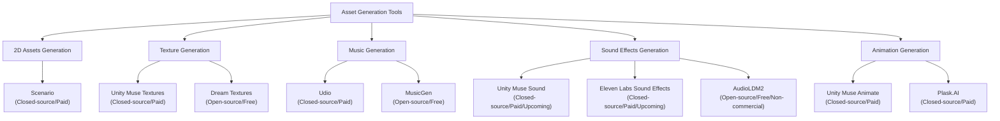
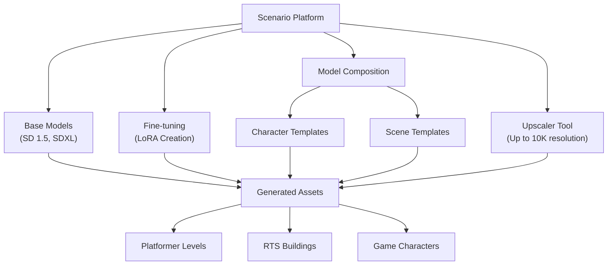
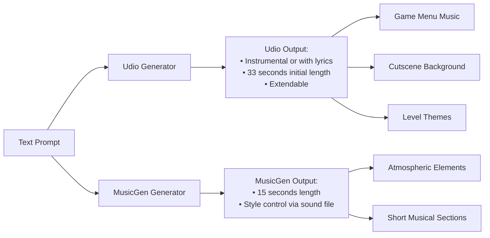
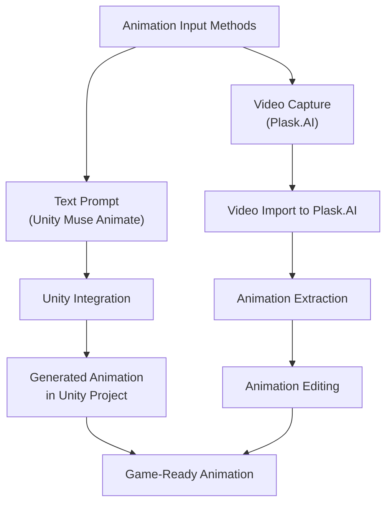
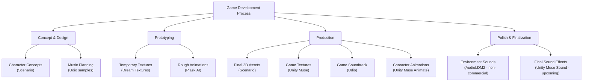

<!-- source: DeepWiki mcp.deepwiki.com · repo huggingface/making-games-with-ai-course · page 2.2 Asset Generation Tools · fetched 2026-10-26 -->

# Asset Generation Tools

Relevant source files

The following files were used as context for generating this wiki page:

- [units/en/unit2/2d-generation.mdx](units/en/unit2/2d-generation.mdx)
- [units/en/unit2/animation-generation.mdx](units/en/unit2/animation-generation.mdx)
- [units/en/unit2/conclusion.mdx](units/en/unit2/conclusion.mdx)
- [units/en/unit2/introduction.mdx](units/en/unit2/introduction.mdx)
- [units/en/unit2/music-generation.mdx](units/en/unit2/music-generation.mdx)
- [units/en/unit2/sound-generation.mdx](units/en/unit2/sound-generation.mdx)
- [units/en/unit2/texture-generation.mdx](units/en/unit2/texture-generation.mdx)

## Purpose and Scope

This document covers AI-powered tools for generating game assets, including 2D graphics, textures, music, sound effects, and animations. These tools help game developers accelerate asset creation and enable small teams to produce high-quality content that would otherwise require specialized skills or larger teams. For information about AI systems for NPC intelligence, see [NPC Intelligence Systems](#2.1). For AI tools that assist with development processes, see [Development Tools](#2.3).

Sources: [units/en/unit2/introduction.mdx:9-15](), [units/en/unit2/conclusion.mdx:3-5]()

## Overview of Asset Generation Tools

AI asset generation tools are categorized by the type of content they produce. The course covers several key tools across five major categories, focusing on solutions that balance quality with practical implementation.

Sources: [units/en/unit2/introduction.mdx:16-27](), [units/en/unit2/2d-generation.mdx:1-5](), [units/en/unit2/texture-generation.mdx:1-3](), [units/en/unit2/music-generation.mdx:1-4](), [units/en/unit2/sound-generation.mdx:1-7](), [units/en/unit2/animation-generation.mdx:1-6]()

## Tool Classification System

The course uses a consistent classification system to help identify the characteristics of each tool:

| Symbol | Meaning |
|--------|---------|
| 🤗 | Open-source |
| 🔒 | Closed-source (proprietary) |
| 💸 | Paid tool (often with a free tier) |
| 🆓 | Free tool |
| 🛑 | Upcoming/Not yet available |

Sources: [units/en/unit2/introduction.mdx:18-27]()

## 2D Assets Generation

### Scenario (Closed-source/Paid)

Scenario is a platform for generating 2D game assets using text-to-image models while maintaining stylistic consistency across multiple generations.

Key features:
- Based on Stable Diffusion (SD 1.5 and SDXL) open-source models
- Fine-tuning capabilities for creating custom LoRA models
- Composition tools for combining multiple models
- Upscaling tools to enhance resolution up to 10K and fix artifacts
- Consistent character generation across multiple images

Use cases:
- Platformer game environments
- 2D RTS building assets
- Character design and iteration

Sources: [units/en/unit2/2d-generation.mdx:10-62]()

## Texture Generation

Texture generation tools allow developers to create stylized or PBR (Physically Based Rendering) textures for 3D game assets using text prompts.

### Unity Muse Textures Generator (Closed-source/Paid)

Unity's integrated solution for generating textures directly within the Unity editor:
- Text-prompt based texture generation 
- Integration with Unity's asset pipeline

### Dream Textures (Open-source/Free)

An open-source alternative for texture generation:
- Text-prompt based texture creation
- Various texture types supported
- GitHub-hosted project for community contributions

| Tool | License | Integration | Input Method | Notable Features |
|------|---------|-------------|--------------|------------------|
| Unity Muse Textures | Closed-source/Paid | Native Unity | Text prompts | Direct integration with Unity projects |
| Dream Textures | Open-source/Free | External tool | Text prompts | Various texture types, community-supported |

Sources: [units/en/unit2/texture-generation.mdx:1-19]()

## Music Generation

Music generation tools create game soundtracks and musical elements that match specific moods or atmospheric requirements.

### Udio (Closed-source/Paid)

Features:
- Text-prompt based music generation
- Can generate instrumental music or music with lyrics
- 600 daily generations quota
- Music extension capabilities

### MusicGen (Open-source/Free)

Created by Meta AI, this tool offers:
- 15-second music generation from text prompts
- Sound file input for style control
- Available on Hugging Face Spaces for easy access

Sources: [units/en/unit2/music-generation.mdx:1-34]()

## Sound Effects Generation

Sound effects generation tools create immersive audio elements for game environments and interactions.

### Current and Upcoming Tools

Several tools are mentioned in the course, though some are still in development:

| Tool | Status | License | Features |
|------|--------|---------|----------|
| Unity Muse Sound | Upcoming | Closed-source/Paid | Text-prompt based sound generation within Unity |
| Eleven Labs Sound Effects | Upcoming (waitlist) | Closed-source/Paid | High-quality sound effects from text prompts |
| AudioLDM2 | Available | Open-source/Free (non-commercial license) | High-quality sound effects, restricted to non-commercial use |

Sources: [units/en/unit2/sound-generation.mdx:1-26]()

## Animation Generation

Animation tools address one of the most challenging aspects of game development by automating or simplifying animation creation.

### Unity Muse Animate (Closed-source/Paid)

- Generates animations based on text prompts
- Direct integration with Unity projects
- Will be used in an upcoming unit of the course

### Plask.AI (Closed-source/Paid)

- Video-based motion capture alternative
- Extracts animations from smartphone video recordings
- Editing capabilities for extracted animations

Sources: [units/en/unit2/animation-generation.mdx:1-22]()

## Integration in Game Development Workflow

The asset generation tools covered in this document are designed to be integrated into different stages of the game development process, addressing specific production challenges.

Sources: [units/en/unit2/introduction.mdx:12-14](), [units/en/unit2/conclusion.mdx:3-5]()

## Tool Comparison and Selection

When selecting asset generation tools for a project, developers should consider several factors:

| Consideration | Description |
|---------------|-------------|
| License | Is the tool open-source or proprietary? Can it be used for commercial projects? |
| Cost | Free vs. paid (often with free tiers) |
| Integration | Does it integrate with your game engine or workflow? |
| Quality | Output quality and consistency |
| Customization | Ability to fine-tune or control the output |
| Production Stage | Concept art vs. final assets |

The course provides a curated selection with at least two options per category to give developers flexibility based on their specific needs and constraints.

Sources: [units/en/unit2/introduction.mdx:16-27](), [units/en/unit2/conclusion.mdx:9-11]()

## Practical Application in Course

These asset generation tools will be utilized in upcoming units for two game demos, allowing students to see practical applications beyond theoretical knowledge.

Sources: [units/en/unit2/conclusion.mdx:3-7]()

## Additional Resources

For more AI tools for game developers beyond those covered in this document, the course recommends checking the "Awesome AI Tools for Game Developers list":
- GitHub repository: [https://github.com/simoninithomas/awesome-ai-tools-for-game-dev](https://github.com/simoninithomas/awesome-ai-tools-for-game-dev)
- Contributors are encouraged to add tools to this list

Sources: [units/en/unit2/conclusion.mdx:9-11]()

---

