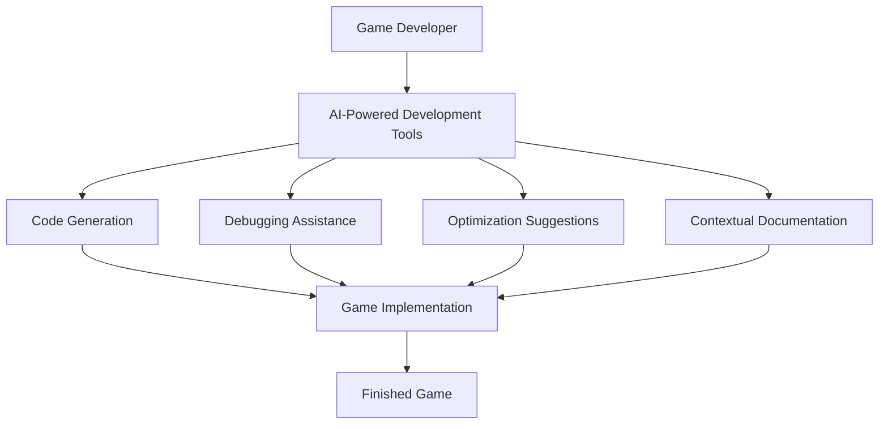
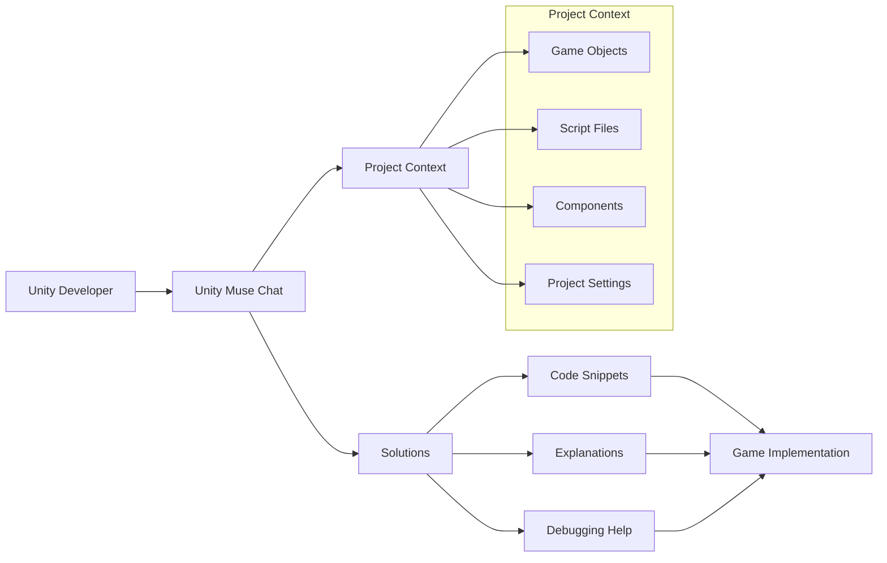
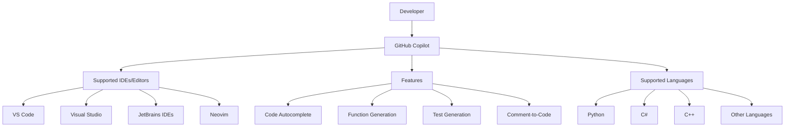
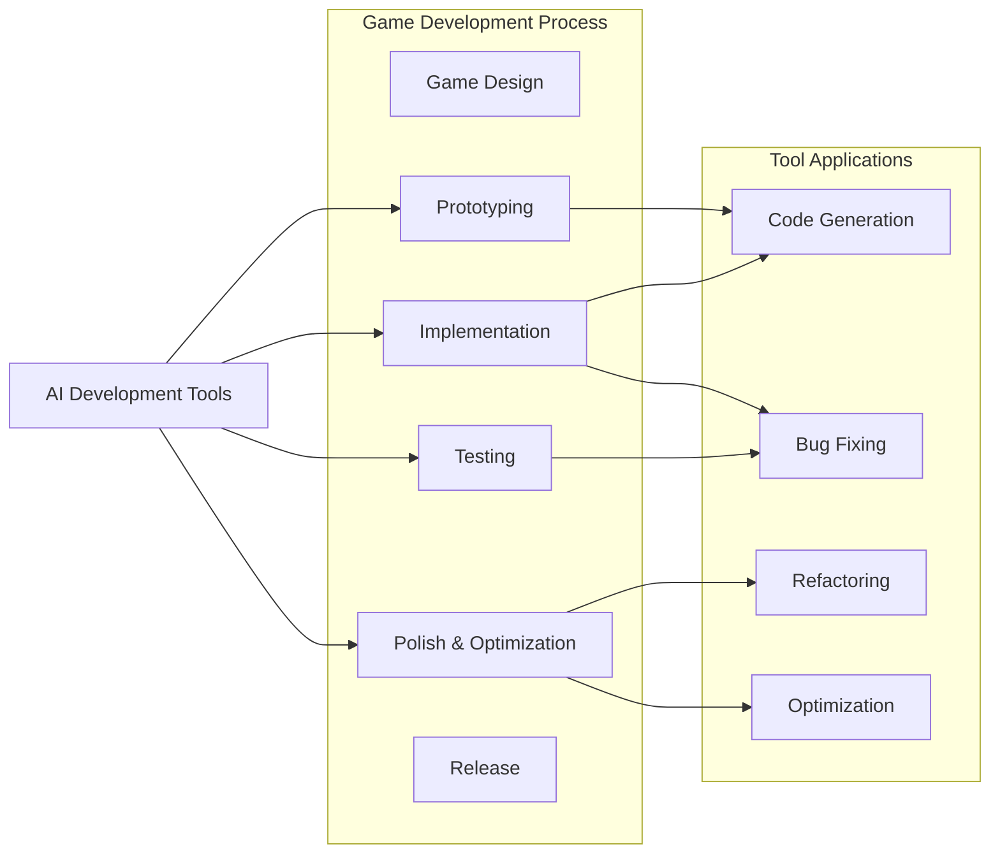
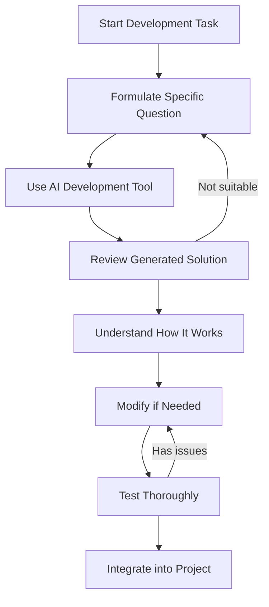

<!-- source: DeepWiki mcp.deepwiki.com · repo huggingface/making-games-with-ai-course · page 2.3 Development Tools · fetched 2026-10-26 -->

# Development Tools

Relevant source files

The following files were used as context for generating this wiki page:

- [units/en/unit2/code-assistants.mdx](units/en/unit2/code-assistants.mdx)
- [units/en/unitbonus1/ai-in-unity.mdx](units/en/unitbonus1/ai-in-unity.mdx)
- [units/en/unitbonus1/ai-in-unreal.mdx](units/en/unitbonus1/ai-in-unreal.mdx)

## Purpose and Scope

This document covers AI-powered development tools that assist in the game development process. While the [NPC Intelligence Systems](#2.1) and [Asset Generation Tools](#2.2) focus on creating game content and gameplay features, this section examines tools that enhance the development workflow itself. We'll explore how AI can help developers write code, debug issues, and optimize their development process.

## Overview of AI-Powered Development Assistants

AI development tools serve as intelligent assistants that can significantly increase developer productivity by automating repetitive tasks, suggesting solutions to coding problems, and providing contextual assistance based on the current project state.

Sources: [units/en/unit2/code-assistants.mdx:1-14]()

## Code Assistants

Code assistants represent the primary category of AI development tools covered in this course. These tools use large language models trained on vast code repositories to assist developers in writing, understanding, and debugging code.

### Unity Muse Chat

Unity Muse Chat is an AI conversation assistant integrated directly into the Unity Editor. It's designed specifically for Unity development and has several key advantages:

- **Context-aware**: Understands your project structure, game objects, and components
- **In-editor integration**: Accessible directly within the Unity development environment
- **Unity-specific knowledge**: Trained on Unity documentation and common patterns
- **Code generation**: Creates code snippets tailored to your specific project needs
- **Debugging assistance**: Helps identify and fix issues in your code

Unity Muse Chat is particularly valuable for developers who need assistance implementing specific game features or fixing issues in their Unity projects. The tool can generate complete code solutions with explanations of how the code works, as demonstrated in the example of creating a flickering light effect.

**Availability**: Unity Muse is a paid tool with a 15-day free trial.

Sources: [units/en/unit2/code-assistants.mdx:5-44]()

### GitHub Copilot

GitHub Copilot is a broader coding assistant that works across various programming languages and development environments. It's particularly useful for:

- Non-Unity game engines like Unreal Engine
- General programming tasks in languages like Python, C++, C#, and others
- Projects developed outside of specialized game engines

GitHub Copilot integrates directly with popular code editors and IDEs to provide real-time code suggestions as you type. Unlike Unity Muse Chat, it's not specific to game development but offers broader language support.

**Availability**: GitHub Copilot is a paid subscription service, but is free for verified students, teachers, and maintainers of popular open-source projects.

Sources: [units/en/unit2/code-assistants.mdx:46-54]()

## Integration with Game Development Workflow

AI development tools can be integrated throughout the game development process to enhance productivity at different stages.

Sources: [units/en/unit2/code-assistants.mdx:1-54]()

## Comparison of Tools

| Feature | Unity Muse Chat | GitHub Copilot |
|---------|----------------|----------------|
| **Environment** | Unity Editor | Multiple IDEs/editors |
| **Context Awareness** | High (Unity-specific) | Medium (general code) |
| **Game Engine Focus** | Unity | Any engine/framework |
| **Language Support** | C# (Unity-focused) | Multiple languages |
| **Integration** | Direct in Unity Editor | Editor plugins |
| **Pricing** | Paid (15-day free trial) | Paid (free for students, teachers, and some open-source contributors) |
| **Best For** | Unity-specific development | Multi-platform development |

Sources: [units/en/unit2/code-assistants.mdx:5-54]()

## Best Practices for Using AI Development Tools

When using AI-powered development tools like Unity Muse Chat and GitHub Copilot, consider the following best practices:

1. **Review generated code**: Always understand and review any AI-generated code before integrating it
2. **Ask specific questions**: Provide clear context and specific requirements for better results
3. **Iterative refinement**: Use the tools as a starting point and refine the suggestions
4. **Learn from the solutions**: Use explanations to improve your own understanding of the code
5. **Test thoroughly**: AI-generated code may contain subtle bugs or assumptions

Sources: [units/en/unit2/code-assistants.mdx:25-37]()

## Related Classical AI Tools for Game Development

While the focus of this section is on AI-powered development tools, it's worth noting that there are also tools for implementing classical AI techniques in game engines:

- **Unity**: Visual behavior tree editors, navigation mesh tools
- **Unreal Engine**: Built-in behavior trees, Environment Query System (EQS), AI perception systems

For more information on these classical AI implementations, see:
- [Classical AI in Unity](#unitbonus1)
- [Classical AI in Unreal Engine](#unitbonus1)

Sources: [units/en/unitbonus1/ai-in-unity.mdx:1-9](), [units/en/unitbonus1/ai-in-unreal.mdx:1-12]()

## Example Workflow: Using Unity Muse Chat

The course demonstrates an example of using Unity Muse Chat to create a flickering light effect for a space station environment:

1. The developer selects the point light in their Unity scene
2. They ask Muse how to create a flickering effect
3. Muse generates a complete C# script with explanations of how the code works
4. The developer applies the script to the light object
5. The result is a realistic flickering effect that enhances the game atmosphere

This workflow demonstrates how AI development tools can quickly solve specific implementation challenges with minimal effort from the developer, allowing more time to be spent on creative aspects of game development.

Sources: [units/en/unit2/code-assistants.mdx:15-37]()

## Conclusion

AI-powered development tools represent a significant advancement in game development workflows, offering assistance with coding, debugging, and optimization. The course covers Unity Muse Chat and GitHub Copilot as examples of these tools, demonstrating how they can be integrated into the development process to increase productivity and solve implementation challenges more efficiently.

By leveraging these tools appropriately, game developers can focus more on creative aspects of game design while using AI to handle more routine coding tasks and provide solutions to technical challenges.

---

