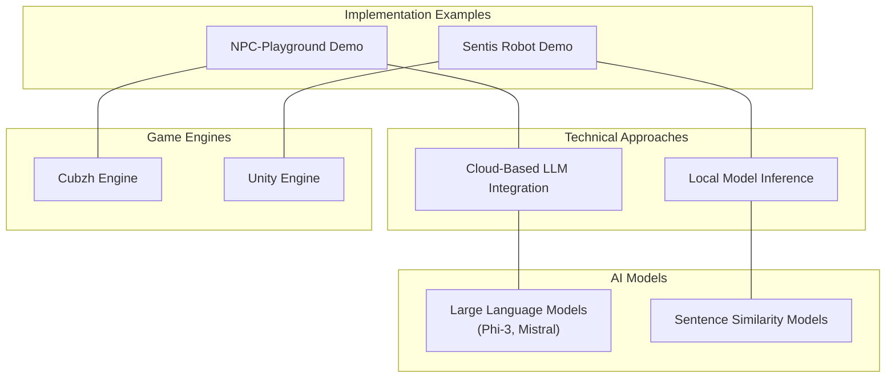
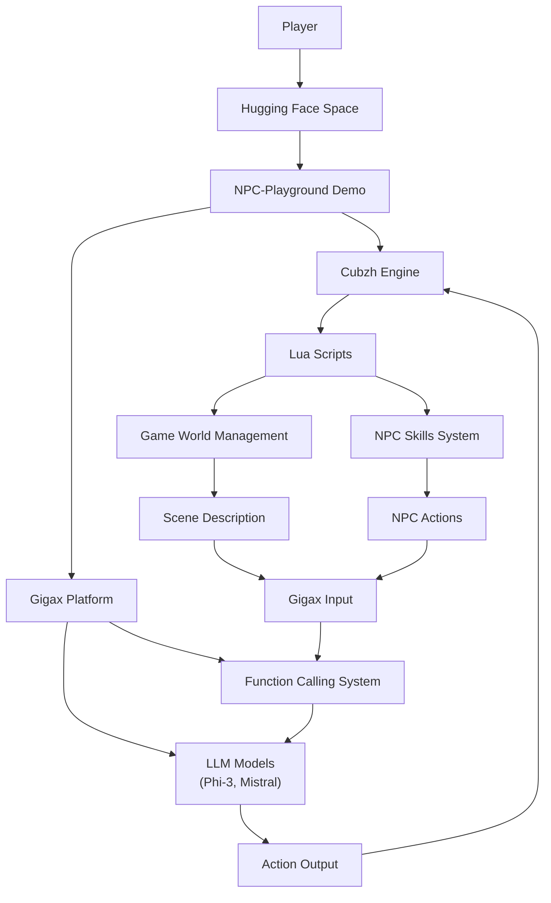
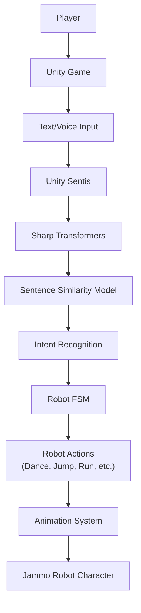
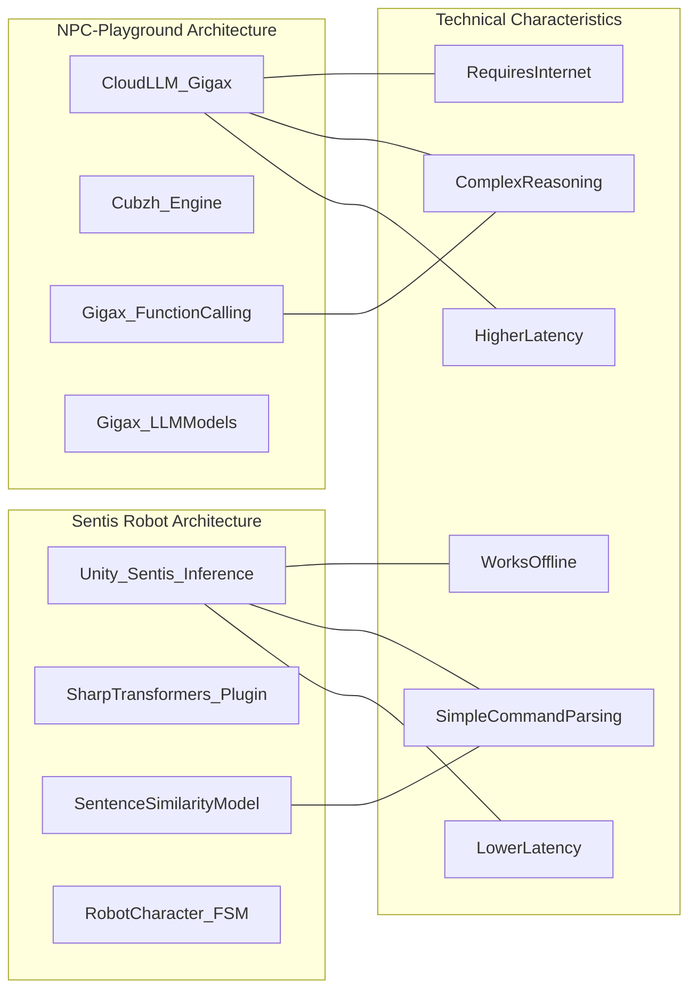

<!-- source: DeepWiki mcp.deepwiki.com · repo huggingface/making-games-with-ai-course · page 3 Implementation Examples · fetched 2026-10-26 -->

# Implementation Examples

Relevant source files

The following files were used as context for generating this wiki page:

- [units/en/unit1/introduction.mdx](units/en/unit1/introduction.mdx)
- [units/en/unit3/conclusion.mdx](units/en/unit3/conclusion.mdx)
- [units/en/unit3/demo.mdx](units/en/unit3/demo.mdx)

## Purpose and Scope

This document explores the practical AI implementations demonstrated in the Making Games with AI course. These examples serve as concrete applications of AI concepts in actual game projects, providing developers with ready-to-use patterns for their own games. This page focuses on two major implementations:

1. The NPC-Playground demo using Cubzh and Gigax
2. The Sentis Robot demo using Unity Sentis and sentence similarity

For information about the theoretical aspects of AI systems for games, see [AI Systems for Games](#2). For details about specific NPC intelligence systems, see [NPC Intelligence Systems](#2.1).

## Overview of Main Implementation Examples

The course features two primary implementation examples that demonstrate different approaches to integrating AI into games:

Sources: `units/en/unit3/demo.mdx:1-53`, `units/en/unit1/introduction.mdx:1-56`

These implementations demonstrate two distinct approaches to AI integration in games:

1. **NPC-Playground**: A cloud-based implementation using LLMs via Gigax and the Cubzh game engine to create intelligent NPCs with complex conversational abilities.

2. **Sentis Robot Demo**: A local inference implementation using Unity Sentis to run a sentence similarity model directly within the game, enabling natural language commands without requiring internet connectivity.

## NPC-Playground Demo

The NPC-Playground demo showcases the integration of Large Language Models (LLMs) into game NPCs using Cubzh as the game engine and Gigax as the LLM platform.

### Technical Architecture

Sources: `units/en/unit3/demo.mdx:4-53`

### Key Components

#### Cubzh
Cubzh is a cross-platform UGC (User Generated Content) game engine that serves as the environment in which the NPCs operate. As described in the demo documentation, Cubzh is:

- A cross-platform engine where users can create game experiences
- Powered by a Lua scripting API for game logic
- Equipped with a library of voxel items (+25K items)
- Available on multiple platforms (Steam, Epic Game Store, mobile, and browser)

In the NPC-Playground, Cubzh handles the game environment, renders the world, processes player inputs, and executes the actions recommended by the LLM.

#### Gigax
Gigax is the platform that powers the LLM-backed NPCs. Key aspects include:

- Fine-tuned large language models specifically for NPC interactions
- Uses the "function calling" principle to translate natural language into game actions
- Offers two open-sourced models on the Hugging Face Hub:
  - Phi-3 fine-tuned model
  - Mistral-7B fine-tuned model

#### Input/Output Flow
The communication between Cubzh and Gigax follows this pattern:

1. **Input to Gigax**:
   - Text description of the 3D scene
   - Description of recent events
   - List of available NPC actions (e.g., `<say>`, `<jump>`, `<attack>`)

2. **Output from Gigax**:
   - One of the available actions with parameters referencing entities in the scene
   - Example: `say NPC1 "Hello, Captain!"`

3. **Execution in Cubzh**:
   - The Lua scripts interpret and execute the action
   - The corresponding animation or behavior is triggered in the game

#### Hugging Face Spaces Integration
The demo is hosted on Hugging Face Spaces, providing an accessible environment for users to interact with the implementation and clone it for their own experiments.

Sources: `units/en/unit3/demo.mdx:14-52`, `units/en/unit3/conclusion.mdx:5-23`

## Sentis Robot Demo

The Sentis Robot Demo showcases the integration of AI models directly into a Unity game using local inference rather than cloud-based API calls.

### Technical Architecture

Sources: `units/en/unit1/introduction.mdx:9-32`

### Key Components

#### Unity and Sentis
The demo uses Unity as the game engine and Unity Sentis to run AI models locally:

- Built with Unity 2022.3+ 
- Uses Unity Sentis, a neural network inference library
- Enables running AI models directly inside the game without requiring internet connectivity

#### Sharp Transformers
Sharp Transformers is a Unity plugin providing utilities for running Transformer models from Hugging Face in Unity games:

- Handles preprocessing of input text
- Manages model inference
- Bridges between Unity Sentis and Transformer models

#### Sentence Similarity Model
The core AI functionality comes from a sentence similarity model that:

- Compares player input against predefined commands
- Identifies the closest matching intent
- Allows for natural language understanding without exact command matching

#### Robot Character (Jammo)
The demo features a robot character named Jammo that:

- Responds to player text commands
- Can perform various actions like dancing, jumping, and running
- Uses a finite state machine to manage different behavior states

### Interaction Flow
1. Player provides text input
2. The input is processed by the sentence similarity model through Sentis
3. The model identifies the intended command
4. The robot's FSM transitions to the appropriate state
5. The robot performs the corresponding animation/action

### Extensions and Variations
The documentation shows that the Sentis Robot Demo can be extended or modified in various ways:

- A Dungeon Escape demo where the player gives commands to escape a jail
- A stealth game where commands guide a character to sneak into a party
- Integration with Speech-to-Text for voice command input

Sources: `units/en/unit1/introduction.mdx:39-54`

## Comparison and Use Cases

The two implementation examples demonstrate different approaches to AI integration in games, each with unique advantages and appropriate use cases.

Sources: `units/en/unit3/demo.mdx:1-53`, `units/en/unit1/introduction.mdx:1-56`

### Key Differences

| Feature | NPC-Playground | Sentis Robot Demo |
|---------|----------------|-------------------|
| **Game Engine** | Cubzh | Unity |
| **AI Approach** | Cloud-based LLM | Local model inference |
| **AI Complexity** | High (full LLM capabilities) | Moderate (sentence similarity) |
| **Internet Requirement** | Required | Not required |
| **Latency** | Higher (API calls) | Lower (local inference) |
| **Customization** | NPC personas, skills | Command mappings, FSM states |
| **Scale** | Multiple complex NPCs | Single-agent focused |
| **Hosting** | Hugging Face Spaces | Built application |

### When to Use Each Approach

#### NPC-Playground Approach (Cloud LLM)
Best suited for:
- Complex NPCs with conversational abilities
- Games where NPCs need to reason about complex situations
- When internet connectivity can be assumed
- When API call latency is acceptable
- When you need to prototype rapidly using Hugging Face Spaces

#### Sentis Robot Demo Approach (Local Inference)
Best suited for:
- Mobile games where offline play is important
- Games requiring low latency responses
- Simple command recognition systems
- Voice-controlled game mechanics
- Environments with limited or no internet connectivity

Both implementations provide valuable starting points for developers looking to integrate AI into their games, with different trade-offs in terms of complexity, capabilities, and technical requirements.

Sources: `units/en/unit3/demo.mdx:1-53`, `units/en/unit1/introduction.mdx:1-56`, `units/en/unit3/conclusion.mdx:1-28`

---

