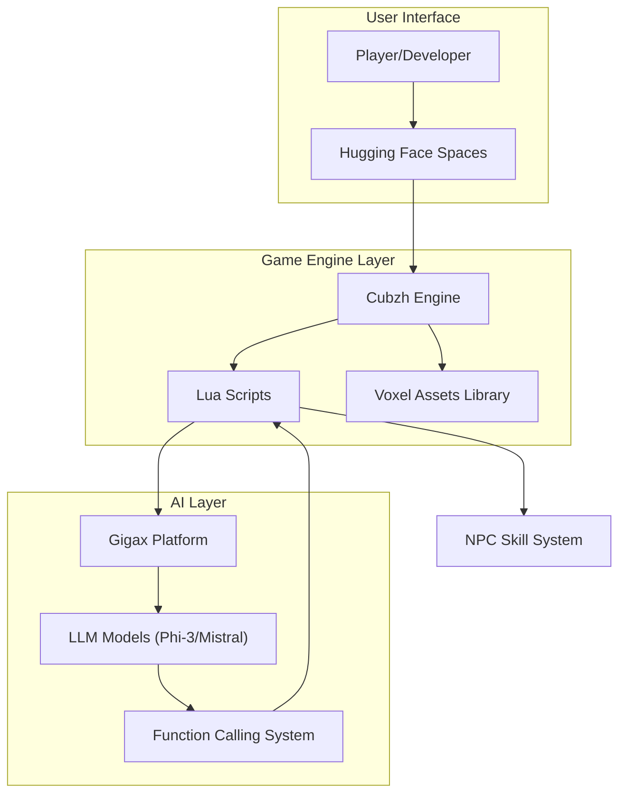
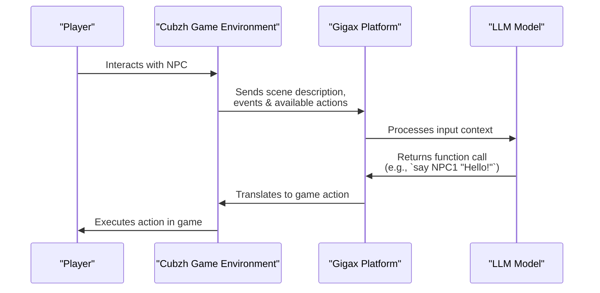
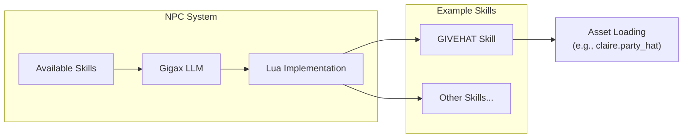
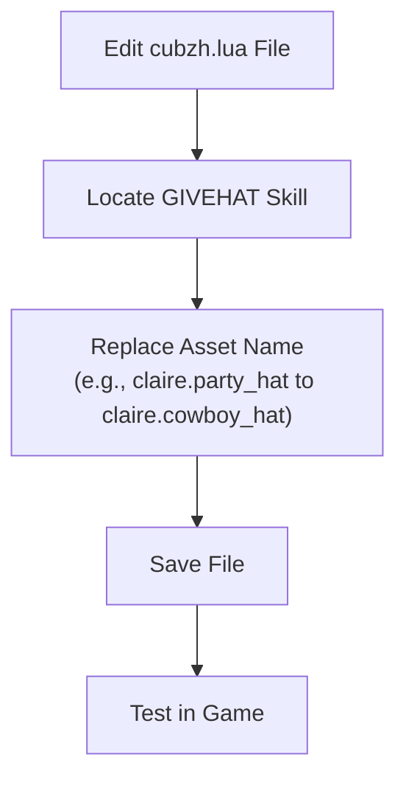
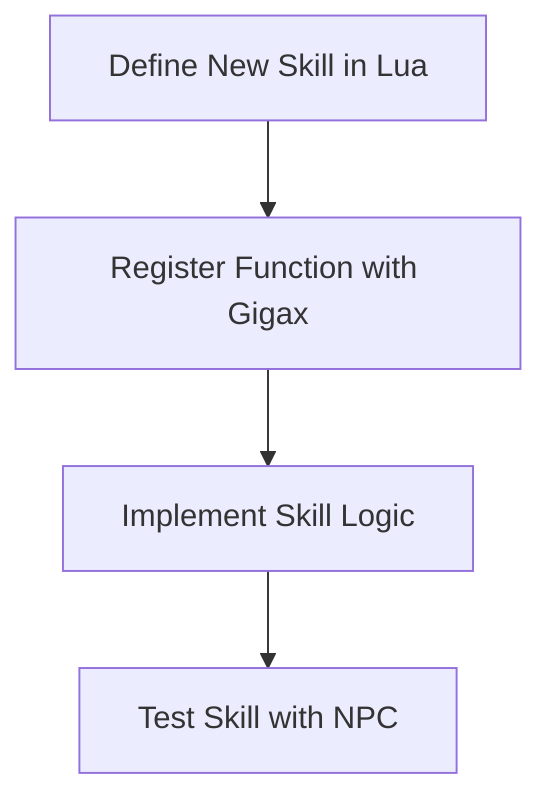

<!-- source: DeepWiki mcp.deepwiki.com · repo huggingface/making-games-with-ai-course · page 3.1 NPC-Playground · fetched 2026-10-26 -->

# NPC-Playground

<details>
<summary>Relevant source files</summary>

The following files were used as context for generating this wiki page:

- [units/en/unit3/conclusion.mdx](units/en/unit3/conclusion.mdx)
- [units/en/unit3/customize.mdx](units/en/unit3/customize.mdx)
- [units/en/unit3/demo.mdx](units/en/unit3/demo.mdx)
- [units/en/unit3/introduction.mdx](units/en/unit3/introduction.mdx)

</details>


## Purpose and Scope

NPC-Playground is a collaborative demonstration system created by the Cubzh and Gigax teams that showcases LLM-powered NPCs (Non-Player Characters) in an interactive 3D environment. This documentation covers the technical architecture of the NPC-Playground system, its core components, implementation details, and customization capabilities. This page focuses specifically on the technical implementation of the demo, not on its usage or tutorial aspects. For information about the Unity Sentis-based NPC implementation, see [Sentis Robot Demo](#3.2).

Sources: [units/en/unit3/introduction.mdx:1-22](), [units/en/unit3/demo.mdx:1-5]()

## System Architecture Overview

NPC-Playground integrates three primary technologies to create an interactive AI-driven game environment:



The system functions through a bidirectional flow where:
1. User interactions in the Cubzh environment generate context for the LLM
2. The Gigax platform processes this context through its models
3. Function calling translates LLM outputs into game actions
4. Actions are executed through the Lua scripting layer

Sources: [units/en/unit3/demo.mdx:4-11](), [units/en/unit3/introduction.mdx:7-14]()

## Core Components

### Cubzh Game Engine

Cubzh is a cross-platform UGC (User Generated Content) game engine that provides the 3D environment and gameplay mechanics for NPC-Playground.

Key technical features:
- Runs directly in the browser via Hugging Face Spaces
- Provides a Lua scripting API for game logic
- Includes a voxel rendering system
- Offers access to 25,000+ community-created voxel assets
- Handles physics, user input, and game state management

Sources: [units/en/unit3/demo.mdx:13-29]()

### Gigax LLM Platform

Gigax serves as the AI backend for the NPC-Playground, providing LLM-powered intelligence to the NPCs.

Technical specifications:
- Fine-tuned LLM models specifically for NPC interactions
- Cloud-hosted models with local inference options
- Implements a function calling architecture for action execution
- Available models:
  - Phi-3 fine-tuned model (3.8B parameters)
  - Mistral-7B fine-tuned model (7B parameters)

Sources: [units/en/unit3/demo.mdx:34-52]()

## Function Calling Implementation

The NPC intelligence is implemented using a function calling pattern that translates natural language into game actions:



Input/output flow:
1. **Input**: The model receives:
   - Text description of the 3D scene
   - Description of recent events
   - List of NPC's available actions (e.g., `<say>`, `<jump>`, `<attack>`)

2. **Output**: The model returns one of the available actions with parameters that reference entities in the scene, such as:
   ```
   say NPC1 "Hello, Captain!"
   ```

Sources: [units/en/unit3/demo.mdx:38-45]()

## NPC Skill System

NPC-Playground implements a skill system that defines what actions NPCs can perform. Skills are implemented in Lua and can be customized or extended.



### Skill Implementation Example

Skills are defined in the Lua scripts within the Cubzh environment. For example, the `GIVEHAT` skill:
- Loads a specific voxel asset (e.g., `claire.party_hat`)
- Attaches it to the player character when triggered
- Can be invoked by the LLM when a player asks for a hat

Sources: [units/en/unit3/customize.mdx:44-61]()

## Customization Capabilities

The NPC-Playground system is designed to be highly customizable, allowing developers to:

### 1. Modify Existing Skills

Developers can modify existing skills by editing the Lua scripts. For example, changing the hat asset in the `GIVEHAT` skill:



Available hat assets for customization:
- `pratamacam.chicken_hat`: Chicken Hat
- `claire.sombrero`: Sombrero
- `exoticwilper.hat`: Bear hat
- `creativitial.cap`: Child cap
- `claire.napoleon_hat`: Napoleon Hat
- `claire.cowboy_hat`: Cowboy hat

Sources: [units/en/unit3/customize.mdx:25-62]()

### 2. Create New Skills

Developers can teach NPCs new skills by implementing additional Lua functions and making them available to the Gigax LLM:



The process typically involves:
1. Defining a new function in the Lua codebase
2. Implementing the logic for the skill (e.g., spawning objects, playing animations)
3. Making the skill available to the Gigax function calling system
4. Testing the skill through NPC interactions

Sources: [units/en/unit3/customize.mdx:65-68]()

## Deployment and Accessibility

NPC-Playground is deployed as a Hugging Face Space, making it easily accessible through a web browser. This implementation allows:

- Immediate access without software installation
- Easy forking and customization of the codebase
- Public sharing of customized versions
- Cross-platform compatibility

The demo can be accessed at: [https://huggingface.co/spaces/cubzh/ai-npcs](https://huggingface.co/spaces/cubzh/ai-npcs)

Sources: [units/en/unit3/introduction.mdx:11-14](), [units/en/unit3/demo.mdx:10-11]()

## Technical Limitations and Considerations

When working with the NPC-Playground system, developers should be aware of:

1. **Latency**: LLM processing happens in the cloud, which may introduce response delays depending on network conditions
2. **Context Window**: LLMs have limited context windows, affecting how much history they can consider
3. **Asset Limitations**: While the system provides access to 25,000+ voxel assets, custom 3D models cannot be directly imported
4. **Skill Complexity**: Complex skills may require additional implementation to work properly with the function calling system

Sources: [units/en/unit3/demo.mdx:46-52]()

## Further Development

The NPC-Playground system is designed as an open-source foundation that developers can build upon. Potential areas for extension include:

- Creating more complex NPC behaviors and interactions
- Implementing multi-NPC coordination and communication
- Developing game-specific skills and mechanics
- Experimenting with different LLM models and parameters

Sources: [units/en/unit3/customize.mdx:15-23](), [units/en/unit3/conclusion.mdx:5-7]()

---

