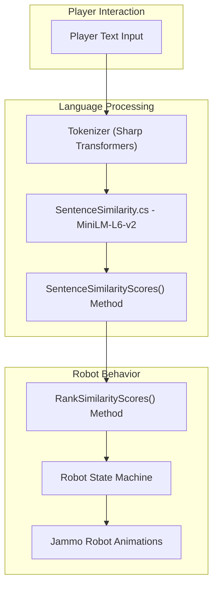
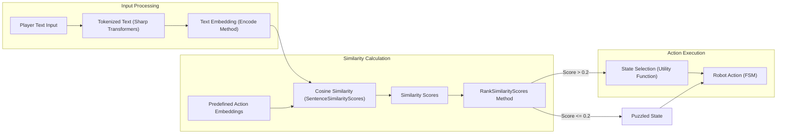
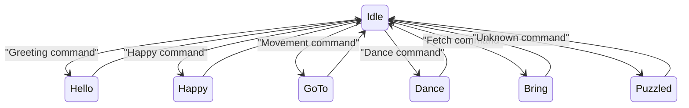
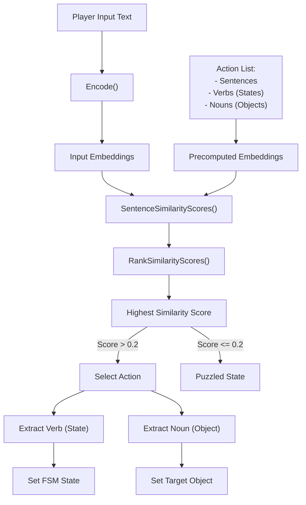

<!-- source: DeepWiki mcp.deepwiki.com · repo huggingface/making-games-with-ai-course · page 3.2 Sentis Robot Demo · fetched 2026-10-26 -->

# Sentis Robot Demo

Relevant source files

The following files were used as context for generating this wiki page:

- [units/en/unit1/introduction.mdx](units/en/unit1/introduction.mdx)
- [units/en/unit1/local-vs-api.mdx](units/en/unit1/local-vs-api.mdx)
- [units/en/unit1/make-demo.mdx](units/en/unit1/make-demo.mdx)
- [units/en/unit1/next-steps.mdx](units/en/unit1/next-steps.mdx)
- [units/en/unit1/sentence-similarity-explained.mdx](units/en/unit1/sentence-similarity-explained.mdx)

The Sentis Robot Demo showcases a smart NPC robot capable of understanding and responding to natural language player commands. This system leverages Unity Sentis to run an AI sentence similarity model locally, allowing for fluid interaction without manual mapping of every possible input. The robot interprets textual commands and performs corresponding actions based on semantic understanding rather than exact string matching.

For information about remote AI integration alternatives using APIs instead of local models, see [NPC Intelligence Systems](#2.1).

## System Architecture Overview

Sources: [units/en/unit1/make-demo.mdx:38-80](), [units/en/unit1/sentence-similarity-explained.mdx:1-46]()

## Processing Pipeline

The system processes player input through several stages to determine the appropriate robot action:

Sources: [units/en/unit1/sentence-similarity-explained.mdx:42-77](), [units/en/unit1/make-demo.mdx:75-137]()

## Core Components

### 1. Sentence Similarity Model

The demo uses the all-MiniLM-L6-v2 BERT Transformer model for sentence embedding:

- **Model**: A lightweight BERT model that generates vector representations (embeddings) of sentences
- **Tokenizer**: Provided by Sharp Transformers, converts text into token IDs
- **Similarity Measurement**: Uses cosine similarity to compare how semantically close two sentences are

This approach allows the robot to understand player inputs that are semantically similar to predefined actions, even when phrased differently.

Sources: [units/en/unit1/local-vs-api.mdx:1-65](), [units/en/unit1/sentence-similarity-explained.mdx:1-42]()

### 2. SentenceSimilarity.cs Implementation

The `SentenceSimilarity.cs` script handles the AI inference process with three main functions:

1. **Encode**: Takes player input text, tokenizes it using Sharp Transformers, and creates an embedding via the Sentis model
2. **SentenceSimilarityScores**: Calculates similarity scores between the input embedding and the predefined action embeddings
3. **RankSimilarityScores**: Identifies the most similar action and returns its index and score

During initialization in `Awake()`, the script:
- Loads the neural network
- Creates a Sentis inference engine (worker)
- Sets up operators for tensor operations

Sources: [units/en/unit1/make-demo.mdx:50-80]()

### 3. Robot Behavior System

The robot's behavior is implemented using a Finite State Machine (FSM) with 7 distinct states:

Each state defines specific behaviors and animations. For example, in the Hello state, the robot moves toward the player, faces them correctly, and plays a greeting animation before returning to Idle.

The FSM is implemented in the `Update()` method using a switch statement, with each case handling a specific state's behavior logic.

Sources: [units/en/unit1/make-demo.mdx:86-108]()

### 4. Action Selection Utility Function

The utility function bridges the sentence similarity system and robot behavior:

The action list structure contains:
- **Sentence**: What will be embedded in the AI model (e.g., "Go to the blue pillar")
- **Verb**: Corresponding to a state in the FSM (e.g., "GoTo")
- **Noun**: Object to interact with, if applicable (e.g., "BluePillar")

Sources: [units/en/unit1/make-demo.mdx:112-137]()

## Technical Implementation

### Setup Requirements

To implement the Sentis Robot Demo, two key packages must be installed:

1. **Unity Sentis**:
   - Package name: `com.unity.sentis`
   - Version: 1.3.0
   - Installation: Via Package Manager

2. **Sharp Transformers**:
   - Git URL: https://github.com/huggingface/sharp-transformers.git
   - Installation: Add package from git URL in Package Manager

Sources: [units/en/unit1/make-demo.mdx:1-33]()

### Similarity Threshold

The system uses a similarity threshold (0.2) to determine if a player input is close enough to any predefined action:

- If the highest similarity score is **above 0.2**, the robot performs the corresponding action
- If all similarity scores are **below 0.2**, the robot enters the Puzzled state, showing confusion

This threshold was determined through testing and should be adjusted when adding more actions to prevent overlapping interpretations.

| Player Input | Example Processing | Robot Response |
|--------------|------------|--------------|
| "Hello there" | Matches "Hello" with high score | Robot greets player |
| "Go to the blue pillar" | Matches "Move to blue pillar" action | Robot moves to blue pillar |
| "Bring me the red box" | Matches "Bring red box" action | Robot fetches red box |
| "Do you like rabbits?" | No matches above threshold | Robot shows confusion (puzzled) |

Sources: [units/en/unit1/sentence-similarity-explained.mdx:67-76](), [units/en/unit1/make-demo.mdx:138-175]()

## Extending the System

The demo is designed to be easily extendable:

### Adding New Actions

1. Create new game objects in the scene (e.g., a green pillar)
2. Add new entries to the action list:
   - Add a descriptive sentence: "Go to the green column"
   - Specify the verb: "GoTo"
   - Specify the noun: "GreenColumn"
3. Ensure the similarity threshold is appropriate for the expanded action set

### Potential Enhancements

1. **Voice Commands**: Integrate Speech-To-Text functionality using Whisper model
2. **Complex Scenarios**: Build new gameplay scenarios like:
   - Dungeon escape using the same codebase
   - Stealth games with voice commands
   - Interactive NPCs with more diverse actions

Sources: [units/en/unit1/make-demo.mdx:150-175](), [units/en/unit1/next-steps.mdx:1-24]()

## Local AI Integration Advantages

Running the AI model locally offers several benefits in this implementation:

1. **Offline functionality**: Players don't need an internet connection
2. **No API costs**: No per-request charges for inference
3. **Low latency**: No network delays in processing commands
4. **No privacy concerns**: Player inputs aren't sent to external servers

The small size of the MiniLM-L6-v2 model (less than 100MB) makes it practical to include with the game and run on consumer hardware.

Sources: [units/en/unit1/local-vs-api.mdx:39-64]()

---

