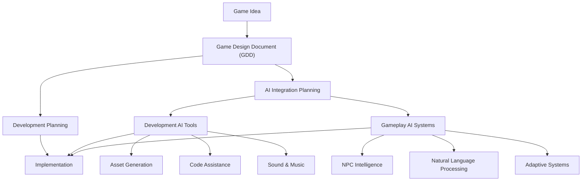
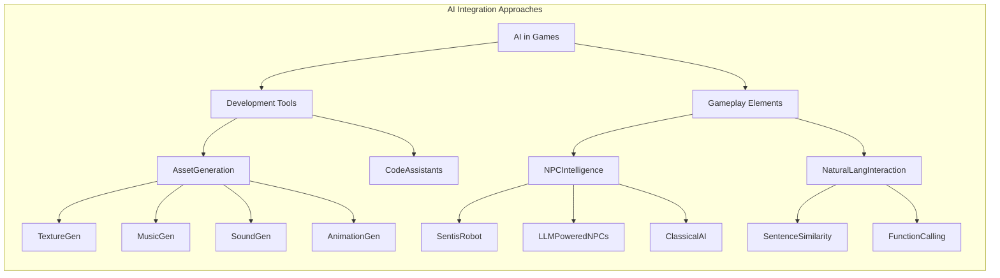
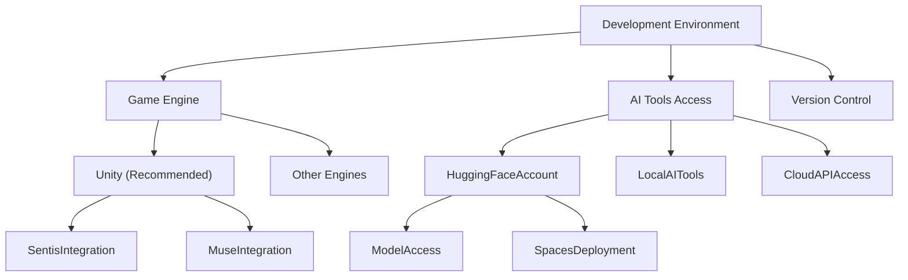
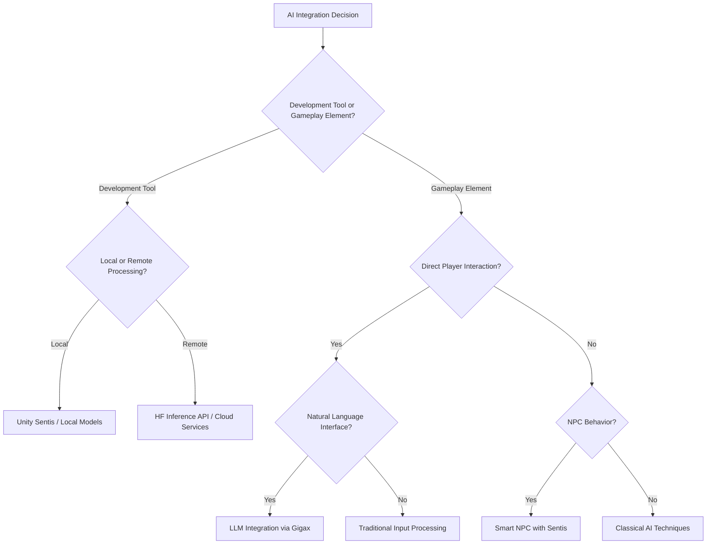

<!-- source: DeepWiki mcp.deepwiki.com · repo huggingface/making-games-with-ai-course · page 4 Game Design Process · fetched 2026-10-26 -->

# Game Design Process

Relevant source files

The following files were used as context for generating this wiki page:

- [units/en/demo1/introduction.mdx](units/en/demo1/introduction.mdx)
- [units/en/unit0/game-demo.mdx](units/en/unit0/game-demo.mdx)

This document outlines the methodical approach to designing games with AI integration, covering the workflow from initial idea generation to Game Design Document (GDD) creation and preparation for development. It focuses on how to strategically incorporate AI either as development assistance tools or as gameplay elements.

For specific techniques for generating game ideas, see [Game Ideation](#4.1). For detailed guidance on structuring your Game Design Document, see [Game Design Document (GDD)](#4.2).

## Process Overview

The game design process for AI-enhanced games follows a structured path with special consideration for AI integration points:

Sources: [units/en/demo1/introduction.mdx:10-16]()

## Integration Approaches

The course identifies two primary approaches to AI integration in game development:

Sources: [units/en/demo1/introduction.mdx:12-16]()

## Game Design Document Components

For AI-enhanced games, your GDD needs to address both traditional game design elements and AI-specific considerations:

| Component | Description | AI-Specific Documentation |
|-----------|-------------|----------------------------|
| Gameplay mechanics | Core interaction loops and rules | Which mechanics involve AI systems |
| Story | Narrative elements and progression | How AI might enhance storytelling |
| AI models/tools | Technologies to be implemented | Specific models, integration points, fallbacks |
| Asset requirements | Visual, audio, and other resources | Which assets will be AI-generated vs. manual |
| Scope definition | Project boundaries and MVP | Technical limitations of AI approaches |
| Team structure | Roles and responsibilities | AI expertise requirements |

Sources: [units/en/demo1/introduction.mdx:27-35]()

## Development Environment Setup

The course recommends the following technical setup for AI-enhanced game development:

Sources: [units/en/unit0/game-demo.mdx:16-40]()

## Scope Management

Effective scope management is crucial when incorporating AI into game development:

### Recommended Scope Control Techniques

- Define a clear Minimum Viable Product (MVP) that demonstrates AI integration
- Prioritize core AI features over secondary game elements
- Account for additional testing time for AI systems
- Consider technical requirements and limitations early
- Plan for fallbacks if AI systems don't perform as expected

Sources: [units/en/demo1/introduction.mdx:37-38]()

## Learning Approach

The course emphasizes a "learn by doing" methodology:

1. Design a small-scope game incorporating AI features
2. Document the design through a focused GDD
3. Implement a functional demo
4. Iterate based on technical discoveries

This practical approach allows for experimentation with AI tools while maintaining a manageable project scope.

Sources: [units/en/unit0/game-demo.mdx:10-14]()

## Technical Requirements

At minimum, the following technical components are required:

- Computer with internet connection
- Hugging Face account for AI model access
- Game engine license (free version sufficient for most projects)
- Optional: GPU for local AI model inference (for certain integration approaches)

Sources: [units/en/unit0/game-demo.mdx:36-40]()

## AI Integration Decision Tree

When deciding how to integrate AI into your game design, consider this decision framework:

Sources: [units/en/demo1/introduction.mdx:12-16]()

The process outlined in this document provides a structured approach to designing games that leverage AI technologies. By following this framework, you can create a well-considered design that effectively incorporates AI while maintaining a realistic development scope.

---

