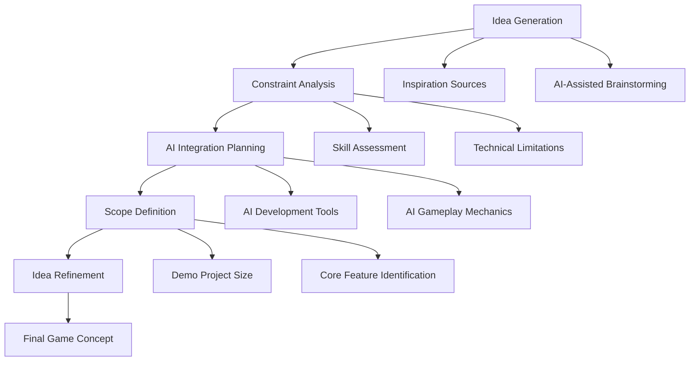
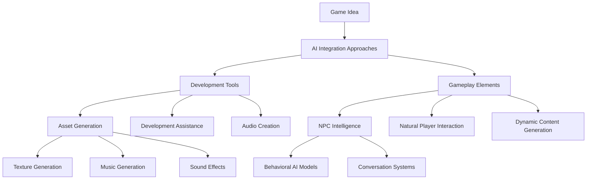
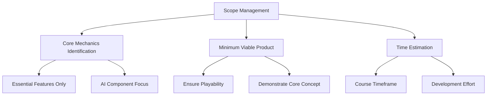
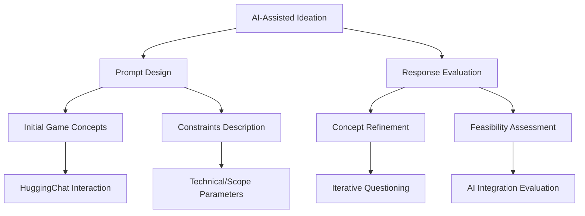

<!-- source: DeepWiki mcp.deepwiki.com · repo huggingface/making-games-with-ai-course · page 4.1 Game Ideation · fetched 2026-10-26 -->

# Game Ideation

Relevant source files

The following files were used as context for generating this wiki page:

- [units/en/demo1/game-idea.mdx](units/en/demo1/game-idea.mdx)
- [units/en/demo1/introduction.mdx](units/en/demo1/introduction.mdx)

## Purpose and Scope

Game Ideation is the foundational process of generating and refining game concepts specifically for games that leverage AI, either as development tools or as gameplay mechanics. This document covers methodologies, constraints, and best practices for developing compelling game ideas suitable for AI integration within the Making Games with AI Course framework.

For information about turning your game idea into a formal plan, see [Game Design Document (GDD)](#4.2).

## Game Ideation Process

The process of developing a game idea for AI-enhanced games follows a structured approach that balances creativity with practical constraints.

Sources: [units/en/demo1/introduction.mdx:10-25](), [units/en/demo1/game-idea.mdx:1-45]()

## Key Ideation Principles

### Embracing Constraints

The course emphasizes working within limitations as a catalyst for innovation. When developing your game idea, consider:

- Your current technical skills and experience
- Available development time
- Resource limitations
- Technical feasibility with current AI tools

The course provides a practical example: developing a detective game where players interview suspects via phone calls due to the difficulty of animating human faces, demonstrating how constraints can guide design decisions.

Sources: [units/en/demo1/game-idea.mdx:9-14]()

### Drawing Inspiration

Finding inspiration is crucial for developing compelling game ideas:

- Analyze favorite games for mechanics you enjoy
- Identify specific elements that captivate you
- Consider small features that could serve as the foundation for your project

Sources: [units/en/demo1/game-idea.mdx:15-19]()

### AI Integration Approaches

The course emphasizes two primary approaches to AI integration that should be considered during the ideation phase:

Sources: [units/en/demo1/introduction.mdx:12-15](), [units/en/demo1/game-idea.mdx:21-24]()

## Scope Management: The Scope Curse

The course strongly emphasizes managing scope to ensure project completion, describing this as "The Scope Curse." Key scope management principles include:

- Creating a small, functional demo rather than an ambitious but incomplete concept
- Defining clear project boundaries
- Prioritizing core gameplay over extraneous features
- Setting realistic goals based on available time and resources

Sources: [units/en/demo1/introduction.mdx:37-38](), [units/en/demo1/game-idea.mdx:25-34]()

## AI-Assisted Ideation

The course recommends using AI tools such as HuggingChat to assist in the ideation process when you're stuck or need to expand your thinking:

Sources: [units/en/demo1/game-idea.mdx:35-39]()

## From Ideation to Implementation

Once a game idea is defined, the course guides students through creating a Game Design Document (GDD), which serves as a blueprint for development. The GDD is structured as a one-page document that defines:

| GDD Component | Description |
|---------------|-------------|
| Gameplay Mechanics | Core interactive elements and rules of the game |
| Story | Narrative elements (if applicable) |
| AI Integration | Specific AI models and tools to be utilized |
| Asset Requirements | Necessary game assets and resources |
| Scope Definition | Clear project boundaries and deliverables |
| Team Composition | Team members and responsibilities (if applicable) |

Sources: [units/en/demo1/introduction.mdx:25-35](), [units/en/demo1/game-idea.mdx:42-44]()

## Game Idea Evaluation Criteria

When evaluating potential game ideas, consider these key criteria:

1. **AI Integration Potential**: How effectively can AI enhance the game experience?
2. **Technical Feasibility**: Can you realistically implement this with your skills and available tools?
3. **Scope Appropriateness**: Is this achievable within the course timeframe?
4. **Core Appeal**: Does the central concept remain engaging even with minimal features?
5. **Uniqueness**: Does the AI integration provide a novel or interesting gameplay experience?

Sources: [units/en/demo1/game-idea.mdx:1-44]()

## Summary

The Game Ideation process for AI-enhanced games involves balancing creative vision with practical constraints, identifying opportunities for meaningful AI integration, and carefully managing scope to ensure project completion. The course emphasizes starting with small, achievable concepts that demonstrate AI integration rather than ambitious projects that risk remaining incomplete.

After finalizing your game idea using these principles, the next step is to formalize it through a Game Design Document, as covered in [Game Design Document (GDD)](#4.2).

Sources: [units/en/demo1/introduction.mdx:10-41](), [units/en/demo1/game-idea.mdx:1-44]()

---

