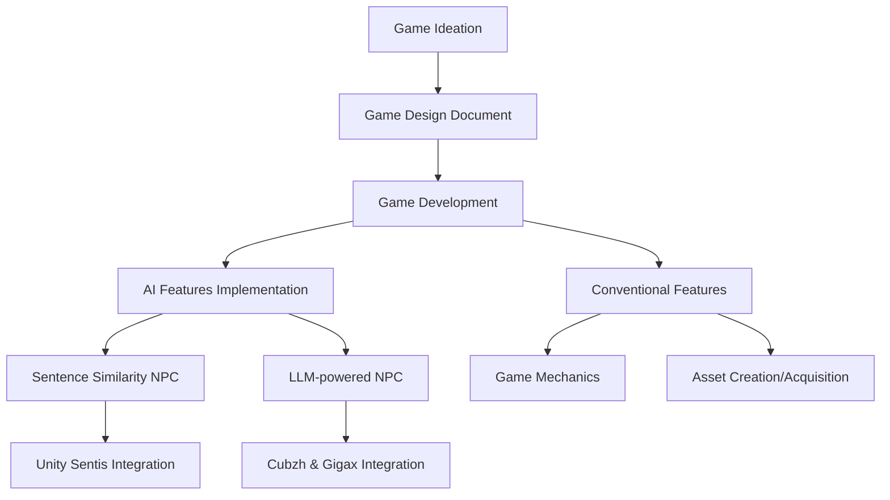
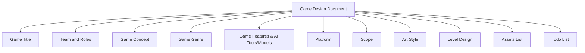
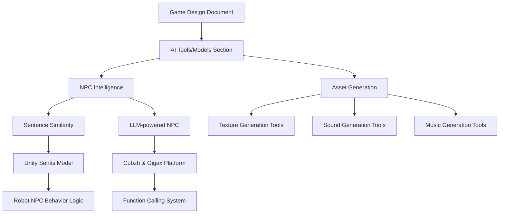
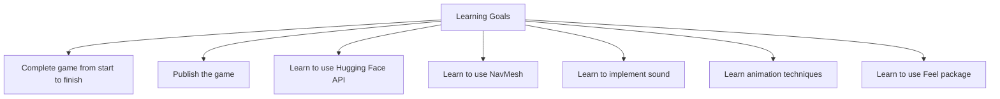

<!-- source: DeepWiki mcp.deepwiki.com · repo huggingface/making-games-with-ai-course · page 4.2 Game Design Document (GDD) · fetched 2026-10-26 -->

# Game Design Document (GDD)

<details>
<summary>Relevant source files</summary>

The following files were used as context for generating this wiki page:

- [units/en/demo1/conclusion.mdx](units/en/demo1/conclusion.mdx)
- [units/en/demo1/game-design-document.mdx](units/en/demo1/game-design-document.mdx)

</details>


## Purpose and Scope

The Game Design Document (GDD) serves as the blueprint for a video game project, documenting the gameplay mechanics, features, scope, assets, and—especially relevant for this course—the AI technologies to be integrated. This document ensures a clear definition and understanding of the game's vision for all team members and facilitates the development process.

For AI-enhanced games, the GDD has the critical function of specifying which AI systems will be integrated and how they'll enhance gameplay. This page focuses specifically on creating a GDD for AI-enhanced games in the context of this course.

For information about the initial game ideation process that precedes creating a GDD, see [Game Ideation](#4.1).

## Position in Game Development Workflow

The GDD occupies a pivotal position in game development, bridging the conceptual and implementation phases:



Sources: [units/en/demo1/game-design-document.mdx:3-15](), [units/en/demo1/conclusion.mdx:1-9]()

## One-Page GDD Template

In this course, a concise one-page GDD is recommended to keep the scope manageable while ensuring all critical elements are documented. The template includes these essential sections:



Sources: [units/en/demo1/game-design-document.mdx:19-67]()

## Key Components of a GDD

### Game Title
A descriptive and memorable name for your game. It's recommended to brainstorm multiple options.

### Team and Roles
Identification of team members and their specific responsibilities, ensuring clear accountability.

### Game Concept
A single sentence description that captures the essence of your game and guides design decisions throughout development.

### Game Genre
Classification of the game type (e.g., platformer, puzzle, strategy), which sets expectations and development parameters.

### Game Features and AI Tools/Models
**This section is particularly crucial for AI-enhanced games.** It should include:
- List of planned game features
- Specific AI tools or models to be implemented
- How AI will enhance gameplay

### Platform
Target platform(s) for deployment. For this course, options include:
- WebGL (for HuggingFace Spaces deployment)
- Windows

### Scope
Definition of the game's scale:
- Expected playtime (10 minutes maximum recommended for course projects)
- Number of levels or amount of content

### Art Style
Visual aesthetic direction (e.g., low-poly, stylized, realistic), guiding asset creation or selection.

### Level Design
Outlines or sketches of planned levels, helping visualize gameplay environments and determine asset requirements.

### Assets
Comprehensive list of all required assets, including models, textures, sounds, and UI elements.

### Todo List
Project management tool listing all tasks that need to be completed.

Sources: [units/en/demo1/game-design-document.mdx:25-67]()

## GDD to AI Component Mapping

For AI-enhanced games, the GDD connects game concepts to specific AI implementations:



Sources: [units/en/demo1/game-design-document.mdx:41-44]()

## Example GDD: Museum Robery

To illustrate the application of this template, the course provides a complete example GDD for a game called "Museum Robery" (alternatively "Roomba Heist").

### Game Concept
The player controls a robot cleaner in a museum at night using voice commands. The objective is to steal a valuable golden duck statue without being detected by lasers and guards.

### Game Features and AI Integration
The game demonstrates AI integration through:
- Voice command recognition (ASR)
- Sentence similarity for understanding player commands
- Robot behavior logic

| Feature | AI Technology | Implementation |
|---------|--------------|----------------|
| Voice Control | Automatic Speech Recognition | Convert player speech to text |
| Command Processing | Sentence Similarity | Interpret player commands |
| Robot Actions | Pre-defined behaviors | Robot can steal and break objects |

### Level Design
The game includes three levels of increasing complexity:

![Level layouts shown in the GDD example]

### Assets
A detailed asset list includes:
- Environmental elements (floor, walls, pedestals)
- Interactive objects (statues, paintings)
- Special effects (laser beams)
- Character models
- UI elements

```
Asset Count:
- 4 statue models
- 6 paintings
- Environmental elements (floors, walls)
- 1 player character (robot)
- Special effects (laser beams)
- UI elements
```

Sources: [units/en/demo1/game-design-document.mdx:70-156]()

## Learning Goals Integration

When creating a GDD for educational purposes, it's valuable to include learning goals that specify what you hope to gain from the development process:



Sources: [units/en/demo1/game-design-document.mdx:212-223]()

## Next Steps After GDD Completion

After finalizing your GDD, the development process continues with:

1. Asset acquisition or creation (covered in the next demo unit)
2. Implementation of core game mechanics
3. Integration of AI systems as specified in the GDD
4. Testing and refinement
5. Publication

Sources: [units/en/demo1/conclusion.mdx:1-9]()

## Conclusion

A well-crafted GDD, even in the concise one-page format recommended for this course, provides the necessary structure and guidance to ensure successful implementation of both traditional and AI-enhanced game features. It serves as the bridge between the ideation phase and actual development, ensuring that all team members have a clear understanding of the project's vision and requirements.

The GDD is particularly important for AI-enhanced games as it explicitly defines which AI technologies will be integrated and how they will contribute to the gameplay experience, ensuring that technical implementation aligns with the game's design goals.

---

