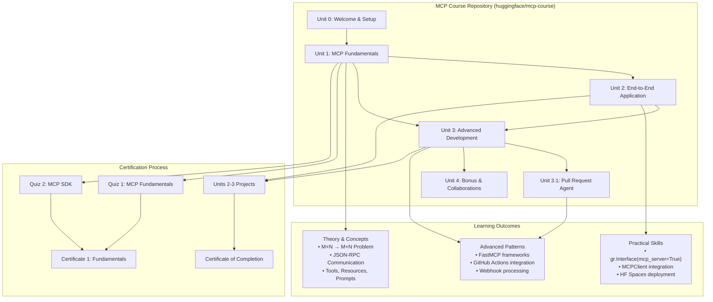
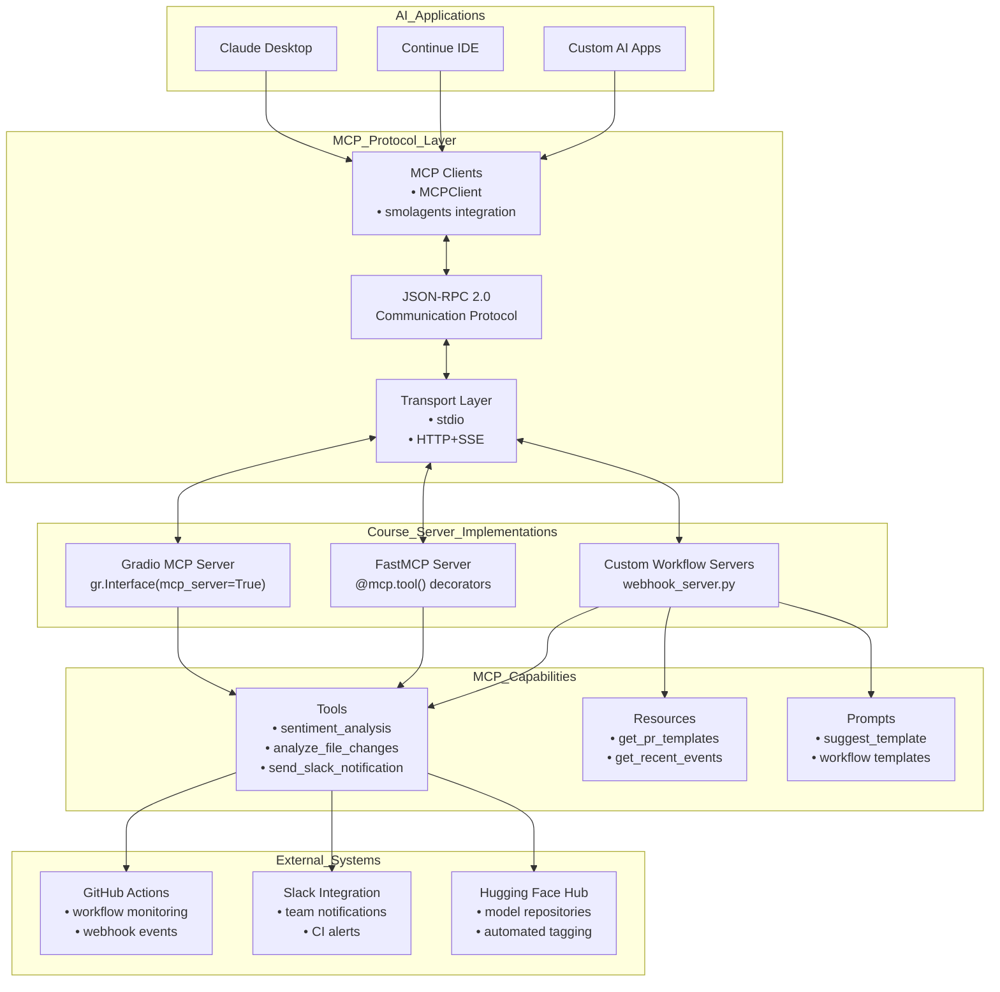
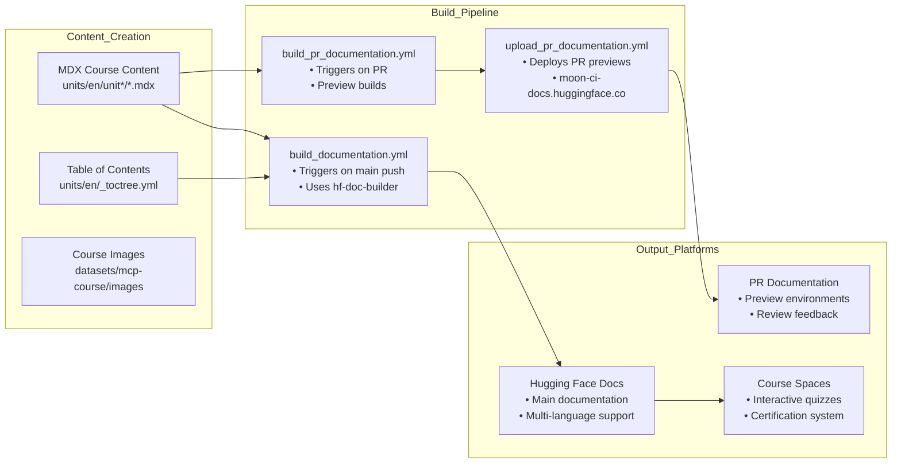
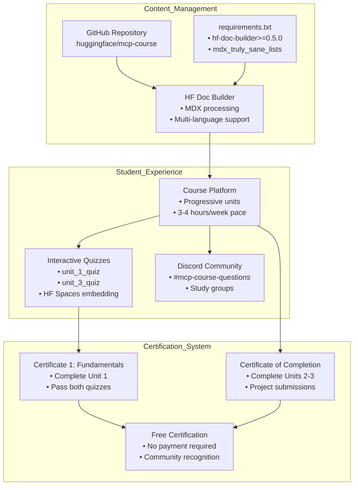

<!-- source: DeepWiki mcp.deepwiki.com · repo huggingface/mcp-course · page 1 Overview · fetched 2026-10-26 -->

# Overview

Relevant source files

The following files were used as context for generating this wiki page:

- [.github/workflows/build_documentation.yml](.github/workflows/build_documentation.yml)
- [.github/workflows/build_pr_documentation.yml](.github/workflows/build_pr_documentation.yml)
- [.github/workflows/upload_pr_documentation.yml](.github/workflows/upload_pr_documentation.yml)
- [README.md](README.md)
- [README_vi.md](README_vi.md)
- [requirements.txt](requirements.txt)
- [units/en/_toctree.yml](units/en/_toctree.yml)
- [units/en/unit0/introduction.mdx](units/en/unit0/introduction.mdx)
- [units/en/unit2/introduction.mdx](units/en/unit2/introduction.mdx)
- [units/en/unit3/certificate.mdx](units/en/unit3/certificate.mdx)

This document provides an overview of the MCP Course repository, an educational platform designed to teach the Model Context Protocol (MCP) from fundamental concepts to advanced implementation patterns. The repository contains comprehensive learning materials, hands-on projects, and certification programs for understanding and building applications with MCP.

For specific information about MCP protocol fundamentals, see [MCP Protocol Fundamentals](#2). For client implementations, see [MCP Clients](#3). For server development patterns, see [MCP Servers](#4).

## Course Architecture and Learning Progression

The MCP Course follows a structured educational pathway designed to take learners from beginner to proficient in Model Context Protocol development.

### Course Structure Overview

Sources: [units/en/_toctree.yml:1-83](), [units/en/unit0/introduction.mdx:46-56](), [units/en/unit0/introduction.mdx:84-92]()

### Educational Content Structure

The course implements a progressive learning model with theoretical foundations, practical applications, and advanced use cases:

| Unit | Focus Area | Key Components | Duration |
|------|------------|----------------|----------|
| 0 | Onboarding | Account setup, Discord, tools | Setup |
| 1 | Fundamentals | Key concepts, architecture, SDK, clients | 1 week |
| 2 | End-to-End App | Gradio servers, multiple clients, deployment | 1 week |
| 3 | Advanced Development | Custom workflows, CI/CD integration, Slack | 1 week |
| 3.1 | Hub Integration | Pull request agents, webhook listeners | Extension |
| 4 | Collaborations | Partner libraries, community projects | Bonus |

Sources: [units/en/unit0/introduction.mdx:46-56](), [units/en/unit0/introduction.mdx:94-96](), [README.md:19-25]()

## MCP Ecosystem Architecture

The course teaches the Model Context Protocol ecosystem, which solves the M×N integration problem between AI applications and external tools.

### MCP Protocol Implementation Map

Sources: [units/en/_toctree.yml:17-27](), [units/en/_toctree.yml:33-46](), [units/en/unit2/introduction.mdx:39-61]()

## Repository Structure and Development Workflow

The repository implements a comprehensive development and documentation pipeline for educational content delivery.

### Documentation and Build Pipeline

Sources: [.github/workflows/build_documentation.yml:1-20](), [.github/workflows/build_pr_documentation.yml:1-20](), [.github/workflows/upload_pr_documentation.yml:1-24]()

### Course Delivery Architecture

The course content is delivered through multiple channels with integrated assessment and certification systems:

Sources: [units/en/unit0/introduction.mdx:84-92](), [units/en/unit0/introduction.mdx:94-108](), [units/en/unit3/certificate.mdx:1-19](), [requirements.txt:1-3]()

## Multi-Language Support and Community

The repository implements internationalization features and community engagement mechanisms:

| Component | English | Vietnamese | Purpose |
|-----------|---------|------------|---------|
| Main README | `README.md` | `README_vi.md` | Repository introduction |
| Course Content | `units/en/` | Planned expansion | Learning materials |
| Documentation Build | `languages: en` | Future support | Publishing pipeline |

The course maintains active community engagement through:
- Discord server with dedicated channels
- GitHub issues and pull requests for contributions
- Partner collaborations with Gradio, Continue, Anthropic
- Free certification process to encourage participation

Sources: [README.md:3](), [README_vi.md:3](), [.github/workflows/build_documentation.yml:17](), [units/en/unit0/introduction.mdx:123-131]()

## Target Audience and Prerequisites

The course is designed for developers with:
- Basic understanding of AI and LLM concepts
- Familiarity with software development principles and API concepts  
- Experience with Python or TypeScript programming languages
- Computer with internet connection and Hugging Face account

The educational approach emphasizes hands-on learning with pre-configured environments, progressive skill building, and real-world application development.

Sources: [units/en/unit0/introduction.mdx:58-75](), [units/en/unit0/introduction.mdx:77-82](), [README.md:27-31]()

---

