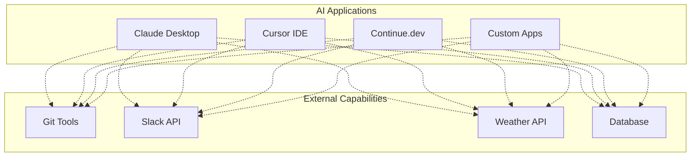
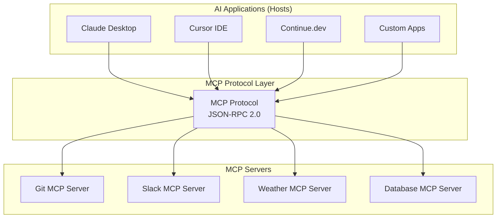
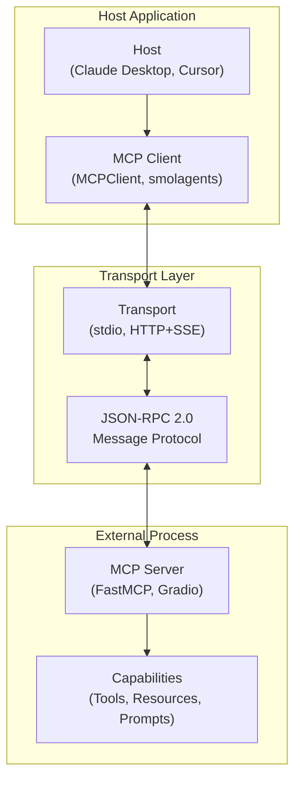
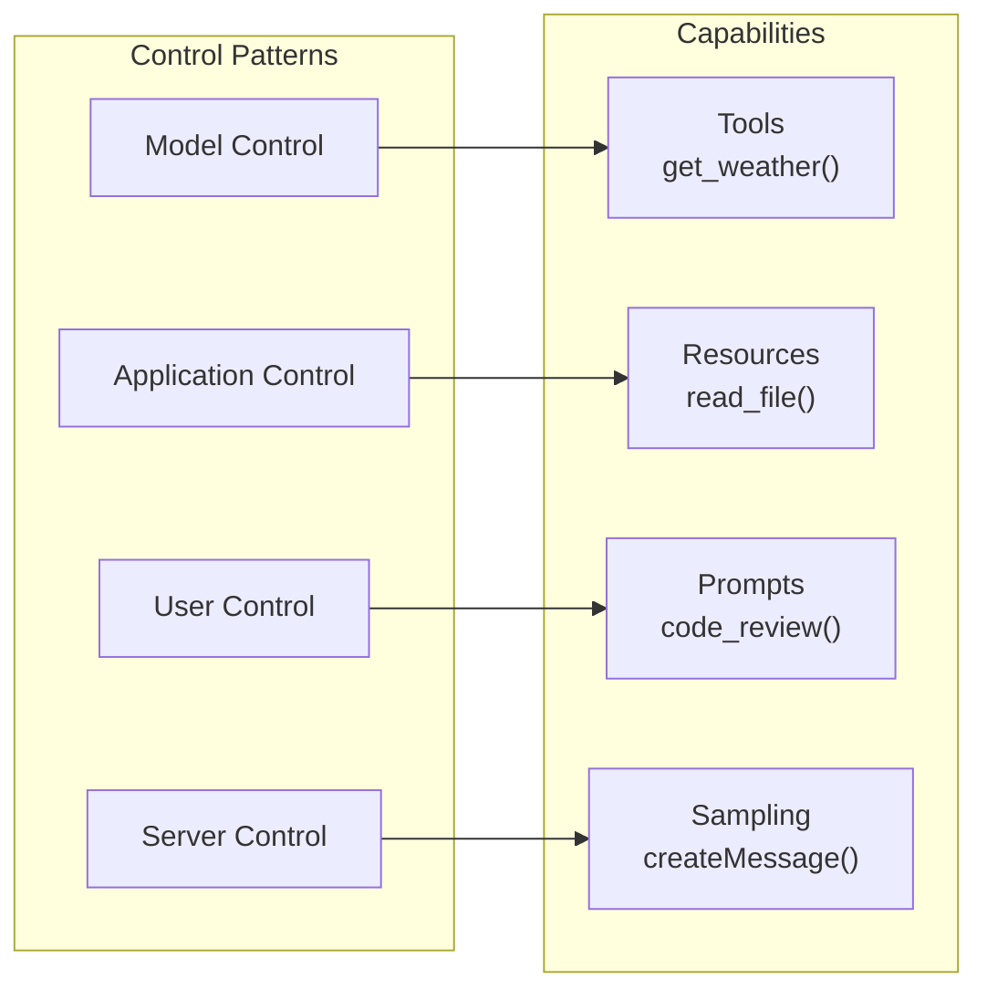
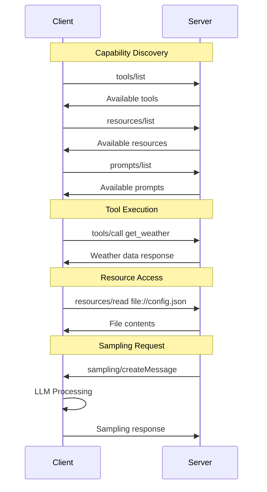
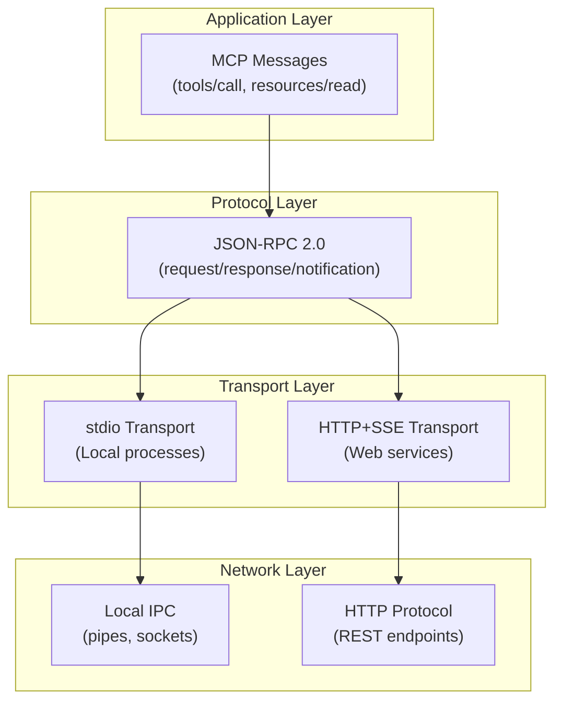
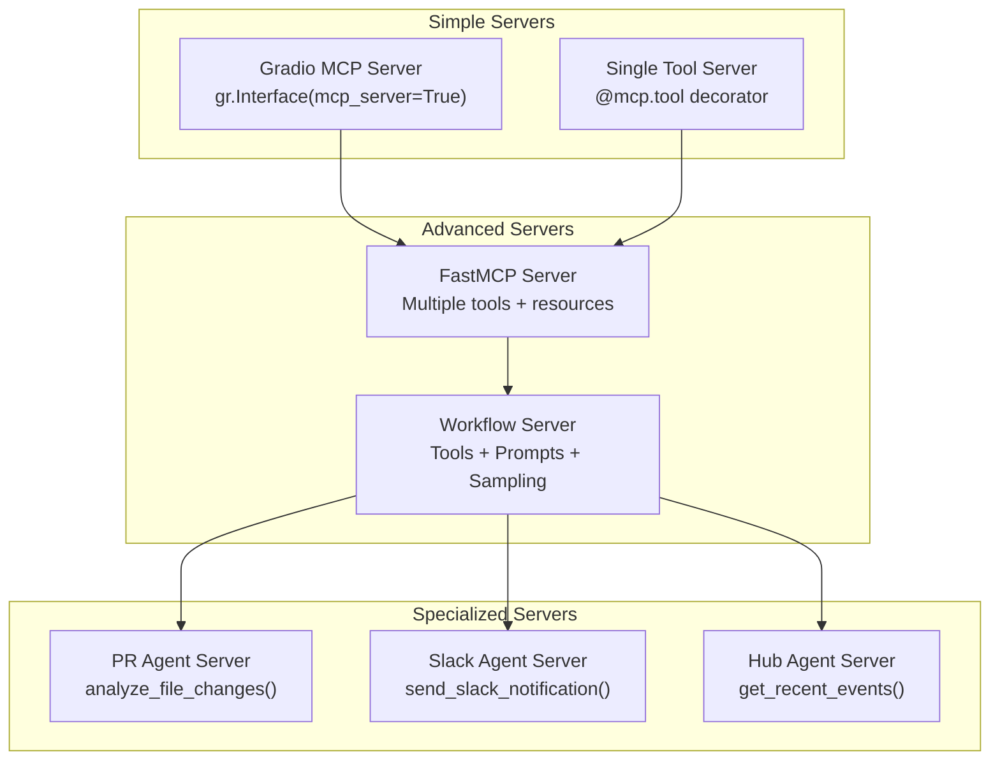

<!-- source: DeepWiki mcp.deepwiki.com · repo huggingface/mcp-course · page 2 MCP Protocol Fundamentals · fetched 2026-10-26 -->

# MCP Protocol Fundamentals

Relevant source files

The following files were used as context for generating this wiki page:

- [units/en/unit1/capabilities.mdx](units/en/unit1/capabilities.mdx)
- [units/en/unit1/key-concepts.mdx](units/en/unit1/key-concepts.mdx)

## Purpose and Scope

This document covers the foundational concepts, architecture, and communication mechanisms of the Model Context Protocol (MCP). It provides a comprehensive overview of how MCP solves the AI application integration challenge through standardized client-server communication patterns and capability abstractions.

For detailed implementation patterns of specific MCP components, see [MCP Clients](#3) and [MCP Servers](#4). For advanced application examples, see [Advanced Applications](#5).

## The Integration Challenge

MCP addresses the fundamental **M×N Integration Problem** that arises when connecting multiple AI applications to multiple external tools and data sources. Without standardization, developers must create individual integrations for each possible pairing, leading to exponential complexity.

### Problem: M×N Custom Integrations

**M×N Integration Problem**

Sources: [units/en/unit1/key-concepts.mdx:12-32]()

### Solution: M+N Standardized Protocol

**M+N Solution with MCP**

Sources: [units/en/unit1/key-concepts.mdx:28-35]()

## Core Architecture

MCP defines a three-tier architecture with distinct roles and responsibilities for each component.

### Component Relationships

**MCP Architecture Components**

### Component Definitions

| Component | Description | Examples |
|-----------|-------------|----------|
| **Host** | User-facing AI application that orchestrates interactions | `Claude Desktop`, `Cursor IDE`, `smolagents` |
| **Client** | Protocol handler within Host managing Server communication | `MCPClient`, `@huggingface/tiny-agents` |  
| **Server** | External service exposing capabilities via MCP protocol | `FastMCP` servers, `gr.Interface(mcp_server=True)` |

Sources: [units/en/unit1/key-concepts.mdx:48-65]()

## MCP Capabilities

MCP defines four core capability types that Servers can expose to Clients, each with distinct control patterns and use cases.

### Capability Types and Control Patterns

**MCP Capability Control Model**

### Capability Characteristics

| Capability | Controller | Direction | Side Effects | Approval Required | Example Code Entity |
|------------|------------|-----------|--------------|-------------------|-------------------|
| **Tools** | Model (LLM) | Client → Server | Yes | Yes | `get_weather()`, `send_slack_notification()` |
| **Resources** | Application | Client → Server | No (read-only) | Typically no | `read_file()`, `get_pr_templates()` |
| **Prompts** | User | Server → Client | No | No | `code_review()`, `suggest_template()` |
| **Sampling** | Server | Server → Client → Server | Indirectly | Yes | `createMessage()`, `analyze_file_changes()` |

Sources: [units/en/unit1/capabilities.mdx:13-228]()

### Discovery and Interaction Flow

**MCP Capability Discovery and Interaction Protocol**

Sources: [units/en/unit1/capabilities.mdx:229-238]()

## Protocol Overview

MCP uses JSON-RPC 2.0 as its core communication protocol, supporting multiple transport mechanisms for different deployment scenarios.

### Transport and Protocol Stack

**MCP Protocol Stack**

### Key Protocol Features

- **Bidirectional Communication**: Both Client and Server can initiate requests
- **Capability Negotiation**: Dynamic discovery of available Tools, Resources, and Prompts
- **Transport Flexibility**: Support for `stdio` (local) and `HTTP+SSE` (remote) transports
- **JSON-RPC 2.0 Compliance**: Standard request/response/notification patterns

For detailed protocol specifications and message formats, see [Communication Protocol](#2.2).

Sources: [units/en/unit1/key-concepts.mdx:1-93](), [units/en/unit1/capabilities.mdx:1-243]()

## Implementation Patterns

MCP implementations typically follow these common patterns based on the capability types they expose:

### Server Implementation Patterns

**MCP Server Implementation Progression**

Sources: [units/en/unit1/key-concepts.mdx:77-89]()

## Conclusion

MCP Protocol Fundamentals establish the foundation for standardized AI application integration through:

1. **Problem Resolution**: Transforming M×N integration complexity into M+N standardization
2. **Clear Architecture**: Well-defined Host-Client-Server component relationships  
3. **Capability Abstraction**: Four distinct capability types with appropriate control boundaries
4. **Protocol Standardization**: JSON-RPC 2.0 with flexible transport options

This foundation enables the rich ecosystem of MCP implementations covered in subsequent sections, from simple [Gradio MCP Servers](#4.1) to complex [Advanced Applications](#5) involving workflow automation and multi-system integration.

For architectural details and capability specifications, see [Core Concepts and Architecture](#2.1). For protocol mechanics and message formats, see [Communication Protocol](#2.2).

Sources: [units/en/unit1/key-concepts.mdx:90-93](), [units/en/unit1/capabilities.mdx:239-243]()

---

