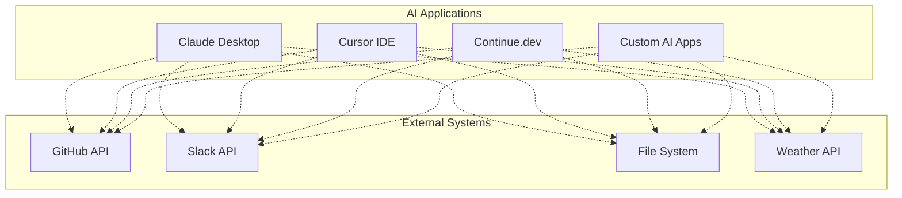
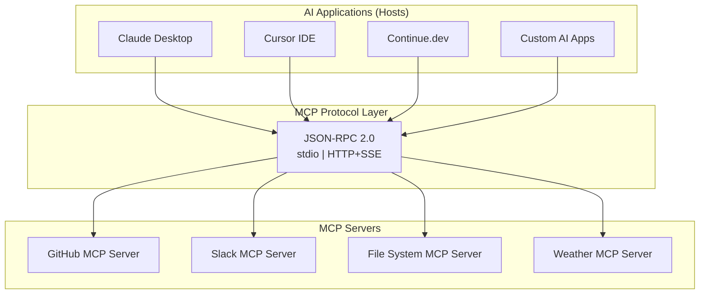
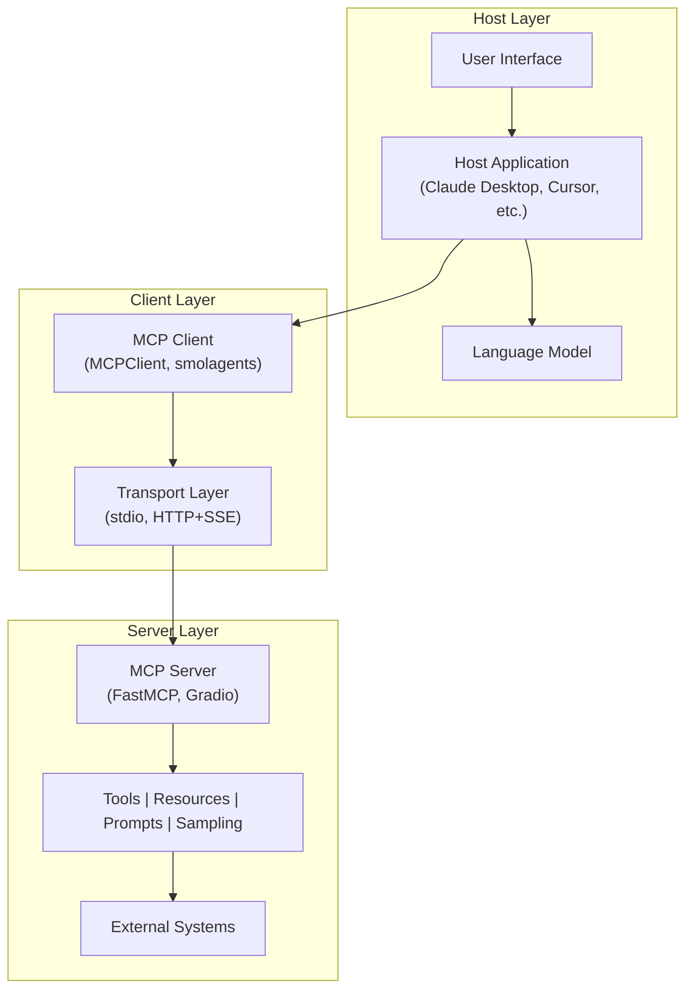
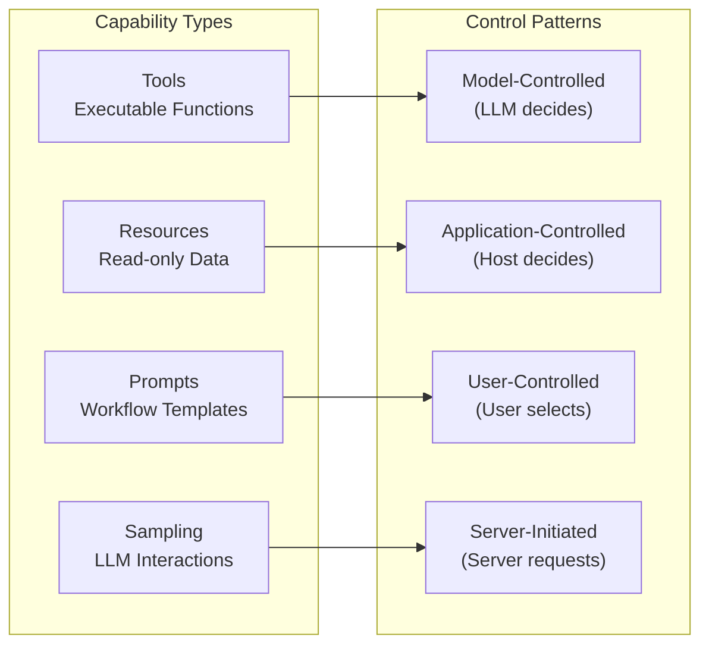
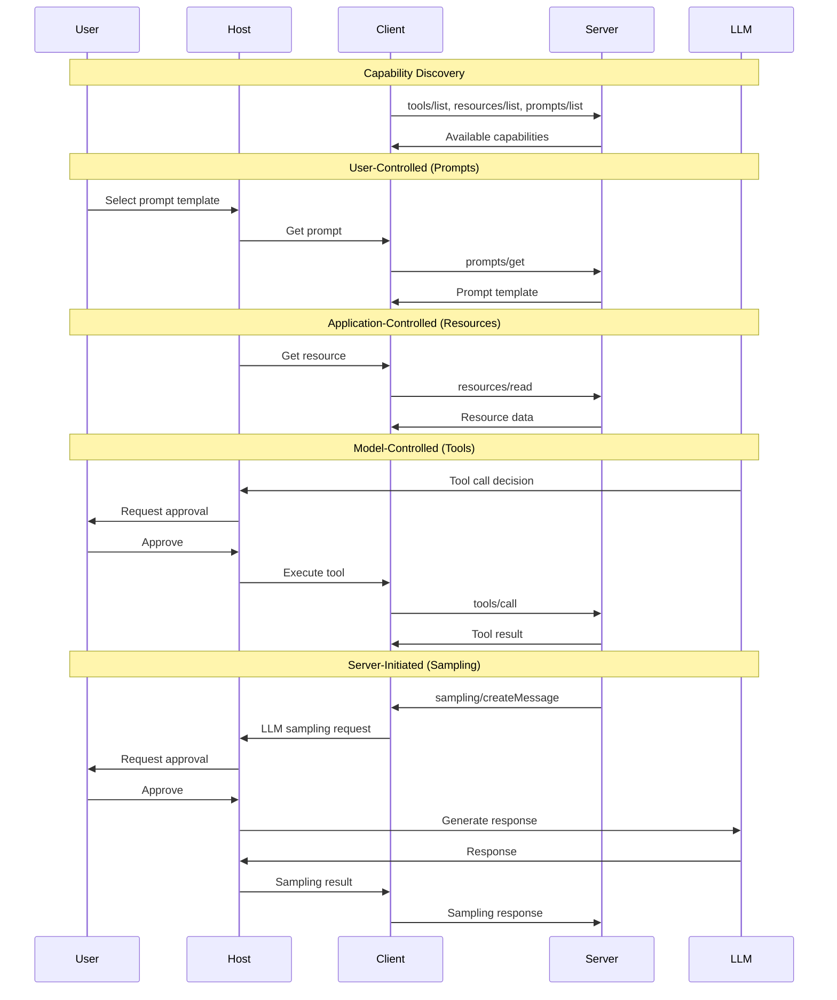
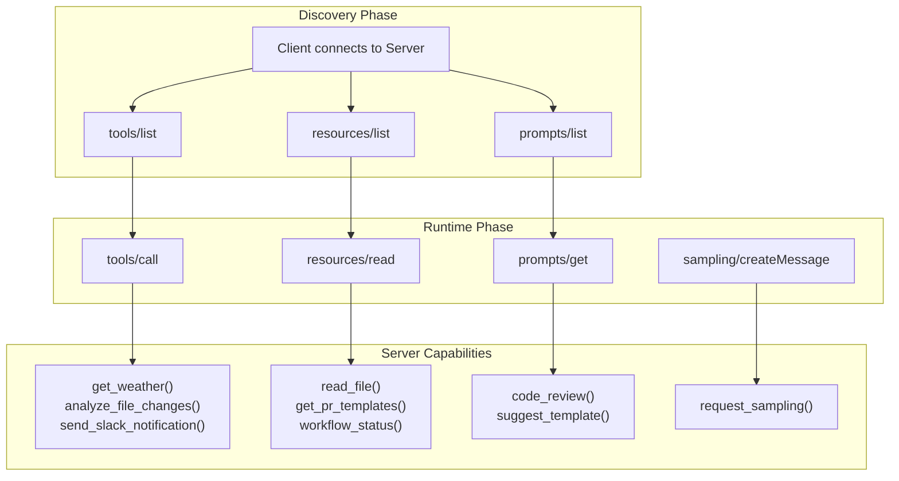

<!-- source: DeepWiki mcp.deepwiki.com · repo huggingface/mcp-course · page 2.1 Core Concepts and Architecture · fetched 2026-10-26 -->

# Core Concepts and Architecture

Relevant source files

The following files were used as context for generating this wiki page:

- [units/en/unit1/capabilities.mdx](units/en/unit1/capabilities.mdx)
- [units/en/unit1/key-concepts.mdx](units/en/unit1/key-concepts.mdx)

This document covers the fundamental concepts and architectural patterns underlying the Model Context Protocol (MCP). It explains the M×N integration problem that MCP solves, the core components of the Host-Client-Server architecture, and the four capability types that enable AI applications to interact with external systems. For specific implementation details of the communication protocol, see [Communication Protocol](#2.2). For information about client implementations, see [MCP Clients](#3).

## The M×N Integration Problem

MCP addresses the fundamental challenge of connecting multiple AI applications to multiple external tools and data sources. Without a standardized protocol, developers face an exponential integration problem.

### Without MCP: M×N Complexity

**M×N Integration Problem Architecture**

Each AI application requires individual integrations with every external system, creating M×N custom connections that are expensive to build and maintain.

Sources: [units/en/unit1/key-concepts.mdx:12-27]()

### With MCP: M+N Solution

**MCP M+N Solution Architecture**

MCP transforms the integration problem into M+N by providing a standard interface. Each AI application implements MCP client functionality once, and each external system implements MCP server functionality once.

Sources: [units/en/unit1/key-concepts.mdx:28-35]()

## Core Architecture Components

MCP follows a three-tier architecture with distinct roles and responsibilities for each component.

**Host-Client-Server Architecture**

### Host
The user-facing AI application that end-users interact with directly. Examples include Anthropic's Claude Desktop, AI-enhanced IDEs like Cursor, or custom applications built with frameworks like smolagents. Hosts initiate connections to MCP Servers and orchestrate the overall flow between user requests, LLM processing, and external tools.

### Client  
A component within the host application that manages communication with a specific MCP Server. Each Client maintains a 1:1 connection with a single Server, handling the protocol-level details of MCP communication. The Client acts as an intermediary between the Host's logic and the external Server.

### Server
An external program or service that exposes capabilities via the MCP protocol. Servers implement the four core capability types and handle requests from Clients through standardized JSON-RPC 2.0 messages.

Sources: [units/en/unit1/key-concepts.mdx:48-64]()

## MCP Capabilities

MCP defines four distinct capability types that servers can expose to clients, each with specific control patterns and use cases.

**MCP Capability Control Patterns**

### Tools
Executable functions that the AI model can invoke to perform actions or retrieve computed data. Tools are model-controlled, meaning the LLM decides when to call them based on context. Due to their potential for side effects, tool execution typically requires explicit user approval.

**Example use cases**: Weather data retrieval (`get_weather`), API calls, file operations, calculations

### Resources  
Read-only data sources that provide context without significant computation. Resources are application-controlled, with the Host deciding when to access them. They present lower security risks since they cannot modify external state.

**Example use cases**: File contents (`read_file`), database records, configuration data, documentation

### Prompts
Pre-defined templates or workflows that guide interactions between users, AI models, and available capabilities. Prompts are user-controlled, often presented as options in the Host application's UI before the AI model begins processing.

**Example use cases**: Code review templates (`code_review`), specialized workflows, guided interactions

### Sampling
Server-initiated requests for the Client/Host to perform LLM interactions. This enables recursive actions where the LLM can review generated content and make further decisions. Like Tools, sampling operations typically require user approval.

**Example use cases**: Multi-step analysis, autonomous agent workflows, content review and refinement

Sources: [units/en/unit1/key-concepts.mdx:66-89](), [units/en/unit1/capabilities.mdx:13-202]()

## Capability Control and Interaction Patterns

The four capabilities follow distinct control patterns that determine when and how they are invoked during MCP interactions.

| Capability | Controlled By | Direction | Side Effects | Approval Needed | Discovery Method |
|------------|---------------|-----------|--------------|-----------------|------------------|
| Tools      | Model (LLM)   | Client → Server | Yes (potentially) | Yes | `tools/list` |
| Resources  | Application   | Client → Server | No (read-only) | Typically no | `resources/list` |
| Prompts    | User          | Server → Client | No | No (selected by user) | `prompts/list` |
| Sampling   | Server        | Server → Client → Server | Indirectly | Yes | N/A |

**MCP Capability Interaction Flow**

Sources: [units/en/unit1/capabilities.mdx:211-228]()

## Discovery and Communication Flow

MCP implements dynamic capability discovery, allowing Clients to adapt to each Server's specific functionality without hardcoded knowledge.

**MCP Discovery and Runtime Communication Flow**

The discovery process enables flexible, runtime adaptation to available capabilities:

1. **Connection Establishment**: Client connects to Server using configured transport
2. **Capability Discovery**: Client queries available Tools, Resources, and Prompts
3. **Runtime Interaction**: Host orchestrates capability usage based on user requests and LLM decisions
4. **Dynamic Adaptation**: System adapts to each Server's specific functionality

Sources: [units/en/unit1/capabilities.mdx:229-238]()

## Architectural Principles

MCP's architecture embodies several key principles that enable scalable AI application integration:

**Standardization**: JSON-RPC 2.0 protocol ensures consistent communication patterns across all implementations.

**Separation of Concerns**: Clear boundaries between Host (user interaction), Client (protocol handling), and Server (capability implementation).

**Security by Design**: Explicit approval mechanisms for potentially dangerous operations (Tools and Sampling).

**Discoverability**: Dynamic capability discovery eliminates need for hardcoded integrations.

**Extensibility**: Open capability model allows new types of interactions without protocol changes.

These architectural decisions transform the exponential integration problem into a linear one, enabling the MCP ecosystem to scale efficiently as new AI applications and external systems join the network.

Sources: [units/en/unit1/key-concepts.mdx:1-93](), [units/en/unit1/capabilities.mdx:1-243]()

---

