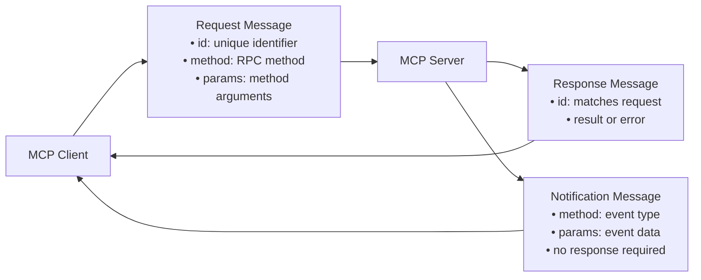
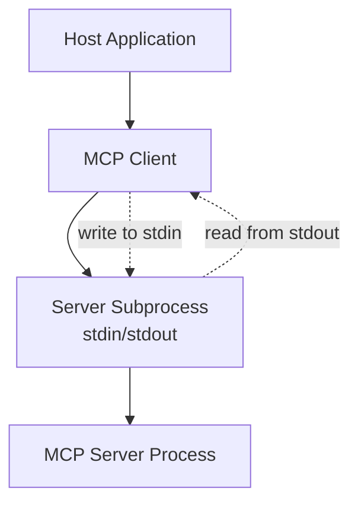
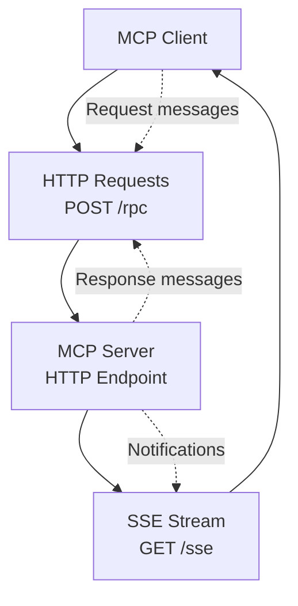
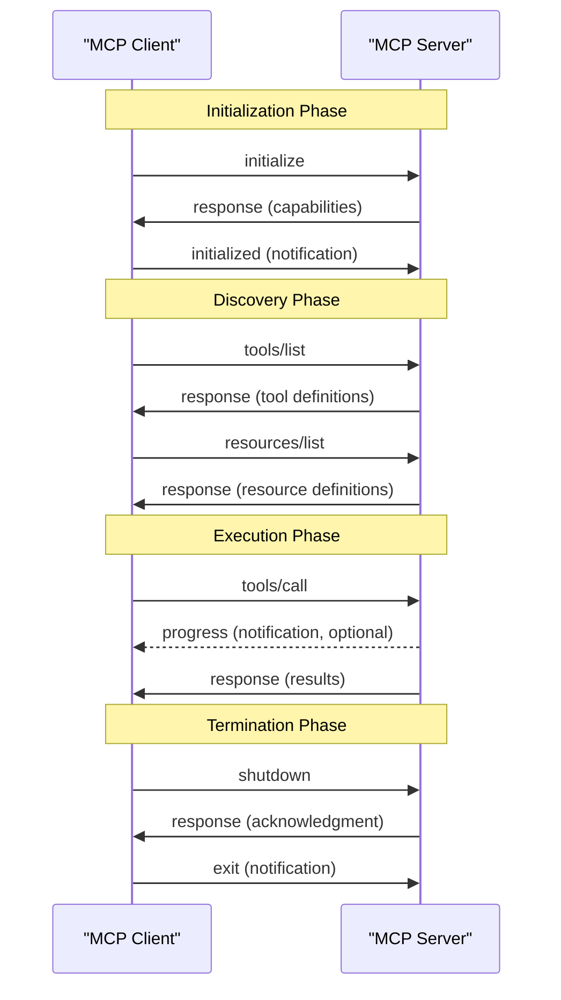
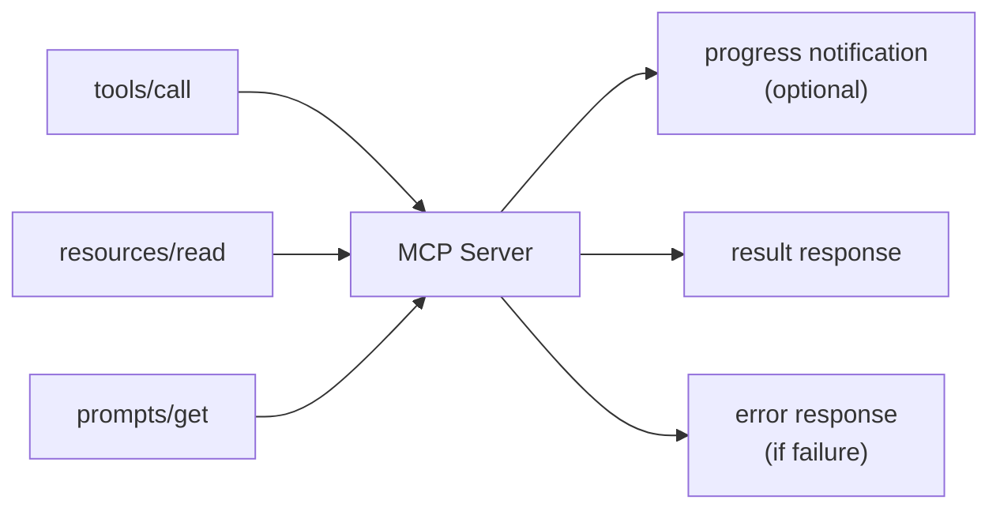

<!-- source: DeepWiki mcp.deepwiki.com · repo huggingface/mcp-course · page 2.2 Communication Protocol · fetched 2026-10-26 -->

# Communication Protocol

<details>
<summary>Relevant source files</summary>

The following files were used as context for generating this wiki page:

- [units/en/unit1/architectural-components.mdx](units/en/unit1/architectural-components.mdx)
- [units/en/unit1/communication-protocol.mdx](units/en/unit1/communication-protocol.mdx)
- [units/en/unit1/gradio-mcp.mdx](units/en/unit1/gradio-mcp.mdx)

</details>


## Purpose and Scope

This document covers the MCP (Model Context Protocol) communication protocol, including the JSON-RPC 2.0 message format, transport mechanisms, and protocol lifecycle. The communication protocol defines how MCP Clients and Servers exchange messages in a standardized, interoperable way.

For information about the architectural components and roles of Hosts, Clients, and Servers, see [Core Concepts and Architecture](#2.1). For specific client implementations and configuration patterns, see [MCP Clients](#3).

## JSON-RPC 2.0 Foundation

MCP uses **JSON-RPC 2.0** as the foundational message format for all communication between Clients and Servers. This provides a lightweight, language-agnostic remote procedure call protocol that is human-readable and well-established in the industry.

The protocol supports three fundamental message types that enable structured communication:



**JSON-RPC Message Flow Between Client and Server**

Sources: [units/en/unit1/communication-protocol.mdx:11-18]()

## Message Types

### Requests

Request messages are sent from Client to Server to initiate operations. Each request includes a unique `id`, the `method` name to invoke, and optional `params` for method arguments.

Common MCP request methods include:
- `tools/call` - Execute a specific tool
- `tools/list` - Discover available tools  
- `resources/list` - Discover available resources
- `prompts/list` - Discover available prompts
- `initialize` - Initialize the connection

```json
{
  "jsonrpc": "2.0",
  "id": 1,
  "method": "tools/call",
  "params": {
    "name": "weather",
    "arguments": {
      "location": "San Francisco"
    }
  }
}
```

Sources: [units/en/unit1/communication-protocol.mdx:23-44]()

### Responses

Response messages are sent from Server to Client in reply to requests. They contain the same `id` as the corresponding request and either a `result` for successful operations or an `error` for failures.

Success response example:
```json
{
  "jsonrpc": "2.0",
  "id": 1,
  "result": {
    "temperature": 62,
    "conditions": "Partly cloudy"
  }
}
```

Error response example:
```json
{
  "jsonrpc": "2.0",
  "id": 1,
  "error": {
    "code": -32602,
    "message": "Invalid location parameter"
  }
}
```

Sources: [units/en/unit1/communication-protocol.mdx:46-75]()

### Notifications

Notifications are one-way messages that don't require responses, typically sent from Server to Client to provide updates or progress information.

```json
{
  "jsonrpc": "2.0",
  "method": "progress",
  "params": {
    "message": "Processing data...",
    "percent": 50
  }
}
```

Sources: [units/en/unit1/communication-protocol.mdx:76-91]()

## Transport Mechanisms

MCP supports two primary transport mechanisms for delivering JSON-RPC messages between Clients and Servers.

### stdio Transport

The stdio transport enables local communication where Client and Server run on the same machine. The Host application launches the Server as a subprocess and communicates through standard input/output streams.



**stdio Transport Architecture**

Key characteristics:
- **Simple setup**: No network configuration required
- **Security**: Sandboxed by operating system process isolation  
- **Use cases**: Local file system access, running local scripts
- **Process management**: Host manages Server subprocess lifecycle

Sources: [units/en/unit1/communication-protocol.mdx:96-109]()

### HTTP+SSE Transport

The HTTP+SSE (Server-Sent Events) transport enables remote communication across networks. Communication occurs over HTTP with SSE providing a persistent connection for Server-to-Client notifications.



**HTTP+SSE Transport Architecture**

Key characteristics:
- **Network connectivity**: Works across machines and networks
- **Web integration**: Compatible with web services and APIs
- **Serverless support**: Works in serverless environments
- **Bidirectional**: HTTP for requests/responses, SSE for notifications

The Gradio MCP integration uses this transport with endpoints at:
- **SSE endpoint**: `/gradio_api/mcp/sse` for persistent connections
- **Schema endpoint**: `/gradio_api/mcp/schema` for capability discovery

Sources: [units/en/unit1/communication-protocol.mdx:110-125](), [units/en/unit1/gradio-mcp.mdx:75-78](), [units/en/unit1/gradio-mcp.mdx:96]()

## Protocol Lifecycle

The MCP protocol defines a structured interaction lifecycle with four distinct phases:



**Complete MCP Protocol Lifecycle**

### Initialization Phase

The initialization phase establishes the connection and negotiates protocol capabilities:

1. **Initialize request**: Client sends protocol version and capabilities
2. **Initialize response**: Server responds with supported version and capabilities  
3. **Initialized notification**: Client confirms initialization completion

| Step | Direction | Message | Purpose |
|------|-----------|---------|---------|
| 1 | Client → Server | `initialize` | Protocol negotiation |
| 2 | Server → Client | response | Capability exchange |
| 3 | Client → Server | `initialized` | Completion confirmation |

Sources: [units/en/unit1/communication-protocol.mdx:133-155]()

### Discovery Phase

The discovery phase allows Clients to learn about available Server capabilities:

1. **List tools**: Client requests available tools with `tools/list`
2. **List resources**: Client requests available resources with `resources/list`  
3. **List prompts**: Client requests available prompts with `prompts/list`

Each discovery request returns structured definitions including names, descriptions, and parameter schemas.

Sources: [units/en/unit1/communication-protocol.mdx:157-174]()

### Execution Phase

The execution phase involves invoking Server capabilities based on Host requirements:

1. **Capability invocation**: Client sends `tools/call`, `resources/read`, or `prompts/get`
2. **Progress notifications**: Server optionally sends progress updates
3. **Result response**: Server returns execution results or errors



**Execution Phase Message Flow**

Sources: [units/en/unit1/communication-protocol.mdx:176-196]()

### Termination Phase

The termination phase gracefully closes the connection:

1. **Shutdown request**: Client sends `shutdown` when done
2. **Shutdown response**: Server acknowledges shutdown
3. **Exit notification**: Client sends final `exit` message

Sources: [units/en/unit1/communication-protocol.mdx:198-220]()

## Protocol Implementation Details

### Gradio MCP Server Implementation

The Gradio MCP integration automatically handles protocol details when `mcp_server=True` is specified in the `launch()` method:

1. **Automatic tool conversion**: Gradio functions become MCP tools with schemas
2. **Input mapping**: Gradio input components map to tool argument schemas  
3. **Output formatting**: Gradio output components determine response format
4. **Transport setup**: HTTP+SSE transport is configured automatically

```python
# Enables MCP server functionality
demo.launch(mcp_server=True)
```

Alternative environment variable configuration:
```bash
export GRADIO_MCP_SERVER=True
```

The implementation provides endpoints:
- **SSE endpoint**: `http://server:port/gradio_api/mcp/sse`
- **Schema endpoint**: `http://server:port/gradio_api/mcp/schema`

Sources: [units/en/unit1/gradio-mcp.mdx:86-96](), [units/en/unit1/gradio-mcp.mdx:98-107]()

### Compatibility Considerations

Some MCP Hosts don't support SSE-based servers. The `mcp-remote` proxy can bridge compatibility:

```json
{
  "mcpServers": {
    "gradio": {
      "command": "npx",
      "args": [
        "mcp-remote",
        "http://your-server:port/gradio_api/mcp/sse"
      ]
    }
  }
}
```

Sources: [units/en/unit1/gradio-mcp.mdx:123-137]()

## Protocol Evolution and Extensibility

The MCP protocol is designed for evolution and backward compatibility:

- **Version negotiation**: Initialization includes protocol version exchange
- **Capability discovery**: Enables Clients to adapt to Server-specific features
- **Extensible methods**: New RPC methods can be added without breaking existing implementations
- **Transport flexibility**: New transport mechanisms can be added while maintaining existing ones

This design allows mixing basic and advanced Servers in the same ecosystem while maintaining interoperability.

Sources: [units/en/unit1/communication-protocol.mdx:222-224]()

---

