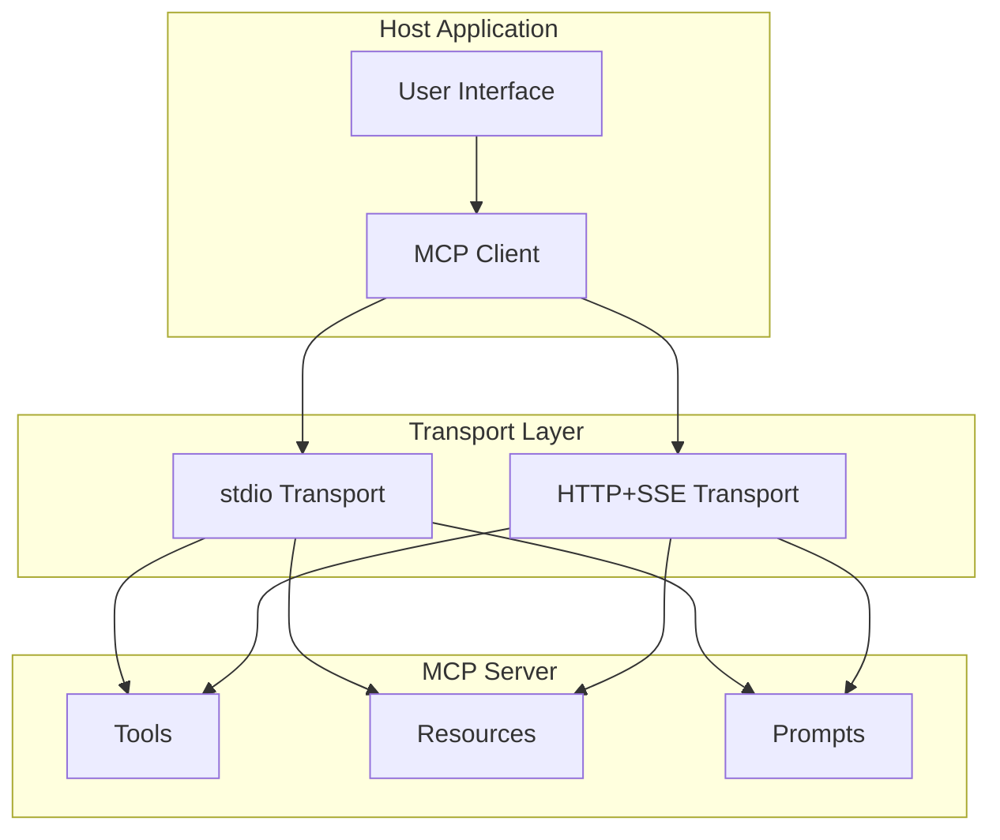
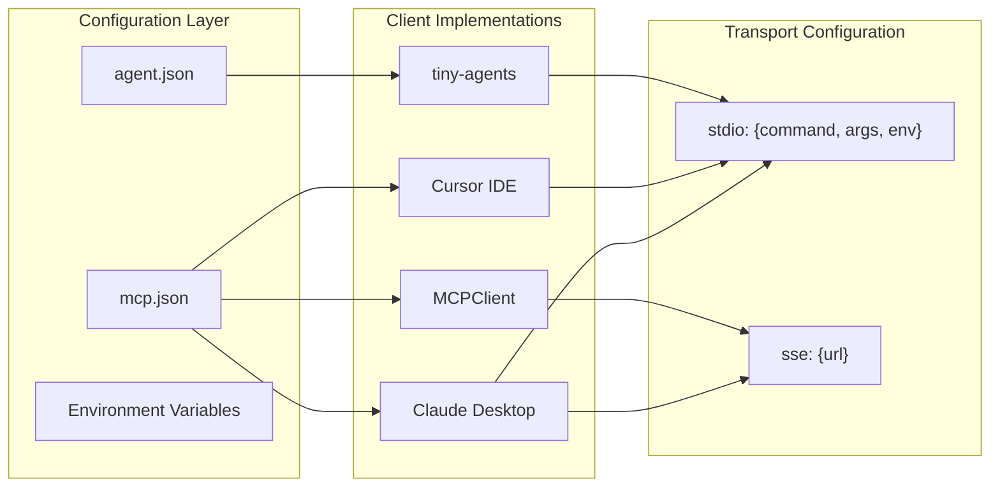

<!-- source: DeepWiki mcp.deepwiki.com · repo huggingface/mcp-course · page 3 MCP Clients · fetched 2026-10-26 -->

# MCP Clients

<details>
<summary>Relevant source files</summary>

The following files were used as context for generating this wiki page:

- [units/en/unit1/mcp-clients.mdx](units/en/unit1/mcp-clients.mdx)
- [units/en/unit2/clients.mdx](units/en/unit2/clients.mdx)
- [units/en/unit2/gradio-server.mdx](units/en/unit2/gradio-server.mdx)

</details>


## Purpose and Scope

MCP Clients serve as the communication bridge between AI applications (Hosts) and external capabilities provided by MCP Servers. This page covers the architecture, types, and configuration patterns of MCP Client implementations, focusing on how they establish connections, manage transport protocols, and facilitate tool discovery and execution.

For detailed configuration syntax and transport setup, see [Client Configuration and Transport](#3.1). For specific client implementation examples, see [Gradio MCP Client](#3.2), [Tiny Agents](#3.3), and [Continue IDE Integration](#3.4).

## MCP Client Architecture

MCP Clients operate as specialized modules within Host applications, responsible for managing the JSON-RPC communication protocol and transport layer connections to MCP Servers.

### Client-Server Communication Flow



Sources: [units/en/unit1/mcp-clients.mdx:23-26](), [units/en/unit2/clients.mdx:1-4]()

### Configuration-Driven Discovery



Sources: [units/en/unit1/mcp-clients.mdx:54-77](), [units/en/unit2/clients.mdx:15-31]()

## Types of MCP Clients

### User Interface Clients

User Interface Clients provide direct interaction capabilities for end users through chat interfaces and interactive development environments.

| Client Type | Implementation | Primary Use Case |
|-------------|----------------|------------------|
| Chat Interface | Claude Desktop | General AI assistance with tool access |
| IDE Integration | Cursor IDE | AI-powered coding with MCP tool support |
| Development Environment | Continue.dev | VS Code extension with local model support |

**Key Configuration Pattern**: These clients use `mcp.json` configuration files with `servers` arrays defining connection parameters.

Sources: [units/en/unit1/mcp-clients.mdx:27-40]()

### Programmatic Clients

Programmatic Clients enable developers to integrate MCP capabilities directly into applications and workflows.

| Client Implementation | Package/Command | Transport Support |
|----------------------|-----------------|-------------------|
| `tiny-agents` | `@huggingface/tiny-agents` | `stdio` |
| `MCPClient` | `huggingface_hub[mcp]` | `sse` |
| `smolagents` | `smolagents` + `MCPClient` | `sse` |

**Configuration Pattern**: These clients use `agent.json` files or direct API calls for server connection specification.

Sources: [units/en/unit1/mcp-clients.mdx:230-334](), [units/en/unit2/clients.mdx:1-4]()

## Configuration Patterns

### Standard mcp.json Structure

The `mcp.json` configuration file follows a consistent structure across MCP Client implementations:

```json
{
  "servers": [
    {
      "name": "server-identifier",
      "transport": {
        "type": "stdio|sse",
        // transport-specific configuration
      }
    }
  ]
}
```

**stdio Transport Configuration**:
- `command`: Executable command (e.g., `"python"`, `"npx"`)
- `args`: Command arguments array
- `env`: Environment variables object

**sse Transport Configuration**:
- `url`: HTTP+SSE endpoint URL

Sources: [units/en/unit1/mcp-clients.mdx:59-98](), [units/en/unit2/clients.mdx:17-31]()

### Environment Variable Integration

MCP Clients support environment variable injection for secure credential management:

```json
{
  "servers": [{
    "name": "authenticated-server",
    "transport": {
      "type": "stdio",
      "command": "python",
      "args": ["/path/to/server.py"],
      "env": {
        "GITHUB_TOKEN": "token_value",
        "API_KEY": "key_value"
      }
    }
  }]
}
```

Server implementations access these through `os.environ.get()` in Python or `process.env` in JavaScript.

Sources: [units/en/unit1/mcp-clients.mdx:120-183]()

## Implementation Approaches

### Direct Integration Pattern

Applications like Claude Desktop and Cursor IDE embed MCP Client functionality directly, parsing `mcp.json` configurations and managing transport connections internally.

### Proxy Bridge Pattern

For clients that don't support HTTP+SSE transport, the `mcp-remote` tool provides a bridge:

```json
{
  "mcpServers": {
    "remote-server": {
      "command": "npx",
      "args": ["-y", "mcp-remote", "https://server.hf.space/gradio_api/mcp/sse", "--transport", "sse-only"]
    }
  }
}
```

This pattern converts remote SSE connections to local stdio interfaces.

Sources: [units/en/unit2/clients.mdx:127-135]()

### Agent Framework Integration

The `tiny-agents` implementation demonstrates agent-centric MCP integration:

1. Install prerequisites: `npm install -g npx`, `pip install "huggingface_hub[mcp]>=0.32.0"`
2. Configure `agent.json` with model and server specifications
3. Execute with `tiny-agents run agent.json` or `npx @huggingface/tiny-agents run ./agent-dir`

This approach combines LLM orchestration with MCP tool discovery and execution.

Sources: [units/en/unit1/mcp-clients.mdx:240-334]()

---

