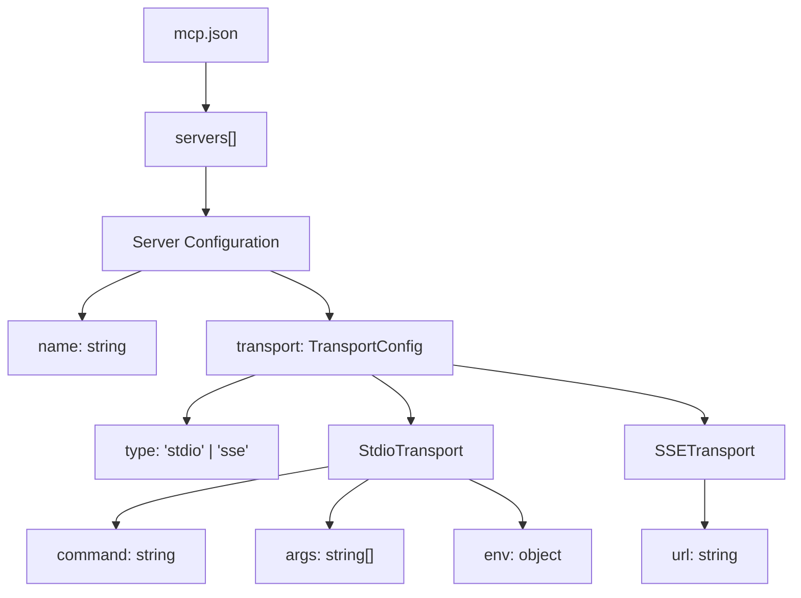
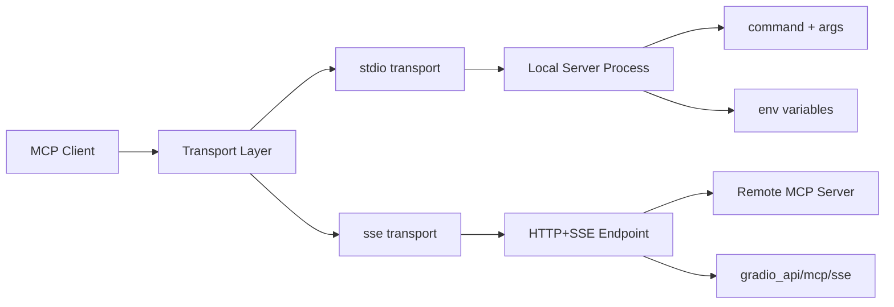
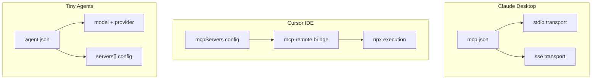
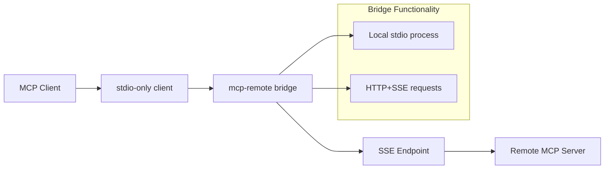

<!-- source: DeepWiki mcp.deepwiki.com · repo huggingface/mcp-course · page 3.1 Client Configuration and Transport · fetched 2026-10-26 -->

# Client Configuration and Transport

<details>
<summary>Relevant source files</summary>

The following files were used as context for generating this wiki page:

- [units/en/unit1/mcp-clients.mdx](units/en/unit1/mcp-clients.mdx)
- [units/en/unit2/clients.mdx](units/en/unit2/clients.mdx)
- [units/en/unit2/gradio-server.mdx](units/en/unit2/gradio-server.mdx)

</details>


This document covers the configuration mechanisms and transport protocols used by MCP (Model Context Protocol) clients to connect to MCP servers. It focuses on the `mcp.json` configuration file structure, transport layer options, environment variable handling, and client-specific setup patterns.

For information about implementing MCP clients programmatically, see [Gradio MCP Client](#3.2) and [Tiny Agents](#3.3). For MCP server implementation details, see [MCP Servers](#4).

## MCP Configuration File Structure

MCP clients use a standardized JSON configuration file to define server connections and transport settings. The configuration follows a consistent structure across different MCP client implementations.

### Basic mcp.json Structure

The standard configuration file uses the following schema:

```json
{
  "servers": [
    {
      "name": "Server Name",
      "transport": {
        "type": "stdio|sse",
        // Transport-specific configuration
      }
    }
  ]
}
```

This structure supports multiple server definitions within a single configuration file, allowing clients to connect to multiple MCP servers simultaneously.

**Configuration File Structure**



Sources: [units/en/unit1/mcp-clients.mdx:59-77](), [units/en/unit2/clients.mdx:15-31]()

## Transport Types and Configuration

MCP supports two primary transport mechanisms for client-server communication: stdio (Standard Input/Output) and SSE (Server-Sent Events over HTTP).

### stdio Transport Configuration

The stdio transport is used for local server processes that communicate through standard input and output streams.

```json
{
  "servers": [
    {
      "name": "File Explorer",
      "transport": {
        "type": "stdio",
        "command": "python",
        "args": ["/path/to/file_explorer_server.py"]
      }
    }
  ]
}
```

Key configuration parameters:
- `command`: The executable command to launch the server process
- `args`: Array of command-line arguments passed to the server process
- `env`: Optional environment variables for the server process

### HTTP+SSE Transport Configuration

The SSE transport enables connection to remote MCP servers via HTTP with Server-Sent Events for real-time communication.

```json
{
  "servers": [
    {
      "name": "Remote API Server",
      "transport": {
        "type": "sse",
        "url": "https://example.com/gradio_api/mcp/sse"
      }
    }
  ]
}
```

The `url` parameter specifies the complete endpoint for the MCP server's SSE interface.

**Transport Layer Architecture**



Sources: [units/en/unit1/mcp-clients.mdx:82-119](), [units/en/unit2/clients.mdx:42-58]()

## Environment Variables

Environment variables provide a secure mechanism for passing sensitive configuration data to MCP servers without hardcoding credentials in configuration files.

### Environment Variable Configuration

Environment variables are specified in the `env` field of the stdio transport configuration:

```json
{
  "servers": [
    {
      "name": "GitHub API",
      "transport": {
        "type": "stdio",
        "command": "python",
        "args": ["/path/to/github_server.py"],
        "env": {
          "GITHUB_TOKEN": "your_github_token"
        }
      }
    }
  ]
}
```

### Server-Side Environment Variable Access

MCP servers access these environment variables using standard library functions:

**Python Implementation:**
```python
import os
github_token = os.environ.get("GITHUB_TOKEN")
```

**JavaScript Implementation:**
```javascript
const githubToken = process.env.GITHUB_TOKEN;
```

Sources: [units/en/unit1/mcp-clients.mdx:120-183]()

## Client-Specific Configuration Patterns

Different MCP client implementations have specific configuration requirements and patterns.

### Claude Desktop Configuration

Claude Desktop uses the standard `mcp.json` format with support for both transport types:

```json
{
  "servers": [
    {
      "name": "Sentiment Analysis",
      "transport": {
        "type": "sse",
        "url": "https://username-mcp-sentiment.hf.space/gradio_api/mcp/sse"
      }
    }
  ]
}
```

### Cursor IDE Configuration

Cursor IDE requires specific configuration through its settings interface, often using the `mcp-remote` bridge for SSE compatibility:

**macOS Configuration:**
```json
{
  "mcpServers": {
    "sentiment-analysis": {
      "command": "npx",
      "args": [
        "-y", 
        "mcp-remote", 
        "https://YOURUSENAME-mcp-sentiment.hf.space/gradio_api/mcp/sse", 
        "--transport", 
        "sse-only"
      ]
    }
  }
}
```

**Windows Configuration:**
```json
{
  "mcpServers": {
    "sentiment-analysis": {
      "command": "cmd",
      "args": [
        "/c", 
        "npx", 
        "-y", 
        "mcp-remote", 
        "https://YOURUSENAME-mcp-sentiment.hf.space/gradio_api/mcp/sse", 
        "--transport", 
        "sse-only"
      ]
    }
  }
}
```

### Tiny Agents Configuration

Tiny agents use an `agent.json` configuration file with additional model and provider specifications:

```json
{
    "model": "Qwen/Qwen2.5-72B-Instruct",
    "provider": "nebius",
    "servers": [
        {
            "type": "stdio",
            "config": {
                "command": "npx",
                "args": ["@playwright/mcp@latest"]
            }
        }
    ]
}
```

**Client Configuration Patterns**



Sources: [units/en/unit2/clients.mdx:81-136](), [units/en/unit1/mcp-clients.mdx:268-333]()

## Transport Bridge Solutions

Some MCP clients have limited transport support, requiring bridge solutions for compatibility with remote servers.

### mcp-remote Bridge

The `mcp-remote` tool serves as a transport bridge that:
- Runs locally as a stdio process
- Forwards requests to remote SSE endpoints
- Provides compatibility for clients that only support stdio transport

**Bridge Configuration Example:**
```json
{
  "mcpServers": {
    "gradio": {
      "command": "npx",
      "args": [
        "mcp-remote",
        "http://localhost:7860/gradio_api/mcp/sse"
      ]
    }
  }
}
```

**Transport Bridge Architecture**



Sources: [units/en/unit2/clients.mdx:127-136](), [units/en/unit2/gradio-server.mdx:134-149]()

## Configuration Validation and Debugging

### Schema Validation

MCP servers expose their schema through dedicated endpoints for validation:

- **Schema Endpoint:** `http://localhost:7860/gradio_api/mcp/schema`
- **API Documentation:** Available in Gradio app footer "View API" link

### Common Configuration Issues

| Issue | Symptom | Solution |
|-------|---------|----------|
| Transport mismatch | Connection refused | Verify transport type matches server |
| Missing environment variables | Authentication errors | Check `env` field configuration |
| Incorrect endpoint URL | 404 errors | Validate SSE endpoint path |
| Bridge compatibility | Protocol errors | Use `mcp-remote` for stdio-only clients |

### Configuration Testing

**Validation Steps:**
1. Verify server accessibility at configured endpoint
2. Check MCP schema availability
3. Test tool discovery and invocation
4. Validate environment variable propagation

Sources: [units/en/unit2/gradio-server.mdx:116-154]()

## Deployment Considerations

### Local Development

For local development, stdio transport provides direct process communication:

```json
{
  "servers": [
    {
      "name": "Local Server",
      "transport": {
        "type": "stdio",
        "command": "python",
        "args": ["./local_server.py"]
      }
    }
  ]
}
```

### Remote Deployment

Remote servers typically use SSE transport with full URL specifications:

```json
{
  "servers": [
    {
      "name": "Production Server",
      "transport": {
        "type": "sse",
        "url": "https://username-server.hf.space/gradio_api/mcp/sse"
      }
    }
  ]
}
```

### Hugging Face Spaces Integration

Gradio MCP servers deployed to Hugging Face Spaces expose their MCP endpoints at:
`https://USERNAME-SPACENAME.hf.space/gradio_api/mcp/sse`

Sources: [units/en/unit2/gradio-server.mdx:155-183](), [units/en/unit1/mcp-clients.mdx:187-226]()

---

