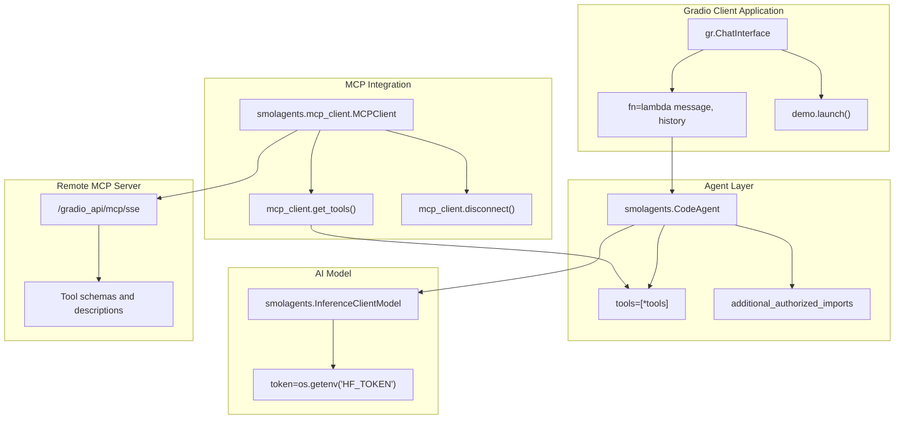
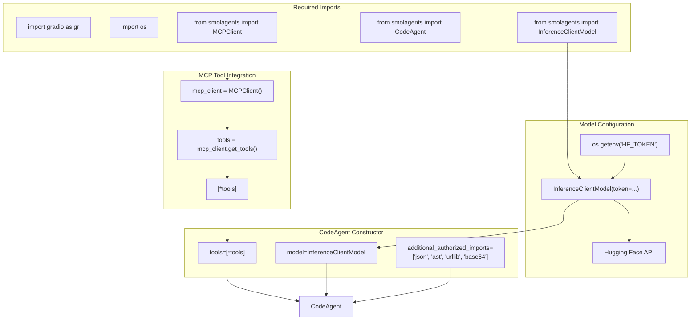
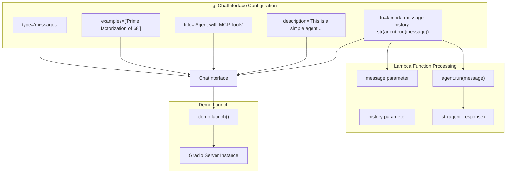
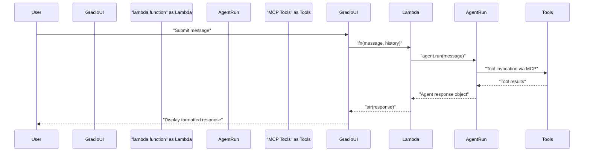
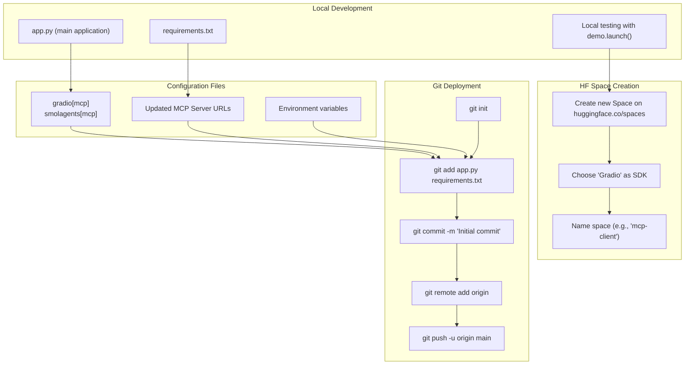
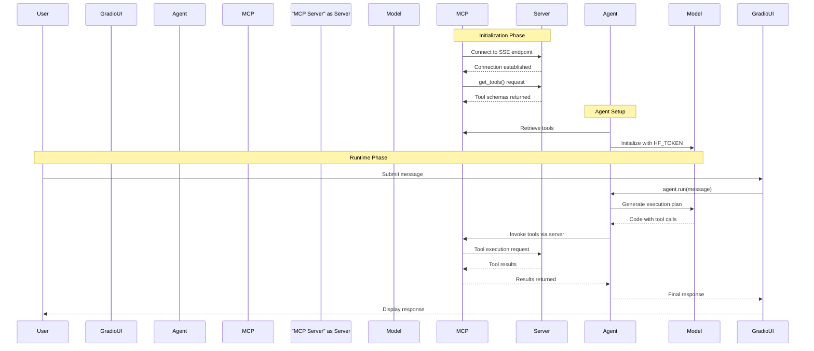

<!-- source: DeepWiki mcp.deepwiki.com · repo huggingface/mcp-course · page 3.2 Gradio MCP Client · fetched 2026-10-26 -->

# Gradio MCP Client

<details>
<summary>Relevant source files</summary>

The following files were used as context for generating this wiki page:

- [units/en/unit2/gradio-client.mdx](units/en/unit2/gradio-client.mdx)
- [units/en/unit2/tiny-agents.mdx](units/en/unit2/tiny-agents.mdx)

</details>


This document covers how to use Gradio as an MCP client to connect to and interact with MCP servers. The Gradio MCP client leverages the `smolagents` library with `MCPClient` to create chat interfaces that can invoke tools from remote MCP servers through Server-Sent Events (SSE) transport.

For information about building MCP servers using Gradio, see [Gradio MCP Server](#4.1). For other MCP client implementations, see [Tiny Agents](#3.3) and [Continue IDE Integration](#3.4).

## Architecture Overview

The Gradio MCP client implementation follows a layered architecture that integrates several key components to create an interactive chat interface with MCP tool capabilities.

### Core Component Interaction



Sources: [units/en/unit2/gradio-client.mdx:55-93](), [units/en/unit2/gradio-client.mdx:109-136]()

## MCPClient Setup and Configuration

The `MCPClient` from the `smolagents.mcp_client` module serves as the primary interface for connecting to remote MCP servers using Server-Sent Events (SSE) transport.

### Required Dependencies

The implementation requires specific packages to be installed:

| Package | Purpose |
|---------|---------|
| `smolagents[mcp]` | Provides `MCPClient` and `CodeAgent` |
| `gradio[mcp]` | Gradio with MCP support |
| `mcp` | MCP protocol implementation |
| `fastmcp` | Additional MCP utilities |

### Basic Connection Setup

The client connects to MCP servers through their SSE endpoints using a URL configuration:

```python
from smolagents.mcp_client import MCPClient

mcp_client = MCPClient(
    {"url": "https://abidlabs-mcp-tool-http.hf.space/gradio_api/mcp/sse"}
)
```

### Tool Discovery and Retrieval

The `get_tools()` method discovers available tools from the remote server:

```python
tools = mcp_client.get_tools()
```

Example tool discovery output shows available capabilities:
- `prime_factors`: Compute the prime factorization of a positive integer
- `generate_cheetah_image`: Generate a cheetah image  
- `image_orientation`: Returns whether image is portrait or landscape
- `sepia`: Apply a sepia filter to the input image

### Connection Management

The client maintains a persistent connection and requires proper cleanup:

```python
try:
    mcp_client = MCPClient({"url": "https://server-url.hf.space/gradio_api/mcp/sse"})
    tools = mcp_client.get_tools()
    # ... application logic
finally:
    mcp_client.disconnect()
```

Sources: [units/en/unit2/gradio-client.mdx:46-50](), [units/en/unit2/gradio-client.mdx:22-40](), [units/en/unit2/gradio-client.mdx:134-136]()

## CodeAgent Integration

The `CodeAgent` from `smolagents` serves as the execution engine that combines MCP tools with language model capabilities to process user requests and generate code-based responses.

### Agent Configuration Flow



### Key Configuration Parameters

The `CodeAgent` constructor requires specific parameters for MCP integration:

| Parameter | Type | Purpose |
|-----------|------|---------|
| `tools` | `List[Tool]` | Tools retrieved from `mcp_client.get_tools()` |
| `model` | `InferenceClientModel` | Language model for code generation |
| `additional_authorized_imports` | `List[str]` | Python modules allowed during code execution |

### Token Configuration

The agent requires authentication through environment variables:

```python
model = InferenceClientModel(token=os.getenv("HF_TOKEN"))
# Alternative token name in examples:
model = InferenceClientModel(token=os.getenv("HUGGINGFACE_API_TOKEN"))
```

### Complete Agent Setup

```python
agent = CodeAgent(
    tools=[*tools], 
    model=model, 
    additional_authorized_imports=["json", "ast", "urllib", "base64"]
)
```

Sources: [units/en/unit2/gradio-client.mdx:55-79](), [units/en/unit2/gradio-client.mdx:116-123]()

## Chat Interface Implementation

The `gr.ChatInterface` provides the user-facing component that handles message input and response display through a lambda function that invokes the `CodeAgent`.

### Interface Configuration Parameters



### Example Prompts and Interface Properties

The chat interface includes predefined examples to guide user interaction:

| Property | Value | Purpose |
|----------|-------|---------|
| `examples` | `["Prime factorization of 68"]` | Sample prompts for users |
| `type` | `"messages"` | Chat interface message format |
| `title` | `"Agent with MCP Tools"` | Application title |
| `description` | Explanatory text | User guidance |

### Message Processing Pipeline



The lambda function acts as the interface adapter, converting agent responses to string format for display in the chat interface.

Sources: [units/en/unit2/gradio-client.mdx:84-92](), [units/en/unit2/gradio-client.mdx:125-131]()

## Deployment to Hugging Face Spaces

The Gradio MCP client can be deployed to Hugging Face Spaces for public access, following a specific deployment workflow with required configuration files.

### Deployment Workflow



### Required Configuration Files

#### requirements.txt
```
gradio[mcp]
smolagents[mcp]
```

#### Updated Server URLs
For deployed spaces, update the MCP client configuration:
```python
mcp_client = MCPClient(
    {"url": "https://abidlabs-mcp-tool-http.hf.space/gradio_api/mcp/sse"}
)
```

### Git Authentication

The deployment process requires proper authentication setup:
- Use access tokens instead of passwords (refer to password-git-deprecation documentation)
- Configure remote origin with proper credentials
- Push code to the Hugging Face Space repository

### Environment Variables

The deployed application requires environment configuration for:
- `HF_TOKEN` or `HUGGINGFACE_API_TOKEN` for model access
- Any additional API keys required by MCP tools

Sources: [units/en/unit2/gradio-client.mdx:140-175]()

## Complete Implementation Workflow

The following diagram illustrates the complete workflow from initialization to user interaction:



This workflow demonstrates the complete integration of Gradio's user interface capabilities with MCP's tool discovery and execution protocol, mediated by the smolagents framework.

Sources: [units/en/unit2/gradio-client.mdx:109-138]()

---

