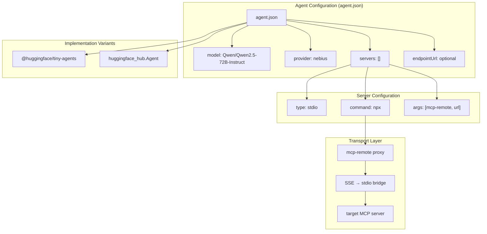
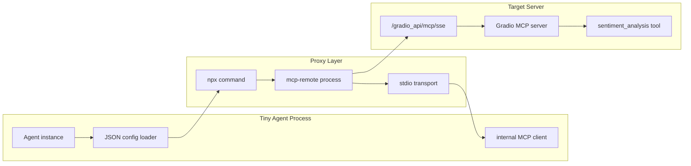

<!-- source: DeepWiki mcp.deepwiki.com · repo huggingface/mcp-course · page 3.3 Tiny Agents · fetched 2026-10-26 -->

# Tiny Agents

<details>
<summary>Relevant source files</summary>

The following files were used as context for generating this wiki page:

- [units/en/unit2/gradio-client.mdx](units/en/unit2/gradio-client.mdx)
- [units/en/unit2/tiny-agents.mdx](units/en/unit2/tiny-agents.mdx)

</details>


This page covers lightweight MCP agent implementations using `@huggingface/tiny-agents` for TypeScript and `huggingface_hub.Agent` for Python. These agents provide a simplified approach to building MCP clients that can connect to multiple MCP servers through standardized JSON configuration.

For MCP client configuration patterns and transport mechanisms, see [Client Configuration and Transport](#3.1). For Gradio-specific MCP client implementations, see [Gradio MCP Client](#3.2).

## Architecture and Components

Tiny Agents provide a lightweight wrapper around MCP client functionality, supporting both TypeScript and Python implementations with shared configuration patterns.

### Agent Configuration Architecture



Sources: [units/en/unit2/tiny-agents.mdx:70-136]()

### MCP Server Integration Pattern



Sources: [units/en/unit2/tiny-agents.mdx:185-227]()

## TypeScript Implementation

The TypeScript implementation uses the `@huggingface/tiny-agents` package to create agents with programmatic configuration.

### Agent Class Configuration

The TypeScript `Agent` class accepts configuration objects with server definitions:

```typescript
// Configuration pattern from tiny-agents.mdx
const agent = new Agent({
    provider: process.env.PROVIDER ?? "nebius",
    model: process.env.MODEL_ID ?? "Qwen/Qwen2.5-72B-Instruct",
    apiKey: process.env.HF_TOKEN,
    servers: [
        {
            command: "npx",
            args: [
                "mcp-remote",
                "http://localhost:7860/gradio_api/mcp/sse"
            ]
        }
    ],
});
```

### Command Line Execution

TypeScript agents can be executed via `npx` with JSON configuration files:

| Command | Purpose |
|---------|---------|
| `npx @huggingface/tiny-agents run ./my-agent` | Execute agent from directory |
| `npm install @huggingface/tiny-agents` | Install TypeScript package |

Sources: [units/en/unit2/tiny-agents.mdx:36-96]()

## Python Implementation

The Python implementation uses `huggingface_hub.Agent` class with similar configuration patterns but Python-native syntax.

### Agent Class Instantiation

```python
# Pattern from tiny-agents.mdx
from huggingface_hub import Agent

agent = Agent(
    model="Qwen/Qwen2.5-72B-Instruct",
    provider="nebius",
    servers=[
        {
            "command": "npx",
            "args": [
                "mcp-remote",
                "http://localhost:7860/gradio_api/mcp/sse"
            ]
        }
    ],
)
```

### Installation Requirements

| Package | Purpose |
|---------|---------|
| `huggingface_hub[mcp]>=0.32.0` | Core agent functionality with MCP support |
| `mcp-remote` | SSE to stdio transport proxy |

### Command Line Interface

Python agents use the `tiny-agents` CLI command:

```bash
tiny-agents run agent.json
```

Sources: [units/en/unit2/tiny-agents.mdx:46-134]()

## Configuration Schema

### JSON Configuration Structure

Both implementations use standardized JSON configuration files with the following schema:

| Field | Type | Description | Example |
|-------|------|-------------|---------|
| `model` | string | LLM model identifier | `"Qwen/Qwen2.5-72B-Instruct"` |
| `provider` | string | Inference provider | `"nebius"` |
| `endpointUrl` | string (optional) | Custom endpoint URL | `"http://localhost:1234/v1"` |
| `servers` | array | MCP server configurations | See server config below |

### Server Configuration Schema

Each server entry in the `servers` array contains:

| Field | Type | Description |
|-------|------|-------------|
| `type` | string | Transport type (typically `"stdio"`) |
| `config.command` | string | Executable command (`"npx"`) |
| `config.args` | array | Command arguments |

### Transport Proxy Configuration

The `mcp-remote` proxy bridges SSE endpoints to stdio transport:

```json
{
    "command": "npx",
    "args": [
        "mcp-remote",
        "http://localhost:7860/gradio_api/mcp/sse"
    ]
}
```

Sources: [units/en/unit2/tiny-agents.mdx:72-127]()

## MCP Server Integration

### Gradio Server Connection

Tiny Agents connect to Gradio MCP servers through the SSE endpoint pattern:

```
http://localhost:7860/gradio_api/mcp/sse
```

For deployed Hugging Face Spaces:

```
https://USERNAME-SPACE_NAME.hf.space/gradio_api/mcp/sse
```

### Multi-Server Configuration

Agents can connect to multiple MCP servers simultaneously by adding multiple server configurations to the `servers` array. This enables tool composition across different service providers.

### Local Model Integration

For local inference servers, agents can be configured with custom endpoints:

```json
{
    "model": "Qwen/Qwen3-32B",
    "endpointUrl": "http://localhost:1234/v1",
    "servers": [...]
}
```

Sources: [units/en/unit2/tiny-agents.mdx:147-171](), [units/en/unit2/tiny-agents.mdx:235-250]()

## Deployment Patterns

### Development vs Production URLs

| Environment | URL Pattern | Example |
|-------------|-------------|---------|
| Local development | `http://localhost:PORT/gradio_api/mcp/sse` | `http://localhost:7860/gradio_api/mcp/sse` |
| Hugging Face Spaces | `https://USERNAME-SPACE.hf.space/gradio_api/mcp/sse` | `https://user-mcp-sentiment.hf.space/gradio_api/mcp/sse` |

### Agent Workflow Capabilities

Tiny Agents enable multi-step workflows by combining tools from different MCP servers:

1. File system operations through filesystem servers
2. Custom analysis through Gradio-based tool servers  
3. Result persistence and reporting
4. Integration with external APIs and services

Sources: [units/en/unit2/tiny-agents.mdx:235-268]()

---

