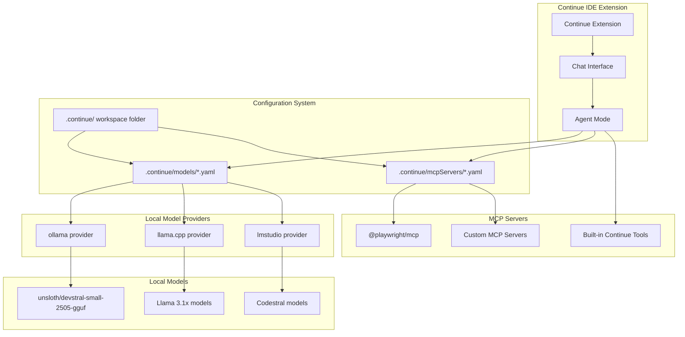
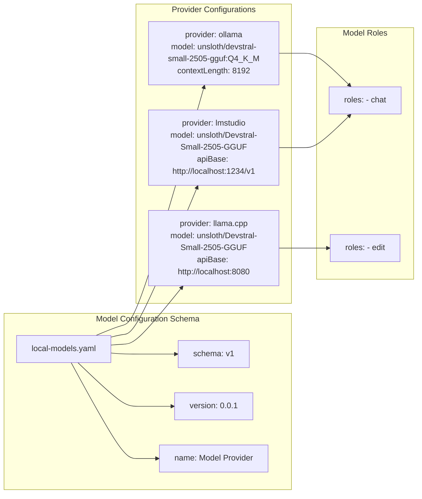
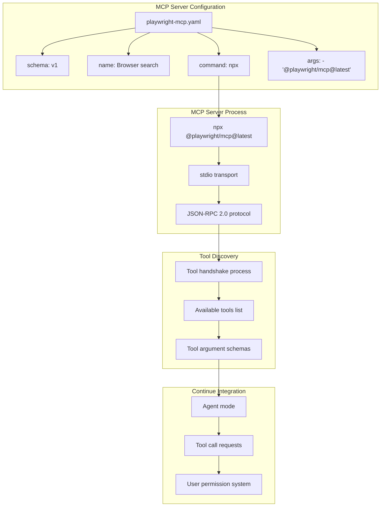
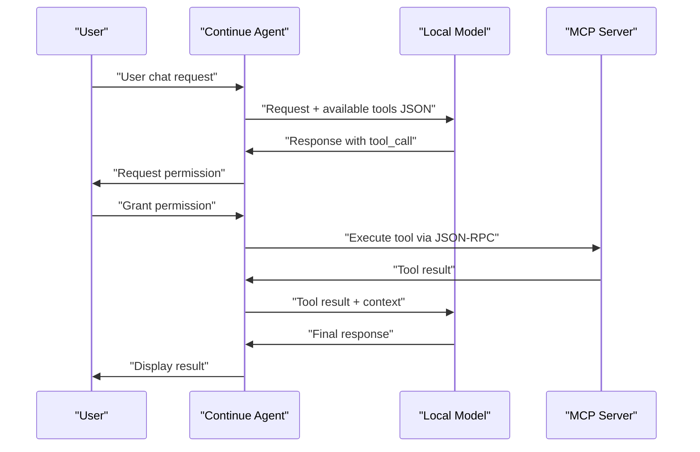

<!-- source: DeepWiki mcp.deepwiki.com · repo huggingface/mcp-course · page 3.4 Continue IDE Integration · fetched 2026-10-26 -->

# Continue IDE Integration

<details>
<summary>Relevant source files</summary>

The following files were used as context for generating this wiki page:

- [units/en/unit2/continue-client.mdx](units/en/unit2/continue-client.mdx)

</details>


## Purpose and Scope

This document covers the integration of Continue IDE with MCP (Model Context Protocol) servers, focusing on local AI coding assistant workflows. Continue enables developers to use local and open-source models with MCP tool calling capabilities directly within VS Code and JetBrains IDEs. 

For information about other MCP client implementations, see [Gradio MCP Client](#3.2) and [Tiny Agents](#3.3). For MCP server development patterns, see [MCP Servers](#4).

## Continue IDE Architecture Overview

Continue provides a bridge between local language models and MCP servers through a standardized configuration system. The integration supports multiple local model providers and allows seamless tool calling workflows within the development environment.

### Continue MCP Integration Architecture



Sources: [units/en/unit2/continue-client.mdx:1-211]()

## Local Model Configuration

Continue supports multiple local model providers through YAML configuration files stored in the `.continue/models` directory. Each provider requires specific configuration parameters for proper integration with MCP tool calling.

### Model Provider Configuration Structure



| Provider | Default API Base | Model Format | Tool Calling Support |
|----------|------------------|--------------|---------------------|
| `ollama` | http://localhost:11434 | GGUF quantized | Yes (with compatible models) |
| `llama.cpp` | http://localhost:8080 | GGUF quantized | Yes (llama-server) |
| `lmstudio` | http://localhost:1234/v1 | GGUF quantized | Yes (OpenAI-compatible API) |

Sources: [units/en/unit2/continue-client.mdx:73-132]()

## MCP Server Integration

Continue integrates with MCP servers through configuration files in the `.continue/mcpServers` directory. Each MCP server is defined with its command, arguments, and connection parameters.

### MCP Server Configuration Pattern



Sources: [units/en/unit2/continue-client.mdx:165-180]()

## Tool Calling Workflow

The tool calling workflow in Continue follows a structured handshake pattern between the model, Continue extension, and MCP servers. This enables autonomous agent behavior with user oversight.

### Tool Handshake Process



The workflow supports both manual permission and automatic execution based on tool policies. Tools with `Automatic` policy skip the permission step for streamlined development workflows.

Sources: [units/en/unit2/continue-client.mdx:139-156]()

## Configuration File Structure

Continue uses a workspace-based configuration system with standardized YAML schemas for both model providers and MCP servers.

### Workspace Configuration Layout

| Directory | Purpose | File Pattern | Schema Version |
|-----------|---------|--------------|----------------|
| `.continue/models/` | Local model configurations | `*.yaml` | `v1` |
| `.continue/mcpServers/` | MCP server definitions | `*.yaml` | `v1` |
| `.continue/` | Workspace root | N/A | N/A |

### Example MCP Server Configuration

The following configuration demonstrates connecting to the Playwright MCP server for web automation tasks:

```yaml
name: Playwright mcpServer
version: 0.0.1
schema: v1
mcpServers:
  - name: Browser search
    command: npx
    args:
      - "@playwright/mcp@latest"
```

This configuration enables tools for web navigation, element extraction, and automated browser interactions within the Continue development environment.

Sources: [units/en/unit2/continue-client.mdx:167-180](), [units/en/unit2/continue-client.mdx:182-197]()

## Integration Benefits and Use Cases

Continue's MCP integration provides several key advantages for local development workflows:

- **Privacy-First Development**: All model inference and tool execution occurs locally
- **Customizable Tool Sets**: MCP servers can be added or removed per project
- **Multi-Model Support**: Switch between different local models based on task requirements
- **IDE-Native Experience**: Tools and responses integrate directly into VS Code/JetBrains workflows

Common use cases include web automation with Playwright MCP, file system operations, API testing, and custom development workflows tailored to specific project requirements.

Sources: [units/en/unit2/continue-client.mdx:200-211]()

---

