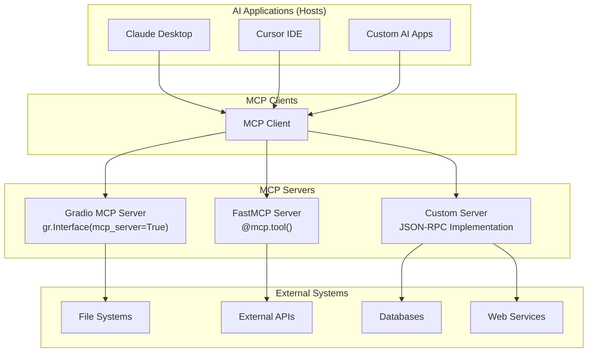
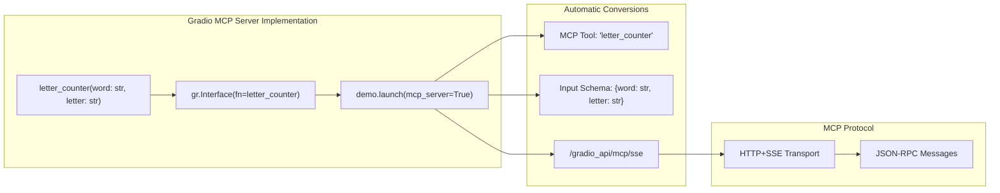
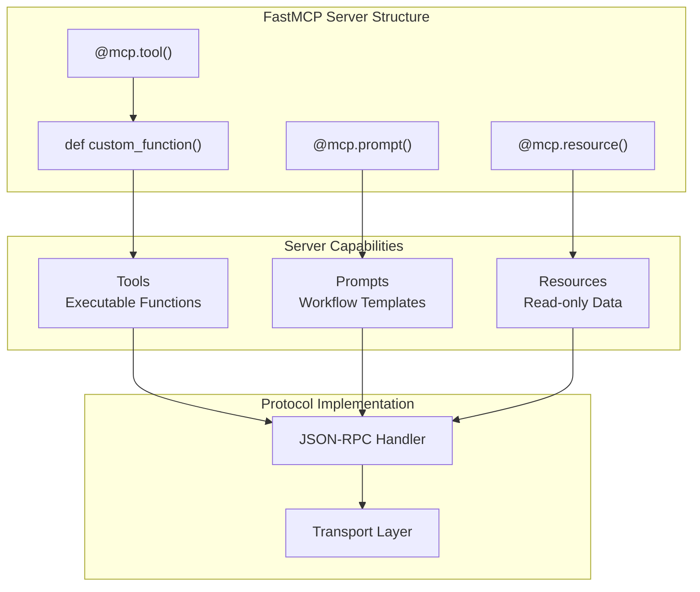
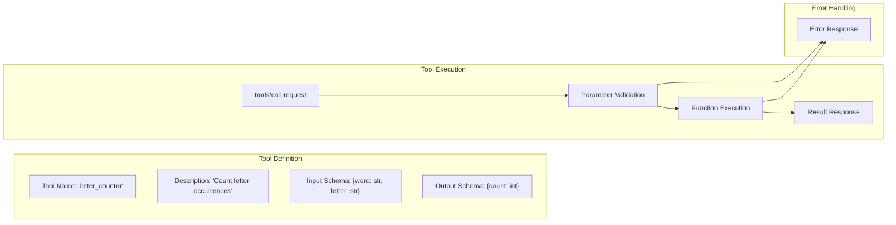
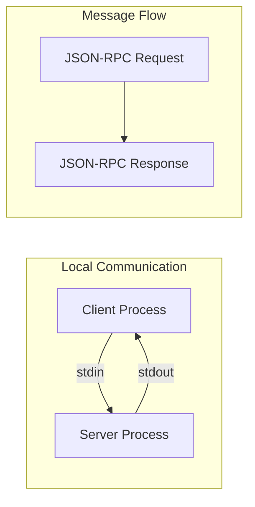
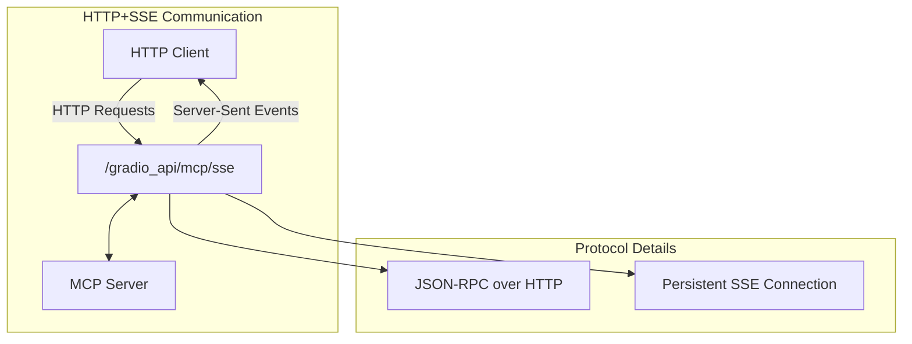

<!-- source: DeepWiki mcp.deepwiki.com · repo huggingface/mcp-course · page 4 MCP Servers · fetched 2026-10-26 -->

# MCP Servers

Relevant source files

The following files were used as context for generating this wiki page:

- [units/en/unit1/architectural-components.mdx](units/en/unit1/architectural-components.mdx)
- [units/en/unit1/communication-protocol.mdx](units/en/unit1/communication-protocol.mdx)
- [units/en/unit1/gradio-mcp.mdx](units/en/unit1/gradio-mcp.mdx)

This document covers MCP Server implementations, including the different approaches for building servers that expose capabilities to AI applications through the Model Context Protocol. It focuses on server-side architecture, implementation patterns, and the various frameworks available for creating MCP servers.

For information about MCP Clients that connect to these servers, see [MCP Clients](#3). For details about the underlying communication protocol, see [Communication Protocol](#2.2).

## Overview

MCP Servers are external programs or services that expose capabilities to AI applications through the standardized Model Context Protocol. They act as bridges between AI models and external systems, providing access to tools, data sources, and services in a structured, discoverable format.

Sources: [units/en/unit1/architectural-components.mdx:40-46](), [units/en/unit1/gradio-mcp.mdx:66-67]()

Key characteristics of MCP Servers include:

- **Standardized Interface**: All servers implement the same MCP protocol regardless of their internal implementation
- **Capability Exposure**: Servers expose their functionality through well-defined capabilities (Tools, Resources, Prompts, Sampling)
- **Transport Flexibility**: Servers can communicate via stdio (local) or HTTP+SSE (remote)
- **Discoverability**: Clients can query servers to discover available capabilities dynamically

## Server Implementation Approaches

MCP Servers can be implemented using several different approaches, each with varying levels of complexity and capability:

### Gradio MCP Integration

The simplest approach uses Gradio's built-in MCP support to automatically convert existing Gradio applications into MCP servers. This approach requires minimal code changes and provides both a web interface and MCP server functionality.

Sources: [units/en/unit1/gradio-mcp.mdx:37-68](), [units/en/unit1/gradio-mcp.mdx:86-92]()

### FastMCP Framework

For more advanced server implementations, the FastMCP framework provides decorators and utilities for building custom MCP servers with full control over capabilities and behavior.

Sources: Based on course structure indicating FastMCP framework usage

### Custom Server Implementation

For maximum flexibility, servers can be implemented from scratch using any programming language that supports JSON-RPC communication. This approach provides complete control over server behavior and capabilities.

## Server Capabilities

MCP Servers expose their functionality through four primary capability types:

| Capability Type | Purpose | Example Use Cases |
|----------------|---------|-------------------|
| **Tools** | Executable functions that can be called by AI models | File operations, API calls, calculations |
| **Resources** | Read-only data sources that can be accessed | Configuration files, documentation, datasets |
| **Prompts** | Reusable prompt templates for specific workflows | Code review templates, analysis frameworks |
| **Sampling** | LLM interaction capabilities for complex workflows | Multi-step reasoning, content generation |

### Tool Implementation Pattern

Tools are the most common server capability, allowing AI models to execute specific functions:

Sources: [units/en/unit1/gradio-mcp.mdx:40-54](), [units/en/unit1/gradio-mcp.mdx:96]()

## Transport Mechanisms

MCP Servers support two primary transport mechanisms for communication with clients:

### stdio Transport

Used for local communication where the server runs as a subprocess:

Sources: [units/en/unit1/communication-protocol.mdx:96-109]()

### HTTP+SSE Transport

Used for remote communication over network connections:

Sources: [units/en/unit1/communication-protocol.mdx:110-125](), [units/en/unit1/gradio-mcp.mdx:75-78]()

## Development Patterns

### Gradio Server Development

The Gradio approach follows a simple pattern for converting existing functions into MCP tools:

1. **Function Definition**: Define functions with proper type hints and docstrings
2. **Interface Creation**: Create a `gr.Interface` with the function
3. **MCP Activation**: Launch with `mcp_server=True` parameter
4. **Automatic Conversion**: Gradio automatically handles MCP protocol implementation

Key requirements for Gradio MCP servers:
- Type hints are required for all function parameters
- Docstrings must include "Args:" sections with parameter descriptions
- Functions should accept string inputs when possible for broader compatibility

Sources: [units/en/unit1/gradio-mcp.mdx:119-121]()

### Environment Configuration

MCP servers can be configured through environment variables:

| Variable | Purpose | Example |
|----------|---------|---------|
| `GRADIO_MCP_SERVER` | Enable MCP server mode | `True` |
| Server-specific configs | Custom server settings | Varies by implementation |

Sources: [units/en/unit1/gradio-mcp.mdx:98-106]()

## Deployment and Hosting

### Hugging Face Spaces Integration

Gradio MCP servers can be deployed to Hugging Face Spaces for public hosting:

- Automatic MCP endpoint exposure at `/gradio_api/mcp/sse`
- Schema introspection available at `/gradio_api/mcp/schema`
- Free hosting for community MCP servers
- Easy sharing and collaboration

Sources: [units/en/unit1/gradio-mcp.mdx:115](), [units/en/unit1/gradio-mcp.mdx:96]()

### Local Development

For local development and testing:

- Use stdio transport for direct client-server communication
- Leverage `mcp-remote` proxy for SSE compatibility with stdio-only clients
- Restart both client and server when encountering connection issues

Sources: [units/en/unit1/gradio-mcp.mdx:123-138]()

## Server Lifecycle

MCP Servers follow a standardized lifecycle for interaction with clients:

1. **Initialization**: Protocol version negotiation and capability advertisement
2. **Discovery**: Clients query available tools, resources, and prompts
3. **Execution**: Clients invoke server capabilities as needed
4. **Termination**: Graceful shutdown and resource cleanup

This lifecycle ensures consistent behavior across different server implementations and provides a reliable foundation for client-server communication.

Sources: [units/en/unit1/communication-protocol.mdx:127-220]()

---

