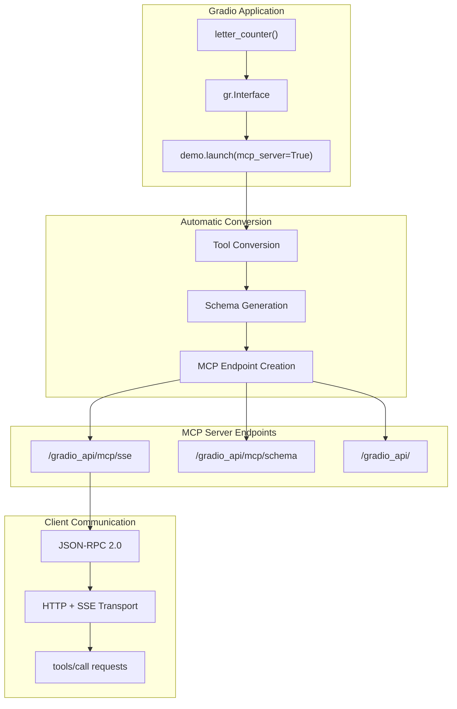
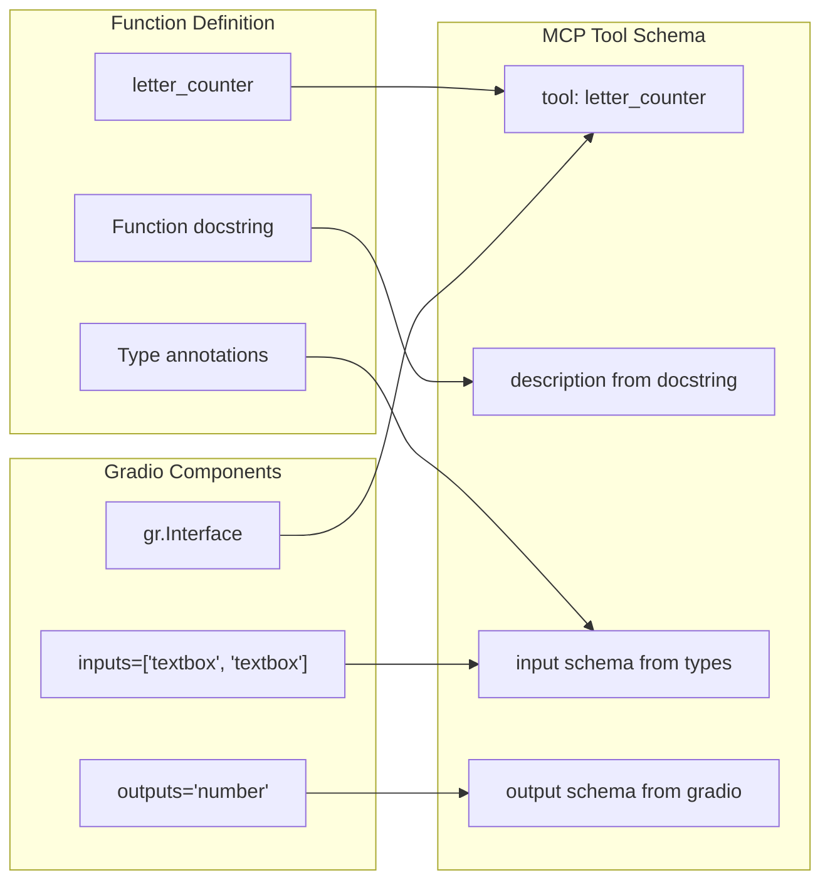
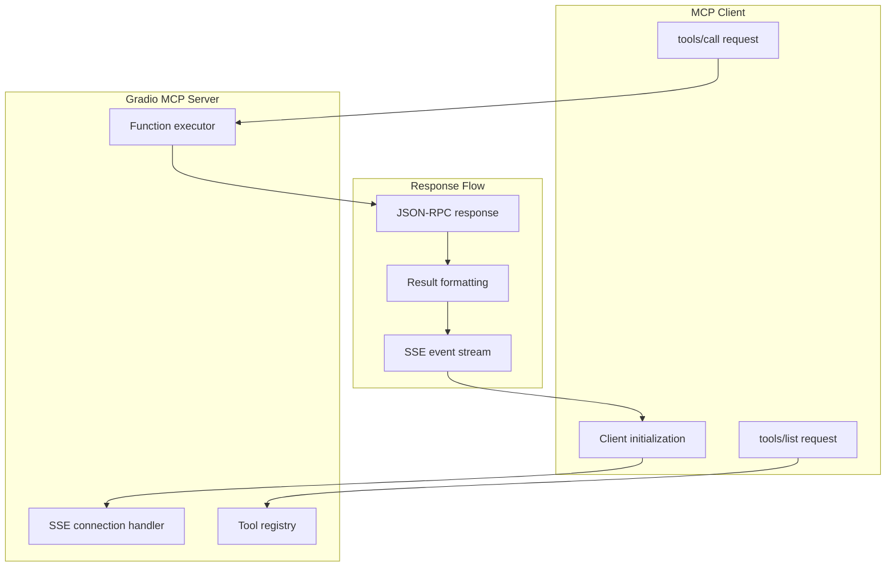
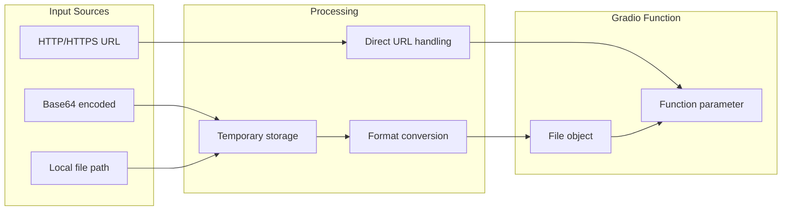
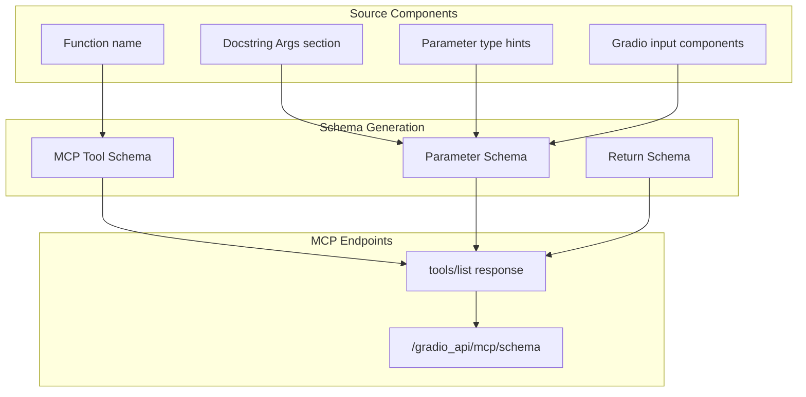

<!-- source: DeepWiki mcp.deepwiki.com · repo huggingface/mcp-course · page 4.1 Gradio MCP Server · fetched 2026-10-26 -->

# Gradio MCP Server

<details>
<summary>Relevant source files</summary>

The following files were used as context for generating this wiki page:

- [units/en/unit1/architectural-components.mdx](units/en/unit1/architectural-components.mdx)
- [units/en/unit1/communication-protocol.mdx](units/en/unit1/communication-protocol.mdx)
- [units/en/unit1/gradio-mcp.mdx](units/en/unit1/gradio-mcp.mdx)

</details>


## Purpose and Scope

The Gradio MCP Server provides automatic MCP server creation from Gradio interfaces, enabling rapid prototyping and deployment of AI-accessible tools with minimal code changes. This integration allows developers to expose existing Gradio applications as MCP-compliant servers by simply adding `mcp_server=True` to the `launch()` method.

This document covers the technical implementation, configuration options, and deployment patterns for Gradio MCP servers. For broader MCP protocol concepts, see [MCP Protocol Fundamentals](#2). For alternative server implementations using FastMCP, see [FastMCP Server Framework](#4.2).

## Architecture Overview

The Gradio MCP integration automatically converts Gradio interfaces into MCP-compliant servers that expose tools via JSON-RPC over HTTP+SSE transport.

### Gradio to MCP Conversion Flow



Sources: [units/en/unit1/gradio-mcp.mdx:37-68](), [units/en/unit1/gradio-mcp.mdx:84-93]()

### MCP Integration Components



Sources: [units/en/unit1/gradio-mcp.mdx:40-54](), [units/en/unit1/gradio-mcp.mdx:88-91]()

## Implementation Patterns

### Basic Server Creation

The simplest Gradio MCP server requires only adding the `mcp_server=True` parameter to an existing Gradio interface:

```python
demo = gr.Interface(
    fn=letter_counter,
    inputs=["textbox", "textbox"], 
    outputs="number"
)
demo.launch(mcp_server=True)
```

Sources: [units/en/unit1/gradio-mcp.mdx:56-68]()

### Environment Variable Configuration

MCP server functionality can be enabled through environment variables as an alternative to the launch parameter:

| Method | Implementation |
|--------|----------------|
| Launch Parameter | `demo.launch(mcp_server=True)` |
| Environment Variable | `export GRADIO_MCP_SERVER=True` |

Sources: [units/en/unit1/gradio-mcp.mdx:98-106]()

## Transport Mechanisms

### HTTP + SSE Endpoint Structure

Gradio MCP servers expose three primary endpoints:

| Endpoint | Purpose | Access Pattern |
|----------|---------|----------------|
| `/gradio_api/mcp/sse` | Main MCP communication | JSON-RPC over SSE |
| `/gradio_api/mcp/schema` | Tool schema inspection | HTTP GET |
| `/gradio_api/` | Standard Gradio API | HTTP POST |

Sources: [units/en/unit1/gradio-mcp.mdx:75-78](), [units/en/unit1/gradio-mcp.mdx:96]()

### Protocol Communication Flow



Sources: [units/en/unit1/gradio-mcp.mdx:84-93](), [units/en/unit1/communication-protocol.mdx:110-124]()

## File Handling and Data Conversion

### Automatic File Processing

The Gradio MCP server handles file data conversions automatically:

| File Type | Input Format | Processing |
|-----------|--------------|------------|
| Images | Base64 strings or URLs | Automatic decoding and format conversion |
| Files | Base64 encoded data | Temporary file creation and cleanup |
| URLs | Full HTTP/HTTPS URLs | Direct URL passing (recommended) |

Sources: [units/en/unit1/gradio-mcp.mdx:108-114]()

### File Handling Best Practices



Sources: [units/en/unit1/gradio-mcp.mdx:108-114]()

## Deployment Options

### Hugging Face Spaces Integration

Gradio MCP servers can be deployed to Hugging Face Spaces for free hosted MCP endpoints:

| Deployment Target | Access Pattern | Use Case |
|-------------------|----------------|----------|
| Local Development | `localhost:port/gradio_api/mcp/sse` | Development and testing |
| Hugging Face Spaces | `https://username-space.hf.space/gradio_api/mcp/sse` | Public MCP server sharing |
| Custom Hosting | Custom domain endpoints | Enterprise deployments |

Sources: [units/en/unit1/gradio-mcp.mdx:115](), [units/en/unit1/gradio-mcp.mdx:141-147]()

### Client Configuration for Hosted Servers

For MCP clients that don't support SSE transport, the `mcp-remote` proxy can be used:

```json
{
  "mcpServers": {
    "gradio": {
      "command": "npx",
      "args": [
        "mcp-remote", 
        "http://your-server:port/gradio_api/mcp/sse"
      ]
    }
  }
}
```

Sources: [units/en/unit1/gradio-mcp.mdx:123-136]()

## Schema Generation and Tool Discovery

### Automatic Schema Creation

The MCP server automatically generates tool schemas from Gradio interface definitions:



Sources: [units/en/unit1/gradio-mcp.mdx:96](), [units/en/unit1/gradio-mcp.mdx:119-120]()

## Troubleshooting and Development

### Common Configuration Issues

| Issue | Solution | Technical Details |
|-------|----------|-------------------|
| Missing type hints | Add type annotations to function parameters | Schema generation requires type information |
| Invalid docstring format | Include "Args:" section with parameter descriptions | Docstring parsing expects specific format |
| SSE compatibility | Use `mcp-remote` proxy for incompatible clients | Some clients don't support SSE transport |
| Connection failures | Restart both client and server | Protocol state synchronization issues |

Sources: [units/en/unit1/gradio-mcp.mdx:117-138]()

### Development Workflow

```mermaid
graph LR
    subgraph "Development"
        CODE_FUNC["Implement function"]
        ADD_TYPES["Add type hints"]
        WRITE_DOCS["Write docstring"]
        CREATE_INTERFACE["Create gr.Interface"]
    end
    
    subgraph "Testing"
        LOCAL_LAUNCH["Launch with mcp_server=True"]
        SCHEMA_CHECK["Check /mcp/schema endpoint"]
        CLIENT_TEST["Test with MCP client"]
    end
    
    subgraph "Deployment"
        HF_UPLOAD["Upload to HF Spaces"]
        PUBLIC_TEST["Test public endpoint"]
        SHARE_URL["Share MCP server URL"]
    end
    
    CODE_FUNC --> ADD_TYPES
    ADD_TYPES --> WRITE_DOCS
    WRITE_DOCS --> CREATE_INTERFACE
    
    CREATE_INTERFACE --> LOCAL_LAUNCH
    LOCAL_LAUNCH --> SCHEMA_CHECK
    SCHEMA_CHECK --> CLIENT_TEST
    
    CLIENT_TEST --> HF_UPLOAD
    HF_UPLOAD --> PUBLIC_TEST
    PUBLIC_TEST --> SHARE_URL
```



Sources: [units/en/unit1/gradio-mcp.mdx:117-147]()

---

