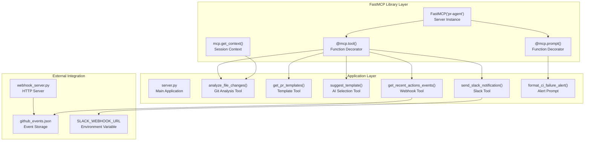
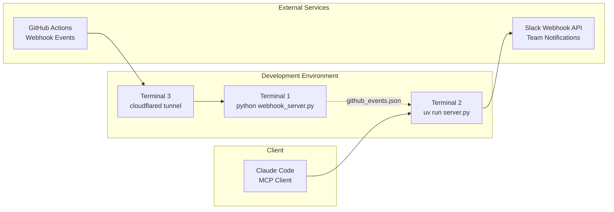
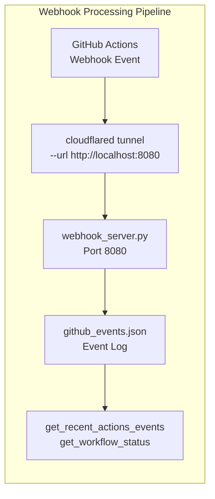

<!-- source: DeepWiki mcp.deepwiki.com · repo huggingface/mcp-course · page 4.2 FastMCP Server Framework · fetched 2026-10-26 -->

# FastMCP Server Framework

<details>
<summary>Relevant source files</summary>

The following files were used as context for generating this wiki page:

- [projects/unit3/build-mcp-server/solution/README.md](projects/unit3/build-mcp-server/solution/README.md)
- [projects/unit3/build-mcp-server/solution/manual_test.md](projects/unit3/build-mcp-server/solution/manual_test.md)
- [projects/unit3/build-mcp-server/solution/pyproject.toml](projects/unit3/build-mcp-server/solution/pyproject.toml)
- [projects/unit3/build-mcp-server/solution/uv.lock](projects/unit3/build-mcp-server/solution/uv.lock)
- [projects/unit3/build-mcp-server/starter/README.md](projects/unit3/build-mcp-server/starter/README.md)
- [projects/unit3/build-mcp-server/starter/pyproject.toml](projects/unit3/build-mcp-server/starter/pyproject.toml)
- [projects/unit3/build-mcp-server/starter/server.py](projects/unit3/build-mcp-server/starter/server.py)
- [units/en/unit3/build-mcp-server.mdx](units/en/unit3/build-mcp-server.mdx)
- [units/en/unit3/github-actions-integration.mdx](units/en/unit3/github-actions-integration.mdx)
- [units/en/unit3/slack-notification.mdx](units/en/unit3/slack-notification.mdx)

</details>


FastMCP is a Python library that provides a high-level framework for building advanced MCP (Model Context Protocol) servers with minimal boilerplate. It uses decorator-based patterns to define tools and prompts, enabling rapid development of complex workflow orchestration systems.

This page covers advanced server development patterns using FastMCP, including custom tool implementation, prompt-driven workflows, and multi-service integration. The framework demonstrates production-ready patterns for building intelligent automation systems that coordinate between external services like GitHub Actions and Slack.

For simpler server creation approaches, see [Gradio MCP Server](#4.1). For protocol fundamentals, see [MCP Protocol Fundamentals](#2).

## FastMCP Library Architecture

FastMCP provides a decorator-based framework for building MCP servers with clean separation between protocol handling and business logic. The library manages MCP communication while developers focus on implementing tools and prompts.

### FastMCP Server Components



Sources: [projects/unit3/build-mcp-server/starter/server.py:11-14](), [projects/unit3/build-mcp-server/starter/server.py:36-78]()

### Multi-Service Architecture Pattern



Sources: [units/en/unit3/github-actions-integration.mdx:186-202](), [units/en/unit3/slack-notification.mdx:232-243]()

### Prompt Implementation Patterns

FastMCP prompts provide reusable workflow templates that guide Claude through complex multi-step processes:

#### Analysis Prompt Pattern
```python
@mcp.prompt()
def analyze_ci_results() -> str:
    """Comprehensive CI/CD analysis workflow."""
    return """Analyze recent CI/CD results and provide actionable insights:
    
1. Use get_recent_actions_events to retrieve latest build data
2. Use get_workflow_status to understand current pipeline state
3. Identify patterns in failures or performance issues
4. Provide specific recommendations for improvement
5. Highlight any critical issues requiring immediate attention

Format your analysis with clear sections and prioritized action items."""

@mcp.prompt()
def format_ci_failure_alert() -> str:
    """Create a Slack alert for CI/CD failures."""
    return """Format this GitHub Actions failure as a Slack message:

Use this template:
:rotating_light: *CI Failure Alert* :rotating_light:

A CI workflow has failed:
*Workflow*: workflow_name
*Branch*: branch_name  
*Status*: Failed
*View Details*: <LOGS_LINK|View Logs>

Please check the logs and address any issues.

Use Slack markdown formatting and keep it concise for quick team scanning."""
```

#### Orchestration Prompt Pattern
```python
@mcp.prompt()
def generate_pr_status_report() -> str:
    """Generate a comprehensive PR status report combining code and CI data."""
    return """Create a comprehensive pull request status report:
    
1. Use analyze_file_changes to understand code modifications
2. Use get_workflow_status to check CI/CD pipeline status
3. Use get_pr_templates to suggest appropriate documentation
4. Combine all data into a reviewer-friendly summary

Include:
- Summary of changes by category (features, fixes, refactoring)
- CI/CD status and any test failures
- Recommended review focus areas
- Template suggestions for PR description"""
```

Sources: [units/en/unit3/github-actions-integration.mdx:172-183](), [units/en/unit3/slack-notification.mdx:186-227]()

### Advanced Tool Patterns

#### Output Management for Large Data
```python
@mcp.tool()
async def analyze_file_changes(base_branch: str = "main", 
                              include_diff: bool = True,
                              max_diff_lines: int = 500) -> str:
    """Analyze file changes with smart output limiting."""
    try:
        # Get git diff with size management
        result = subprocess.run(
            ["git", "diff", f"{base_branch}...HEAD"],
            capture_output=True, 
            text=True,
            cwd=working_dir
        )
        
        diff_lines = result.stdout.split('\n')
        
        # Smart truncation to respect MCP token limits
        if len(diff_lines) > max_diff_lines:
            truncated_diff = '\n'.join(diff_lines[:max_diff_lines])
            truncated_diff += f"\n... Output truncated. Showing {max_diff_lines} of {len(diff_lines)} lines"
            diff_output = truncated_diff
        else:
            diff_output = result.stdout
            
        return json.dumps({
            "stats": stats_result.stdout,
            "total_lines": len(diff_lines),
            "diff": diff_output if include_diff else "Use include_diff=true to see diff",
            "truncated": len(diff_lines) > max_diff_lines
        })
    except Exception as e:
        return json.dumps({"error": str(e)})
```

Sources: [units/en/unit3/build-mcp-server.mdx:244-295]()

## Core Components

## FastMCP Server Implementation Patterns

### Server Initialization and Configuration

FastMCP servers start with a simple initialization pattern that creates the server instance and configures shared resources:

```python
from mcp.server.fastmcp import FastMCP

# Initialize the FastMCP server
mcp = FastMCP("pr-agent")

# Shared configuration
TEMPLATES_DIR = Path(__file__).parent.parent.parent / "templates"
EVENTS_FILE = Path(__file__).parent / "github_events.json"
```

| FastMCP Component | Purpose | Code Pattern |
|-------------------|---------|--------------|
| `FastMCP("server-name")` | Server instance creation | Constructor with server identifier |
| `@mcp.tool()` | Tool function decorator | Async functions returning JSON strings |
| `@mcp.prompt()` | Prompt function decorator | Functions returning instruction strings |
| `mcp.get_context()` | Session context access | Access to client session and roots |
| `mcp.run()` | Server execution | Main event loop for MCP communication |

Sources: [projects/unit3/build-mcp-server/starter/server.py:11-17]()

### Tool Implementation Patterns

FastMCP tools follow a consistent pattern of parameter validation, execution, and structured JSON response:

#### Git Integration Tool Pattern
```python
@mcp.tool()
async def analyze_file_changes(base_branch: str = "main", include_diff: bool = True) -> str:
    """Get the full diff and list of changed files in the current git repository."""
    try:
        # Access Claude's working directory
        context = mcp.get_context()
        roots_result = await context.session.list_roots()
        working_dir = roots_result.roots[0].uri.path
        
        # Execute git commands with proper working directory
        result = subprocess.run(
            ["git", "diff", f"{base_branch}...HEAD"],
            capture_output=True,
            text=True,
            cwd=working_dir
        )
        
        return json.dumps({
            "base_branch": base_branch,
            "files_changed": len(result.stdout.split('\n')),
            "diff": result.stdout if include_diff else "Use include_diff=true"
        })
    except Exception as e:
        return json.dumps({"error": str(e)})
```

#### External API Tool Pattern
```python
@mcp.tool()
def send_slack_notification(message: str) -> str:
    """Send a formatted notification to the team Slack channel."""
    webhook_url = os.getenv("SLACK_WEBHOOK_URL")
    if not webhook_url:
        return json.dumps({"error": "SLACK_WEBHOOK_URL environment variable not set"})
    
    try:
        response = requests.post(
            webhook_url,
            json={"text": message, "mrkdwn": True},
            timeout=10
        )
        return json.dumps({"status": "sent", "response_code": response.status_code})
    except Exception as e:
        return json.dumps({"error": f"Failed to send message: {str(e)}"})
```

Sources: [projects/unit3/build-mcp-server/starter/server.py:36-58](), [units/en/unit3/build-mcp-server.mdx:298-325](), [units/en/unit3/slack-notification.mdx:158-177]()

### Webhook Event Processing

The framework includes a separate HTTP server for handling GitHub webhooks, demonstrating the separation of concerns between MCP communication and external event processing.



The webhook server stores events in a simple JSON file format, making the system easy to test and debug without requiring database infrastructure.

Sources: [units/en/unit3/github-actions-integration.mdx:104-125](), [units/en/unit3/github-actions-integration.mdx:74-84]()

### Event Storage System

The framework uses file-based event storage for simplicity and testability:

```python
# File where webhook server stores events
EVENTS_FILE = Path(__file__).parent / "github_events.json"
```

This approach provides several advantages:
- No database setup required
- Easy manual testing by adding events to JSON file
- Human-readable event logs for debugging
- Simple backup and recovery

Sources: [units/en/unit3/github-actions-integration.mdx:130-143]()

## Advanced FastMCP Patterns

### Context-Aware Tool Development

FastMCP provides session context through `mcp.get_context()` for accessing client information and working directories:

```python
@mcp.tool()
async def analyze_file_changes(base_branch: str = "main") -> str:
    """Analyze git changes in Claude's working directory."""
    # Access client session context
    context = mcp.get_context()
    roots_result = await context.session.list_roots()
    
    # Extract working directory from MCP roots
    working_dir = roots_result.roots[0].uri.path
    
    # Execute commands in correct context
    subprocess.run(["git", "diff"], cwd=working_dir)
```

| Context Method | Purpose | Return Type |
|----------------|---------|-------------|
| `mcp.get_context()` | Access current session | `RequestContext` |
| `context.session` | Client session object | `Session` |
| `context.session.list_roots()` | Client working directories | `ListRootsResult` |
| `roots[0].uri.path` | Extract filesystem path | `str` |

Sources: [units/en/unit3/build-mcp-server.mdx:298-325]()

### Error Handling and Validation

FastMCP tools should implement comprehensive error handling for production reliability:

#### Environment Validation Pattern
```python
@mcp.tool()
def send_slack_notification(message: str) -> str:
    """Send notification with environment validation."""
    # Validate required environment variables
    webhook_url = os.getenv("SLACK_WEBHOOK_URL")
    if not webhook_url:
        return json.dumps({
            "error": "Configuration missing",
            "details": "SLACK_WEBHOOK_URL environment variable not set",
            "fix": "Set environment variable: export SLACK_WEBHOOK_URL=..."
        })
    
    # Validate input parameters
    if not message.strip():
        return json.dumps({
            "error": "Invalid input",
            "details": "Message cannot be empty"
        })
```

#### Network Request Error Handling
```python
try:
    response = requests.post(webhook_url, json=payload, timeout=10)
    response.raise_for_status()
    return json.dumps({"status": "success", "message_id": response.headers.get("X-Slack-Req-Id")})
except requests.exceptions.Timeout:
    return json.dumps({"error": "Request timeout", "retry": True})
except requests.exceptions.RequestException as e:
    return json.dumps({"error": f"Network error: {str(e)}", "retry": False})
```

Sources: [units/en/unit3/slack-notification.mdx:158-177](), [units/en/unit3/build-mcp-server.mdx:206-221]()

### Resource Management Patterns

#### Template and Configuration Management
```python
@mcp.tool()
async def get_pr_templates() -> str:
    """List available PR templates with their content."""
    try:
        templates = []
        for template_file in TEMPLATES_DIR.glob("*.md"):
            content = template_file.read_text()
            templates.append({
                "filename": template_file.name,
                "type": template_file.stem,
                "content": content,
                "size": len(content)
            })
        
        return json.dumps({
            "templates": templates,
            "count": len(templates),
            "directory": str(TEMPLATES_DIR)
        })
    except Exception as e:
        return json.dumps({"error": str(e)})
```

#### Event Storage and Retrieval
```python
@mcp.tool()
async def get_recent_actions_events(limit: int = 10) -> str:
    """Retrieve recent GitHub Actions events from webhook storage."""
    try:
        if not EVENTS_FILE.exists():
            return json.dumps({"events": [], "message": "No events file found"})
        
        with open(EVENTS_FILE, 'r') as f:
            all_events = [json.loads(line) for line in f]
        
        # Return most recent events
        recent_events = all_events[-limit:] if len(all_events) > limit else all_events
        
        return json.dumps({
            "events": recent_events,
            "total_available": len(all_events),
            "returned": len(recent_events)
        })
    except Exception as e:
        return json.dumps({"error": str(e)})
```

Sources: [projects/unit3/build-mcp-server/starter/server.py:62-66](), [units/en/unit3/github-actions-integration.mdx:155-167]()

## Prompt Implementation

### Workflow Standardization

MCP Prompts in the framework provide reusable templates for consistent workflow execution:

| Prompt | Purpose | Usage Pattern |
|--------|---------|---------------|
| `analyze_ci_results` | Comprehensive CI/CD analysis | User-initiated analysis of recent builds |
| `create_deployment_summary` | Team-friendly updates | Post-deployment communication |
| `format_ci_failure_alert` | Slack alert formatting | Automatic failure notifications |
| `format_ci_success_summary` | Success message formatting | Automatic success notifications |

Prompts return instruction strings that guide Claude through complex multi-step workflows while maintaining consistency across team interactions.

Sources: [units/en/unit3/github-actions-integration.mdx:172-183](), [units/en/unit3/slack-notification.mdx:180-227]()

### Slack Integration Patterns

The framework demonstrates external API integration through Slack webhooks:

```python
@mcp.tool()
def send_slack_notification(message: str) -> str:
    """Send a formatted notification to the team Slack channel."""
    webhook_url = os.getenv("SLACK_WEBHOOK_URL")
    # HTTP POST to Slack webhook with markdown formatting
```

Key integration principles:
- Environment variable management for sensitive credentials
- Structured error handling for network requests
- Support for rich formatting (Slack markdown)
- Timeout and retry logic for production reliability

Sources: [units/en/unit3/slack-notification.mdx:158-177](), [units/en/unit3/slack-notification.mdx:127-137]()

## Development and Testing Workflow

### FastMCP Server Development Setup

FastMCP servers require specific setup patterns for development and testing environments:

#### Project Structure
```
project/
├── server.py              # Main FastMCP server
├── webhook_server.py       # Separate HTTP server
├── pyproject.toml         # Dependencies with mcp[cli]
├── test_server.py         # pytest test suite
├── validate_starter.py    # Implementation validator
└── github_events.json    # Event storage (created at runtime)
```

#### Development Dependencies
```toml
[project]
dependencies = [
    "mcp[cli]>=1.0.0",
]

[project.optional-dependencies]
dev = [
    "pytest>=8.3.0",
    "pytest-asyncio>=0.21.0",
]
```

Sources: [projects/unit3/build-mcp-server/starter/pyproject.toml:1-28]()

### Testing FastMCP Servers

#### Unit Testing Pattern
```python
import asyncio
import json
import pytest
from server import analyze_file_changes, get_pr_templates, suggest_template

@pytest.mark.asyncio
async def test_analyze_file_changes():
    """Test git analysis tool."""
    result = await analyze_file_changes("main", True)
    data = json.loads(result)
    
    assert "base_branch" in data
    assert "files_changed" in data
    assert data["base_branch"] == "main"

@pytest.mark.asyncio  
async def test_get_pr_templates():
    """Test template retrieval tool."""
    result = await get_pr_templates()
    data = json.loads(result)
    
    assert "templates" in data
    assert isinstance(data["templates"], list)
```

#### Claude Code Integration Testing
```bash
# Configure FastMCP server with Claude Code
claude mcp add pr-agent -- uv --directory /absolute/path/to/starter run server.py

# Verify server registration
claude mcp list

# Test individual tools
# "Can you analyze my git changes?"
# "What PR templates are available?" 
# "Based on my changes, suggest a template?"
```

#### Validation Script Testing
```python
# validate_starter.py checks implementation completeness
def validate_tool_registration():
    """Verify all required tools are registered with FastMCP."""
    from server import mcp
    
    required_tools = [
        "analyze_file_changes",
        "get_pr_templates", 
        "suggest_template"
    ]
    
    registered_tools = [tool.name for tool in mcp.list_tools()]
    
    for tool in required_tools:
        assert tool in registered_tools, f"Tool {tool} not registered"
```

Sources: [units/en/unit3/build-mcp-server.mdx:145-184](), [projects/unit3/build-mcp-server/solution/manual_test.md:13-44]()

### Production Deployment Patterns

#### Environment Configuration
```python
# Environment variable validation
def validate_environment():
    """Check required environment variables for production."""
    required_vars = ["SLACK_WEBHOOK_URL"]
    missing = [var for var in required_vars if not os.getenv(var)]
    
    if missing:
        raise EnvironmentError(f"Missing environment variables: {missing}")

# Server initialization with validation
if __name__ == "__main__":
    validate_environment()
    mcp.run()
```

#### Multi-Service Coordination
```bash
# Production startup sequence
# Terminal 1: Start webhook receiver
python webhook_server.py &

# Terminal 2: Start FastMCP server  
uv run server.py &

# Terminal 3: Expose webhooks (development)
cloudflared tunnel --url http://localhost:8080 &

# Wait for all services
wait
```

Sources: [units/en/unit3/slack-notification.mdx:124-137](), [units/en/unit3/github-actions-integration.mdx:186-202]()

## Security and Configuration

### Environment Variable Management

The framework follows security best practices for handling sensitive credentials:

```bash
export SLACK_WEBHOOK_URL="https://hooks.slack.com/services/YOUR/WEBHOOK/URL"
```

Security principles implemented:
- No hardcoded secrets in source code
- Environment variable validation at runtime
- Structured error messages for missing configuration
- Clear separation between public and private configuration

Sources: [units/en/unit3/slack-notification.mdx:124-137]()

### Working Directory Handling

The framework addresses the common MCP development issue of working directory context through MCP roots:

```python
# Get Claude's working directory from roots
context = mcp.get_context()
roots_result = await context.session.list_roots()
working_dir = roots_result.roots[0].uri.path
```

This ensures that git operations and file analysis work on the correct repository rather than the MCP server's installation directory.

Sources: [units/en/unit3/build-mcp-server.mdx:298-325]()

## Real-World Applications

The FastMCP Server Framework demonstrates patterns applicable to many automation scenarios beyond development workflows:

| Pattern | Application Areas | Key Benefits |
|---------|------------------|---------------|
| Event-driven automation | Customer support, content moderation | Real-time response to external events |
| Intelligent data analysis | Business intelligence, monitoring | Claude-powered decision making from raw data |
| Multi-service integration | DevOps, marketing automation | Coordinated workflows across platforms |
| Template-based formatting | Documentation, reporting | Consistent output formatting |

The framework's design principles of providing raw data to Claude rather than hard-coding business logic make it adaptable to diverse use cases while maintaining simplicity and reliability.

Sources: [units/en/unit3/conclusion.mdx:64-78]()

---

