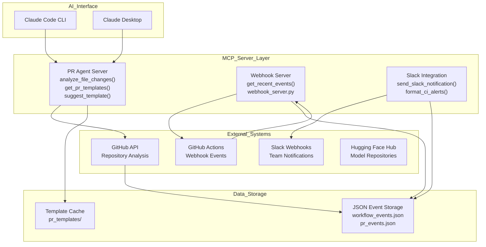
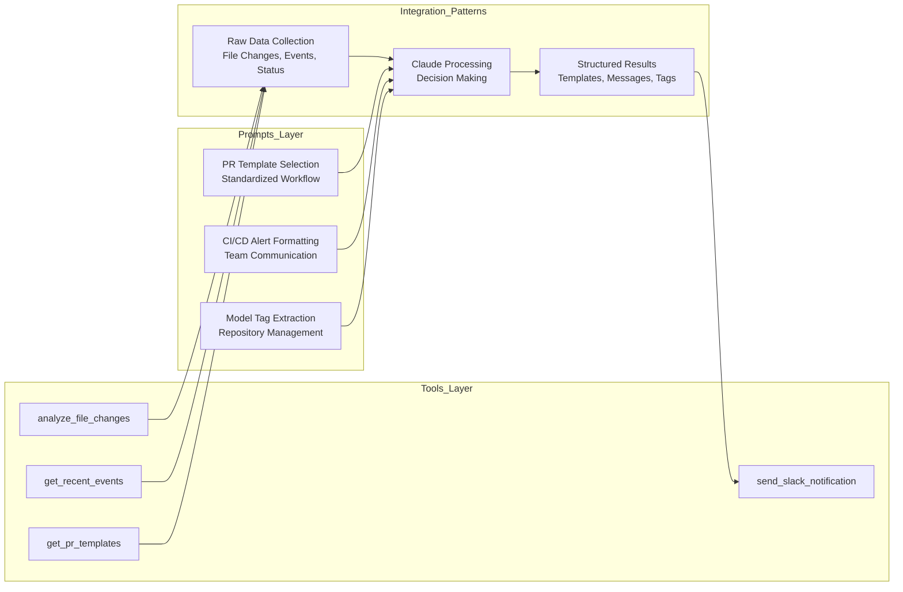
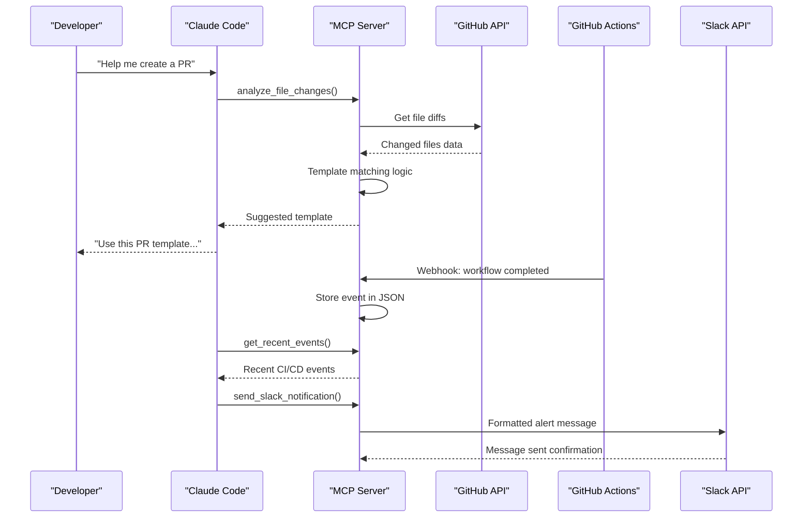
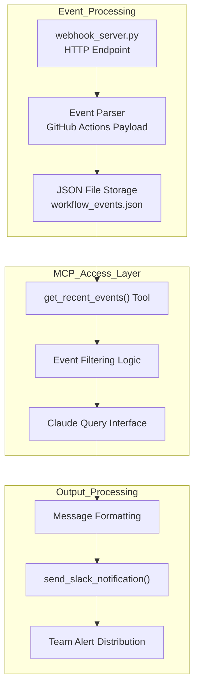

<!-- source: DeepWiki mcp.deepwiki.com · repo huggingface/mcp-course · page 5 Advanced Applications · fetched 2026-10-26 -->

# Advanced Applications

<details>
<summary>Relevant source files</summary>

The following files were used as context for generating this wiki page:

- [units/en/unit3/conclusion.mdx](units/en/unit3/conclusion.mdx)
- [units/en/unit3/introduction.mdx](units/en/unit3/introduction.mdx)

</details>


This document covers real-world MCP applications that demonstrate complex automation workflows, CI/CD integration, and repository management systems. These applications showcase how MCP servers can orchestrate multi-system integrations to solve practical development team challenges.

For basic MCP server implementations, see [MCP Servers](#4). For client-side integration patterns, see [MCP Clients](#3).

## Purpose and Scope

Advanced Applications represent the practical implementation of MCP servers that integrate multiple external systems to automate complex development workflows. These applications demonstrate:

- **Multi-system orchestration** through MCP Tools and Prompts
- **Real-time event processing** via webhook integrations  
- **Intelligent workflow automation** using Claude's decision-making capabilities
- **Team communication patterns** that bridge development tools with collaboration platforms

The applications covered solve common development team challenges: unclear pull requests, silent CI/CD failures, and information silos between team members.

## Advanced Application Architecture

### Workflow Automation System



**Sources:** [units/en/unit3/introduction.mdx:13-17](), [units/en/unit3/introduction.mdx:25-29]()

### MCP Primitives Integration Pattern



**Sources:** [units/en/unit3/introduction.mdx:44-46](), [units/en/unit3/conclusion.mdx:48-51]()

## Real-World Problem Solving Patterns

### Development Team Challenge Resolution

| Challenge | MCP Solution | Implementation |
|-----------|--------------|----------------|
| Unclear PR descriptions | `analyze_file_changes()` + template matching | File diff analysis with intelligent template suggestion |
| Silent CI/CD failures | `webhook_server.py` + event processing | Real-time GitHub Actions monitoring with structured alerts |
| Team communication gaps | `send_slack_notification()` + formatted messages | Automated team updates with contextual information |
| Repository tag management | Hub webhook processing + tag extraction | Intelligent model repository categorization |

### Automation Workflow Architecture



**Sources:** [units/en/unit3/introduction.mdx:15-17](), [units/en/unit3/conclusion.mdx:25-31]()

## Integration Architecture Patterns

### Webhook Processing System

The advanced applications implement a separation of concerns between MCP servers and webhook receivers:

- **MCP Server**: Handles Claude interactions and tool execution
- **Webhook Server**: Receives GitHub Actions events and stores them
- **Event Storage**: Simple JSON file-based persistence for reliability
- **Claude Orchestration**: Intelligent processing of stored events

### File-Based Event Storage Pattern



**Sources:** [units/en/unit3/conclusion.mdx:54-56](), [units/en/unit3/conclusion.mdx:105-107]()

## Development Best Practices

### Error Handling and Security Patterns

Advanced MCP applications implement robust error handling and security practices:

```python
# Error handling returns structured JSON
def analyze_file_changes():
    try:
        # File analysis logic
        return {"status": "success", "data": analysis_results}
    except Exception as e:
        return {"status": "error", "message": str(e)}

# Environment variables for sensitive credentials  
SLACK_WEBHOOK_URL = os.getenv("SLACK_WEBHOOK_URL")
GITHUB_TOKEN = os.getenv("GITHUB_TOKEN")
```

### MCP Server Design Philosophy

The advanced applications follow key design principles:

1. **Data Provider Pattern**: MCP servers provide raw, structured data to Claude
2. **Intelligence Delegation**: Claude makes decisions based on provided data
3. **Simple Persistence**: JSON file storage for reliability and testability
4. **Modular Architecture**: Separate concerns between webhook processing and MCP tools

**Sources:** [units/en/unit3/conclusion.mdx:100-102](), [units/en/unit3/conclusion.mdx:58-62]()

## Common Integration Patterns

### Tools + Prompts Combination

Advanced applications demonstrate the power of combining MCP Tools with Prompts:

1. **Data Collection**: Tools gather information from external systems
2. **Intelligent Analysis**: Claude processes data using contextual understanding  
3. **Formatted Output**: Prompts ensure consistent, structured results
4. **External Integration**: Tools interact with APIs and services for automation

### Scalability Considerations

The file-based storage pattern used in advanced applications can handle:
- **Multiple repositories**: Event storage per repository
- **Team scaling**: Centralized notification management
- **Event volume**: JSON file rotation and archiving strategies
- **Integration expansion**: Adding new webhook sources and notification targets

**Sources:** [units/en/unit3/conclusion.mdx:73-78](), [units/en/unit3/conclusion.mdx:86-90]()

---

