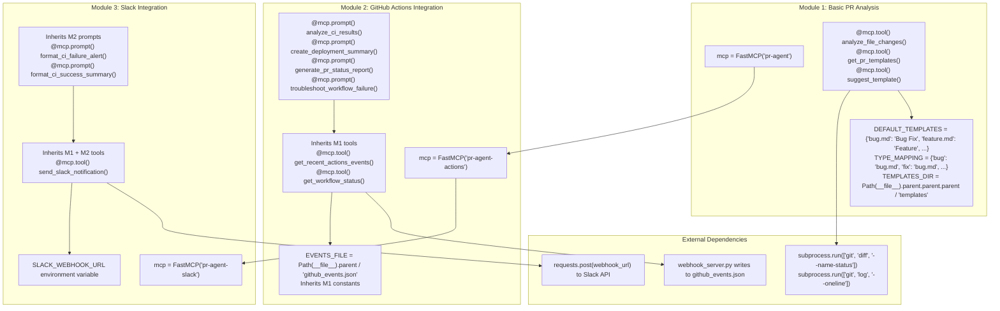
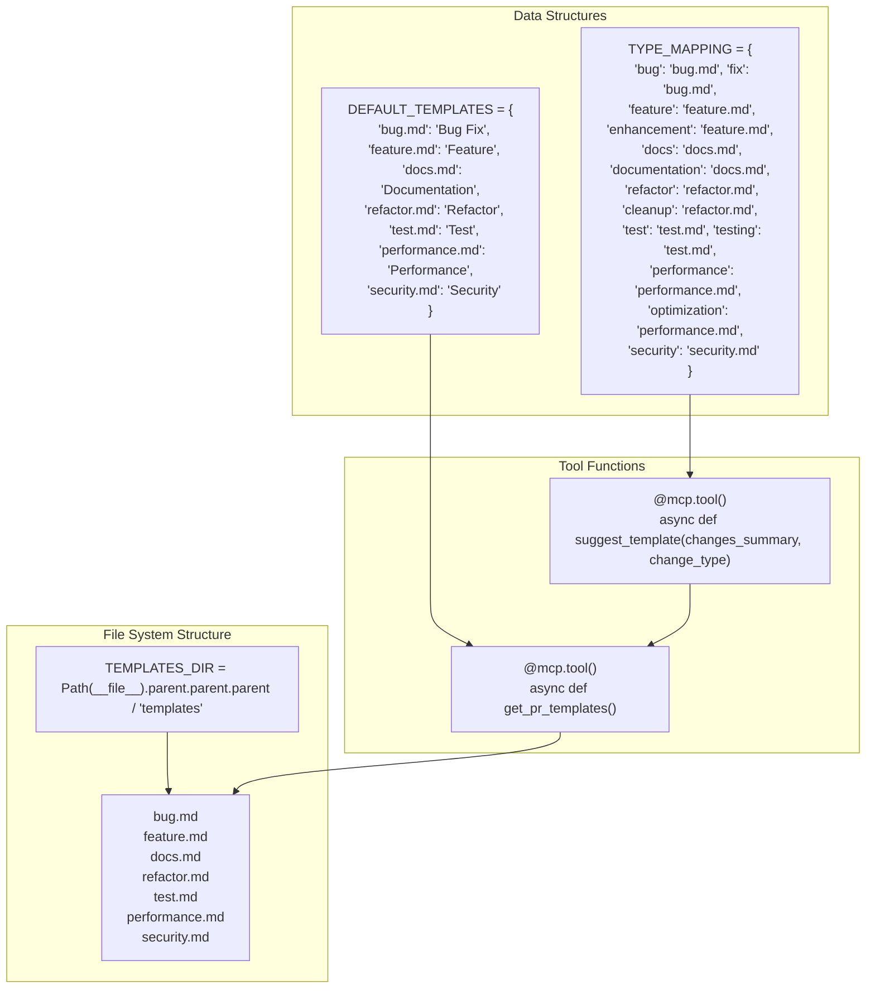
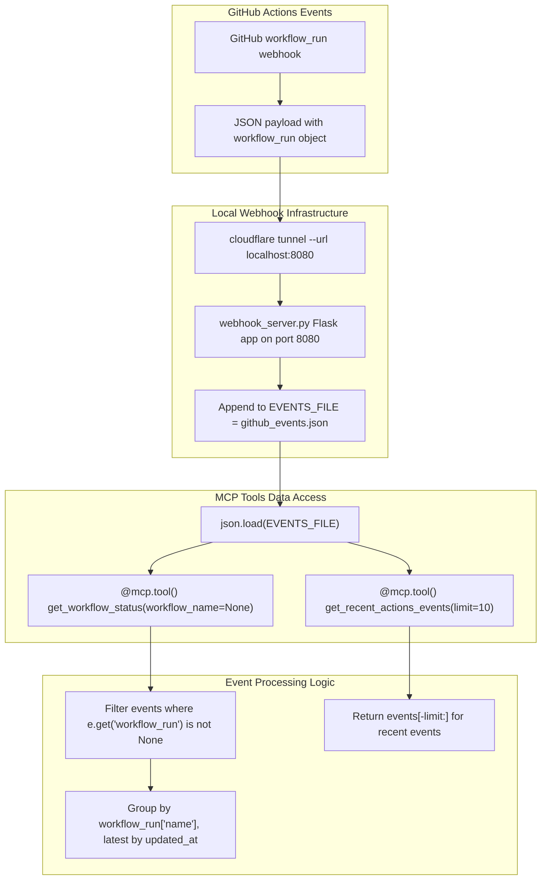
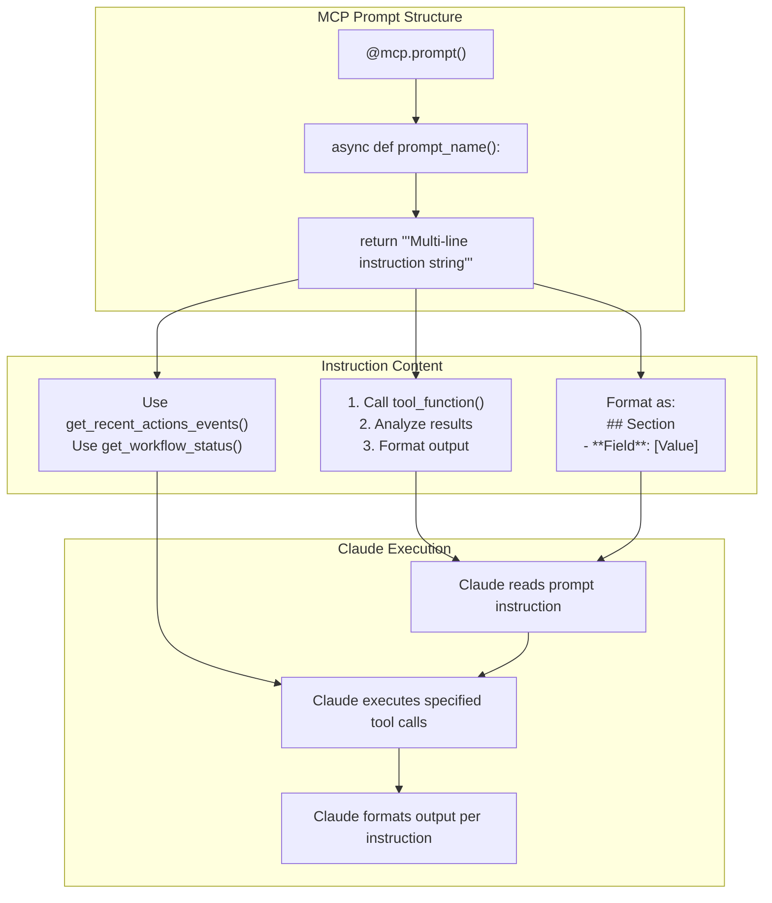
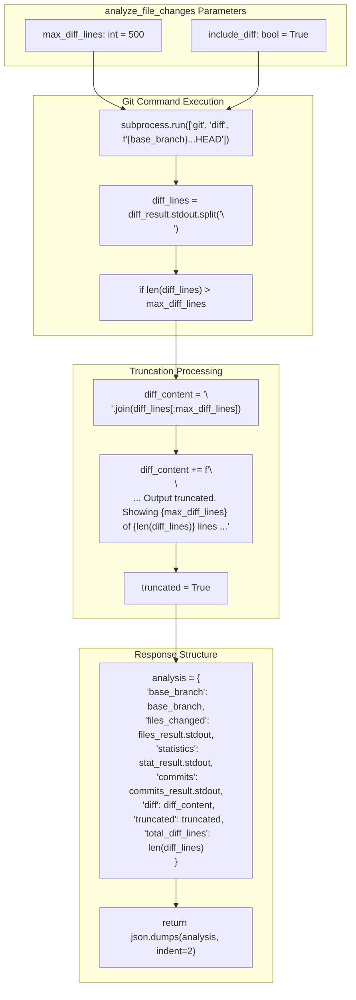
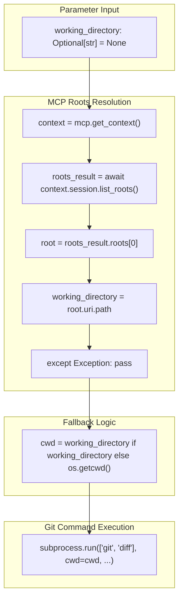
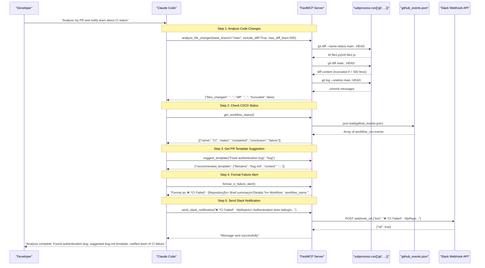

<!-- source: DeepWiki mcp.deepwiki.com · repo huggingface/mcp-course · page 5.1 Pull Request Agent · fetched 2026-10-26 -->

# Pull Request Agent

<details>
<summary>Relevant source files</summary>

The following files were used as context for generating this wiki page:

- [projects/unit3/build-mcp-server/solution/README.md](projects/unit3/build-mcp-server/solution/README.md)
- [projects/unit3/build-mcp-server/solution/manual_test.md](projects/unit3/build-mcp-server/solution/manual_test.md)
- [projects/unit3/build-mcp-server/solution/pyproject.toml](projects/unit3/build-mcp-server/solution/pyproject.toml)
- [projects/unit3/build-mcp-server/solution/server.py](projects/unit3/build-mcp-server/solution/server.py)
- [projects/unit3/build-mcp-server/solution/test_server.py](projects/unit3/build-mcp-server/solution/test_server.py)
- [projects/unit3/build-mcp-server/solution/uv.lock](projects/unit3/build-mcp-server/solution/uv.lock)
- [projects/unit3/build-mcp-server/starter/README.md](projects/unit3/build-mcp-server/starter/README.md)
- [projects/unit3/build-mcp-server/starter/pyproject.toml](projects/unit3/build-mcp-server/starter/pyproject.toml)
- [projects/unit3/build-mcp-server/starter/server.py](projects/unit3/build-mcp-server/starter/server.py)
- [projects/unit3/github-actions-integration/solution/server.py](projects/unit3/github-actions-integration/solution/server.py)
- [projects/unit3/github-actions-integration/starter/server.py](projects/unit3/github-actions-integration/starter/server.py)
- [projects/unit3/slack-notification/starter/server.py](projects/unit3/slack-notification/starter/server.py)
- [units/en/unit3/conclusion.mdx](units/en/unit3/conclusion.mdx)
- [units/en/unit3/introduction.mdx](units/en/unit3/introduction.mdx)

</details>


The Pull Request Agent is a three-module MCP server implementation that demonstrates progressive MCP development from basic git analysis to complete CI/CD automation. Built using the FastMCP framework, it provides MCP Tools and Prompts for analyzing code changes, monitoring GitHub Actions workflows, and sending Slack notifications.

The system implements a practical development automation scenario: automatic PR template selection based on file changes, CI/CD monitoring via webhook integration, and team communication through formatted Slack messages.

## System Overview

The Pull Request Agent consists of three progressive modules:

- **Module 1**: Basic MCP Tools (`analyze_file_changes`, `get_pr_templates`, `suggest_template`) for git analysis and PR template suggestion
- **Module 2**: GitHub Actions integration with webhook server and MCP Prompts for CI/CD workflow monitoring  
- **Module 3**: Slack API integration with formatted notification tools for team communication

Each module builds upon the previous implementation, demonstrating MCP development patterns including output limiting, working directory resolution, webhook processing, and external API integration.

Sources: [units/en/unit3/introduction.mdx:13-17](), [projects/unit3/build-mcp-server/solution/server.py:1-14](), [projects/unit3/github-actions-integration/solution/server.py:1-6](), [projects/unit3/slack-notification/starter/server.py:1-6]()

## System Architecture

### Overall System Architecture

```mermaid
graph TB
    subgraph "Claude Client"
        CLAUDE_CODE["Claude Code"]
        MCP_PROTOCOL["MCP JSON-RPC Protocol"]
    end
    
    subgraph "FastMCP Server Instances"
        MODULE1["mcp = FastMCP('pr-agent')"]
        MODULE2["mcp = FastMCP('pr-agent-actions')"] 
        MODULE3["mcp = FastMCP('pr-agent-slack')"]
    end
    
    subgraph "MCP Tools (@mcp.tool())"
        ANALYZE_FILE_CHANGES["analyze_file_changes()"]
        GET_PR_TEMPLATES["get_pr_templates()"]
        SUGGEST_TEMPLATE["suggest_template()"]
        GET_RECENT_ACTIONS_EVENTS["get_recent_actions_events()"]
        GET_WORKFLOW_STATUS["get_workflow_status()"]
        SEND_SLACK_NOTIFICATION["send_slack_notification()"]
    end
    
    subgraph "MCP Prompts (@mcp.prompt())"
        ANALYZE_CI_RESULTS["analyze_ci_results()"]
        CREATE_DEPLOYMENT_SUMMARY["create_deployment_summary()"]
        GENERATE_PR_STATUS_REPORT["generate_pr_status_report()"]
        TROUBLESHOOT_WORKFLOW_FAILURE["troubleshoot_workflow_failure()"]
        FORMAT_CI_FAILURE_ALERT["format_ci_failure_alert()"]
        FORMAT_CI_SUCCESS_SUMMARY["format_ci_success_summary()"]
    end
    
    subgraph "File System Storage"
        TEMPLATES_DIR_PATH["TEMPLATES_DIR = Path(__file__).parent.parent.parent / 'templates'"]
        EVENTS_FILE_PATH["EVENTS_FILE = Path(__file__).parent / 'github_events.json'"]
        DEFAULT_TEMPLATES_DICT["DEFAULT_TEMPLATES = {'bug.md': 'Bug Fix', ...}"]
        TYPE_MAPPING_DICT["TYPE_MAPPING = {'bug': 'bug.md', ...}"]
    end
    
    subgraph "External Processes"
        WEBHOOK_SERVER_PY["webhook_server.py:8080"]
        GIT_SUBPROCESS["subprocess.run(['git', 'diff'])"]
        SLACK_WEBHOOK_URL["SLACK_WEBHOOK_URL env var"]
    end
    
    CLAUDE_CODE --> MCP_PROTOCOL
    MCP_PROTOCOL --> MODULE1
    MCP_PROTOCOL --> MODULE2  
    MCP_PROTOCOL --> MODULE3
    
    MODULE1 --> ANALYZE_FILE_CHANGES
    MODULE1 --> GET_PR_TEMPLATES
    MODULE1 --> SUGGEST_TEMPLATE
    
    MODULE2 --> GET_RECENT_ACTIONS_EVENTS
    MODULE2 --> GET_WORKFLOW_STATUS
    MODULE2 --> ANALYZE_CI_RESULTS
    MODULE2 --> CREATE_DEPLOYMENT_SUMMARY
    MODULE2 --> GENERATE_PR_STATUS_REPORT
    MODULE2 --> TROUBLESHOOT_WORKFLOW_FAILURE
    
    MODULE3 --> SEND_SLACK_NOTIFICATION
    MODULE3 --> FORMAT_CI_FAILURE_ALERT
    MODULE3 --> FORMAT_CI_SUCCESS_SUMMARY
    
    ANALYZE_FILE_CHANGES --> GIT_SUBPROCESS
    GET_PR_TEMPLATES --> TEMPLATES_DIR_PATH
    GET_PR_TEMPLATES --> DEFAULT_TEMPLATES_DICT
    SUGGEST_TEMPLATE --> TYPE_MAPPING_DICT
    GET_RECENT_ACTIONS_EVENTS --> EVENTS_FILE_PATH
    GET_WORKFLOW_STATUS --> EVENTS_FILE_PATH
    SEND_SLACK_NOTIFICATION --> SLACK_WEBHOOK_URL
    
    WEBHOOK_SERVER_PY --> EVENTS_FILE_PATH
```



Sources: [projects/unit3/build-mcp-server/solution/server.py:16](), [projects/unit3/github-actions-integration/solution/server.py:16](), [projects/unit3/slack-notification/starter/server.py:16](), [projects/unit3/github-actions-integration/solution/server.py:19-34]()

### Module Data Flow and Dependencies



Sources: [projects/unit3/build-mcp-server/solution/server.py:16-47](), [projects/unit3/github-actions-integration/solution/server.py:16-50](), [projects/unit3/slack-notification/starter/server.py:16-50](), [projects/unit3/github-actions-integration/solution/server.py:263-389]()

## Module Progression

The Pull Request Agent demonstrates progressive complexity across three modules, each building upon the previous foundation.

### Module 1: Core PR Analysis Tools

The base module implements three MCP Tools for git repository analysis and PR template suggestion.

**Implementation Details:**

| Component | Parameters | Return Type | Key Features |
|-----------|------------|-------------|--------------|
| `analyze_file_changes` | `base_branch="main"`, `include_diff=True`, `max_diff_lines=500`, `working_directory=None` | JSON string | Git diff with output limiting, working directory resolution |
| `get_pr_templates` | None | JSON string | Reads templates from `TEMPLATES_DIR`, returns content and metadata |
| `suggest_template` | `changes_summary: str`, `change_type: str` | JSON string | Maps change types via `TYPE_MAPPING` to template files |

**Template System Implementation:**



Sources: [projects/unit3/build-mcp-server/solution/server.py:18-47](), [projects/unit3/build-mcp-server/solution/server.py:50-213]()

### Module 2: GitHub Actions Integration

Extends the system with real-time webhook capabilities and MCP Prompts for standardized workflows.

**Webhook Event Processing Architecture:**



Sources: [projects/unit3/github-actions-integration/solution/server.py:33-34](), [projects/unit3/github-actions-integration/solution/server.py:197-260]()

**MCP Prompts for Workflow Guidance:**

Module 2 introduces four MCP Prompts that provide structured workflow instructions to Claude:

| Prompt Function | Return Value (Instruction String) | Tool Integration |
|-----------------|-----------------------------------|------------------|
| `analyze_ci_results()` | Multi-step CI/CD analysis workflow with health assessment format | Calls `get_recent_actions_events()` and `get_workflow_status()` |
| `create_deployment_summary()` | Slack-formatted deployment message template | Calls `get_workflow_status()` for deployment workflows |
| `generate_pr_status_report()` | Comprehensive PR report combining code and CI data | Calls `analyze_file_changes()`, `get_workflow_status()`, `suggest_template()` |
| `troubleshoot_workflow_failure()` | Systematic troubleshooting guide with diagnostic steps | Calls `get_recent_actions_events()` and `get_workflow_status()` |

**Prompt Implementation Pattern:**



Sources: [projects/unit3/github-actions-integration/solution/server.py:265-389]()

### Module 3: Slack Integration and Notification Formatting

Module 3 adds external API integration with Slack webhooks and specialized formatting prompts.

**Slack Integration Implementation:**

```mermaid
graph TB
    subgraph "Environment Configuration"
        SLACK_WEBHOOK_URL_ENV["SLACK_WEBHOOK_URL environment variable"]
        OS_GETENV["os.getenv('SLACK_WEBHOOK_URL')"]
    end
    
    subgraph "MCP Tool Implementation"
        SEND_SLACK_NOTIFICATION_TOOL["@mcp.tool() send_slack_notification(message: str)"]
        WEBHOOK_URL_CHECK["if not webhook_url: return error"]
        HTTP_POST_REQUEST["requests.post(webhook_url, json={'text': message})"]
    end
    
    subgraph "Slack Formatting Prompts"
        FORMAT_CI_FAILURE_ALERT_PROMPT["@mcp.prompt() format_ci_failure_alert()"]
        FORMAT_CI_SUCCESS_SUMMARY_PROMPT["@mcp.prompt() format_ci_success_summary()"]
        SLACK_MARKDOWN_SYNTAX["Returns Slack-specific markdown formatting rules"]
    end
    
    subgraph "Slack Message Format"
        SLACK_BOLD["*text* for bold"]
        SLACK_LINKS["<https://url|Link Text> for links"]
        SLACK_CODE["`text` for code"]
        SLACK_QUOTES["> text for quotes"]
        SLACK_BULLETS["• for bullets"]
    end
    
    SLACK_WEBHOOK_URL_ENV --> OS_GETENV
    OS_GETENV --> SEND_SLACK_NOTIFICATION_TOOL
    SEND_SLACK_NOTIFICATION_TOOL --> WEBHOOK_URL_CHECK
    WEBHOOK_URL_CHECK --> HTTP_POST_REQUEST
    
    FORMAT_CI_FAILURE_ALERT_PROMPT --> SLACK_MARKDOWN_SYNTAX
    FORMAT_CI_SUCCESS_SUMMARY_PROMPT --> SLACK_MARKDOWN_SYNTAX
    SLACK_MARKDOWN_SYNTAX --> SLACK_BOLD
    SLACK_MARKDOWN_SYNTAX --> SLACK_LINKS
    SLACK_MARKDOWN_SYNTAX --> SLACK_CODE
    SLACK_MARKDOWN_SYNTAX --> SLACK_QUOTES
    SLACK_MARKDOWN_SYNTAX --> SLACK_BULLETS
```

Sources: [projects/unit3/slack-notification/starter/server.py:242-264](), [projects/unit3/slack-notification/starter/server.py:268-324]()

## Key Implementation Patterns

### Output Limiting Implementation

The `analyze_file_changes` function implements output limiting to prevent exceeding MCP's token constraints:

**Truncation Logic Implementation:**



Sources: [projects/unit3/build-mcp-server/solution/server.py:124-142](), [projects/unit3/build-mcp-server/solution/server.py:152-162]()

### Working Directory Resolution Using MCP Roots

The `analyze_file_changes` function resolves the correct working directory for git commands using MCP's roots mechanism:

**Directory Resolution Implementation:**



**Debug Information Structure:**

The implementation includes debug information in the response to help troubleshoot directory resolution issues:

| Debug Field | Source | Purpose |
|-------------|--------|---------|
| `provided_working_directory` | Function parameter | Track explicit directory parameter |
| `actual_cwd` | Resolved working directory | Show final directory used |
| `server_process_cwd` | `os.getcwd()` | MCP server's process directory |
| `server_file_location` | `Path(__file__).parent` | Server script location |
| `roots_check` | MCP roots API | Roots resolution success/failure |

Sources: [projects/unit3/build-mcp-server/solution/server.py:66-104]()

### Event Storage Architecture

The webhook integration uses file-based event storage for simplicity and reliability:

**Event Processing Flow:**

| Stage | Component | Responsibility |
|-------|-----------|----------------|
| Reception | `webhook_server.py` | HTTP webhook endpoint, event validation |
| Storage | `github_events.json` | Append-only event log with timestamps |
| Retrieval | `get_recent_actions_events` | Query interface with limit parameters |
| Analysis | `get_workflow_status` | Event filtering and workflow grouping |

Sources: [units/en/unit3/github-actions-integration.mdx:120-125](), [projects/unit3/github-actions-integration/solution/server.py:197-260]()

## Integration Workflows

### End-to-End PR Analysis and Notification Workflow



Sources: [projects/unit3/build-mcp-server/solution/server.py:50-213](), [projects/unit3/github-actions-integration/solution/server.py:194-260](), [projects/unit3/slack-notification/starter/server.py:242-264]()

### Real-time CI/CD Monitoring

The system provides continuous monitoring through webhook integration:

**Monitoring Components:**

| Component | Port/Protocol | Function |
|-----------|---------------|-----------|
| `webhook_server.py` | HTTP :8080 | GitHub webhook receiver |
| Cloudflare Tunnel | HTTPS proxy | Public endpoint for GitHub |
| `github_events.json` | File storage | Event persistence |
| MCP Tools | JSON-RPC | Event query interface |

Sources: [units/en/unit3/github-actions-integration.mdx:104-119]()

## Security Considerations

The system implements security best practices for webhook and API integration:

**Webhook URL Security:**
- Environment variable storage: `SLACK_WEBHOOK_URL`
- No hardcoded credentials in source code
- Gitignore patterns for sensitive files

**Error Handling:**
- Structured JSON error responses
- Graceful degradation for missing services
- Input validation for user parameters

Sources: [units/en/unit3/slack-notification.mdx:128-137](), [projects/unit3/github-actions-integration/solution/server.py:144-147]()

This Pull Request Agent system demonstrates advanced MCP development patterns including progressive feature development, external system integration, and intelligent workflow automation that transforms development team productivity.

---

