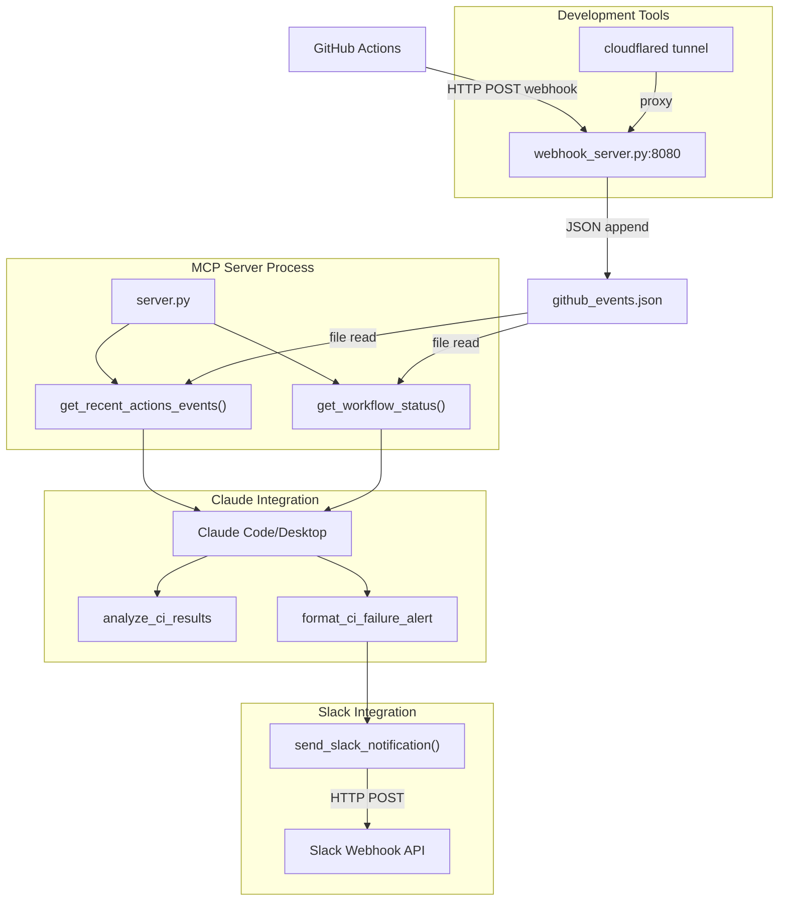
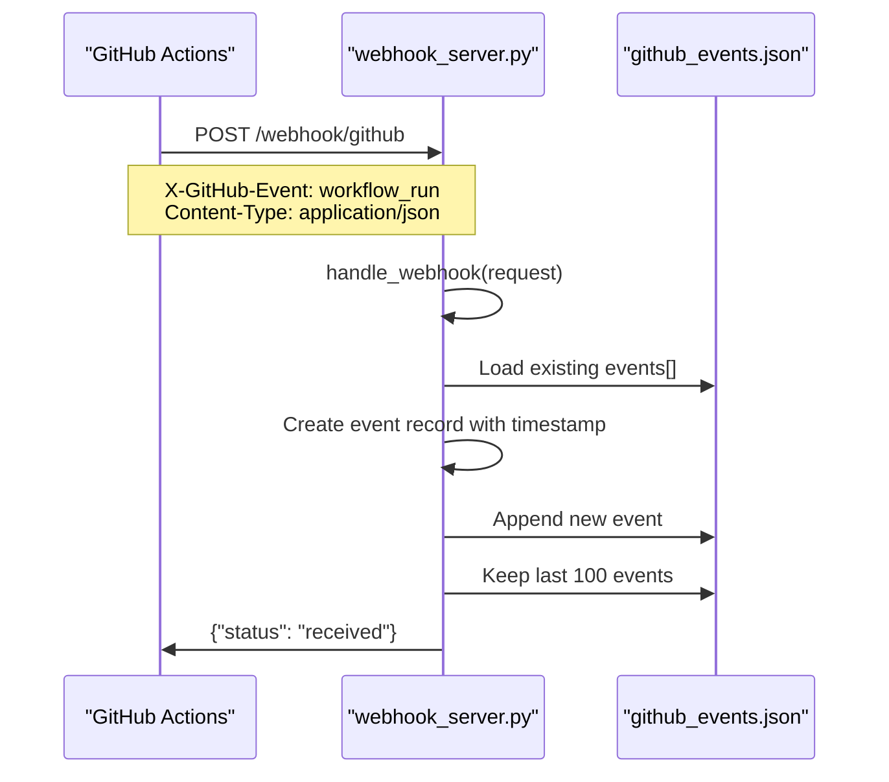
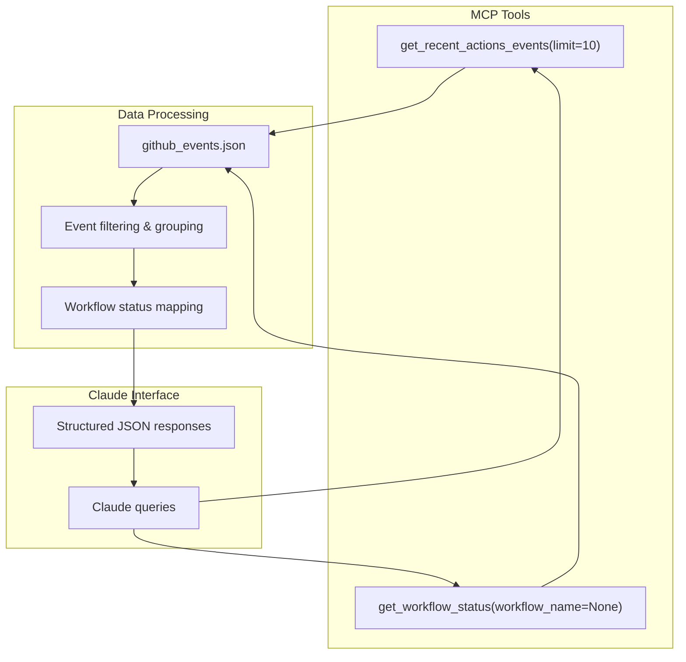
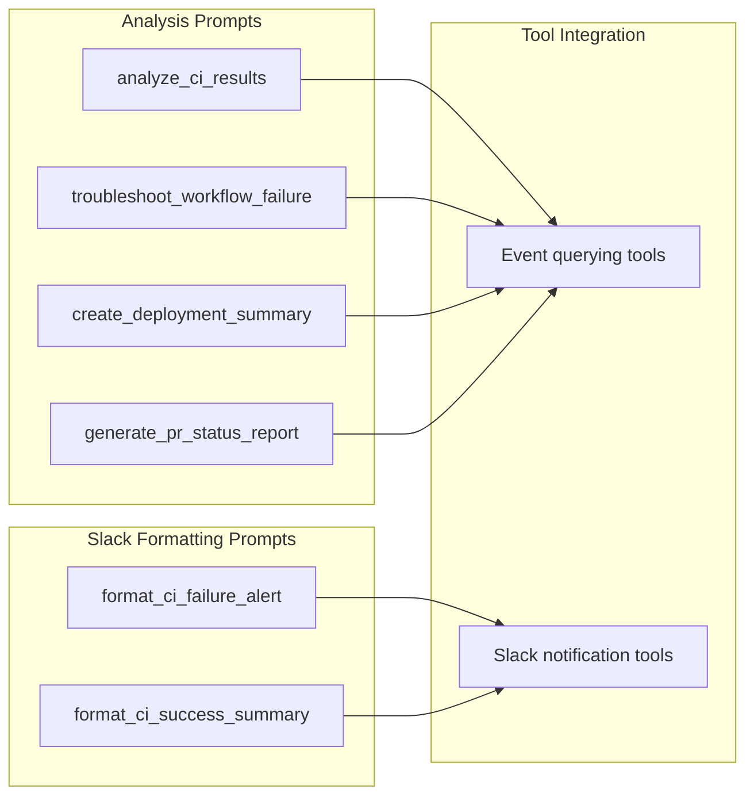
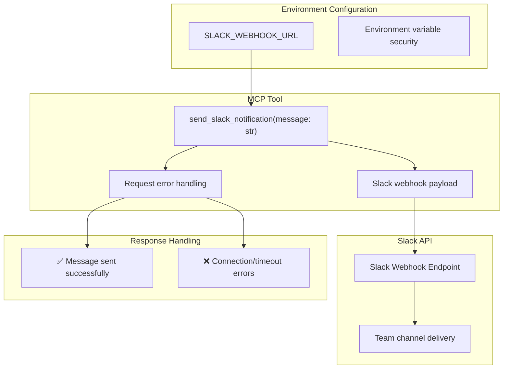
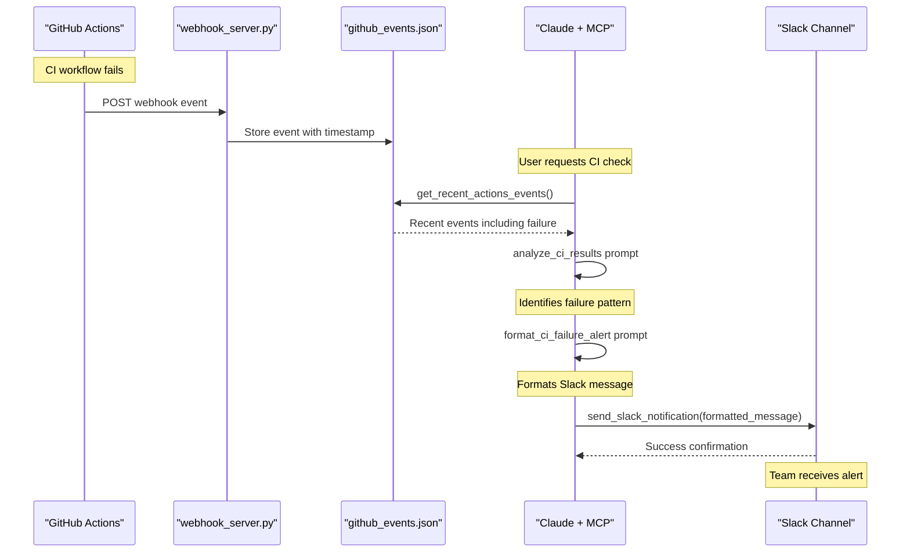
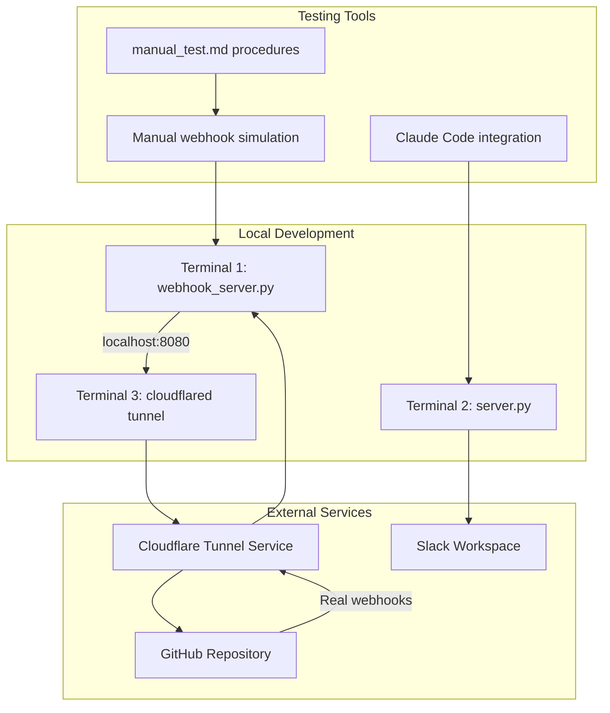

<!-- source: DeepWiki mcp.deepwiki.com · repo huggingface/mcp-course · page 5.2 CI/CD Monitoring and Slack Integration · fetched 2026-10-26 -->

# CI/CD Monitoring and Slack Integration

<details>
<summary>Relevant source files</summary>

The following files were used as context for generating this wiki page:

- [.gitignore](.gitignore)
- [LICENSE](LICENSE)
- [projects/unit3/github-actions-integration/.gitignore](projects/unit3/github-actions-integration/.gitignore)
- [projects/unit3/github-actions-integration/solution/README.md](projects/unit3/github-actions-integration/solution/README.md)
- [projects/unit3/github-actions-integration/solution/manual_test.md](projects/unit3/github-actions-integration/solution/manual_test.md)
- [projects/unit3/github-actions-integration/solution/pyproject.toml](projects/unit3/github-actions-integration/solution/pyproject.toml)
- [projects/unit3/github-actions-integration/solution/uv.lock](projects/unit3/github-actions-integration/solution/uv.lock)
- [projects/unit3/github-actions-integration/solution/webhook_server.py](projects/unit3/github-actions-integration/solution/webhook_server.py)
- [projects/unit3/github-actions-integration/starter/README.md](projects/unit3/github-actions-integration/starter/README.md)
- [projects/unit3/github-actions-integration/starter/pyproject.toml](projects/unit3/github-actions-integration/starter/pyproject.toml)
- [projects/unit3/github-actions-integration/starter/webhook_server.py](projects/unit3/github-actions-integration/starter/webhook_server.py)
- [projects/unit3/slack-notification/solution/README.md](projects/unit3/slack-notification/solution/README.md)
- [projects/unit3/slack-notification/solution/github_events.json](projects/unit3/slack-notification/solution/github_events.json)
- [projects/unit3/slack-notification/solution/manual_test.md](projects/unit3/slack-notification/solution/manual_test.md)
- [projects/unit3/slack-notification/solution/pyproject.toml](projects/unit3/slack-notification/solution/pyproject.toml)
- [projects/unit3/slack-notification/solution/server.py](projects/unit3/slack-notification/solution/server.py)
- [projects/unit3/slack-notification/solution/uv.lock](projects/unit3/slack-notification/solution/uv.lock)
- [projects/unit3/slack-notification/solution/webhook_server.py](projects/unit3/slack-notification/solution/webhook_server.py)
- [projects/unit3/slack-notification/starter/README.md](projects/unit3/slack-notification/starter/README.md)
- [projects/unit3/slack-notification/starter/manual_test.md](projects/unit3/slack-notification/starter/manual_test.md)
- [projects/unit3/slack-notification/starter/pyproject.toml](projects/unit3/slack-notification/starter/pyproject.toml)
- [units/en/unit3/build-mcp-server.mdx](units/en/unit3/build-mcp-server.mdx)
- [units/en/unit3/github-actions-integration.mdx](units/en/unit3/github-actions-integration.mdx)
- [units/en/unit3/slack-notification.mdx](units/en/unit3/slack-notification.mdx)

</details>


This document covers the automated CI/CD monitoring system that processes GitHub Actions webhook events and delivers intelligent team notifications via Slack. The system extends the PR Agent from [Pull Request Agent](#5.1) with real-time workflow monitoring and automated communication capabilities.

For information about the foundational MCP server implementation, see [Pull Request Agent](#5.1). For automated repository tagging workflows, see [Hugging Face Hub Tagging Agent](#5.3).

## System Architecture

The CI/CD monitoring system operates through a multi-service architecture that bridges GitHub Actions events with intelligent Slack notifications via MCP (Model Context Protocol) integration.

### Webhook Event Processing Flow



Sources: [units/en/unit3/github-actions-integration.mdx:74-79](), [projects/unit3/slack-notification/solution/webhook_server.py:15-47](), [projects/unit3/slack-notification/solution/server.py:196-260]()

### Service Components and Responsibilities

| Component | Port/Path | Primary Function | Key Classes/Functions |
|-----------|-----------|------------------|----------------------|
| `webhook_server.py` | `:8080` | GitHub webhook receiver | `handle_webhook()`, `EVENTS_FILE` |
| `server.py` | stdio | MCP server with CI tools | `get_recent_actions_events()`, `get_workflow_status()` |
| `github_events.json` | filesystem | Event persistence | JSON array storage |
| Cloudflare Tunnel | dynamic | Local development proxy | External service |
| Slack Webhook | HTTPS | Message delivery | External API |

Sources: [projects/unit3/github-actions-integration/solution/webhook_server.py:13-57](), [projects/unit3/slack-notification/solution/server.py:196-304]()

## Webhook Server Implementation

The webhook server provides a lightweight HTTP endpoint for receiving GitHub Actions events and persisting them for MCP server consumption.

### Event Reception and Storage



The `handle_webhook()` function in [projects/unit3/github-actions-integration/solution/webhook_server.py:15-47]() processes incoming events by:

1. Extracting GitHub event metadata from headers (`X-GitHub-Event`)
2. Creating structured event records with timestamps
3. Appending to the persistent JSON event log
4. Maintaining a rolling window of the last 100 events

Sources: [projects/unit3/github-actions-integration/solution/webhook_server.py:15-47](), [projects/unit3/slack-notification/solution/webhook_server.py:15-47]()

### Event Schema Structure

The webhook server normalizes GitHub webhook payloads into a consistent schema stored in `EVENTS_FILE`:

```json
{
  "timestamp": "2024-01-15T10:30:00Z",
  "event_type": "workflow_run", 
  "action": "completed",
  "workflow_run": {
    "name": "CI",
    "status": "completed",
    "conclusion": "failure",
    "run_number": 42,
    "html_url": "https://github.com/user/repo/actions/runs/123"
  },
  "repository": "user/repo",
  "sender": "username"
}
```

Sources: [projects/unit3/github-actions-integration/solution/webhook_server.py:20-29]()

## MCP Tools for Event Analysis

The MCP server provides tools that read from the webhook event storage and enable Claude to analyze CI/CD pipeline status.

### Event Querying Tools



**`get_recent_actions_events()`** [projects/unit3/slack-notification/solution/server.py:196-213]():
- Returns the most recent N events from `github_events.json`
- Provides raw event data for Claude analysis
- Handles missing file gracefully with empty array

**`get_workflow_status()`** [projects/unit3/slack-notification/solution/server.py:215-260]():
- Filters for `workflow_run` events specifically
- Groups by workflow name and returns latest status
- Supports optional workflow name filtering
- Returns structured status with conclusion, run number, and URLs

Sources: [projects/unit3/slack-notification/solution/server.py:196-260]()

## MCP Prompts for Standardized Workflows

The system includes MCP Prompts that provide Claude with structured templates for consistent CI/CD analysis and communication.

### CI Analysis Prompt Templates



**`analyze_ci_results`** [projects/unit3/slack-notification/solution/server.py:369-386]():
- Guides Claude through systematic CI/CD health assessment
- Combines `get_recent_actions_events()` and `get_workflow_status()` calls
- Provides structured output format with health indicators and recommendations

**`format_ci_failure_alert`** [projects/unit3/slack-notification/solution/server.py:308-335]():
- Creates Slack-formatted failure notifications
- Enforces specific Slack markdown syntax (`*bold*`, `<url|text>` links)
- Provides template structure for consistent alert formatting

Sources: [projects/unit3/slack-notification/solution/server.py:308-386](), [projects/unit3/slack-notification/solution/server.py:411-494]()

### Prompt-Driven Workflow Pattern

The prompts establish a consistent pattern for CI/CD analysis:

1. **Data Collection**: Use tools to gather recent events and workflow status
2. **Analysis**: Apply structured reasoning to identify issues and trends  
3. **Formatting**: Apply consistent Slack markdown formatting
4. **Communication**: Send formatted messages via `send_slack_notification()`

Sources: [units/en/unit3/slack-notification.mdx:70-75]()

## Slack Integration Architecture

The Slack integration provides the final delivery mechanism for CI/CD alerts and summaries, using webhook-based messaging with rich formatting support.

### Slack Notification Tool Implementation



The `send_slack_notification()` tool [projects/unit3/slack-notification/solution/server.py:264-304]() implements:

- **Environment-based configuration**: Reads `SLACK_WEBHOOK_URL` from environment variables
- **Slack markdown support**: Sets `"mrkdwn": true` in payload for rich formatting
- **Comprehensive error handling**: Handles timeout, connection errors, and invalid responses
- **Structured responses**: Returns clear success/failure messages for Claude

Sources: [projects/unit3/slack-notification/solution/server.py:264-304]()

### Message Formatting Standards

The system enforces specific Slack markdown formatting through prompt templates:

| Format Type | Slack Syntax | Usage |
|-------------|--------------|--------|
| Bold text | `*text*` | Emphasis, headers |
| Code blocks | `` `text` `` | Technical details, commit hashes |
| Links | `<https://url\|text>` | GitHub URLs, action logs |
| Quotes | `> text` | Summaries, status updates |
| Emojis | `:emoji_name:` | Visual indicators |

**Critical formatting requirements** enforced by prompts [projects/unit3/slack-notification/solution/server.py:323-334]():
- Use `*text*` for bold, NOT `**text**`  
- Use exact link format: `<https://full-url|Link Text>`
- Avoid GitHub-style markdown in Slack contexts

Sources: [projects/unit3/slack-notification/solution/server.py:308-365]()

## Complete Workflow Integration

The system demonstrates end-to-end integration of all MCP primitives (Tools, Prompts) working together for automated team communication.

### End-to-End Event Processing



### Integration Pattern Benefits

The complete workflow demonstrates several key integration patterns:

1. **Event-driven architecture**: GitHub events trigger automated analysis workflows
2. **File-based decoupling**: `github_events.json` separates webhook handling from MCP processing
3. **Prompt-guided consistency**: Standardized templates ensure uniform communication
4. **Tool composition**: Multiple MCP tools work together for complex workflows

**Example complete workflow** from [units/en/unit3/slack-notification.mdx:272-281]():
```
User: "Check recent CI events and notify the team about any failures"

Claude workflow:
1. Uses get_recent_actions_events() → finds failure event
2. Uses format_ci_failure_alert() → generates formatted message  
3. Uses send_slack_notification() → sends to Slack
4. Reports back: "Sent failure alert to #dev-team channel"
```

Sources: [units/en/unit3/slack-notification.mdx:270-281](), [projects/unit3/slack-notification/solution/server.py:1-502]()

## Development and Testing Infrastructure

The system includes comprehensive development tools and testing approaches for local development and validation.

### Local Development Setup



**Development workflow** from [projects/unit3/github-actions-integration/solution/README.md:83-92]():

1. **Start webhook server**: `python webhook_server.py` on port 8080
2. **Start MCP server**: `uv run server.py` for Claude integration  
3. **Start tunnel**: `cloudflared tunnel --url http://localhost:8080` for GitHub access
4. **Configure GitHub webhook**: Point to tunnel URL + `/webhook/github`

### Testing Strategies

**Manual webhook simulation** [projects/unit3/slack-notification/solution/manual_test.md:28-56]():
- Curl commands to simulate GitHub events without real repository setup
- Test both success and failure workflow scenarios
- Validate event storage and MCP tool responses

**Integration testing** [projects/unit3/slack-notification/solution/manual_test.md:94-149]():
- End-to-end workflow validation from webhook to Slack delivery
- Prompt functionality testing in isolation
- Error handling validation for network and configuration issues

Sources: [projects/unit3/github-actions-integration/solution/README.md:83-110](), [projects/unit3/slack-notification/solution/manual_test.md:1-254]()

---

