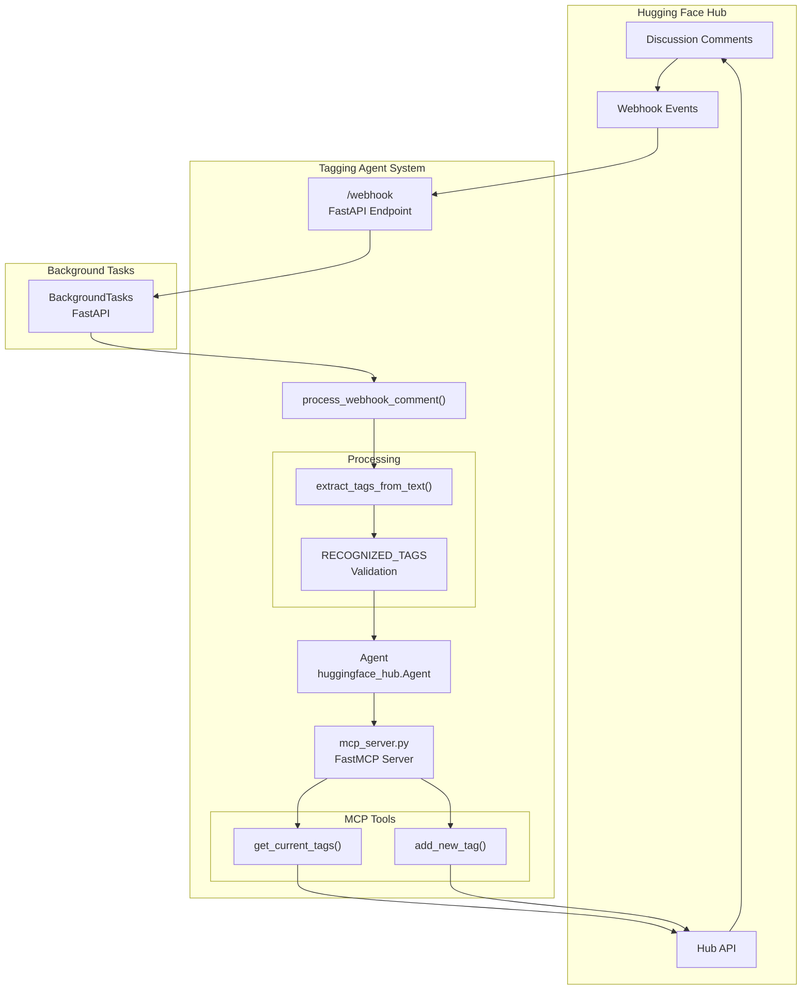
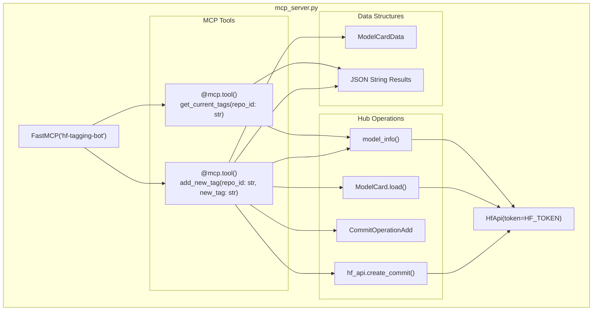
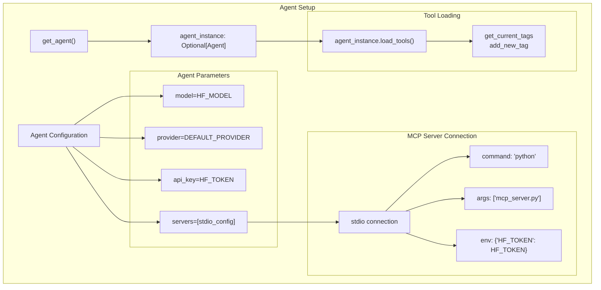
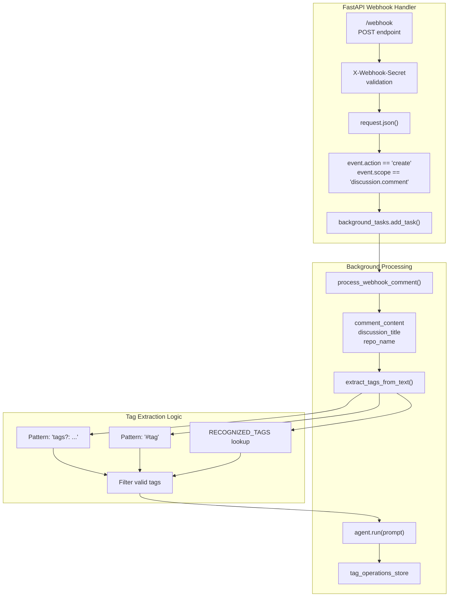
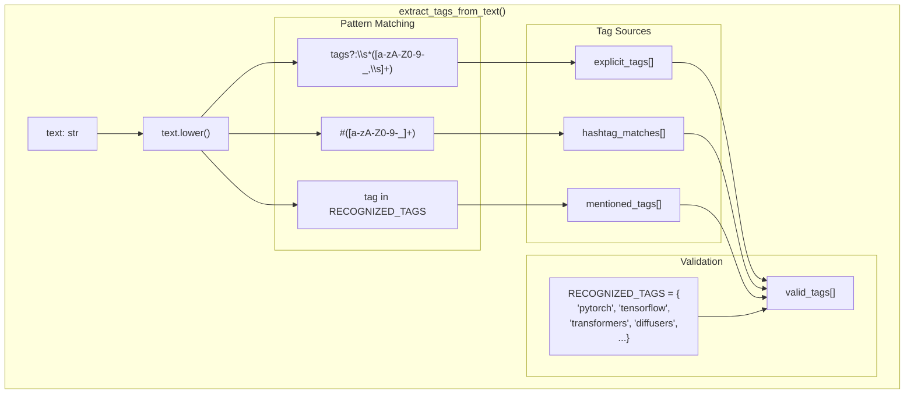

<!-- source: DeepWiki mcp.deepwiki.com · repo huggingface/mcp-course · page 5.3 Hugging Face Hub Tagging Agent · fetched 2026-10-26 -->

# Hugging Face Hub Tagging Agent

<details>
<summary>Relevant source files</summary>

The following files were used as context for generating this wiki page:

- [units/en/unit3_1/conclusion.mdx](units/en/unit3_1/conclusion.mdx)
- [units/en/unit3_1/creating-the-mcp-server.mdx](units/en/unit3_1/creating-the-mcp-server.mdx)
- [units/en/unit3_1/introduction.mdx](units/en/unit3_1/introduction.mdx)
- [units/en/unit3_1/mcp-client.mdx](units/en/unit3_1/mcp-client.mdx)
- [units/en/unit3_1/quiz1.mdx](units/en/unit3_1/quiz1.mdx)
- [units/en/unit3_1/quiz2.mdx](units/en/unit3_1/quiz2.mdx)
- [units/en/unit3_1/setting-up-the-project.mdx](units/en/unit3_1/setting-up-the-project.mdx)
- [units/en/unit3_1/webhook-listener.mdx](units/en/unit3_1/webhook-listener.mdx)

</details>


This document covers the implementation of an automated tagging agent for Hugging Face model repositories. The system monitors repository discussions via webhooks and automatically creates pull requests to add relevant tags to model metadata. The agent combines MCP server tools, intelligent client orchestration, and real-time webhook processing to enhance repository discoverability.

For information about the broader Pull Request Agent system including CI/CD monitoring and Slack integration, see [CI/CD Monitoring and Slack Integration](#5.2).

## System Architecture Overview

The Hugging Face Hub Tagging Agent consists of four main components that work together to process discussion events and create repository improvements:

### Component Interaction Flow



Sources: [units/en/unit3_1/introduction.mdx:36-42](), [units/en/unit3_1/webhook-listener.mdx:94-177](), [units/en/unit3_1/mcp-client.mdx:13-21]()

### Core Components

| Component | File | Purpose |
|-----------|------|---------|
| **MCP Server** | `mcp_server.py` | FastMCP-based server exposing Hub interaction tools |
| **MCP Client** | `app.py` | Agent-based orchestration using `huggingface_hub.Agent` |
| **Webhook Listener** | `app.py` | FastAPI endpoint processing Hub discussion events |
| **Tag Processing** | `app.py` | Natural language tag extraction and validation |

Sources: [units/en/unit3_1/introduction.mdx:44-56](), [units/en/unit3_1/setting-up-the-project.mdx:20-30]()

## MCP Server Implementation

The MCP server provides two essential tools for Hub interaction, implemented using the FastMCP framework:

### Server Architecture



Sources: [units/en/unit3_1/creating-the-mcp-server.mdx:18-63](), [units/en/unit3_1/creating-the-mcp-server.mdx:77-122]()

### Tool Implementation Details

The MCP server implements two core tools following the FastMCP pattern:

#### get_current_tags Tool

The `get_current_tags` tool retrieves existing repository tags using the Hub API:

```python
@mcp.tool()
def get_current_tags(repo_id: str) -> str:
```

Key implementation aspects:
- Uses `model_info(repo_id=repo_id, token=HF_TOKEN)` to fetch repository metadata
- Returns JSON-serialized results for MCP protocol compliance
- Handles authentication errors when `HF_TOKEN` is missing
- Provides structured response with `status`, `repo_id`, `current_tags`, and `count` fields

Sources: [units/en/unit3_1/creating-the-mcp-server.mdx:77-122]()

#### add_new_tag Tool

The `add_new_tag` tool creates pull requests to add new tags:

```python
@mcp.tool()
def add_new_tag(repo_id: str, new_tag: str) -> str:
```

Key implementation aspects:
- Validates tag doesn't already exist to prevent duplicate PRs
- Handles missing model cards by creating new `ModelCard` and `ModelCardData` instances
- Uses `CommitOperationAdd` with `create_pr=True` to generate pull requests
- Creates detailed PR descriptions explaining the changes

Sources: [units/en/unit3_1/creating-the-mcp-server.mdx:141-307]()

## MCP Client Integration

The MCP client uses the `huggingface_hub.Agent` class to orchestrate tool usage with language model reasoning:

### Agent Configuration



Sources: [units/en/unit3_1/mcp-client.mdx:24-108]()

### Intelligent Tool Orchestration

The Agent provides intelligent tool usage through natural language instructions:

```python
prompt = f"""
For the repository '{repo_name}', check if the tag '{tag}' already exists.
If it doesn't exist, add it via a pull request.

Repository: {repo_name}
Tag to check/add: {tag}
"""
response = await agent.run(prompt)
```

The Agent automatically:
1. Reasons about which tools to call and in what sequence
2. Calls `get_current_tags` to check existing tags
3. Calls `add_new_tag` if the tag is missing
4. Provides natural language summaries of actions taken

Sources: [units/en/unit3_1/mcp-client.mdx:124-146](), [units/en/unit3_1/mcp-client.mdx:260-273]()

## Webhook Processing Pipeline

The webhook processing system handles real-time events from the Hugging Face Hub:

### Webhook Handler Flow



Sources: [units/en/unit3_1/webhook-listener.mdx:94-177](), [units/en/unit3_1/webhook-listener.mdx:183-294]()

### Event Processing Implementation

The webhook handler implements several key patterns:

#### Security Validation
```python
webhook_secret = request.headers.get("X-Webhook-Secret")
if webhook_secret != WEBHOOK_SECRET:
    return {"error": "incorrect secret"}, 400
```

#### Event Filtering
```python
if (
    event.get("action") == "create" and 
    event.get("scope") == "discussion.comment"
):
```

#### Background Processing
```python
background_tasks.add_task(process_webhook_comment, webhook_data)
```

This pattern ensures webhook responses are returned within 10 seconds while complex processing happens asynchronously.

Sources: [units/en/unit3_1/webhook-listener.mdx:106-177]()

## Tag Extraction and Processing

The tag extraction system uses multiple strategies to identify relevant tags from discussion content:

### Tag Recognition Patterns



Sources: [units/en/unit3_1/mcp-client.mdx:234-291]()

### Recognized Tags Configuration

The system maintains a curated set of valid ML/AI tags:

```python
RECOGNIZED_TAGS = {
    "pytorch", "tensorflow", "jax", "transformers", "diffusers",
    "text-generation", "text-classification", "question-answering",
    "text-to-image", "image-classification", "object-detection",
    # ... additional ML/AI tags
}
```

This validation prevents irrelevant tags from being added to repositories and focuses on meaningful ML/AI categorization.

Sources: [units/en/unit3_1/mcp-client.mdx:238-251]()

## Performance and Reliability Patterns

The system implements several patterns for production reliability:

### Singleton Agent Pattern
```python
agent_instance: Optional[Agent] = None

async def get_agent():
    global agent_instance
    if agent_instance is None and HF_TOKEN:
        # Create and configure agent once
```

This prevents expensive agent recreation and MCP server startup overhead.

### Background Task Processing
```python
@app.post("/webhook")
async def webhook_handler(request: Request, background_tasks: BackgroundTasks):
    # Quick validation and response
    background_tasks.add_task(process_webhook_comment, webhook_data)
    return {"status": "accepted"}
```

Ensures webhook responses are returned within platform timeout limits.

### Operation Monitoring
```python
tag_operations_store: List[Dict[str, Any]] = []

# Store operation records for debugging
operation = {
    "timestamp": datetime.now().isoformat(),
    "repo_name": repo_name,
    "extracted_tags": all_tags,
    "status": "processing"
}
```

Provides visibility into webhook processing for debugging and monitoring.

Sources: [units/en/unit3_1/mcp-client.mdx:304-354](), [units/en/unit3_1/webhook-listener.mdx:324-348]()

## Deployment and Configuration

The system requires several environment variables and configuration files:

### Required Environment Variables
- `HF_TOKEN`: Hugging Face API token for Hub interactions
- `WEBHOOK_SECRET`: Shared secret for webhook validation
- `HF_MODEL`: Language model for agent reasoning (optional)
- `HF_PROVIDER`: Model provider configuration (optional)

### Project Structure
```
hf-pr-agent/
├── mcp_server.py              # FastMCP server implementation
├── app.py                     # FastAPI webhook + agent logic
├── requirements.txt           # Python dependencies
├── pyproject.toml             # Project configuration
└── env.example                # Environment template
```

Sources: [units/en/unit3_1/setting-up-the-project.mdx:89-106](), [units/en/unit3_1/setting-up-the-project.mdx:20-30]()

---

