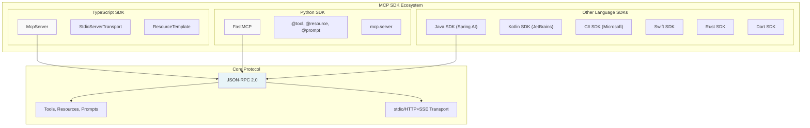
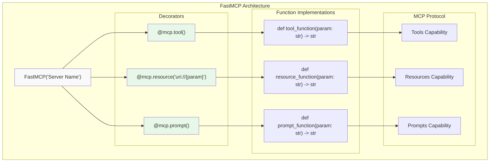
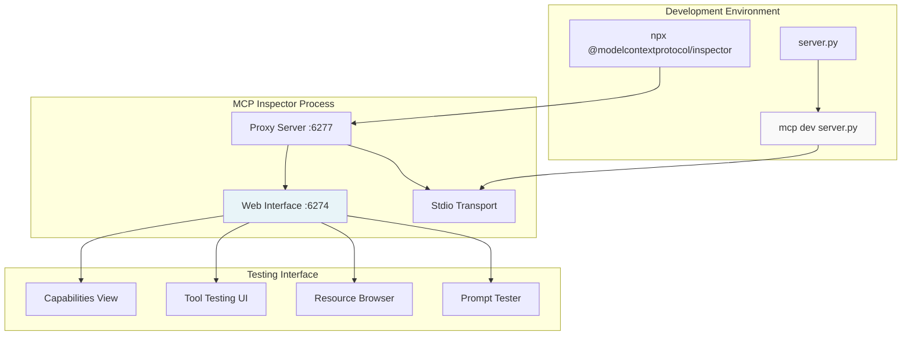
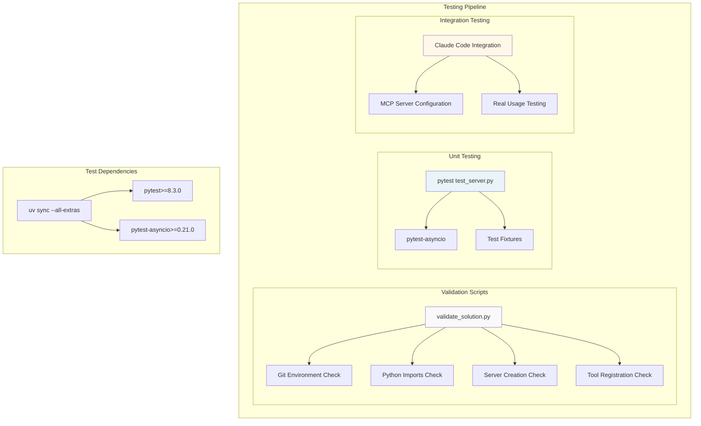
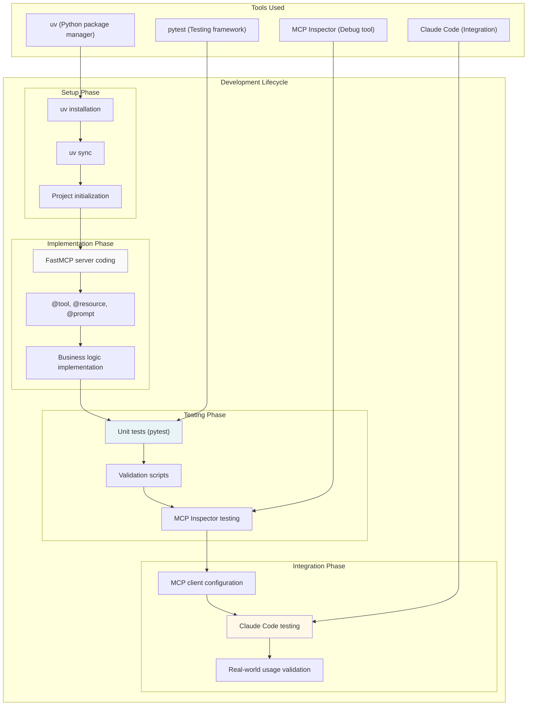

<!-- source: DeepWiki mcp.deepwiki.com · repo huggingface/mcp-course · page 6 Development Tools and SDKs · fetched 2026-10-26 -->

# Development Tools and SDKs

<details>
<summary>Relevant source files</summary>

The following files were used as context for generating this wiki page:

- [units/en/unit1/sdk.mdx](units/en/unit1/sdk.mdx)
- [units/vi/unit1/sdk.mdx](units/vi/unit1/sdk.mdx)

</details>


This document covers the development tools, SDKs, and frameworks available for building MCP (Model Context Protocol) applications. It focuses on the official language SDKs, development utilities like the MCP Inspector, testing frameworks, and best practices for MCP development workflows.

For information about specific MCP client implementations, see [MCP Clients](#3). For server implementation patterns, see [MCP Servers](#4).

## Official MCP SDKs

The Model Context Protocol provides official SDKs for multiple programming languages, each following the same core architecture while providing language-specific idioms and abstractions.

### SDK Architecture



Sources: [units/en/unit1/sdk.mdx:155-169]()

### Language Support Matrix

| Language | Repository | Maintainer | Status |
|----------|------------|------------|--------|
| TypeScript | [github.com/modelcontextprotocol/typescript-sdk](https://github.com/modelcontextprotocol/typescript-sdk) | Anthropic | Active |
| Python | [github.com/modelcontextprotocol/python-sdk](https://github.com/modelcontextprotocol/python-sdk) | Anthropic | Active |
| Java | [github.com/modelcontextprotocol/java-sdk](https://github.com/modelcontextprotocol/java-sdk) | Spring AI (VMware) | Active |
| Kotlin | [github.com/modelcontextprotocol/kotlin-sdk](https://github.com/modelcontextprotocol/kotlin-sdk) | JetBrains | Active |
| C# | [github.com/modelcontextprotocol/csharp-sdk](https://github.com/modelcontextprotocol/csharp-sdk) | Microsoft | Active (Preview) |
| Swift | [github.com/modelcontextprotocol/swift-sdk](https://github.com/modelcontextprotocol/swift-sdk) | loopwork-ai | Active |
| Rust | [github.com/modelcontextprotocol/rust-sdk](https://github.com/modelcontextprotocol/rust-sdk) | Anthropic/Community | Active |
| Dart | [https://github.com/leehack/mcp_dart](https://github.com/leehack/mcp_dart) | Flutter Community | Active |

Sources: [units/en/unit1/sdk.mdx:162-172]()
</thinking>

### Key SDK Classes and Components

| Language | Key Classes | Import Paths |
|----------|-------------|--------------|
| TypeScript | `McpServer`, `StdioServerTransport`, `ResourceTemplate` | `@modelcontextprotocol/sdk/server/mcp.js`, `@modelcontextprotocol/sdk/server/stdio.js` |
| Python | `FastMCP` | `mcp.server.fastmcp` |

Sources: [units/en/unit1/sdk.mdx:25-26](), [units/en/unit1/sdk.mdx:65-69]()

## FastMCP Framework

FastMCP is the primary Python framework for building MCP servers, providing a decorator-based approach for implementing MCP capabilities.

### FastMCP Core Components



### FastMCP Implementation Pattern

The FastMCP framework follows a simple decorator pattern for implementing MCP capabilities:

```python
from mcp.server.fastmcp import FastMCP

# Create an MCP server
mcp = FastMCP("Weather Service")

# Tool implementation
@mcp.tool()
def get_weather(location: str) -> str:
    """Get the current weather for a specified location."""
    return f"Weather in {location}: Sunny, 72°F"

# Resource implementation
@mcp.resource("weather://{location}")
def weather_resource(location: str) -> str:
    """Provide weather data as a resource."""
    return f"Weather data for {location}: Sunny, 72°F"

# Prompt implementation
@mcp.prompt()
def weather_report(location: str) -> str:
    """Create a weather report prompt."""
    return f"""You are a weather reporter. Weather report for {location}?"""

# Run the server
if __name__ == "__main__":
    mcp.run()
```

Sources: [units/en/unit1/sdk.mdx:24-52]()

## TypeScript SDK

The TypeScript SDK provides a more verbose but flexible approach to MCP server implementation using explicit class instantiation and method registration.

### TypeScript SDK Implementation Pattern

```javascript
// index.mjs
import {
  McpServer,
  ResourceTemplate,
} from "@modelcontextprotocol/sdk/server/mcp.js";
import { StdioServerTransport } from "@modelcontextprotocol/sdk/server/stdio.js";
import { z } from "zod";

// Create an MCP server
const server = new McpServer({
  name: "Weather Service",
  version: "1.0.0",
});

// Tool implementation
server.tool("get_weather", { location: z.string() }, async ({ location }) => ({
  content: [
    {
      type: "text",
      text: `Weather in ${location}: Sunny, 72°F`,
    },
  ],
}));

// Resource implementation
server.resource(
  "weather",
  new ResourceTemplate("weather://{location}", { list: undefined }),
  async (uri, { location }) => ({
    contents: [
      {
        uri: uri.href,
        text: `Weather data for ${location}: Sunny, 72°F`,
      },
    ],
  })
);

// Prompt implementation
server.prompt(
  "weather_report",
  { location: z.string() },
  async ({ location }) => ({
    messages: [
      {
        role: "assistant",
        content: {
          type: "text",
          text: "You are a weather reporter.",
        },
      },
      {
        role: "user",
        content: {
          type: "text",
          text: `Weather report for ${location}?`,
        },
      },
    ],
  })
);

// Run the server
const transport = new StdioServerTransport();
await server.connect(transport);
```

Sources: [units/en/unit1/sdk.mdx:64-129]()

## MCP Inspector

The MCP Inspector is a development tool that provides a web-based interface for testing and debugging MCP servers during development.

### MCP Inspector Workflow



### MCP Inspector Setup

To start the MCP Inspector for development:

```bash
# For Python servers
mcp dev server.py

# For TypeScript servers  
npx @modelcontextprotocol/inspector node ./index.mjs
```

This will initialize a development server and log the following output:

```bash
Starting MCP inspector...
⚙️ Proxy server listening on port 6277
Spawned stdio transport
Connected MCP client to backing server transport
Created web app transport
Set up MCP proxy
🔍 MCP Inspector is up and running at http://127.0.0.1:6274 🚀
```

You can then open the MCP Inspector at `http://127.0.0.1:6274` to see the server's capabilities and interact with them through the web UI.

Sources: [units/en/unit1/sdk.mdx:140-155]()

## Testing and Validation

MCP development includes comprehensive testing frameworks and validation tools to ensure server implementations work correctly.

### Testing Framework Components



### Testing Commands

The testing workflow includes multiple validation levels:

```bash
# Install dependencies with testing extras
uv sync --all-extras

# Run validation script
uv run python validate_solution.py

# Run unit tests
uv run pytest test_server.py -v

# Configure for integration testing
claude mcp add pr-agent -- uv --directory /absolute/path/to/module run server.py
claude mcp list
```

Sources: [projects/unit3/build-mcp-server/solution/manual_test.md:14-31](), [projects/unit3/build-mcp-server/solution/pyproject.toml:12-15](), [projects/unit3/build-mcp-server/solution/manual_test.md:35-45]()

### Validation Coverage

The validation script checks:
- Git environment setup
- Python imports and dependencies
- Server instantiation (`FastMCP` creation)
- Tool registration and functionality
- Template creation and management
- Tool execution with real parameters

Sources: [projects/unit3/build-mcp-server/solution/manual_test.md:19-26]()

## Development Workflow

The complete MCP development workflow integrates multiple tools and testing phases.

### End-to-End Development Process



### Project Structure

MCP projects follow a standard structure with dependency management via `uv`:

```
project/
├── pyproject.toml          # Project configuration and dependencies
├── server.py               # Main server implementation
├── validate_solution.py    # Validation script
├── test_server.py         # Unit tests
├── manual_test.md         # Testing documentation
└── README.md              # Project documentation
```

The `pyproject.toml` defines core dependencies:
- `mcp[cli]>=1.0.0` - Core MCP framework with CLI tools
- `pytest>=8.3.0` - Testing framework
- `pytest-asyncio>=0.21.0` - Async testing support

Sources: [projects/unit3/build-mcp-server/solution/pyproject.toml:1-28](), [projects/unit3/build-mcp-server/solution/README.md:13-32]()

### Best Practices

1. **Use Type Hints**: Both Python and TypeScript SDKs benefit from proper type annotations
2. **Implement Comprehensive Tests**: Include unit tests, validation scripts, and integration tests
3. **Leverage MCP Inspector**: Use the web interface for iterative development and debugging
4. **Follow Naming Conventions**: Use descriptive names for tools, resources, and prompts
5. **Document Your APIs**: Provide clear docstrings and parameter descriptions
6. **Test with Real Clients**: Validate functionality with actual MCP clients like Claude Code

Sources: [projects/unit3/build-mcp-server/solution/README.md:49-57](), [projects/unit3/build-mcp-server/solution/manual_test.md:90-109]()

---

