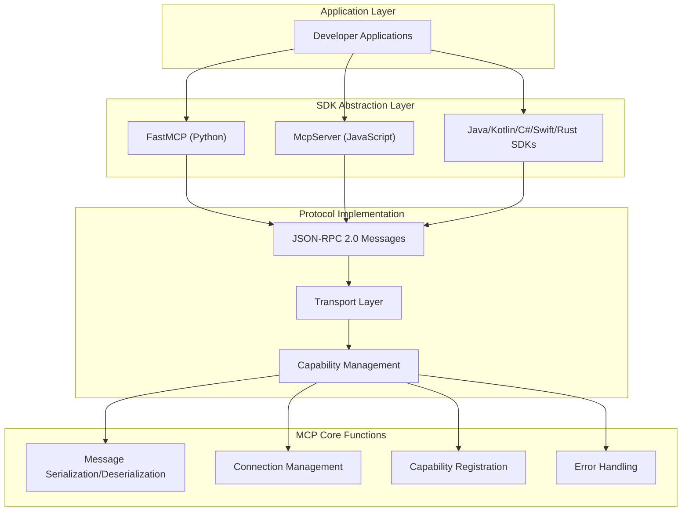
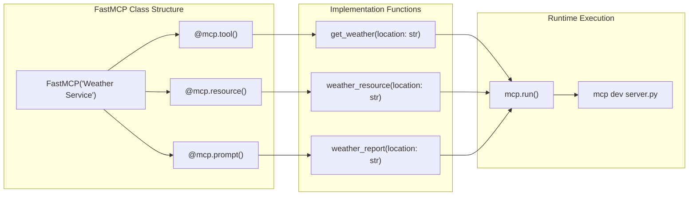
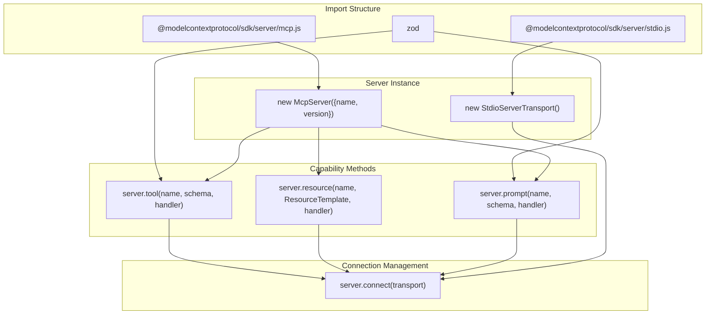
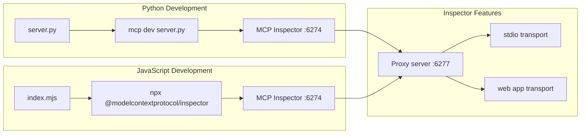

<!-- source: DeepWiki mcp.deepwiki.com · repo huggingface/mcp-course · page 6.1 MCP SDK · fetched 2026-10-26 -->

# MCP SDK

<details>
<summary>Relevant source files</summary>

The following files were used as context for generating this wiki page:

- [units/en/unit1/quiz1.mdx](units/en/unit1/quiz1.mdx)
- [units/en/unit1/quiz2.mdx](units/en/unit1/quiz2.mdx)
- [units/en/unit1/sdk.mdx](units/en/unit1/sdk.mdx)
- [units/vi/unit1/sdk.mdx](units/vi/unit1/sdk.mdx)

</details>


This page covers the multi-language SDK implementations available for the Model Context Protocol, focusing on Python FastMCP and JavaScript McpServer frameworks. It provides examples of implementing MCP capabilities and best practices for SDK usage across different programming languages.

For information about MCP protocol fundamentals, see [Core Concepts and Architecture](#2.1). For specific server implementation patterns, see [FastMCP Server Framework](#4.2).

## Purpose and Scope

The MCP SDK ecosystem provides language-specific abstractions that simplify working with the Model Context Protocol. These SDKs handle low-level protocol details including JSON-RPC message serialization, transport management, and capability registration, allowing developers to focus on implementing business logic rather than protocol mechanics.

**SDK Architecture Overview**



Sources: [units/en/unit1/sdk.mdx:7-14]()

## Core SDK Functionality

All MCP SDKs provide consistent functionality aligned with the MCP protocol specification:

| Function | Description | Implementation Level |
|----------|-------------|---------------------|
| Protocol Communication | JSON-RPC 2.0 message handling | Low-level |
| Capability Registration | Tools, Resources, Prompts registration | High-level |
| Message Serialization | Automatic JSON serialization/deserialization | Low-level |
| Connection Management | Transport lifecycle and state management | Low-level |
| Error Handling | Protocol-level error propagation and handling | Low-level |

Sources: [units/en/unit1/sdk.mdx:7-14]()

## Python FastMCP Implementation

The Python SDK uses the `FastMCP` class from `mcp.server.fastmcp` module. It provides decorator-based capability registration with automatic type validation.

**FastMCP Server Pattern**



Key implementation details:
- `FastMCP` constructor takes server name as parameter
- `@mcp.tool()` decorator for executable functions
- `@mcp.resource("uri_pattern")` decorator for read-only data sources
- `@mcp.prompt()` decorator for workflow templates
- `mcp.run()` method starts the server

Sources: [units/en/unit1/sdk.mdx:24-52]()

## JavaScript McpServer Implementation

The JavaScript SDK uses the `McpServer` class from `@modelcontextprotocol/sdk/server/mcp.js` with explicit schema validation via Zod.

**McpServer Class Structure**



Key implementation details:
- `McpServer` constructor requires name and version configuration
- `server.tool()` method with explicit schema validation
- `ResourceTemplate` class for URI pattern matching
- `StdioServerTransport` for transport layer management
- `server.connect()` method for transport binding

Sources: [units/en/unit1/sdk.mdx:63-129]()

## Core Primitives Implementation Patterns

Both SDKs implement the three core MCP primitives with language-specific patterns:

### Tools Implementation

**Python FastMCP:**
```python
@mcp.tool()
def get_weather(location: str) -> str:
    """Get the current weather for a specified location."""
    return f"Weather in {location}: Sunny, 72°F"
```

**JavaScript McpServer:**
```javascript
server.tool("get_weather", { location: z.string() }, async ({ location }) => ({
  content: [{ type: "text", text: `Weather in ${location}: Sunny, 72°F` }]
}));
```

### Resources Implementation

**Python FastMCP:**
```python
@mcp.resource("weather://{location}")
def weather_resource(location: str) -> str:
    """Provide weather data as a resource."""
    return f"Weather data for {location}: Sunny, 72°F"
```

**JavaScript McpServer:**
```javascript
server.resource(
  "weather",
  new ResourceTemplate("weather://{location}", { list: undefined }),
  async (uri, { location }) => ({
    contents: [{ uri: uri.href, text: `Weather data for ${location}: Sunny, 72°F` }]
  })
);
```

### Prompts Implementation

**Python FastMCP:**
```python
@mcp.prompt()
def weather_report(location: str) -> str:
    """Create a weather report prompt."""
    return f"""You are a weather reporter. Weather report for {location}?"""
```

**JavaScript McpServer:**
```javascript
server.prompt(
  "weather_report",
  { location: z.string() },
  async ({ location }) => ({
    messages: [
      { role: "assistant", content: { type: "text", text: "You are a weather reporter." }},
      { role: "user", content: { type: "text", text: `Weather report for ${location}?` }}
    ]
  })
);
```

Sources: [units/en/unit1/sdk.mdx:31-47](), [units/en/unit1/sdk.mdx:78-124]()

## Multi-Language SDK Ecosystem

The MCP ecosystem provides official SDKs across multiple programming languages, each maintained by different organizations:

| Language | Repository | Maintainer | Status | Key Features |
|----------|------------|------------|--------|--------------|
| TypeScript | `modelcontextprotocol/typescript-sdk` | Anthropic | Active | `McpServer`, `StdioServerTransport` |
| Python | `modelcontextprotocol/python-sdk` | Anthropic | Active | `FastMCP`, decorator patterns |
| Java | `modelcontextprotocol/java-sdk` | Spring AI (VMware) | Active | Spring integration |
| Kotlin | `modelcontextprotocol/kotlin-sdk` | JetBrains | Active | Coroutine support |
| C# | `modelcontextprotocol/csharp-sdk` | Microsoft | Active (Preview) | .NET integration |
| Swift | `modelcontextprotocol/swift-sdk` | loopwork-ai | Active | iOS/macOS support |
| Rust | `modelcontextprotocol/rust-sdk` | Anthropic/Community | Active | Memory safety |
| Dart | `leehack/mcp_dart` | Flutter Community | Active | Flutter support |

Sources: [units/en/unit1/sdk.mdx:162-172]()

## Development Workflow and Tooling

The MCP SDK ecosystem includes development tools for testing and debugging:

**Development Command Patterns**



### Development Commands

**Python FastMCP:**
- Server execution: `mcp dev server.py`
- Inspector access: `http://127.0.0.1:6274`

**JavaScript McpServer:**
- Server execution: `npx @modelcontextprotocol/inspector node ./index.mjs`
- Inspector access: `http://127.0.0.1:6274`

### MCP Inspector Output Pattern

```
Starting MCP inspector...
⚙️ Proxy server listening on port 6277
Spawned stdio transport
Connected MCP client to backing server transport
Created web app transport
Set up MCP proxy
🔍 MCP Inspector is up and running at http://127.0.0.1:6274 🚀
```

The Inspector provides:
- Capability visualization and testing
- JSON-RPC message inspection
- Interactive tool execution
- Resource browsing interface

Sources: [units/en/unit1/sdk.mdx:54-58](), [units/en/unit1/sdk.mdx:131-135](), [units/en/unit1/sdk.mdx:140-155]()

---

