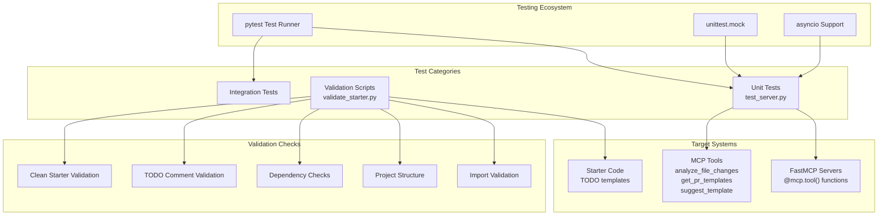
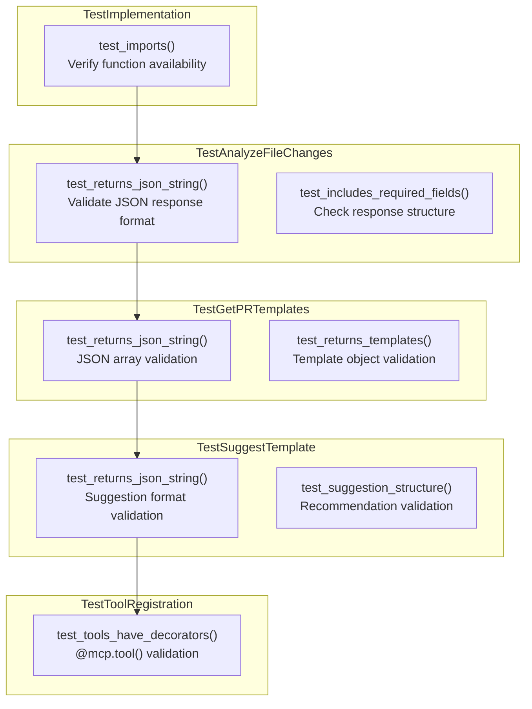
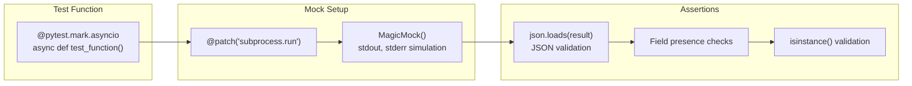
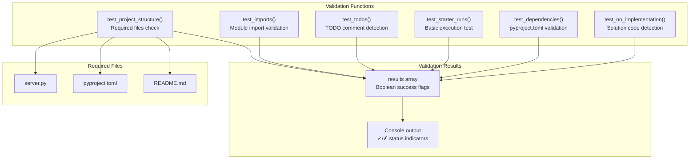
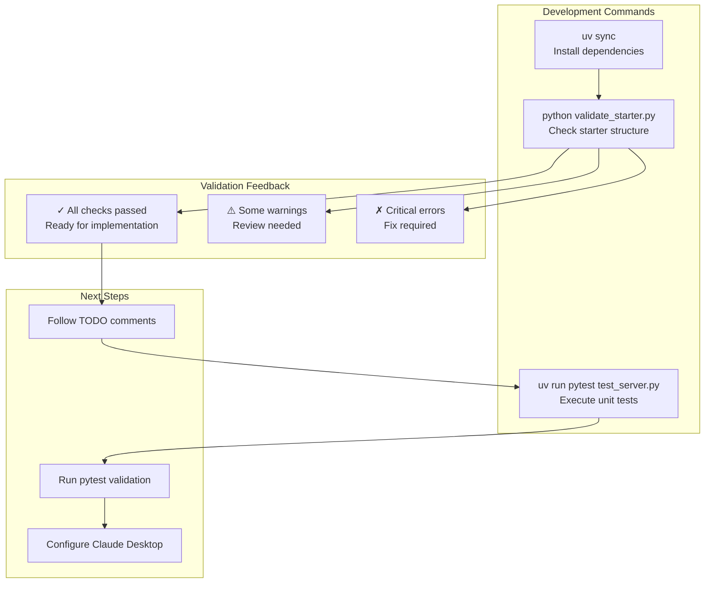

<!-- source: DeepWiki mcp.deepwiki.com · repo huggingface/mcp-course · page 6.2 Testing and Validation · fetched 2026-10-26 -->

# Testing and Validation

Relevant source files

The following files were used as context for generating this wiki page:

- [projects/unit3/build-mcp-server/starter/test_server.py](projects/unit3/build-mcp-server/starter/test_server.py)
- [projects/unit3/build-mcp-server/starter/validate_starter.py](projects/unit3/build-mcp-server/starter/validate_starter.py)
- [projects/unit3/github-actions-integration/solution/test_server.py](projects/unit3/github-actions-integration/solution/test_server.py)
- [projects/unit3/github-actions-integration/starter/test_server.py](projects/unit3/github-actions-integration/starter/test_server.py)
- [projects/unit3/github-actions-integration/starter/validate_starter.py](projects/unit3/github-actions-integration/starter/validate_starter.py)
- [projects/unit3/slack-notification/solution/test_server.py](projects/unit3/slack-notification/solution/test_server.py)
- [projects/unit3/slack-notification/starter/test_server.py](projects/unit3/slack-notification/starter/test_server.py)
- [projects/unit3/slack-notification/starter/validate_starter.py](projects/unit3/slack-notification/starter/validate_starter.py)

This document covers the testing frameworks, validation patterns, and development workflows used throughout the MCP course repository. It focuses on the automated testing infrastructure for MCP server implementations, starter code validation systems, and best practices for ensuring code quality in educational projects.

For information about MCP SDK implementations and development tools, see [MCP SDK](#6.1). For details about MCP server development patterns, see [MCP Servers](#4).

## Purpose and Scope

The testing and validation system provides:
- **Unit Testing Framework**: Comprehensive pytest-based testing for MCP tool functions
- **Starter Code Validation**: Automated checks to ensure educational templates are properly structured
- **Development Workflow Support**: Scripts and patterns that support the learn-build-test cycle
- **Quality Assurance**: Consistent validation patterns across multiple course modules

## Testing Architecture Overview

Sources: [projects/unit3/build-mcp-server/starter/test_server.py:1-182](), [projects/unit3/github-actions-integration/starter/validate_starter.py:1-193]()

## Unit Testing Framework

### Test Structure and Organization

The unit testing system follows a consistent pattern across all MCP server implementations:

Sources: [projects/unit3/build-mcp-server/starter/test_server.py:27-170](), [projects/unit3/github-actions-integration/starter/test_server.py:27-145]()

### Import Validation Pattern

All test files implement a robust import validation system that handles both starter and solution code:

| Test Component | Purpose | Implementation |
|----------------|---------|----------------|
| `IMPORTS_SUCCESSFUL` | Global flag tracking import status | [projects/unit3/build-mcp-server/starter/test_server.py:14-24]() |
| `test_imports()` | Validates all required functions exist | [projects/unit3/build-mcp-server/starter/test_server.py:30-36]() |
| `@pytest.mark.skipif` | Conditional test execution | [projects/unit3/build-mcp-server/starter/test_server.py:39]() |

### Async Testing with Mocking

The testing framework extensively uses `unittest.mock` to simulate external dependencies:

Sources: [projects/unit3/build-mcp-server/starter/test_server.py:44-73](), [projects/unit3/github-actions-integration/solution/test_server.py:24-66]()

## Starter Code Validation System

### Validation Script Architecture

The `validate_starter.py` scripts ensure educational templates are properly configured:

Sources: [projects/unit3/github-actions-integration/starter/validate_starter.py:12-147](), [projects/unit3/build-mcp-server/starter/validate_starter.py:149-191]()

### TODO Comment Validation

The validation system checks for educational guidance markers:

| Validation Check | Purpose | Implementation |
|------------------|---------|----------------|
| TODO Detection | Ensures learner guidance exists | [projects/unit3/build-mcp-server/starter/validate_starter.py:51-72]() |
| Solution Prevention | Prevents accidentally included solutions | [projects/unit3/build-mcp-server/starter/validate_starter.py:121-147]() |
| Import Testing | Validates starter code structure | [projects/unit3/build-mcp-server/starter/validate_starter.py:31-49]() |

## Advanced Testing Patterns

### Integration Testing Workflow

The solution test files demonstrate comprehensive integration testing:

```mermaid
graph LR
    subgraph "TestIntegration"
        WORKFLOW["test_full_workflow()"]
    end
    
    subgraph "Test Steps"
        ANALYZE["analyze_file_changes()"]
        TEMPLATES["get_pr_templates()"]  
        SUGGEST["suggest_template()"]
    end
    
    subgraph "Assertions"
        RESULT_TYPES["String return validation"]
        JSON_STRUCTURE["JSON parsing checks"]
        FIELD_PRESENCE["Required field validation"]
        WORKFLOW_LOGIC["End-to-end logic validation"]
    end
    
    WORKFLOW --> ANALYZE
    ANALYZE --> TEMPLATES
    TEMPLATES --> SUGGEST
    
    SUGGEST --> RESULT_TYPES
    RESULT_TYPES --> JSON_STRUCTURE
    JSON_STRUCTURE --> FIELD_PRESENCE
    FIELD_PRESENCE --> WORKFLOW_LOGIC
```

Sources: [projects/unit3/github-actions-integration/solution/test_server.py:156-190](), [projects/unit3/slack-notification/solution/test_server.py:156-190]()

### Flexible Assertion Patterns

The testing framework accommodates both starter and solution implementations:

| Pattern | Starter Code Behavior | Solution Code Behavior |
|---------|----------------------|------------------------|
| Error Handling | Returns structured error messages | Returns actual data |
| Field Validation | Flexible field checking | Strict schema validation |
| Mock Responses | Accepts empty/minimal responses | Validates complete responses |

Sources: [projects/unit3/build-mcp-server/starter/test_server.py:65-73](), [projects/unit3/github-actions-integration/solution/test_server.py:99-154]()

## Development Workflow Integration

### Test Execution Commands

The testing system provides clear execution paths for learners:

Sources: [projects/unit3/build-mcp-server/starter/validate_starter.py:182-187](), [projects/unit3/build-mcp-server/starter/test_server.py:172-182]()

### Error Handling and Feedback

The validation system provides comprehensive error reporting:

| Error Type | Detection Method | User Guidance |
|------------|------------------|---------------|
| Import Failures | Exception catching in import blocks | Dependency installation instructions |
| Missing Files | `Path.exists()` checks | File creation requirements |
| Implementation Issues | Content scanning for solution indicators | TODO comment guidance |
| Execution Errors | Try-catch around module loading | Debug information and next steps |

Sources: [projects/unit3/github-actions-integration/starter/validate_starter.py:31-49](), [projects/unit3/build-mcp-server/starter/test_server.py:148-154]()

---

