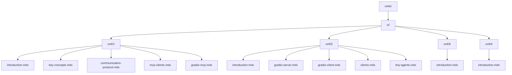
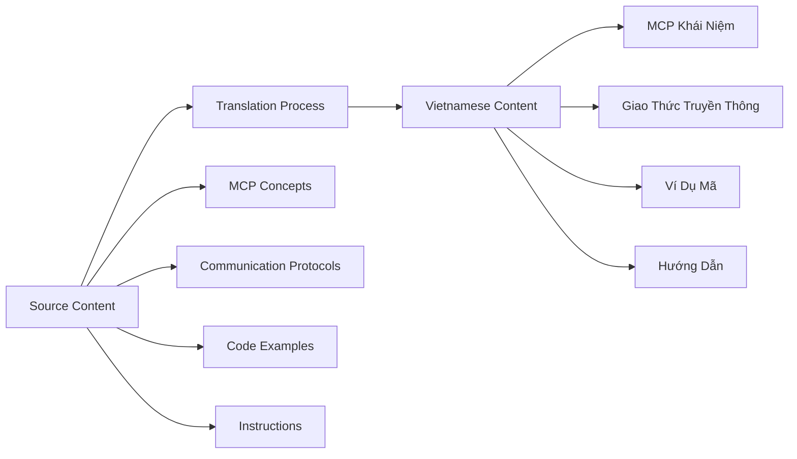
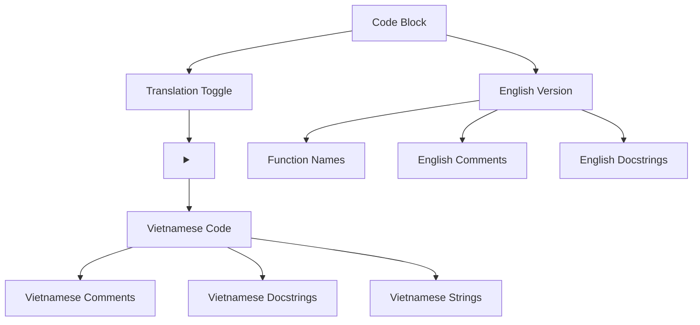
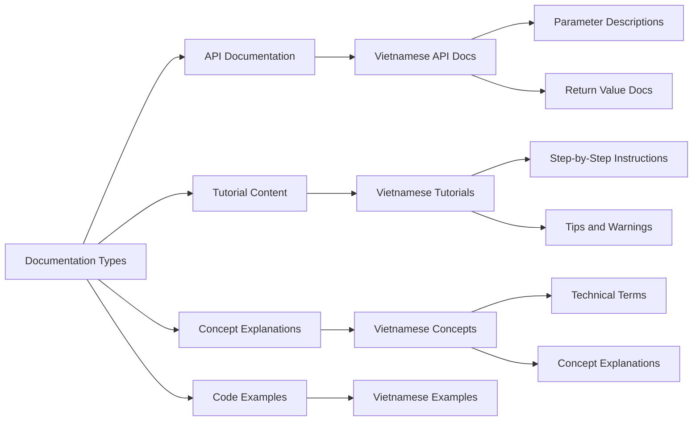
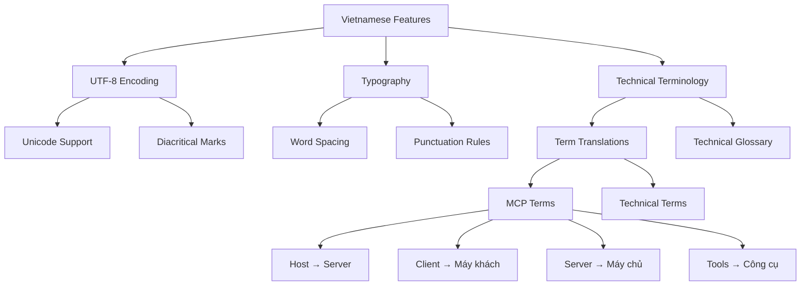
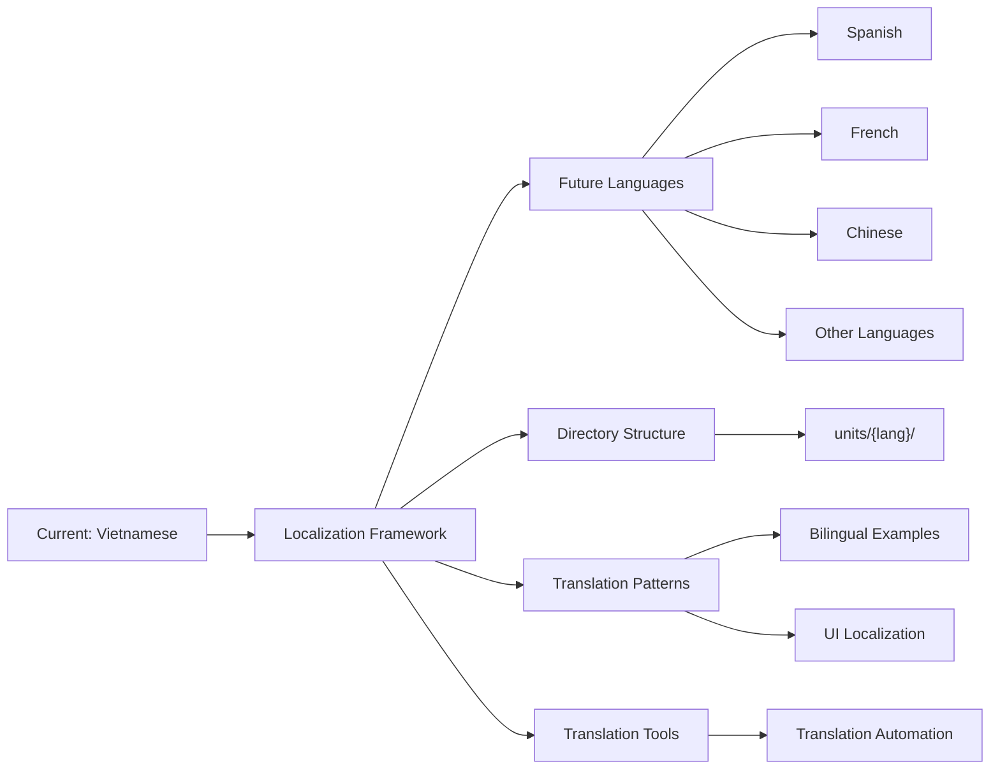

<!-- source: DeepWiki mcp.deepwiki.com · repo huggingface/mcp-course · page 8 Internationalization and Localization · fetched 2026-10-26 -->

# Internationalization and Localization

<details>
<summary>Relevant source files</summary>

The following files were used as context for generating this wiki page:

- [units/vi/unit1/communication-protocol.mdx](units/vi/unit1/communication-protocol.mdx)
- [units/vi/unit1/gradio-mcp.mdx](units/vi/unit1/gradio-mcp.mdx)
- [units/vi/unit1/introduction.mdx](units/vi/unit1/introduction.mdx)
- [units/vi/unit1/key-concepts.mdx](units/vi/unit1/key-concepts.mdx)
- [units/vi/unit1/mcp-clients.mdx](units/vi/unit1/mcp-clients.mdx)
- [units/vi/unit2/clients.mdx](units/vi/unit2/clients.mdx)
- [units/vi/unit2/gradio-client.mdx](units/vi/unit2/gradio-client.mdx)
- [units/vi/unit2/gradio-server.mdx](units/vi/unit2/gradio-server.mdx)
- [units/vi/unit2/introduction.mdx](units/vi/unit2/introduction.mdx)
- [units/vi/unit2/tiny-agents.mdx](units/vi/unit2/tiny-agents.mdx)
- [units/vi/unit3/introduction.mdx](units/vi/unit3/introduction.mdx)
- [units/vi/unit4/introduction.mdx](units/vi/unit4/introduction.mdx)

</details>


This document covers the internationalization (i18n) and localization (l10n) implementation within the MCP course repository, focusing on multi-language support for educational content and documentation. The system primarily demonstrates Vietnamese translations of the core MCP course materials, establishing patterns for future language additions.

For information about the overall course structure and educational content, see [Course Structure and Educational Content](#7).

## Localization Architecture

The repository implements a file-based localization system using language-specific directory structures to organize translated content.

### Directory Structure Pattern



**Language-Specific Organization**
The `units/vi/` directory contains Vietnamese translations mirroring the main course structure, with each unit maintaining identical file organization to the source content.

Sources: [units/vi/unit1/introduction.mdx:1-33](), [units/vi/unit2/introduction.mdx:1-66](), [units/vi/unit3/introduction.mdx:1-3](), [units/vi/unit4/introduction.mdx:1-5]()

## Content Translation Patterns

### Full Document Translation

The localization system provides complete Vietnamese translations of all course materials, including technical documentation, code examples, and instructional content.



**Translation Coverage**
- Technical terminology and concepts
- Code documentation and comments
- User interface strings
- Educational instructions and explanations
- Error messages and troubleshooting guides

Sources: [units/vi/unit1/key-concepts.mdx:1-88](), [units/vi/unit1/communication-protocol.mdx:1-221]()

### Bilingual Code Examples

The system implements a dual-language approach for code examples, providing both original English code and Vietnamese translations using collapsible sections.



**Implementation Pattern**
The repository uses HTML `<details>` and `<summary>` tags to create expandable translation sections, allowing users to view Vietnamese translations without disrupting the main content flow.

Sources: [units/vi/unit1/mcp-clients.mdx:119-134](), [units/vi/unit1/mcp-clients.mdx:154-169](), [units/vi/unit2/gradio-server.mdx:32-69]()

## Localized User Interface Elements

### Gradio Interface Localization

The course demonstrates localization of Gradio user interface components, including form labels, descriptions, and placeholder text.

| UI Component | Vietnamese Translation | Context |
|--------------|----------------------|---------|
| Placeholder Text | "Nhập văn bản để phân tích..." | Input field guidance |
| Title | "Phân Tích Cảm Xúc Văn Bản" | Application title |
| Description | "Phân tích cảm xúc văn bản sử dụng TextBlob" | Feature description |
| Button Text | "Bấm để xem bản dịch tiếng Việt" | Translation toggle |

**Gradio Localization Examples**
- Form input labels and placeholders
- Application titles and descriptions
- User feedback messages
- Navigation and interaction elements

Sources: [units/vi/unit2/gradio-server.mdx:56-63](), [units/vi/unit2/gradio-client.mdx:56-57](), [units/vi/unit2/gradio-client.mdx:105]()

### Documentation Localization

Technical documentation receives comprehensive Vietnamese translation, including:



**Documentation Elements**
- Function and method descriptions
- Parameter and return value documentation
- Step-by-step tutorials and guides
- Technical concept explanations
- Warning and tip messages

Sources: [units/vi/unit1/mcp-clients.mdx:17-22](), [units/vi/unit2/introduction.mdx:13-26]()

## Translation Implementation Strategies

### Code Comment Translation

The system provides Vietnamese translations for code comments and docstrings while maintaining the original English function names and technical identifiers.

**Python Code Translation Pattern**
```python
# Original English
def sentiment_analysis(text: str) -> dict:
    """
    Analyze the sentiment of the given text.
    
    Args:
        text (str): The text to analyze
        
    Returns:
        dict: A dictionary containing polarity, subjectivity, and assessment
    """

# Vietnamese Translation
def sentiment_analysis(text: str) -> dict:
    """
    Phân tích cảm xúc của văn bản được cung cấp.
    
    Args:
        text (str): Văn bản cần phân tích
        
    Returns:
        dict: Từ điển chứa thông tin về độ phân cực, tính chủ quan và đánh giá
    """
```

Sources: [units/vi/unit2/gradio-server.mdx:75-92]()

### Markdown Content Translation

The repository translates all Markdown content including headers, body text, code block descriptions, and metadata.

**Translation Elements**
- Section headers and subheaders
- Paragraph content and explanations
- List items and bullet points
- Table headers and cell content
- Code block descriptions and captions

Sources: [units/vi/unit1/introduction.mdx:1-33](), [units/vi/unit2/introduction.mdx:39-66]()

## Language-Specific Features

### Vietnamese Language Support

The implementation includes specific considerations for Vietnamese language characteristics:



**Vietnamese-Specific Implementation**
- Proper UTF-8 encoding for Vietnamese diacritical marks
- Technical terminology translation with consistent usage
- Culturally appropriate explanations and examples
- Vietnamese punctuation and formatting conventions

Sources: [units/vi/unit1/key-concepts.mdx:46-85](), [units/vi/unit1/mcp-clients.mdx:15-22]()

### Localization Patterns

The system establishes consistent patterns for future language additions:

| Pattern | Implementation | Example |
|---------|----------------|---------|
| Directory Structure | `units/{lang}/` | `units/vi/` |
| File Naming | Mirror source structure | `introduction.mdx` |
| Translation Toggles | HTML details/summary | Collapsible sections |
| Code Localization | Comments and strings only | Preserve identifiers |
| UI Element Translation | Complete localization | Gradio components |

**Extensibility Design**
The localization system is designed to support additional languages by replicating the directory structure and translation patterns established for Vietnamese.

Sources: [units/vi/unit2/tiny-agents.mdx:107-127](), [units/vi/unit2/clients.mdx:62-79]()

## Future Localization Considerations

### Scalability Framework

The current Vietnamese implementation provides a foundation for expanding to additional languages through:



**Expansion Capabilities**
- Standardized directory structure for new languages
- Established translation patterns and conventions
- Reusable UI localization components
- Documentation translation workflows

Sources: [units/vi/unit4/introduction.mdx:1-5](), [units/vi/unit3/introduction.mdx:1-3]()