# Page: Overview

# Overview

<details>
<summary>Relevant source files</summary>

The following files were used as context for generating this wiki page:

- [.github/workflows/build_documentation.yml](.github/workflows/build_documentation.yml)
- [.github/workflows/build_pr_documentation.yml](.github/workflows/build_pr_documentation.yml)
- [.github/workflows/upload_pr_documentation.yml](.github/workflows/upload_pr_documentation.yml)
- [README.md](README.md)
- [README_vi.md](README_vi.md)
- [requirements.txt](requirements.txt)
- [units/en/_toctree.yml](units/en/_toctree.yml)
- [units/en/unit0/introduction.mdx](units/en/unit0/introduction.mdx)
- [units/en/unit2/introduction.mdx](units/en/unit2/introduction.mdx)
- [units/en/unit3/certificate.mdx](units/en/unit3/certificate.mdx)

</details>


This document provides an overview of the MCP Course repository, an educational platform designed to teach the Model Context Protocol (MCP) from fundamental concepts to advanced implementation patterns. The repository contains comprehensive learning materials, hands-on projects, and certification programs for understanding and building applications with MCP.

For specific information about MCP protocol fundamentals, see [MCP Protocol Fundamentals](#2). For client implementations, see [MCP Clients](#3). For server development patterns, see [MCP Servers](#4).

## Course Architecture and Learning Progression

The MCP Course follows a structured educational pathway designed to take learners from beginner to proficient in Model Context Protocol development.

### Course Structure Overview

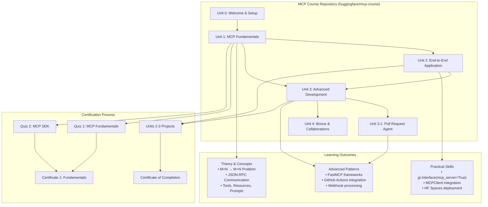

Sources: [units/en/_toctree.yml:1-83](), [units/en/unit0/introduction.mdx:46-56](), [units/en/unit0/introduction.mdx:84-92]()

### Educational Content Structure

The course implements a progressive learning model with theoretical foundations, practical applications, and advanced use cases:

| Unit | Focus Area | Key Components | Duration |
|------|------------|----------------|----------|
| 0 | Onboarding | Account setup, Discord, tools | Setup |
| 1 | Fundamentals | Key concepts, architecture, SDK, clients | 1 week |
| 2 | End-to-End App | Gradio servers, multiple clients, deployment | 1 week |
| 3 | Advanced Development | Custom workflows, CI/CD integration, Slack | 1 week |
| 3.1 | Hub Integration | Pull request agents, webhook listeners | Extension |
| 4 | Collaborations | Partner libraries, community projects | Bonus |

Sources: [units/en/unit0/introduction.mdx:46-56](), [units/en/unit0/introduction.mdx:94-96](), [README.md:19-25]()

## MCP Ecosystem Architecture

The course teaches the Model Context Protocol ecosystem, which solves the M×N integration problem between AI applications and external tools.

### MCP Protocol Implementation Map

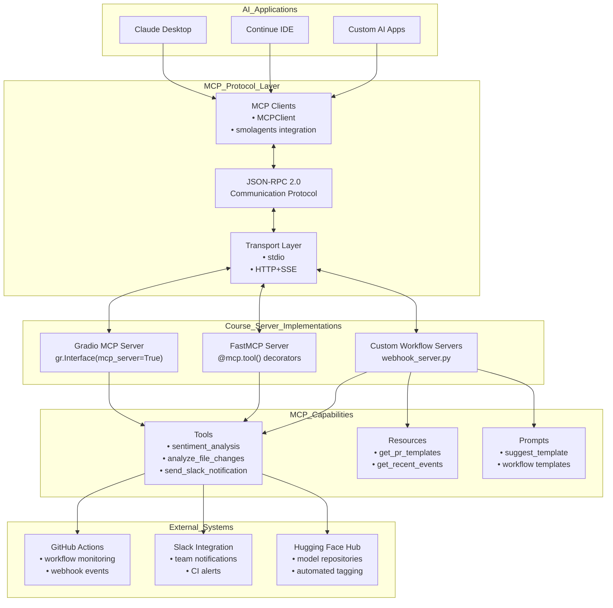

Sources: [units/en/_toctree.yml:17-27](), [units/en/_toctree.yml:33-46](), [units/en/unit2/introduction.mdx:39-61]()

## Repository Structure and Development Workflow

The repository implements a comprehensive development and documentation pipeline for educational content delivery.

### Documentation and Build Pipeline

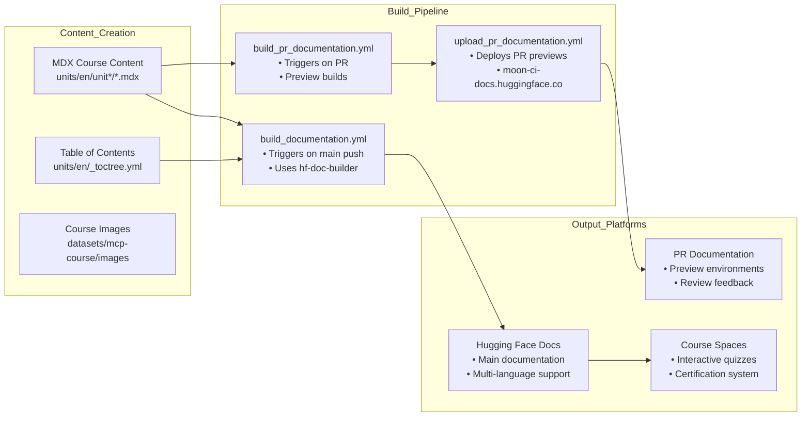

Sources: [.github/workflows/build_documentation.yml:1-20](), [.github/workflows/build_pr_documentation.yml:1-20](), [.github/workflows/upload_pr_documentation.yml:1-24]()

### Course Delivery Architecture

The course content is delivered through multiple channels with integrated assessment and certification systems:

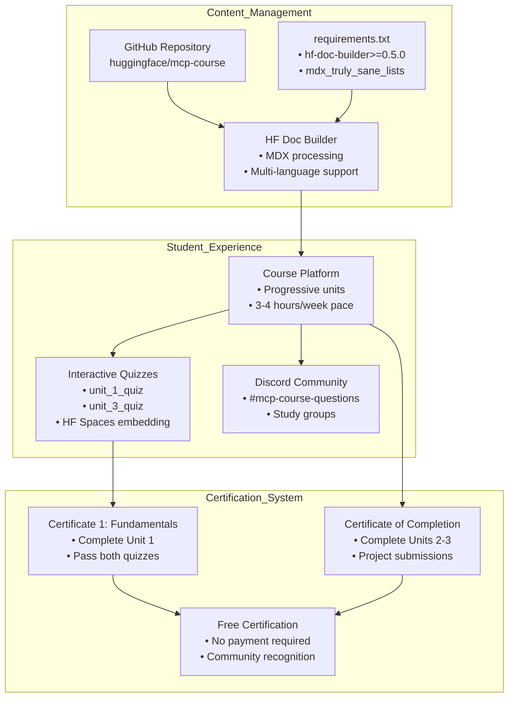

Sources: [units/en/unit0/introduction.mdx:84-92](), [units/en/unit0/introduction.mdx:94-108](), [units/en/unit3/certificate.mdx:1-19](), [requirements.txt:1-3]()

## Multi-Language Support and Community

The repository implements internationalization features and community engagement mechanisms:

| Component | English | Vietnamese | Purpose |
|-----------|---------|------------|---------|
| Main README | `README.md` | `README_vi.md` | Repository introduction |
| Course Content | `units/en/` | Planned expansion | Learning materials |
| Documentation Build | `languages: en` | Future support | Publishing pipeline |

The course maintains active community engagement through:
- Discord server with dedicated channels
- GitHub issues and pull requests for contributions
- Partner collaborations with Gradio, Continue, Anthropic
- Free certification process to encourage participation

Sources: [README.md:3](), [README_vi.md:3](), [.github/workflows/build_documentation.yml:17](), [units/en/unit0/introduction.mdx:123-131]()

## Target Audience and Prerequisites

The course is designed for developers with:
- Basic understanding of AI and LLM concepts
- Familiarity with software development principles and API concepts  
- Experience with Python or TypeScript programming languages
- Computer with internet connection and Hugging Face account

The educational approach emphasizes hands-on learning with pre-configured environments, progressive skill building, and real-world application development.

Sources: [units/en/unit0/introduction.mdx:58-75](), [units/en/unit0/introduction.mdx:77-82](), [README.md:27-31]()

---

# Page: MCP Protocol Fundamentals

# MCP Protocol Fundamentals

<details>
<summary>Relevant source files</summary>

The following files were used as context for generating this wiki page:

- [units/en/unit1/capabilities.mdx](units/en/unit1/capabilities.mdx)
- [units/en/unit1/key-concepts.mdx](units/en/unit1/key-concepts.mdx)

</details>


## Purpose and Scope

This document covers the foundational concepts, architecture, and communication mechanisms of the Model Context Protocol (MCP). It provides a comprehensive overview of how MCP solves the AI application integration challenge through standardized client-server communication patterns and capability abstractions.

For detailed implementation patterns of specific MCP components, see [MCP Clients](#3) and [MCP Servers](#4). For advanced application examples, see [Advanced Applications](#5).

## The Integration Challenge

MCP addresses the fundamental **M×N Integration Problem** that arises when connecting multiple AI applications to multiple external tools and data sources. Without standardization, developers must create individual integrations for each possible pairing, leading to exponential complexity.

### Problem: M×N Custom Integrations

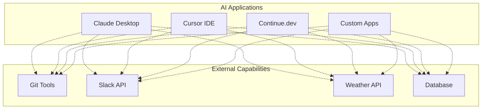

**M×N Integration Problem**

Sources: [units/en/unit1/key-concepts.mdx:12-32]()

### Solution: M+N Standardized Protocol

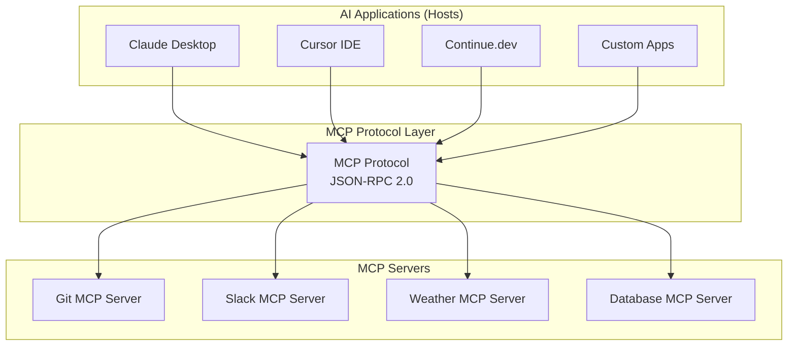

**M+N Solution with MCP**

Sources: [units/en/unit1/key-concepts.mdx:28-35]()

## Core Architecture

MCP defines a three-tier architecture with distinct roles and responsibilities for each component.

### Component Relationships

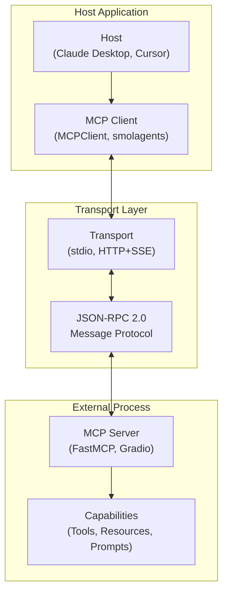

**MCP Architecture Components**

### Component Definitions

| Component | Description | Examples |
|-----------|-------------|----------|
| **Host** | User-facing AI application that orchestrates interactions | `Claude Desktop`, `Cursor IDE`, `smolagents` |
| **Client** | Protocol handler within Host managing Server communication | `MCPClient`, `@huggingface/tiny-agents` |  
| **Server** | External service exposing capabilities via MCP protocol | `FastMCP` servers, `gr.Interface(mcp_server=True)` |

Sources: [units/en/unit1/key-concepts.mdx:48-65]()

## MCP Capabilities

MCP defines four core capability types that Servers can expose to Clients, each with distinct control patterns and use cases.

### Capability Types and Control Patterns

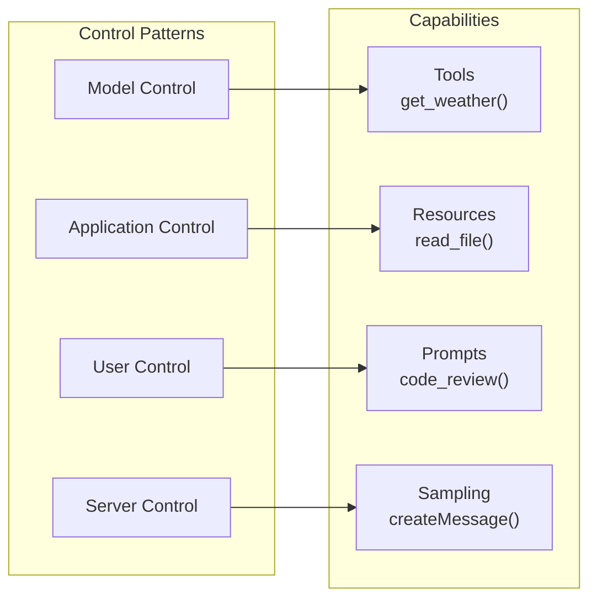

**MCP Capability Control Model**

### Capability Characteristics

| Capability | Controller | Direction | Side Effects | Approval Required | Example Code Entity |
|------------|------------|-----------|--------------|-------------------|-------------------|
| **Tools** | Model (LLM) | Client → Server | Yes | Yes | `get_weather()`, `send_slack_notification()` |
| **Resources** | Application | Client → Server | No (read-only) | Typically no | `read_file()`, `get_pr_templates()` |
| **Prompts** | User | Server → Client | No | No | `code_review()`, `suggest_template()` |
| **Sampling** | Server | Server → Client → Server | Indirectly | Yes | `createMessage()`, `analyze_file_changes()` |

Sources: [units/en/unit1/capabilities.mdx:13-228]()

### Discovery and Interaction Flow

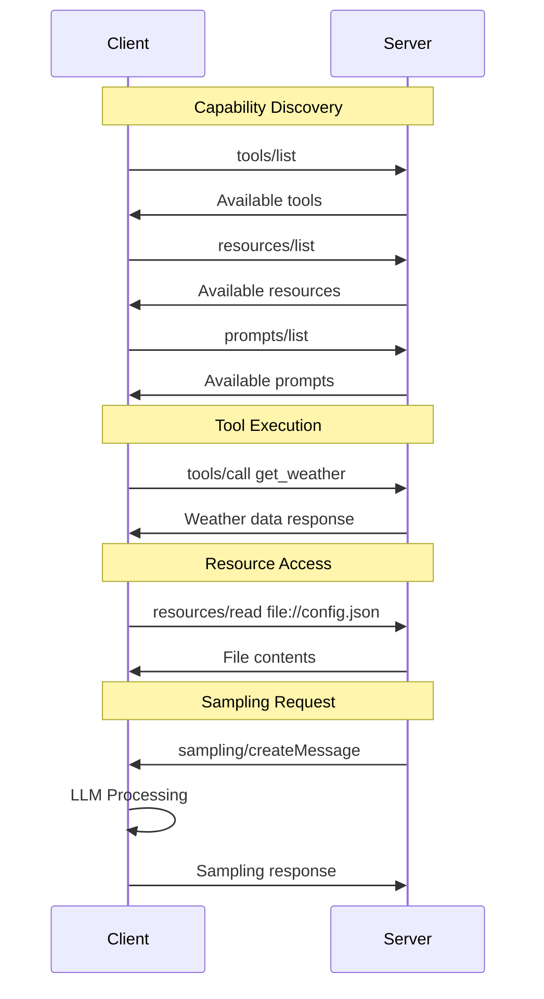

**MCP Capability Discovery and Interaction Protocol**

Sources: [units/en/unit1/capabilities.mdx:229-238]()

## Protocol Overview

MCP uses JSON-RPC 2.0 as its core communication protocol, supporting multiple transport mechanisms for different deployment scenarios.

### Transport and Protocol Stack

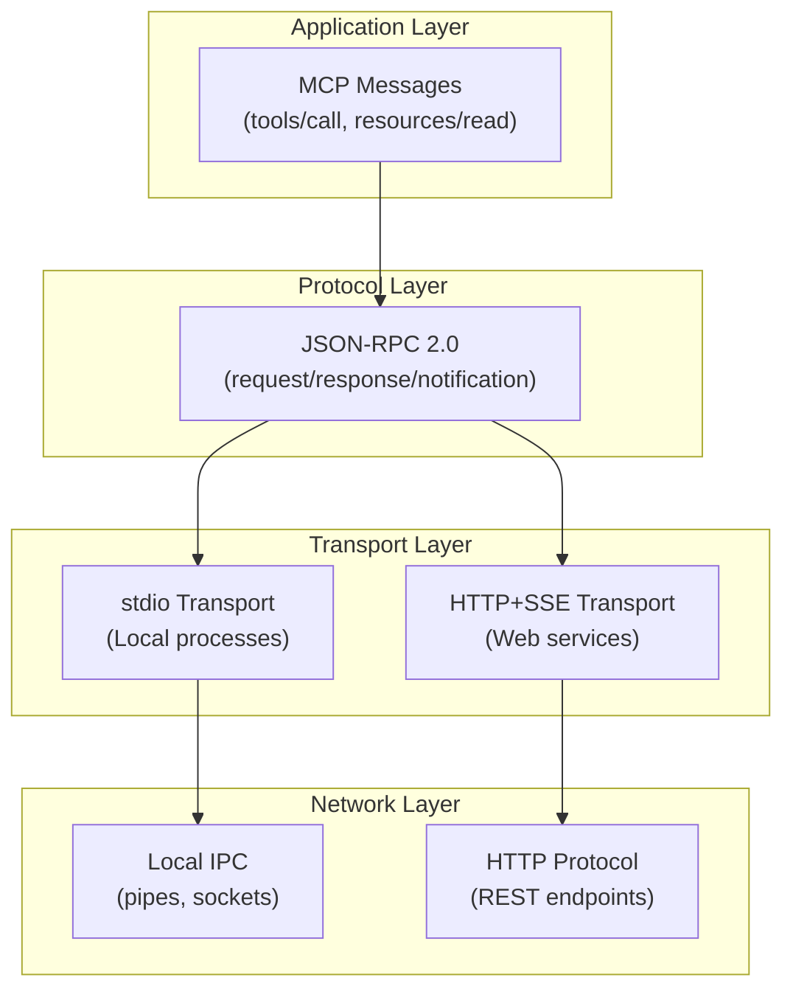

**MCP Protocol Stack**

### Key Protocol Features

- **Bidirectional Communication**: Both Client and Server can initiate requests
- **Capability Negotiation**: Dynamic discovery of available Tools, Resources, and Prompts
- **Transport Flexibility**: Support for `stdio` (local) and `HTTP+SSE` (remote) transports
- **JSON-RPC 2.0 Compliance**: Standard request/response/notification patterns

For detailed protocol specifications and message formats, see [Communication Protocol](#2.2).

Sources: [units/en/unit1/key-concepts.mdx:1-93](), [units/en/unit1/capabilities.mdx:1-243]()

## Implementation Patterns

MCP implementations typically follow these common patterns based on the capability types they expose:

### Server Implementation Patterns

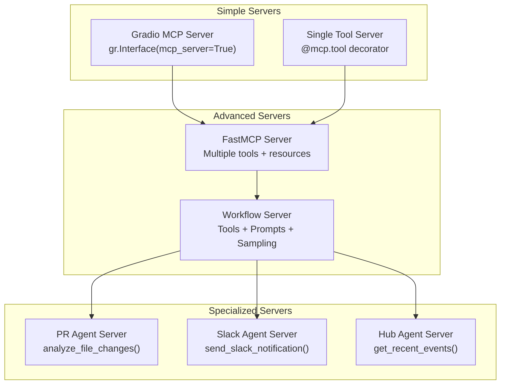

**MCP Server Implementation Progression**

Sources: [units/en/unit1/key-concepts.mdx:77-89]()

## Conclusion

MCP Protocol Fundamentals establish the foundation for standardized AI application integration through:

1. **Problem Resolution**: Transforming M×N integration complexity into M+N standardization
2. **Clear Architecture**: Well-defined Host-Client-Server component relationships  
3. **Capability Abstraction**: Four distinct capability types with appropriate control boundaries
4. **Protocol Standardization**: JSON-RPC 2.0 with flexible transport options

This foundation enables the rich ecosystem of MCP implementations covered in subsequent sections, from simple [Gradio MCP Servers](#4.1) to complex [Advanced Applications](#5) involving workflow automation and multi-system integration.

For architectural details and capability specifications, see [Core Concepts and Architecture](#2.1). For protocol mechanics and message formats, see [Communication Protocol](#2.2).

Sources: [units/en/unit1/key-concepts.mdx:90-93](), [units/en/unit1/capabilities.mdx:239-243]()

---

# Page: Core Concepts and Architecture

# Core Concepts and Architecture

<details>
<summary>Relevant source files</summary>

The following files were used as context for generating this wiki page:

- [units/en/unit1/capabilities.mdx](units/en/unit1/capabilities.mdx)
- [units/en/unit1/key-concepts.mdx](units/en/unit1/key-concepts.mdx)

</details>


This document covers the fundamental concepts and architectural patterns underlying the Model Context Protocol (MCP). It explains the M×N integration problem that MCP solves, the core components of the Host-Client-Server architecture, and the four capability types that enable AI applications to interact with external systems. For specific implementation details of the communication protocol, see [Communication Protocol](#2.2). For information about client implementations, see [MCP Clients](#3).

## The M×N Integration Problem

MCP addresses the fundamental challenge of connecting multiple AI applications to multiple external tools and data sources. Without a standardized protocol, developers face an exponential integration problem.

### Without MCP: M×N Complexity

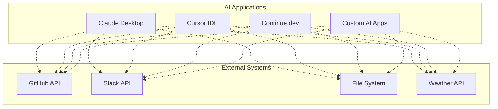

**M×N Integration Problem Architecture**

Each AI application requires individual integrations with every external system, creating M×N custom connections that are expensive to build and maintain.

Sources: [units/en/unit1/key-concepts.mdx:12-27]()

### With MCP: M+N Solution

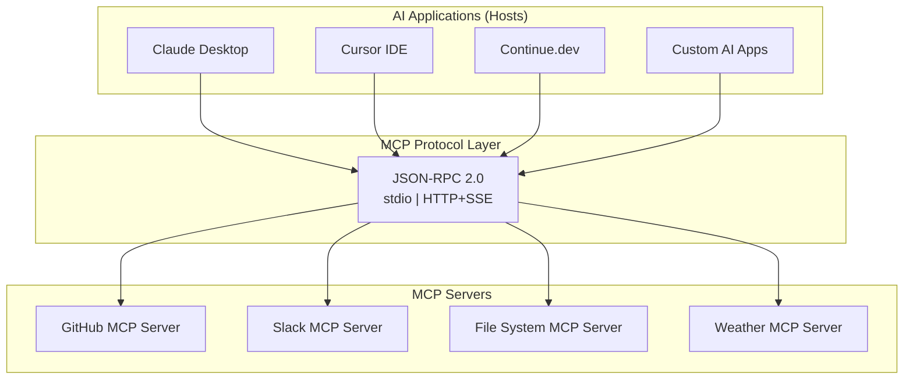

**MCP M+N Solution Architecture**

MCP transforms the integration problem into M+N by providing a standard interface. Each AI application implements MCP client functionality once, and each external system implements MCP server functionality once.

Sources: [units/en/unit1/key-concepts.mdx:28-35]()

## Core Architecture Components

MCP follows a three-tier architecture with distinct roles and responsibilities for each component.

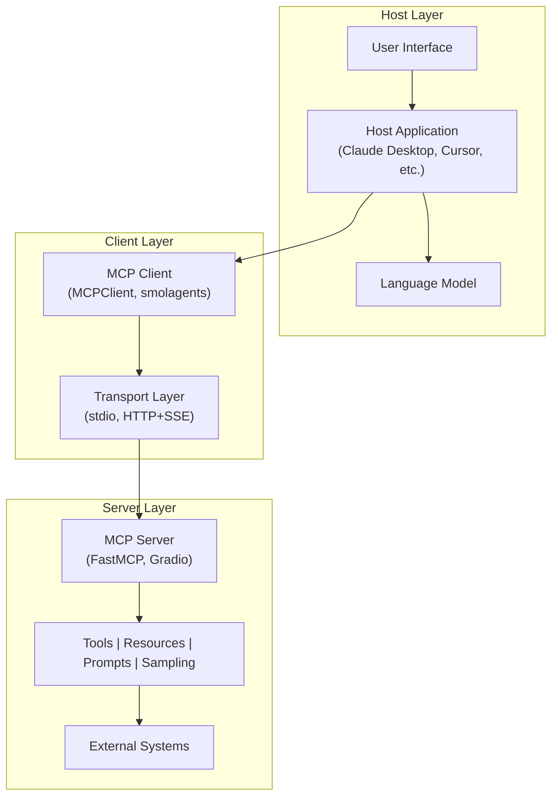

**Host-Client-Server Architecture**

### Host
The user-facing AI application that end-users interact with directly. Examples include Anthropic's Claude Desktop, AI-enhanced IDEs like Cursor, or custom applications built with frameworks like smolagents. Hosts initiate connections to MCP Servers and orchestrate the overall flow between user requests, LLM processing, and external tools.

### Client  
A component within the host application that manages communication with a specific MCP Server. Each Client maintains a 1:1 connection with a single Server, handling the protocol-level details of MCP communication. The Client acts as an intermediary between the Host's logic and the external Server.

### Server
An external program or service that exposes capabilities via the MCP protocol. Servers implement the four core capability types and handle requests from Clients through standardized JSON-RPC 2.0 messages.

Sources: [units/en/unit1/key-concepts.mdx:48-64]()

## MCP Capabilities

MCP defines four distinct capability types that servers can expose to clients, each with specific control patterns and use cases.

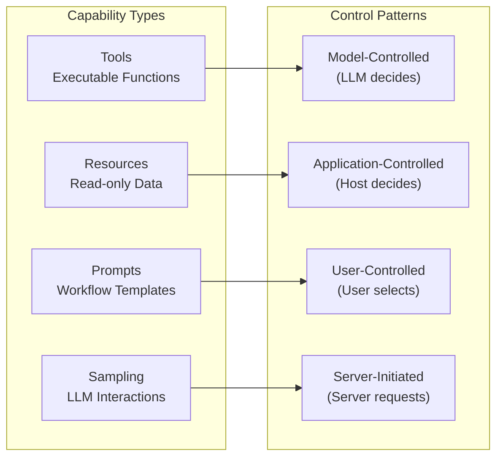

**MCP Capability Control Patterns**

### Tools
Executable functions that the AI model can invoke to perform actions or retrieve computed data. Tools are model-controlled, meaning the LLM decides when to call them based on context. Due to their potential for side effects, tool execution typically requires explicit user approval.

**Example use cases**: Weather data retrieval (`get_weather`), API calls, file operations, calculations

### Resources  
Read-only data sources that provide context without significant computation. Resources are application-controlled, with the Host deciding when to access them. They present lower security risks since they cannot modify external state.

**Example use cases**: File contents (`read_file`), database records, configuration data, documentation

### Prompts
Pre-defined templates or workflows that guide interactions between users, AI models, and available capabilities. Prompts are user-controlled, often presented as options in the Host application's UI before the AI model begins processing.

**Example use cases**: Code review templates (`code_review`), specialized workflows, guided interactions

### Sampling
Server-initiated requests for the Client/Host to perform LLM interactions. This enables recursive actions where the LLM can review generated content and make further decisions. Like Tools, sampling operations typically require user approval.

**Example use cases**: Multi-step analysis, autonomous agent workflows, content review and refinement

Sources: [units/en/unit1/key-concepts.mdx:66-89](), [units/en/unit1/capabilities.mdx:13-202]()

## Capability Control and Interaction Patterns

The four capabilities follow distinct control patterns that determine when and how they are invoked during MCP interactions.

| Capability | Controlled By | Direction | Side Effects | Approval Needed | Discovery Method |
|------------|---------------|-----------|--------------|-----------------|------------------|
| Tools      | Model (LLM)   | Client → Server | Yes (potentially) | Yes | `tools/list` |
| Resources  | Application   | Client → Server | No (read-only) | Typically no | `resources/list` |
| Prompts    | User          | Server → Client | No | No (selected by user) | `prompts/list` |
| Sampling   | Server        | Server → Client → Server | Indirectly | Yes | N/A |

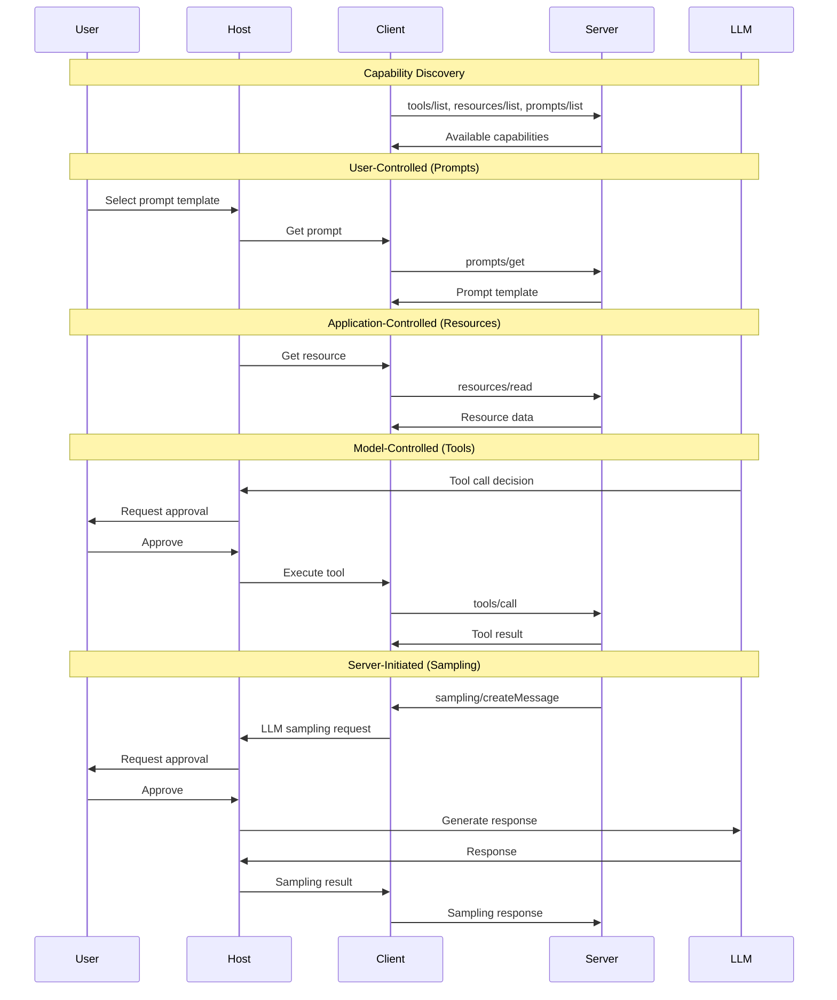

**MCP Capability Interaction Flow**

Sources: [units/en/unit1/capabilities.mdx:211-228]()

## Discovery and Communication Flow

MCP implements dynamic capability discovery, allowing Clients to adapt to each Server's specific functionality without hardcoded knowledge.

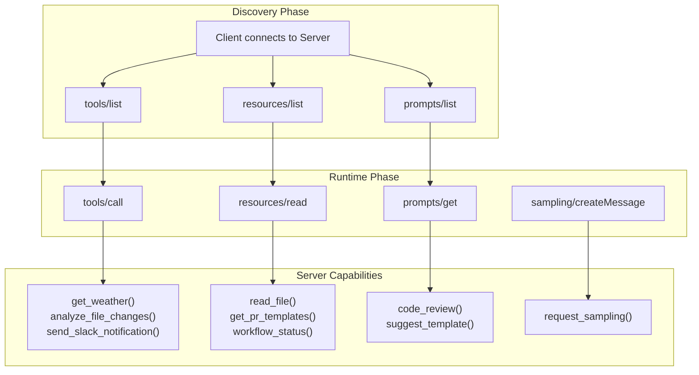

**MCP Discovery and Runtime Communication Flow**

The discovery process enables flexible, runtime adaptation to available capabilities:

1. **Connection Establishment**: Client connects to Server using configured transport
2. **Capability Discovery**: Client queries available Tools, Resources, and Prompts
3. **Runtime Interaction**: Host orchestrates capability usage based on user requests and LLM decisions
4. **Dynamic Adaptation**: System adapts to each Server's specific functionality

Sources: [units/en/unit1/capabilities.mdx:229-238]()

## Architectural Principles

MCP's architecture embodies several key principles that enable scalable AI application integration:

**Standardization**: JSON-RPC 2.0 protocol ensures consistent communication patterns across all implementations.

**Separation of Concerns**: Clear boundaries between Host (user interaction), Client (protocol handling), and Server (capability implementation).

**Security by Design**: Explicit approval mechanisms for potentially dangerous operations (Tools and Sampling).

**Discoverability**: Dynamic capability discovery eliminates need for hardcoded integrations.

**Extensibility**: Open capability model allows new types of interactions without protocol changes.

These architectural decisions transform the exponential integration problem into a linear one, enabling the MCP ecosystem to scale efficiently as new AI applications and external systems join the network.

Sources: [units/en/unit1/key-concepts.mdx:1-93](), [units/en/unit1/capabilities.mdx:1-243]()

---

# Page: Communication Protocol

# Communication Protocol

<details>
<summary>Relevant source files</summary>

The following files were used as context for generating this wiki page:

- [units/en/unit1/architectural-components.mdx](units/en/unit1/architectural-components.mdx)
- [units/en/unit1/communication-protocol.mdx](units/en/unit1/communication-protocol.mdx)
- [units/en/unit1/gradio-mcp.mdx](units/en/unit1/gradio-mcp.mdx)

</details>


## Purpose and Scope

This document covers the MCP (Model Context Protocol) communication protocol, including the JSON-RPC 2.0 message format, transport mechanisms, and protocol lifecycle. The communication protocol defines how MCP Clients and Servers exchange messages in a standardized, interoperable way.

For information about the architectural components and roles of Hosts, Clients, and Servers, see [Core Concepts and Architecture](#2.1). For specific client implementations and configuration patterns, see [MCP Clients](#3).

## JSON-RPC 2.0 Foundation

MCP uses **JSON-RPC 2.0** as the foundational message format for all communication between Clients and Servers. This provides a lightweight, language-agnostic remote procedure call protocol that is human-readable and well-established in the industry.

The protocol supports three fundamental message types that enable structured communication:

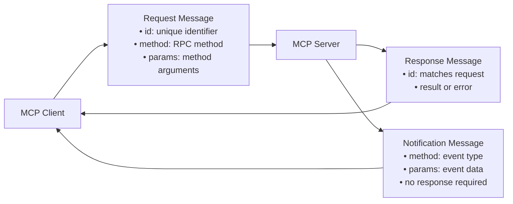

**JSON-RPC Message Flow Between Client and Server**

Sources: [units/en/unit1/communication-protocol.mdx:11-18]()

## Message Types

### Requests

Request messages are sent from Client to Server to initiate operations. Each request includes a unique `id`, the `method` name to invoke, and optional `params` for method arguments.

Common MCP request methods include:
- `tools/call` - Execute a specific tool
- `tools/list` - Discover available tools  
- `resources/list` - Discover available resources
- `prompts/list` - Discover available prompts
- `initialize` - Initialize the connection

```json
{
  "jsonrpc": "2.0",
  "id": 1,
  "method": "tools/call",
  "params": {
    "name": "weather",
    "arguments": {
      "location": "San Francisco"
    }
  }
}
```

Sources: [units/en/unit1/communication-protocol.mdx:23-44]()

### Responses

Response messages are sent from Server to Client in reply to requests. They contain the same `id` as the corresponding request and either a `result` for successful operations or an `error` for failures.

Success response example:
```json
{
  "jsonrpc": "2.0",
  "id": 1,
  "result": {
    "temperature": 62,
    "conditions": "Partly cloudy"
  }
}
```

Error response example:
```json
{
  "jsonrpc": "2.0",
  "id": 1,
  "error": {
    "code": -32602,
    "message": "Invalid location parameter"
  }
}
```

Sources: [units/en/unit1/communication-protocol.mdx:46-75]()

### Notifications

Notifications are one-way messages that don't require responses, typically sent from Server to Client to provide updates or progress information.

```json
{
  "jsonrpc": "2.0",
  "method": "progress",
  "params": {
    "message": "Processing data...",
    "percent": 50
  }
}
```

Sources: [units/en/unit1/communication-protocol.mdx:76-91]()

## Transport Mechanisms

MCP supports two primary transport mechanisms for delivering JSON-RPC messages between Clients and Servers.

### stdio Transport

The stdio transport enables local communication where Client and Server run on the same machine. The Host application launches the Server as a subprocess and communicates through standard input/output streams.

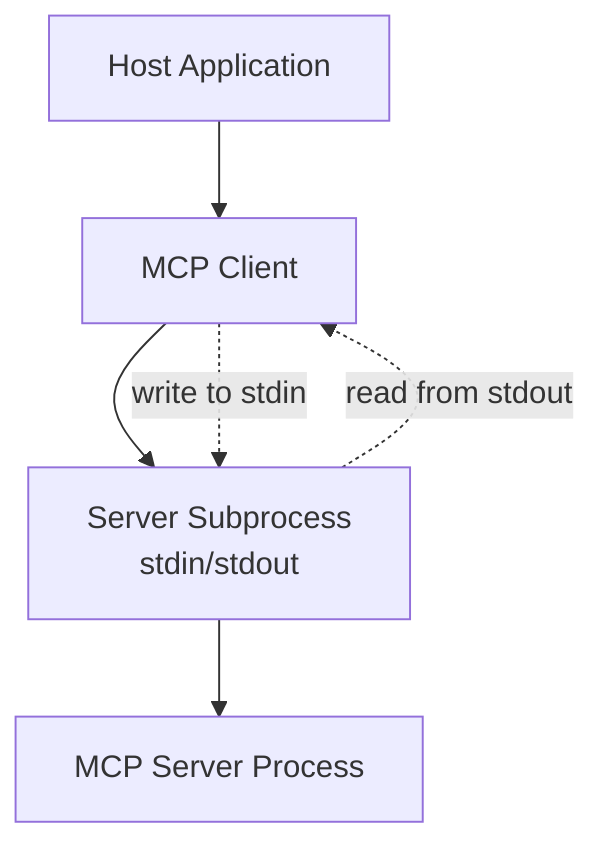

**stdio Transport Architecture**

Key characteristics:
- **Simple setup**: No network configuration required
- **Security**: Sandboxed by operating system process isolation  
- **Use cases**: Local file system access, running local scripts
- **Process management**: Host manages Server subprocess lifecycle

Sources: [units/en/unit1/communication-protocol.mdx:96-109]()

### HTTP+SSE Transport

The HTTP+SSE (Server-Sent Events) transport enables remote communication across networks. Communication occurs over HTTP with SSE providing a persistent connection for Server-to-Client notifications.

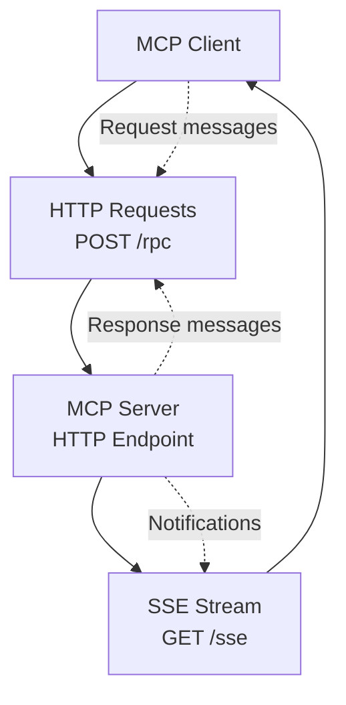

**HTTP+SSE Transport Architecture**

Key characteristics:
- **Network connectivity**: Works across machines and networks
- **Web integration**: Compatible with web services and APIs
- **Serverless support**: Works in serverless environments
- **Bidirectional**: HTTP for requests/responses, SSE for notifications

The Gradio MCP integration uses this transport with endpoints at:
- **SSE endpoint**: `/gradio_api/mcp/sse` for persistent connections
- **Schema endpoint**: `/gradio_api/mcp/schema` for capability discovery

Sources: [units/en/unit1/communication-protocol.mdx:110-125](), [units/en/unit1/gradio-mcp.mdx:75-78](), [units/en/unit1/gradio-mcp.mdx:96]()

## Protocol Lifecycle

The MCP protocol defines a structured interaction lifecycle with four distinct phases:

```mermaid
sequenceDiagram
    participant C as "MCP Client"
    participant S as "MCP Server"
    
    Note over C,S: Initialization Phase
    C->>S: initialize
    S->>C: response (capabilities)
    C->>S: initialized (notification)
    
    Note over C,S: Discovery Phase  
    C->>S: tools/list
    S->>C: response (tool definitions)
    C->>S: resources/list
    S->>C: response (resource definitions)
    
    Note over C,S: Execution Phase
    C->>S: tools/call
    S-->>C: progress (notification, optional)
    S->>C: response (results)
    
    Note over C,S: Termination Phase
    C->>S: shutdown
    S->>C: response (acknowledgment)
    C->>S: exit (notification)
```

**Complete MCP Protocol Lifecycle**

### Initialization Phase

The initialization phase establishes the connection and negotiates protocol capabilities:

1. **Initialize request**: Client sends protocol version and capabilities
2. **Initialize response**: Server responds with supported version and capabilities  
3. **Initialized notification**: Client confirms initialization completion

| Step | Direction | Message | Purpose |
|------|-----------|---------|---------|
| 1 | Client → Server | `initialize` | Protocol negotiation |
| 2 | Server → Client | response | Capability exchange |
| 3 | Client → Server | `initialized` | Completion confirmation |

Sources: [units/en/unit1/communication-protocol.mdx:133-155]()

### Discovery Phase

The discovery phase allows Clients to learn about available Server capabilities:

1. **List tools**: Client requests available tools with `tools/list`
2. **List resources**: Client requests available resources with `resources/list`  
3. **List prompts**: Client requests available prompts with `prompts/list`

Each discovery request returns structured definitions including names, descriptions, and parameter schemas.

Sources: [units/en/unit1/communication-protocol.mdx:157-174]()

### Execution Phase

The execution phase involves invoking Server capabilities based on Host requirements:

1. **Capability invocation**: Client sends `tools/call`, `resources/read`, or `prompts/get`
2. **Progress notifications**: Server optionally sends progress updates
3. **Result response**: Server returns execution results or errors

```mermaid
graph LR
    toolscall["tools/call"] --> Server["MCP Server"]
    resourcesread["resources/read"] --> Server
    promptsget["prompts/get"] --> Server
    
    Server --> progress["progress notification<br/>(optional)"]
    Server --> result["result response"]
    Server --> error["error response<br/>(if failure)"]
```

**Execution Phase Message Flow**

Sources: [units/en/unit1/communication-protocol.mdx:176-196]()

### Termination Phase

The termination phase gracefully closes the connection:

1. **Shutdown request**: Client sends `shutdown` when done
2. **Shutdown response**: Server acknowledges shutdown
3. **Exit notification**: Client sends final `exit` message

Sources: [units/en/unit1/communication-protocol.mdx:198-220]()

## Protocol Implementation Details

### Gradio MCP Server Implementation

The Gradio MCP integration automatically handles protocol details when `mcp_server=True` is specified in the `launch()` method:

1. **Automatic tool conversion**: Gradio functions become MCP tools with schemas
2. **Input mapping**: Gradio input components map to tool argument schemas  
3. **Output formatting**: Gradio output components determine response format
4. **Transport setup**: HTTP+SSE transport is configured automatically

```python
# Enables MCP server functionality
demo.launch(mcp_server=True)
```

Alternative environment variable configuration:
```bash
export GRADIO_MCP_SERVER=True
```

The implementation provides endpoints:
- **SSE endpoint**: `http://server:port/gradio_api/mcp/sse`
- **Schema endpoint**: `http://server:port/gradio_api/mcp/schema`

Sources: [units/en/unit1/gradio-mcp.mdx:86-96](), [units/en/unit1/gradio-mcp.mdx:98-107]()

### Compatibility Considerations

Some MCP Hosts don't support SSE-based servers. The `mcp-remote` proxy can bridge compatibility:

```json
{
  "mcpServers": {
    "gradio": {
      "command": "npx",
      "args": [
        "mcp-remote",
        "http://your-server:port/gradio_api/mcp/sse"
      ]
    }
  }
}
```

Sources: [units/en/unit1/gradio-mcp.mdx:123-137]()

## Protocol Evolution and Extensibility

The MCP protocol is designed for evolution and backward compatibility:

- **Version negotiation**: Initialization includes protocol version exchange
- **Capability discovery**: Enables Clients to adapt to Server-specific features
- **Extensible methods**: New RPC methods can be added without breaking existing implementations
- **Transport flexibility**: New transport mechanisms can be added while maintaining existing ones

This design allows mixing basic and advanced Servers in the same ecosystem while maintaining interoperability.

Sources: [units/en/unit1/communication-protocol.mdx:222-224]()

---

# Page: MCP Clients

# MCP Clients

<details>
<summary>Relevant source files</summary>

The following files were used as context for generating this wiki page:

- [units/en/unit1/mcp-clients.mdx](units/en/unit1/mcp-clients.mdx)
- [units/en/unit2/clients.mdx](units/en/unit2/clients.mdx)
- [units/en/unit2/gradio-server.mdx](units/en/unit2/gradio-server.mdx)

</details>


## Purpose and Scope

MCP Clients serve as the communication bridge between AI applications (Hosts) and external capabilities provided by MCP Servers. This page covers the architecture, types, and configuration patterns of MCP Client implementations, focusing on how they establish connections, manage transport protocols, and facilitate tool discovery and execution.

For detailed configuration syntax and transport setup, see [Client Configuration and Transport](#3.1). For specific client implementation examples, see [Gradio MCP Client](#3.2), [Tiny Agents](#3.3), and [Continue IDE Integration](#3.4).

## MCP Client Architecture

MCP Clients operate as specialized modules within Host applications, responsible for managing the JSON-RPC communication protocol and transport layer connections to MCP Servers.

### Client-Server Communication Flow

```mermaid
graph TB
    subgraph "Host Application"
        UI["User Interface"]
        CLIENT["MCP Client"]
    end
    
    subgraph "Transport Layer"
        STDIO["stdio Transport"]
        SSE["HTTP+SSE Transport"]
    end
    
    subgraph "MCP Server"
        TOOLS["Tools"]
        RESOURCES["Resources"]
        PROMPTS["Prompts"]
    end
    
    UI --> CLIENT
    CLIENT --> STDIO
    CLIENT --> SSE
    STDIO --> TOOLS
    SSE --> TOOLS
    STDIO --> RESOURCES
    SSE --> RESOURCES
    STDIO --> PROMPTS
    SSE --> PROMPTS
```

Sources: [units/en/unit1/mcp-clients.mdx:23-26](), [units/en/unit2/clients.mdx:1-4]()

### Configuration-Driven Discovery

```mermaid
graph LR
    subgraph "Configuration Layer"
        MCP_JSON["mcp.json"]
        AGENT_JSON["agent.json"]
        ENV_VARS["Environment Variables"]
    end
    
    subgraph "Client Implementations"
        CLAUDE["Claude Desktop"]
        CURSOR["Cursor IDE"]
        TINY_AGENTS["tiny-agents"]
        MCPCLIENT["MCPClient"]
    end
    
    subgraph "Transport Configuration"
        STDIO_CONFIG["stdio: {command, args, env}"]
        SSE_CONFIG["sse: {url}"]
    end
    
    MCP_JSON --> CLAUDE
    MCP_JSON --> CURSOR
    AGENT_JSON --> TINY_AGENTS
    MCP_JSON --> MCPCLIENT
    
    CLAUDE --> STDIO_CONFIG
    CLAUDE --> SSE_CONFIG
    CURSOR --> STDIO_CONFIG
    TINY_AGENTS --> STDIO_CONFIG
    MCPCLIENT --> SSE_CONFIG
```

Sources: [units/en/unit1/mcp-clients.mdx:54-77](), [units/en/unit2/clients.mdx:15-31]()

## Types of MCP Clients

### User Interface Clients

User Interface Clients provide direct interaction capabilities for end users through chat interfaces and interactive development environments.

| Client Type | Implementation | Primary Use Case |
|-------------|----------------|------------------|
| Chat Interface | Claude Desktop | General AI assistance with tool access |
| IDE Integration | Cursor IDE | AI-powered coding with MCP tool support |
| Development Environment | Continue.dev | VS Code extension with local model support |

**Key Configuration Pattern**: These clients use `mcp.json` configuration files with `servers` arrays defining connection parameters.

Sources: [units/en/unit1/mcp-clients.mdx:27-40]()

### Programmatic Clients

Programmatic Clients enable developers to integrate MCP capabilities directly into applications and workflows.

| Client Implementation | Package/Command | Transport Support |
|----------------------|-----------------|-------------------|
| `tiny-agents` | `@huggingface/tiny-agents` | `stdio` |
| `MCPClient` | `huggingface_hub[mcp]` | `sse` |
| `smolagents` | `smolagents` + `MCPClient` | `sse` |

**Configuration Pattern**: These clients use `agent.json` files or direct API calls for server connection specification.

Sources: [units/en/unit1/mcp-clients.mdx:230-334](), [units/en/unit2/clients.mdx:1-4]()

## Configuration Patterns

### Standard mcp.json Structure

The `mcp.json` configuration file follows a consistent structure across MCP Client implementations:

```json
{
  "servers": [
    {
      "name": "server-identifier",
      "transport": {
        "type": "stdio|sse",
        // transport-specific configuration
      }
    }
  ]
}
```

**stdio Transport Configuration**:
- `command`: Executable command (e.g., `"python"`, `"npx"`)
- `args`: Command arguments array
- `env`: Environment variables object

**sse Transport Configuration**:
- `url`: HTTP+SSE endpoint URL

Sources: [units/en/unit1/mcp-clients.mdx:59-98](), [units/en/unit2/clients.mdx:17-31]()

### Environment Variable Integration

MCP Clients support environment variable injection for secure credential management:

```json
{
  "servers": [{
    "name": "authenticated-server",
    "transport": {
      "type": "stdio",
      "command": "python",
      "args": ["/path/to/server.py"],
      "env": {
        "GITHUB_TOKEN": "token_value",
        "API_KEY": "key_value"
      }
    }
  }]
}
```

Server implementations access these through `os.environ.get()` in Python or `process.env` in JavaScript.

Sources: [units/en/unit1/mcp-clients.mdx:120-183]()

## Implementation Approaches

### Direct Integration Pattern

Applications like Claude Desktop and Cursor IDE embed MCP Client functionality directly, parsing `mcp.json` configurations and managing transport connections internally.

### Proxy Bridge Pattern

For clients that don't support HTTP+SSE transport, the `mcp-remote` tool provides a bridge:

```json
{
  "mcpServers": {
    "remote-server": {
      "command": "npx",
      "args": ["-y", "mcp-remote", "https://server.hf.space/gradio_api/mcp/sse", "--transport", "sse-only"]
    }
  }
}
```

This pattern converts remote SSE connections to local stdio interfaces.

Sources: [units/en/unit2/clients.mdx:127-135]()

### Agent Framework Integration

The `tiny-agents` implementation demonstrates agent-centric MCP integration:

1. Install prerequisites: `npm install -g npx`, `pip install "huggingface_hub[mcp]>=0.32.0"`
2. Configure `agent.json` with model and server specifications
3. Execute with `tiny-agents run agent.json` or `npx @huggingface/tiny-agents run ./agent-dir`

This approach combines LLM orchestration with MCP tool discovery and execution.

Sources: [units/en/unit1/mcp-clients.mdx:240-334]()

---

# Page: Client Configuration and Transport

# Client Configuration and Transport

<details>
<summary>Relevant source files</summary>

The following files were used as context for generating this wiki page:

- [units/en/unit1/mcp-clients.mdx](units/en/unit1/mcp-clients.mdx)
- [units/en/unit2/clients.mdx](units/en/unit2/clients.mdx)
- [units/en/unit2/gradio-server.mdx](units/en/unit2/gradio-server.mdx)

</details>


This document covers the configuration mechanisms and transport protocols used by MCP (Model Context Protocol) clients to connect to MCP servers. It focuses on the `mcp.json` configuration file structure, transport layer options, environment variable handling, and client-specific setup patterns.

For information about implementing MCP clients programmatically, see [Gradio MCP Client](#3.2) and [Tiny Agents](#3.3). For MCP server implementation details, see [MCP Servers](#4).

## MCP Configuration File Structure

MCP clients use a standardized JSON configuration file to define server connections and transport settings. The configuration follows a consistent structure across different MCP client implementations.

### Basic mcp.json Structure

The standard configuration file uses the following schema:

```json
{
  "servers": [
    {
      "name": "Server Name",
      "transport": {
        "type": "stdio|sse",
        // Transport-specific configuration
      }
    }
  ]
}
```

This structure supports multiple server definitions within a single configuration file, allowing clients to connect to multiple MCP servers simultaneously.

**Configuration File Structure**

```mermaid
graph TB
    Config["mcp.json"] --> Servers["servers[]"]
    Servers --> ServerConfig["Server Configuration"]
    ServerConfig --> Name["name: string"]
    ServerConfig --> Transport["transport: TransportConfig"]
    Transport --> Type["type: 'stdio' | 'sse'"]
    Transport --> StdioConfig["StdioTransport"]
    Transport --> SSEConfig["SSETransport"]
    
    StdioConfig --> Command["command: string"]
    StdioConfig --> Args["args: string[]"]
    StdioConfig --> Env["env: object"]
    
    SSEConfig --> URL["url: string"]
```

Sources: [units/en/unit1/mcp-clients.mdx:59-77](), [units/en/unit2/clients.mdx:15-31]()

## Transport Types and Configuration

MCP supports two primary transport mechanisms for client-server communication: stdio (Standard Input/Output) and SSE (Server-Sent Events over HTTP).

### stdio Transport Configuration

The stdio transport is used for local server processes that communicate through standard input and output streams.

```json
{
  "servers": [
    {
      "name": "File Explorer",
      "transport": {
        "type": "stdio",
        "command": "python",
        "args": ["/path/to/file_explorer_server.py"]
      }
    }
  ]
}
```

Key configuration parameters:
- `command`: The executable command to launch the server process
- `args`: Array of command-line arguments passed to the server process
- `env`: Optional environment variables for the server process

### HTTP+SSE Transport Configuration

The SSE transport enables connection to remote MCP servers via HTTP with Server-Sent Events for real-time communication.

```json
{
  "servers": [
    {
      "name": "Remote API Server",
      "transport": {
        "type": "sse",
        "url": "https://example.com/gradio_api/mcp/sse"
      }
    }
  ]
}
```

The `url` parameter specifies the complete endpoint for the MCP server's SSE interface.

**Transport Layer Architecture**

```mermaid
graph LR
    Client["MCP Client"] --> Transport["Transport Layer"]
    Transport --> StdioTransport["stdio transport"]
    Transport --> SSETransport["sse transport"]
    
    StdioTransport --> LocalProcess["Local Server Process"]
    LocalProcess --> Command["command + args"]
    LocalProcess --> EnvVars["env variables"]
    
    SSETransport --> HTTPEndpoint["HTTP+SSE Endpoint"]
    HTTPEndpoint --> RemoteServer["Remote MCP Server"]
    HTTPEndpoint --> GradioAPI["gradio_api/mcp/sse"]
```

Sources: [units/en/unit1/mcp-clients.mdx:82-119](), [units/en/unit2/clients.mdx:42-58]()

## Environment Variables

Environment variables provide a secure mechanism for passing sensitive configuration data to MCP servers without hardcoding credentials in configuration files.

### Environment Variable Configuration

Environment variables are specified in the `env` field of the stdio transport configuration:

```json
{
  "servers": [
    {
      "name": "GitHub API",
      "transport": {
        "type": "stdio",
        "command": "python",
        "args": ["/path/to/github_server.py"],
        "env": {
          "GITHUB_TOKEN": "your_github_token"
        }
      }
    }
  ]
}
```

### Server-Side Environment Variable Access

MCP servers access these environment variables using standard library functions:

**Python Implementation:**
```python
import os
github_token = os.environ.get("GITHUB_TOKEN")
```

**JavaScript Implementation:**
```javascript
const githubToken = process.env.GITHUB_TOKEN;
```

Sources: [units/en/unit1/mcp-clients.mdx:120-183]()

## Client-Specific Configuration Patterns

Different MCP client implementations have specific configuration requirements and patterns.

### Claude Desktop Configuration

Claude Desktop uses the standard `mcp.json` format with support for both transport types:

```json
{
  "servers": [
    {
      "name": "Sentiment Analysis",
      "transport": {
        "type": "sse",
        "url": "https://username-mcp-sentiment.hf.space/gradio_api/mcp/sse"
      }
    }
  ]
}
```

### Cursor IDE Configuration

Cursor IDE requires specific configuration through its settings interface, often using the `mcp-remote` bridge for SSE compatibility:

**macOS Configuration:**
```json
{
  "mcpServers": {
    "sentiment-analysis": {
      "command": "npx",
      "args": [
        "-y", 
        "mcp-remote", 
        "https://YOURUSENAME-mcp-sentiment.hf.space/gradio_api/mcp/sse", 
        "--transport", 
        "sse-only"
      ]
    }
  }
}
```

**Windows Configuration:**
```json
{
  "mcpServers": {
    "sentiment-analysis": {
      "command": "cmd",
      "args": [
        "/c", 
        "npx", 
        "-y", 
        "mcp-remote", 
        "https://YOURUSENAME-mcp-sentiment.hf.space/gradio_api/mcp/sse", 
        "--transport", 
        "sse-only"
      ]
    }
  }
}
```

### Tiny Agents Configuration

Tiny agents use an `agent.json` configuration file with additional model and provider specifications:

```json
{
    "model": "Qwen/Qwen2.5-72B-Instruct",
    "provider": "nebius",
    "servers": [
        {
            "type": "stdio",
            "config": {
                "command": "npx",
                "args": ["@playwright/mcp@latest"]
            }
        }
    ]
}
```

**Client Configuration Patterns**

```mermaid
graph TB
    subgraph "Claude Desktop"
        ClaudeConfig["mcp.json"]
        ClaudeStdio["stdio transport"]
        ClaudeSSE["sse transport"]
    end
    
    subgraph "Cursor IDE"
        CursorConfig["mcpServers config"]
        MCPRemote["mcp-remote bridge"]
        NPXCommand["npx execution"]
    end
    
    subgraph "Tiny Agents"
        AgentConfig["agent.json"]
        ModelConfig["model + provider"]
        ServerConfig["servers[] config"]
    end
    
    ClaudeConfig --> ClaudeStdio
    ClaudeConfig --> ClaudeSSE
    
    CursorConfig --> MCPRemote
    MCPRemote --> NPXCommand
    
    AgentConfig --> ModelConfig
    AgentConfig --> ServerConfig
```

Sources: [units/en/unit2/clients.mdx:81-136](), [units/en/unit1/mcp-clients.mdx:268-333]()

## Transport Bridge Solutions

Some MCP clients have limited transport support, requiring bridge solutions for compatibility with remote servers.

### mcp-remote Bridge

The `mcp-remote` tool serves as a transport bridge that:
- Runs locally as a stdio process
- Forwards requests to remote SSE endpoints
- Provides compatibility for clients that only support stdio transport

**Bridge Configuration Example:**
```json
{
  "mcpServers": {
    "gradio": {
      "command": "npx",
      "args": [
        "mcp-remote",
        "http://localhost:7860/gradio_api/mcp/sse"
      ]
    }
  }
}
```

**Transport Bridge Architecture**

```mermaid
graph LR
    MCPClient["MCP Client"] --> StdioOnly["stdio-only client"]
    StdioOnly --> MCPRemote["mcp-remote bridge"]
    MCPRemote --> SSEEndpoint["SSE Endpoint"]
    SSEEndpoint --> RemoteMCPServer["Remote MCP Server"]
    
    MCPRemote --> LocalProcess["Local stdio process"]
    MCPRemote --> HTTPRequest["HTTP+SSE requests"]
    
    subgraph "Bridge Functionality"
        LocalProcess
        HTTPRequest
    end
```

Sources: [units/en/unit2/clients.mdx:127-136](), [units/en/unit2/gradio-server.mdx:134-149]()

## Configuration Validation and Debugging

### Schema Validation

MCP servers expose their schema through dedicated endpoints for validation:

- **Schema Endpoint:** `http://localhost:7860/gradio_api/mcp/schema`
- **API Documentation:** Available in Gradio app footer "View API" link

### Common Configuration Issues

| Issue | Symptom | Solution |
|-------|---------|----------|
| Transport mismatch | Connection refused | Verify transport type matches server |
| Missing environment variables | Authentication errors | Check `env` field configuration |
| Incorrect endpoint URL | 404 errors | Validate SSE endpoint path |
| Bridge compatibility | Protocol errors | Use `mcp-remote` for stdio-only clients |

### Configuration Testing

**Validation Steps:**
1. Verify server accessibility at configured endpoint
2. Check MCP schema availability
3. Test tool discovery and invocation
4. Validate environment variable propagation

Sources: [units/en/unit2/gradio-server.mdx:116-154]()

## Deployment Considerations

### Local Development

For local development, stdio transport provides direct process communication:

```json
{
  "servers": [
    {
      "name": "Local Server",
      "transport": {
        "type": "stdio",
        "command": "python",
        "args": ["./local_server.py"]
      }
    }
  ]
}
```

### Remote Deployment

Remote servers typically use SSE transport with full URL specifications:

```json
{
  "servers": [
    {
      "name": "Production Server",
      "transport": {
        "type": "sse",
        "url": "https://username-server.hf.space/gradio_api/mcp/sse"
      }
    }
  ]
}
```

### Hugging Face Spaces Integration

Gradio MCP servers deployed to Hugging Face Spaces expose their MCP endpoints at:
`https://USERNAME-SPACENAME.hf.space/gradio_api/mcp/sse`

Sources: [units/en/unit2/gradio-server.mdx:155-183](), [units/en/unit1/mcp-clients.mdx:187-226]()

---

# Page: Gradio MCP Client

# Gradio MCP Client

<details>
<summary>Relevant source files</summary>

The following files were used as context for generating this wiki page:

- [units/en/unit2/gradio-client.mdx](units/en/unit2/gradio-client.mdx)
- [units/en/unit2/tiny-agents.mdx](units/en/unit2/tiny-agents.mdx)

</details>


This document covers how to use Gradio as an MCP client to connect to and interact with MCP servers. The Gradio MCP client leverages the `smolagents` library with `MCPClient` to create chat interfaces that can invoke tools from remote MCP servers through Server-Sent Events (SSE) transport.

For information about building MCP servers using Gradio, see [Gradio MCP Server](#4.1). For other MCP client implementations, see [Tiny Agents](#3.3) and [Continue IDE Integration](#3.4).

## Architecture Overview

The Gradio MCP client implementation follows a layered architecture that integrates several key components to create an interactive chat interface with MCP tool capabilities.

### Core Component Interaction

```mermaid
graph TB
    subgraph "Gradio_Interface" ["Gradio Client Application"]
        ChatInterface["gr.ChatInterface"]
        LambdaFn["fn=lambda message, history"]
        DemoLaunch["demo.launch()"]
    end
    
    subgraph "Agent_Layer" ["Agent Layer"]
        CodeAgent["smolagents.CodeAgent"]
        ToolsArray["tools=[*tools]"]
        AuthorizedImports["additional_authorized_imports"]
    end
    
    subgraph "MCP_Integration" ["MCP Integration"]
        MCPClient["smolagents.mcp_client.MCPClient"]
        GetTools["mcp_client.get_tools()"]
        DisconnectMethod["mcp_client.disconnect()"]
    end
    
    subgraph "AI_Model" ["AI Model"]
        InferenceClientModel["smolagents.InferenceClientModel"]
        HFToken["token=os.getenv('HF_TOKEN')"]
    end
    
    subgraph "Remote_Server" ["Remote MCP Server"]
        SSEEndpoint["/gradio_api/mcp/sse"]
        MCPToolsResponse["Tool schemas and descriptions"]
    end
    
    ChatInterface --> LambdaFn
    LambdaFn --> CodeAgent
    CodeAgent --> ToolsArray
    CodeAgent --> InferenceClientModel
    CodeAgent --> AuthorizedImports
    
    MCPClient --> GetTools
    GetTools --> ToolsArray
    MCPClient --> SSEEndpoint
    SSEEndpoint --> MCPToolsResponse
    MCPClient --> DisconnectMethod
    
    InferenceClientModel --> HFToken
    ChatInterface --> DemoLaunch
```

Sources: [units/en/unit2/gradio-client.mdx:55-93](), [units/en/unit2/gradio-client.mdx:109-136]()

## MCPClient Setup and Configuration

The `MCPClient` from the `smolagents.mcp_client` module serves as the primary interface for connecting to remote MCP servers using Server-Sent Events (SSE) transport.

### Required Dependencies

The implementation requires specific packages to be installed:

| Package | Purpose |
|---------|---------|
| `smolagents[mcp]` | Provides `MCPClient` and `CodeAgent` |
| `gradio[mcp]` | Gradio with MCP support |
| `mcp` | MCP protocol implementation |
| `fastmcp` | Additional MCP utilities |

### Basic Connection Setup

The client connects to MCP servers through their SSE endpoints using a URL configuration:

```python
from smolagents.mcp_client import MCPClient

mcp_client = MCPClient(
    {"url": "https://abidlabs-mcp-tool-http.hf.space/gradio_api/mcp/sse"}
)
```

### Tool Discovery and Retrieval

The `get_tools()` method discovers available tools from the remote server:

```python
tools = mcp_client.get_tools()
```

Example tool discovery output shows available capabilities:
- `prime_factors`: Compute the prime factorization of a positive integer
- `generate_cheetah_image`: Generate a cheetah image  
- `image_orientation`: Returns whether image is portrait or landscape
- `sepia`: Apply a sepia filter to the input image

### Connection Management

The client maintains a persistent connection and requires proper cleanup:

```python
try:
    mcp_client = MCPClient({"url": "https://server-url.hf.space/gradio_api/mcp/sse"})
    tools = mcp_client.get_tools()
    # ... application logic
finally:
    mcp_client.disconnect()
```

Sources: [units/en/unit2/gradio-client.mdx:46-50](), [units/en/unit2/gradio-client.mdx:22-40](), [units/en/unit2/gradio-client.mdx:134-136]()

## CodeAgent Integration

The `CodeAgent` from `smolagents` serves as the execution engine that combines MCP tools with language model capabilities to process user requests and generate code-based responses.

### Agent Configuration Flow

```mermaid
graph TB
    subgraph "Required_Imports" ["Required Imports"]
        ImportGradio["import gradio as gr"]
        ImportOS["import os"]
        ImportMCPClient["from smolagents import MCPClient"]
        ImportCodeAgent["from smolagents import CodeAgent"]
        ImportInferenceClient["from smolagents import InferenceClientModel"]
    end
    
    subgraph "MCP_Tool_Integration" ["MCP Tool Integration"]
        MCPClientInit["mcp_client = MCPClient()"]
        GetToolsCall["tools = mcp_client.get_tools()"]
        ToolsArray["[*tools]"]
    end
    
    subgraph "Model_Configuration" ["Model Configuration"]
        TokenRetrieval["os.getenv('HF_TOKEN')"]
        ModelInit["InferenceClientModel(token=...)"]
        HFAPIAccess["Hugging Face API"]
    end
    
    subgraph "CodeAgent_Constructor" ["CodeAgent Constructor"]
        ToolsParam["tools=[*tools]"]
        ModelParam["model=InferenceClientModel"]
        AuthImportsParam["additional_authorized_imports=['json', 'ast', 'urllib', 'base64']"]
    end
    
    ImportMCPClient --> MCPClientInit
    MCPClientInit --> GetToolsCall
    GetToolsCall --> ToolsArray
    ToolsArray --> ToolsParam
    
    ImportInferenceClient --> ModelInit
    TokenRetrieval --> ModelInit
    ModelInit --> HFAPIAccess
    ModelInit --> ModelParam
    
    ToolsParam --> CodeAgent
    ModelParam --> CodeAgent
    AuthImportsParam --> CodeAgent
```

### Key Configuration Parameters

The `CodeAgent` constructor requires specific parameters for MCP integration:

| Parameter | Type | Purpose |
|-----------|------|---------|
| `tools` | `List[Tool]` | Tools retrieved from `mcp_client.get_tools()` |
| `model` | `InferenceClientModel` | Language model for code generation |
| `additional_authorized_imports` | `List[str]` | Python modules allowed during code execution |

### Token Configuration

The agent requires authentication through environment variables:

```python
model = InferenceClientModel(token=os.getenv("HF_TOKEN"))
# Alternative token name in examples:
model = InferenceClientModel(token=os.getenv("HUGGINGFACE_API_TOKEN"))
```

### Complete Agent Setup

```python
agent = CodeAgent(
    tools=[*tools], 
    model=model, 
    additional_authorized_imports=["json", "ast", "urllib", "base64"]
)
```

Sources: [units/en/unit2/gradio-client.mdx:55-79](), [units/en/unit2/gradio-client.mdx:116-123]()

## Chat Interface Implementation

The `gr.ChatInterface` provides the user-facing component that handles message input and response display through a lambda function that invokes the `CodeAgent`.

### Interface Configuration Parameters

```mermaid
graph TB
    subgraph "ChatInterface_Config" ["gr.ChatInterface Configuration"]
        FnParam["fn=lambda message, history: str(agent.run(message))"]
        TypeParam["type='messages'"]
        ExamplesParam["examples=['Prime factorization of 68']"]
        TitleParam["title='Agent with MCP Tools'"]
        DescriptionParam["description='This is a simple agent...'"]
    end
    
    subgraph "Lambda_Function" ["Lambda Function Processing"]
        MessageInput["message parameter"]
        HistoryInput["history parameter"]
        AgentRun["agent.run(message)"]
        StrConversion["str(agent_response)"]
    end
    
    subgraph "Demo_Launch" ["Demo Launch"]
        DemoLaunch["demo.launch()"]
        GradioServer["Gradio Server Instance"]
    end
    
    FnParam --> MessageInput
    FnParam --> AgentRun
    AgentRun --> StrConversion
    
    TypeParam --> ChatInterface
    ExamplesParam --> ChatInterface  
    TitleParam --> ChatInterface
    DescriptionParam --> ChatInterface
    FnParam --> ChatInterface
    
    ChatInterface --> DemoLaunch
    DemoLaunch --> GradioServer
```

### Example Prompts and Interface Properties

The chat interface includes predefined examples to guide user interaction:

| Property | Value | Purpose |
|----------|-------|---------|
| `examples` | `["Prime factorization of 68"]` | Sample prompts for users |
| `type` | `"messages"` | Chat interface message format |
| `title` | `"Agent with MCP Tools"` | Application title |
| `description` | Explanatory text | User guidance |

### Message Processing Pipeline

```mermaid
sequenceDiagram
    participant User
    participant "gr.ChatInterface" as GradioUI
    participant "lambda function" as Lambda
    participant "agent.run()" as AgentRun
    participant "MCP Tools" as Tools
    
    User->>GradioUI: "Submit message"
    GradioUI->>Lambda: "fn(message, history)"
    Lambda->>AgentRun: "agent.run(message)"
    AgentRun->>Tools: "Tool invocation via MCP"
    Tools-->>AgentRun: "Tool results"
    AgentRun-->>Lambda: "Agent response object"
    Lambda-->>GradioUI: "str(response)"
    GradioUI-->>User: "Display formatted response"
```

The lambda function acts as the interface adapter, converting agent responses to string format for display in the chat interface.

Sources: [units/en/unit2/gradio-client.mdx:84-92](), [units/en/unit2/gradio-client.mdx:125-131]()

## Deployment to Hugging Face Spaces

The Gradio MCP client can be deployed to Hugging Face Spaces for public access, following a specific deployment workflow with required configuration files.

### Deployment Workflow

```mermaid
graph TB
    subgraph "Local_Development" ["Local Development"]
        AppPy["app.py (main application)"]
        RequirementsTxt["requirements.txt"]
        LocalTesting["Local testing with demo.launch()"]
    end
    
    subgraph "HF_Space_Creation" ["HF Space Creation"]
        CreateSpace["Create new Space on huggingface.co/spaces"]
        ChooseSDK["Choose 'Gradio' as SDK"]
        NameSpace["Name space (e.g., 'mcp-client')"]
    end
    
    subgraph "Configuration_Files" ["Configuration Files"]
        ReqTxtContent["gradio[mcp]<br/>smolagents[mcp]"]
        AppPyContent["Updated MCP Server URLs"]
        EnvVars["Environment variables"]
    end
    
    subgraph "Git_Deployment" ["Git Deployment"]
        GitInit["git init"]
        GitAdd["git add app.py requirements.txt"]
        GitCommit["git commit -m 'Initial commit'"]
        GitRemoteAdd["git remote add origin"]
        GitPush["git push -u origin main"]
    end
    
    LocalTesting --> CreateSpace
    CreateSpace --> ChooseSDK
    ChooseSDK --> NameSpace
    
    AppPy --> ReqTxtContent
    RequirementsTxt --> AppPyContent
    
    ReqTxtContent --> GitAdd
    AppPyContent --> GitAdd
    EnvVars --> GitAdd
    
    GitInit --> GitAdd
    GitAdd --> GitCommit
    GitCommit --> GitRemoteAdd
    GitRemoteAdd --> GitPush
```

### Required Configuration Files

#### requirements.txt
```
gradio[mcp]
smolagents[mcp]
```

#### Updated Server URLs
For deployed spaces, update the MCP client configuration:
```python
mcp_client = MCPClient(
    {"url": "https://abidlabs-mcp-tool-http.hf.space/gradio_api/mcp/sse"}
)
```

### Git Authentication

The deployment process requires proper authentication setup:
- Use access tokens instead of passwords (refer to password-git-deprecation documentation)
- Configure remote origin with proper credentials
- Push code to the Hugging Face Space repository

### Environment Variables

The deployed application requires environment configuration for:
- `HF_TOKEN` or `HUGGINGFACE_API_TOKEN` for model access
- Any additional API keys required by MCP tools

Sources: [units/en/unit2/gradio-client.mdx:140-175]()

## Complete Implementation Workflow

The following diagram illustrates the complete workflow from initialization to user interaction:

```mermaid
sequenceDiagram
    participant User
    participant "gr.ChatInterface" as GradioUI
    participant "CodeAgent" as Agent
    participant "MCPClient" as MCP
    participant "MCP Server" as Server
    participant "InferenceClientModel" as Model
    
    Note over MCP,Server: Initialization Phase
    MCP->>Server: Connect to SSE endpoint
    Server-->>MCP: Connection established
    MCP->>Server: get_tools() request
    Server-->>MCP: Tool schemas returned
    
    Note over Agent: Agent Setup
    Agent->>MCP: Retrieve tools
    Agent->>Model: Initialize with HF_TOKEN
    
    Note over User,Model: Runtime Phase
    User->>GradioUI: Submit message
    GradioUI->>Agent: agent.run(message)
    Agent->>Model: Generate execution plan
    Model-->>Agent: Code with tool calls
    Agent->>MCP: Invoke tools via server
    MCP->>Server: Tool execution request
    Server-->>MCP: Tool results
    MCP-->>Agent: Results returned
    Agent-->>GradioUI: Final response
    GradioUI-->>User: Display response
```

This workflow demonstrates the complete integration of Gradio's user interface capabilities with MCP's tool discovery and execution protocol, mediated by the smolagents framework.

Sources: [units/en/unit2/gradio-client.mdx:109-138]()

---

# Page: Tiny Agents

# Tiny Agents

<details>
<summary>Relevant source files</summary>

The following files were used as context for generating this wiki page:

- [units/en/unit2/gradio-client.mdx](units/en/unit2/gradio-client.mdx)
- [units/en/unit2/tiny-agents.mdx](units/en/unit2/tiny-agents.mdx)

</details>


This page covers lightweight MCP agent implementations using `@huggingface/tiny-agents` for TypeScript and `huggingface_hub.Agent` for Python. These agents provide a simplified approach to building MCP clients that can connect to multiple MCP servers through standardized JSON configuration.

For MCP client configuration patterns and transport mechanisms, see [Client Configuration and Transport](#3.1). For Gradio-specific MCP client implementations, see [Gradio MCP Client](#3.2).

## Architecture and Components

Tiny Agents provide a lightweight wrapper around MCP client functionality, supporting both TypeScript and Python implementations with shared configuration patterns.

### Agent Configuration Architecture

```mermaid
graph TB
    subgraph "Agent Configuration (agent.json)"
        CONFIG["agent.json"]
        MODEL["model: Qwen/Qwen2.5-72B-Instruct"]
        PROVIDER["provider: nebius"]
        SERVERS["servers: []"]
        ENDPOINT["endpointUrl: optional"]
    end
    
    subgraph "Server Configuration"
        SERVER_TYPE["type: stdio"]
        COMMAND["command: npx"]
        ARGS["args: [mcp-remote, url]"]
    end
    
    subgraph "Transport Layer"
        MCP_REMOTE["mcp-remote proxy"]
        SSE_TRANSPORT["SSE → stdio bridge"]
        MCP_SERVER["target MCP server"]
    end
    
    subgraph "Implementation Variants"
        TS_AGENT["@huggingface/tiny-agents"]
        PY_AGENT["huggingface_hub.Agent"]
    end
    
    CONFIG --> MODEL
    CONFIG --> PROVIDER
    CONFIG --> SERVERS
    CONFIG --> ENDPOINT
    
    SERVERS --> SERVER_TYPE
    SERVERS --> COMMAND
    SERVERS --> ARGS
    
    COMMAND --> MCP_REMOTE
    MCP_REMOTE --> SSE_TRANSPORT
    SSE_TRANSPORT --> MCP_SERVER
    
    CONFIG --> TS_AGENT
    CONFIG --> PY_AGENT
```

Sources: [units/en/unit2/tiny-agents.mdx:70-136]()

### MCP Server Integration Pattern

```mermaid
graph LR
    subgraph "Tiny Agent Process"
        AGENT["Agent instance"]
        CONFIG_LOADER["JSON config loader"]
        MCP_CLIENT["internal MCP client"]
    end
    
    subgraph "Proxy Layer"
        NPX["npx command"]
        MCP_REMOTE_PROCESS["mcp-remote process"]
        STDIO_TRANSPORT["stdio transport"]
    end
    
    subgraph "Target Server"
        GRADIO_SERVER["Gradio MCP server"]
        SSE_ENDPOINT["/gradio_api/mcp/sse"]
        TOOLS["sentiment_analysis tool"]
    end
    
    AGENT --> CONFIG_LOADER
    CONFIG_LOADER --> NPX
    NPX --> MCP_REMOTE_PROCESS
    MCP_REMOTE_PROCESS --> STDIO_TRANSPORT
    STDIO_TRANSPORT --> MCP_CLIENT
    
    MCP_REMOTE_PROCESS --> SSE_ENDPOINT
    SSE_ENDPOINT --> GRADIO_SERVER
    GRADIO_SERVER --> TOOLS
```

Sources: [units/en/unit2/tiny-agents.mdx:185-227]()

## TypeScript Implementation

The TypeScript implementation uses the `@huggingface/tiny-agents` package to create agents with programmatic configuration.

### Agent Class Configuration

The TypeScript `Agent` class accepts configuration objects with server definitions:

```typescript
// Configuration pattern from tiny-agents.mdx
const agent = new Agent({
    provider: process.env.PROVIDER ?? "nebius",
    model: process.env.MODEL_ID ?? "Qwen/Qwen2.5-72B-Instruct",
    apiKey: process.env.HF_TOKEN,
    servers: [
        {
            command: "npx",
            args: [
                "mcp-remote",
                "http://localhost:7860/gradio_api/mcp/sse"
            ]
        }
    ],
});
```

### Command Line Execution

TypeScript agents can be executed via `npx` with JSON configuration files:

| Command | Purpose |
|---------|---------|
| `npx @huggingface/tiny-agents run ./my-agent` | Execute agent from directory |
| `npm install @huggingface/tiny-agents` | Install TypeScript package |

Sources: [units/en/unit2/tiny-agents.mdx:36-96]()

## Python Implementation

The Python implementation uses `huggingface_hub.Agent` class with similar configuration patterns but Python-native syntax.

### Agent Class Instantiation

```python
# Pattern from tiny-agents.mdx
from huggingface_hub import Agent

agent = Agent(
    model="Qwen/Qwen2.5-72B-Instruct",
    provider="nebius",
    servers=[
        {
            "command": "npx",
            "args": [
                "mcp-remote",
                "http://localhost:7860/gradio_api/mcp/sse"
            ]
        }
    ],
)
```

### Installation Requirements

| Package | Purpose |
|---------|---------|
| `huggingface_hub[mcp]>=0.32.0` | Core agent functionality with MCP support |
| `mcp-remote` | SSE to stdio transport proxy |

### Command Line Interface

Python agents use the `tiny-agents` CLI command:

```bash
tiny-agents run agent.json
```

Sources: [units/en/unit2/tiny-agents.mdx:46-134]()

## Configuration Schema

### JSON Configuration Structure

Both implementations use standardized JSON configuration files with the following schema:

| Field | Type | Description | Example |
|-------|------|-------------|---------|
| `model` | string | LLM model identifier | `"Qwen/Qwen2.5-72B-Instruct"` |
| `provider` | string | Inference provider | `"nebius"` |
| `endpointUrl` | string (optional) | Custom endpoint URL | `"http://localhost:1234/v1"` |
| `servers` | array | MCP server configurations | See server config below |

### Server Configuration Schema

Each server entry in the `servers` array contains:

| Field | Type | Description |
|-------|------|-------------|
| `type` | string | Transport type (typically `"stdio"`) |
| `config.command` | string | Executable command (`"npx"`) |
| `config.args` | array | Command arguments |

### Transport Proxy Configuration

The `mcp-remote` proxy bridges SSE endpoints to stdio transport:

```json
{
    "command": "npx",
    "args": [
        "mcp-remote",
        "http://localhost:7860/gradio_api/mcp/sse"
    ]
}
```

Sources: [units/en/unit2/tiny-agents.mdx:72-127]()

## MCP Server Integration

### Gradio Server Connection

Tiny Agents connect to Gradio MCP servers through the SSE endpoint pattern:

```
http://localhost:7860/gradio_api/mcp/sse
```

For deployed Hugging Face Spaces:

```
https://USERNAME-SPACE_NAME.hf.space/gradio_api/mcp/sse
```

### Multi-Server Configuration

Agents can connect to multiple MCP servers simultaneously by adding multiple server configurations to the `servers` array. This enables tool composition across different service providers.

### Local Model Integration

For local inference servers, agents can be configured with custom endpoints:

```json
{
    "model": "Qwen/Qwen3-32B",
    "endpointUrl": "http://localhost:1234/v1",
    "servers": [...]
}
```

Sources: [units/en/unit2/tiny-agents.mdx:147-171](), [units/en/unit2/tiny-agents.mdx:235-250]()

## Deployment Patterns

### Development vs Production URLs

| Environment | URL Pattern | Example |
|-------------|-------------|---------|
| Local development | `http://localhost:PORT/gradio_api/mcp/sse` | `http://localhost:7860/gradio_api/mcp/sse` |
| Hugging Face Spaces | `https://USERNAME-SPACE.hf.space/gradio_api/mcp/sse` | `https://user-mcp-sentiment.hf.space/gradio_api/mcp/sse` |

### Agent Workflow Capabilities

Tiny Agents enable multi-step workflows by combining tools from different MCP servers:

1. File system operations through filesystem servers
2. Custom analysis through Gradio-based tool servers  
3. Result persistence and reporting
4. Integration with external APIs and services

Sources: [units/en/unit2/tiny-agents.mdx:235-268]()

---

# Page: Continue IDE Integration

# Continue IDE Integration

<details>
<summary>Relevant source files</summary>

The following files were used as context for generating this wiki page:

- [units/en/unit2/continue-client.mdx](units/en/unit2/continue-client.mdx)

</details>


## Purpose and Scope

This document covers the integration of Continue IDE with MCP (Model Context Protocol) servers, focusing on local AI coding assistant workflows. Continue enables developers to use local and open-source models with MCP tool calling capabilities directly within VS Code and JetBrains IDEs. 

For information about other MCP client implementations, see [Gradio MCP Client](#3.2) and [Tiny Agents](#3.3). For MCP server development patterns, see [MCP Servers](#4).

## Continue IDE Architecture Overview

Continue provides a bridge between local language models and MCP servers through a standardized configuration system. The integration supports multiple local model providers and allows seamless tool calling workflows within the development environment.

### Continue MCP Integration Architecture

```mermaid
graph TB
    subgraph "Continue IDE Extension"
        EXT["Continue Extension"]
        CHAT["Chat Interface"]
        AGENT["Agent Mode"]
    end
    
    subgraph "Local Model Providers"
        OLLAMA["ollama provider"]
        LLAMACPP["llama.cpp provider"] 
        LMSTUDIO["lmstudio provider"]
    end
    
    subgraph "Configuration System"
        MODELS_CONFIG[".continue/models/*.yaml"]
        MCP_CONFIG[".continue/mcpServers/*.yaml"]
        WORKSPACE[".continue/ workspace folder"]
    end
    
    subgraph "MCP Servers"
        PLAYWRIGHT_MCP["@playwright/mcp"]
        CUSTOM_MCP["Custom MCP Servers"]
        BUILTIN_TOOLS["Built-in Continue Tools"]
    end
    
    subgraph "Local Models"
        DEVSTRAL["unsloth/devstral-small-2505-gguf"]
        LLAMA31["Llama 3.1x models"]
        CODESTRAL["Codestral models"]
    end
    
    EXT --> CHAT
    CHAT --> AGENT
    AGENT --> MODELS_CONFIG
    AGENT --> MCP_CONFIG
    
    MODELS_CONFIG --> OLLAMA
    MODELS_CONFIG --> LLAMACPP  
    MODELS_CONFIG --> LMSTUDIO
    
    OLLAMA --> DEVSTRAL
    LLAMACPP --> LLAMA31
    LMSTUDIO --> CODESTRAL
    
    MCP_CONFIG --> PLAYWRIGHT_MCP
    MCP_CONFIG --> CUSTOM_MCP
    AGENT --> BUILTIN_TOOLS
    
    WORKSPACE --> MODELS_CONFIG
    WORKSPACE --> MCP_CONFIG
```

Sources: [units/en/unit2/continue-client.mdx:1-211]()

## Local Model Configuration

Continue supports multiple local model providers through YAML configuration files stored in the `.continue/models` directory. Each provider requires specific configuration parameters for proper integration with MCP tool calling.

### Model Provider Configuration Structure

```mermaid
graph LR
    subgraph "Model Configuration Schema"
        YAML_FILE["local-models.yaml"]
        SCHEMA["schema: v1"]
        VERSION["version: 0.0.1"]
        NAME["name: Model Provider"]
    end
    
    subgraph "Provider Configurations"
        OLLAMA_CONFIG["provider: ollama<br/>model: unsloth/devstral-small-2505-gguf:Q4_K_M<br/>contextLength: 8192"]
        LLAMACPP_CONFIG["provider: llama.cpp<br/>model: unsloth/Devstral-Small-2505-GGUF<br/>apiBase: http://localhost:8080"]
        LMSTUDIO_CONFIG["provider: lmstudio<br/>model: unsloth/Devstral-Small-2505-GGUF<br/>apiBase: http://localhost:1234/v1"]
    end
    
    subgraph "Model Roles"
        CHAT_ROLE["roles: - chat"]
        EDIT_ROLE["roles: - edit"] 
    end
    
    YAML_FILE --> SCHEMA
    YAML_FILE --> VERSION
    YAML_FILE --> NAME
    
    YAML_FILE --> OLLAMA_CONFIG
    YAML_FILE --> LLAMACPP_CONFIG
    YAML_FILE --> LMSTUDIO_CONFIG
    
    OLLAMA_CONFIG --> CHAT_ROLE
    LLAMACPP_CONFIG --> EDIT_ROLE
    LMSTUDIO_CONFIG --> CHAT_ROLE
```

| Provider | Default API Base | Model Format | Tool Calling Support |
|----------|------------------|--------------|---------------------|
| `ollama` | http://localhost:11434 | GGUF quantized | Yes (with compatible models) |
| `llama.cpp` | http://localhost:8080 | GGUF quantized | Yes (llama-server) |
| `lmstudio` | http://localhost:1234/v1 | GGUF quantized | Yes (OpenAI-compatible API) |

Sources: [units/en/unit2/continue-client.mdx:73-132]()

## MCP Server Integration

Continue integrates with MCP servers through configuration files in the `.continue/mcpServers` directory. Each MCP server is defined with its command, arguments, and connection parameters.

### MCP Server Configuration Pattern

```mermaid
graph TB
    subgraph "MCP Server Configuration"
        MCP_YAML["playwright-mcp.yaml"]
        SCHEMA_V1["schema: v1"]
        SERVER_NAME["name: Browser search"]
        COMMAND["command: npx"]
        ARGS["args: - '@playwright/mcp@latest'"]
    end
    
    subgraph "MCP Server Process"
        NPX_PROCESS["npx @playwright/mcp@latest"]
        STDIO_TRANSPORT["stdio transport"]
        JSON_RPC["JSON-RPC 2.0 protocol"]
    end
    
    subgraph "Tool Discovery"
        TOOL_HANDSHAKE["Tool handshake process"]
        AVAILABLE_TOOLS["Available tools list"]
        TOOL_SCHEMAS["Tool argument schemas"]
    end
    
    subgraph "Continue Integration"
        AGENT_MODE["Agent mode"]
        TOOL_CALLS["Tool call requests"]
        PERMISSION_SYSTEM["User permission system"]
    end
    
    MCP_YAML --> SCHEMA_V1
    MCP_YAML --> SERVER_NAME
    MCP_YAML --> COMMAND
    MCP_YAML --> ARGS
    
    COMMAND --> NPX_PROCESS
    NPX_PROCESS --> STDIO_TRANSPORT
    STDIO_TRANSPORT --> JSON_RPC
    
    JSON_RPC --> TOOL_HANDSHAKE
    TOOL_HANDSHAKE --> AVAILABLE_TOOLS
    AVAILABLE_TOOLS --> TOOL_SCHEMAS
    
    TOOL_SCHEMAS --> AGENT_MODE
    AGENT_MODE --> TOOL_CALLS
    TOOL_CALLS --> PERMISSION_SYSTEM
```

Sources: [units/en/unit2/continue-client.mdx:165-180]()

## Tool Calling Workflow

The tool calling workflow in Continue follows a structured handshake pattern between the model, Continue extension, and MCP servers. This enables autonomous agent behavior with user oversight.

### Tool Handshake Process

```mermaid
sequenceDiagram
    participant USER as "User"
    participant CONTINUE as "Continue Agent"
    participant MODEL as "Local Model"
    participant MCP as "MCP Server"
    
    USER->>CONTINUE: "User chat request"
    CONTINUE->>MODEL: "Request + available tools JSON"
    MODEL->>CONTINUE: "Response with tool_call"
    CONTINUE->>USER: "Request permission"
    USER->>CONTINUE: "Grant permission"
    CONTINUE->>MCP: "Execute tool via JSON-RPC"
    MCP->>CONTINUE: "Tool result"
    CONTINUE->>MODEL: "Tool result + context"
    MODEL->>CONTINUE: "Final response"
    CONTINUE->>USER: "Display result"
```

The workflow supports both manual permission and automatic execution based on tool policies. Tools with `Automatic` policy skip the permission step for streamlined development workflows.

Sources: [units/en/unit2/continue-client.mdx:139-156]()

## Configuration File Structure

Continue uses a workspace-based configuration system with standardized YAML schemas for both model providers and MCP servers.

### Workspace Configuration Layout

| Directory | Purpose | File Pattern | Schema Version |
|-----------|---------|--------------|----------------|
| `.continue/models/` | Local model configurations | `*.yaml` | `v1` |
| `.continue/mcpServers/` | MCP server definitions | `*.yaml` | `v1` |
| `.continue/` | Workspace root | N/A | N/A |

### Example MCP Server Configuration

The following configuration demonstrates connecting to the Playwright MCP server for web automation tasks:

```yaml
name: Playwright mcpServer
version: 0.0.1
schema: v1
mcpServers:
  - name: Browser search
    command: npx
    args:
      - "@playwright/mcp@latest"
```

This configuration enables tools for web navigation, element extraction, and automated browser interactions within the Continue development environment.

Sources: [units/en/unit2/continue-client.mdx:167-180](), [units/en/unit2/continue-client.mdx:182-197]()

## Integration Benefits and Use Cases

Continue's MCP integration provides several key advantages for local development workflows:

- **Privacy-First Development**: All model inference and tool execution occurs locally
- **Customizable Tool Sets**: MCP servers can be added or removed per project
- **Multi-Model Support**: Switch between different local models based on task requirements
- **IDE-Native Experience**: Tools and responses integrate directly into VS Code/JetBrains workflows

Common use cases include web automation with Playwright MCP, file system operations, API testing, and custom development workflows tailored to specific project requirements.

Sources: [units/en/unit2/continue-client.mdx:200-211]()

---

# Page: MCP Servers

# MCP Servers

<details>
<summary>Relevant source files</summary>

The following files were used as context for generating this wiki page:

- [units/en/unit1/architectural-components.mdx](units/en/unit1/architectural-components.mdx)
- [units/en/unit1/communication-protocol.mdx](units/en/unit1/communication-protocol.mdx)
- [units/en/unit1/gradio-mcp.mdx](units/en/unit1/gradio-mcp.mdx)

</details>


This document covers MCP Server implementations, including the different approaches for building servers that expose capabilities to AI applications through the Model Context Protocol. It focuses on server-side architecture, implementation patterns, and the various frameworks available for creating MCP servers.

For information about MCP Clients that connect to these servers, see [MCP Clients](#3). For details about the underlying communication protocol, see [Communication Protocol](#2.2).

## Overview

MCP Servers are external programs or services that expose capabilities to AI applications through the standardized Model Context Protocol. They act as bridges between AI models and external systems, providing access to tools, data sources, and services in a structured, discoverable format.

```mermaid
graph TB
    subgraph "AI Applications (Hosts)"
        CLAUDE["Claude Desktop"]
        CURSOR["Cursor IDE"]
        CUSTOM["Custom AI Apps"]
    end
    
    subgraph "MCP Clients"
        CLIENT["MCP Client"]
    end
    
    subgraph "MCP Servers"
        GRADIO["Gradio MCP Server<br/>gr.Interface(mcp_server=True)"]
        FASTMCP["FastMCP Server<br/>@mcp.tool()"]
        CUSTOM_SERVER["Custom Server<br/>JSON-RPC Implementation"]
    end
    
    subgraph "External Systems"
        FILES["File Systems"]
        APIS["External APIs"]
        DATABASES["Databases"]
        SERVICES["Web Services"]
    end
    
    CLAUDE --> CLIENT
    CURSOR --> CLIENT
    CUSTOM --> CLIENT
    
    CLIENT --> GRADIO
    CLIENT --> FASTMCP
    CLIENT --> CUSTOM_SERVER
    
    GRADIO --> FILES
    FASTMCP --> APIS
    CUSTOM_SERVER --> DATABASES
    CUSTOM_SERVER --> SERVICES
```

Sources: [units/en/unit1/architectural-components.mdx:40-46](), [units/en/unit1/gradio-mcp.mdx:66-67]()

Key characteristics of MCP Servers include:

- **Standardized Interface**: All servers implement the same MCP protocol regardless of their internal implementation
- **Capability Exposure**: Servers expose their functionality through well-defined capabilities (Tools, Resources, Prompts, Sampling)
- **Transport Flexibility**: Servers can communicate via stdio (local) or HTTP+SSE (remote)
- **Discoverability**: Clients can query servers to discover available capabilities dynamically

## Server Implementation Approaches

MCP Servers can be implemented using several different approaches, each with varying levels of complexity and capability:

### Gradio MCP Integration

The simplest approach uses Gradio's built-in MCP support to automatically convert existing Gradio applications into MCP servers. This approach requires minimal code changes and provides both a web interface and MCP server functionality.

```mermaid
graph LR
    subgraph "Gradio MCP Server Implementation"
        FUNC["letter_counter(word: str, letter: str)"]
        INTERFACE["gr.Interface(fn=letter_counter)"]
        LAUNCH["demo.launch(mcp_server=True)"]
        
        FUNC --> INTERFACE
        INTERFACE --> LAUNCH
    end
    
    subgraph "Automatic Conversions"
        TOOL["MCP Tool: 'letter_counter'"]
        SCHEMA["Input Schema: {word: str, letter: str}"]
        ENDPOINT["/gradio_api/mcp/sse"]
        
        LAUNCH --> TOOL
        LAUNCH --> SCHEMA
        LAUNCH --> ENDPOINT
    end
    
    subgraph "MCP Protocol"
        SSE["HTTP+SSE Transport"]
        JSONRPC["JSON-RPC Messages"]
        
        ENDPOINT --> SSE
        SSE --> JSONRPC
    end
```

Sources: [units/en/unit1/gradio-mcp.mdx:37-68](), [units/en/unit1/gradio-mcp.mdx:86-92]()

### FastMCP Framework

For more advanced server implementations, the FastMCP framework provides decorators and utilities for building custom MCP servers with full control over capabilities and behavior.

```mermaid
graph TB
    subgraph "FastMCP Server Structure"
        DECORATOR["@mcp.tool()"]
        FUNCTION["def custom_function()"]
        PROMPTS["@mcp.prompt()"]
        RESOURCES["@mcp.resource()"]
        
        DECORATOR --> FUNCTION
    end
    
    subgraph "Server Capabilities"
        TOOLS["Tools<br/>Executable Functions"]
        PROMPT_TEMPLATES["Prompts<br/>Workflow Templates"]
        DATA_SOURCES["Resources<br/>Read-only Data"]
        
        FUNCTION --> TOOLS
        PROMPTS --> PROMPT_TEMPLATES
        RESOURCES --> DATA_SOURCES
    end
    
    subgraph "Protocol Implementation"
        JSONRPC_HANDLER["JSON-RPC Handler"]
        TRANSPORT_LAYER["Transport Layer"]
        
        TOOLS --> JSONRPC_HANDLER
        PROMPT_TEMPLATES --> JSONRPC_HANDLER
        DATA_SOURCES --> JSONRPC_HANDLER
        JSONRPC_HANDLER --> TRANSPORT_LAYER
    end
```

Sources: Based on course structure indicating FastMCP framework usage

### Custom Server Implementation

For maximum flexibility, servers can be implemented from scratch using any programming language that supports JSON-RPC communication. This approach provides complete control over server behavior and capabilities.

## Server Capabilities

MCP Servers expose their functionality through four primary capability types:

| Capability Type | Purpose | Example Use Cases |
|----------------|---------|-------------------|
| **Tools** | Executable functions that can be called by AI models | File operations, API calls, calculations |
| **Resources** | Read-only data sources that can be accessed | Configuration files, documentation, datasets |
| **Prompts** | Reusable prompt templates for specific workflows | Code review templates, analysis frameworks |
| **Sampling** | LLM interaction capabilities for complex workflows | Multi-step reasoning, content generation |

### Tool Implementation Pattern

Tools are the most common server capability, allowing AI models to execute specific functions:

```mermaid
graph LR
    subgraph "Tool Definition"
        NAME["Tool Name: 'letter_counter'"]
        DESCRIPTION["Description: 'Count letter occurrences'"]
        INPUT_SCHEMA["Input Schema: {word: str, letter: str}"]
        OUTPUT_SCHEMA["Output Schema: {count: int}"]
    end
    
    subgraph "Tool Execution"
        REQUEST["tools/call request"]
        VALIDATION["Parameter Validation"]
        EXECUTION["Function Execution"]
        RESPONSE["Result Response"]
        
        REQUEST --> VALIDATION
        VALIDATION --> EXECUTION
        EXECUTION --> RESPONSE
    end
    
    subgraph "Error Handling"
        ERROR_RESPONSE["Error Response"]
        VALIDATION --> ERROR_RESPONSE
        EXECUTION --> ERROR_RESPONSE
    end
```

Sources: [units/en/unit1/gradio-mcp.mdx:40-54](), [units/en/unit1/gradio-mcp.mdx:96]()

## Transport Mechanisms

MCP Servers support two primary transport mechanisms for communication with clients:

### stdio Transport

Used for local communication where the server runs as a subprocess:

```mermaid
graph LR
    subgraph "Local Communication"
        CLIENT_PROCESS["Client Process"]
        SERVER_PROCESS["Server Process"]
        
        CLIENT_PROCESS -->|"stdin"| SERVER_PROCESS
        SERVER_PROCESS -->|"stdout"| CLIENT_PROCESS
    end
    
    subgraph "Message Flow"
        JSON_REQUEST["JSON-RPC Request"]
        JSON_RESPONSE["JSON-RPC Response"]
        
        JSON_REQUEST --> JSON_RESPONSE
    end
```

Sources: [units/en/unit1/communication-protocol.mdx:96-109]()

### HTTP+SSE Transport

Used for remote communication over network connections:

```mermaid
graph TB
    subgraph "HTTP+SSE Communication"
        HTTP_CLIENT["HTTP Client"]
        SSE_ENDPOINT["/gradio_api/mcp/sse"]
        SERVER_PROCESS["MCP Server"]
        
        HTTP_CLIENT -->|"HTTP Requests"| SSE_ENDPOINT
        SSE_ENDPOINT -->|"Server-Sent Events"| HTTP_CLIENT
        SSE_ENDPOINT <--> SERVER_PROCESS
    end
    
    subgraph "Protocol Details"
        JSONRPC_OVER_HTTP["JSON-RPC over HTTP"]
        PERSISTENT_CONNECTION["Persistent SSE Connection"]
        
        SSE_ENDPOINT --> JSONRPC_OVER_HTTP
        SSE_ENDPOINT --> PERSISTENT_CONNECTION
    end
```

Sources: [units/en/unit1/communication-protocol.mdx:110-125](), [units/en/unit1/gradio-mcp.mdx:75-78]()

## Development Patterns

### Gradio Server Development

The Gradio approach follows a simple pattern for converting existing functions into MCP tools:

1. **Function Definition**: Define functions with proper type hints and docstrings
2. **Interface Creation**: Create a `gr.Interface` with the function
3. **MCP Activation**: Launch with `mcp_server=True` parameter
4. **Automatic Conversion**: Gradio automatically handles MCP protocol implementation

Key requirements for Gradio MCP servers:
- Type hints are required for all function parameters
- Docstrings must include "Args:" sections with parameter descriptions
- Functions should accept string inputs when possible for broader compatibility

Sources: [units/en/unit1/gradio-mcp.mdx:119-121]()

### Environment Configuration

MCP servers can be configured through environment variables:

| Variable | Purpose | Example |
|----------|---------|---------|
| `GRADIO_MCP_SERVER` | Enable MCP server mode | `True` |
| Server-specific configs | Custom server settings | Varies by implementation |

Sources: [units/en/unit1/gradio-mcp.mdx:98-106]()

## Deployment and Hosting

### Hugging Face Spaces Integration

Gradio MCP servers can be deployed to Hugging Face Spaces for public hosting:

- Automatic MCP endpoint exposure at `/gradio_api/mcp/sse`
- Schema introspection available at `/gradio_api/mcp/schema`
- Free hosting for community MCP servers
- Easy sharing and collaboration

Sources: [units/en/unit1/gradio-mcp.mdx:115](), [units/en/unit1/gradio-mcp.mdx:96]()

### Local Development

For local development and testing:

- Use stdio transport for direct client-server communication
- Leverage `mcp-remote` proxy for SSE compatibility with stdio-only clients
- Restart both client and server when encountering connection issues

Sources: [units/en/unit1/gradio-mcp.mdx:123-138]()

## Server Lifecycle

MCP Servers follow a standardized lifecycle for interaction with clients:

1. **Initialization**: Protocol version negotiation and capability advertisement
2. **Discovery**: Clients query available tools, resources, and prompts
3. **Execution**: Clients invoke server capabilities as needed
4. **Termination**: Graceful shutdown and resource cleanup

This lifecycle ensures consistent behavior across different server implementations and provides a reliable foundation for client-server communication.

Sources: [units/en/unit1/communication-protocol.mdx:127-220]()

---

# Page: Gradio MCP Server

# Gradio MCP Server

<details>
<summary>Relevant source files</summary>

The following files were used as context for generating this wiki page:

- [units/en/unit1/architectural-components.mdx](units/en/unit1/architectural-components.mdx)
- [units/en/unit1/communication-protocol.mdx](units/en/unit1/communication-protocol.mdx)
- [units/en/unit1/gradio-mcp.mdx](units/en/unit1/gradio-mcp.mdx)

</details>


## Purpose and Scope

The Gradio MCP Server provides automatic MCP server creation from Gradio interfaces, enabling rapid prototyping and deployment of AI-accessible tools with minimal code changes. This integration allows developers to expose existing Gradio applications as MCP-compliant servers by simply adding `mcp_server=True` to the `launch()` method.

This document covers the technical implementation, configuration options, and deployment patterns for Gradio MCP servers. For broader MCP protocol concepts, see [MCP Protocol Fundamentals](#2). For alternative server implementations using FastMCP, see [FastMCP Server Framework](#4.2).

## Architecture Overview

The Gradio MCP integration automatically converts Gradio interfaces into MCP-compliant servers that expose tools via JSON-RPC over HTTP+SSE transport.

### Gradio to MCP Conversion Flow

```mermaid
graph TB
    subgraph "Gradio Application"
        FUNC["letter_counter()"]
        INTERFACE["gr.Interface"]
        LAUNCH["demo.launch(mcp_server=True)"]
    end
    
    subgraph "Automatic Conversion"
        TOOL_CONV["Tool Conversion"]
        SCHEMA_GEN["Schema Generation"]
        ENDPOINT_CREATE["MCP Endpoint Creation"]
    end
    
    subgraph "MCP Server Endpoints"
        SSE_ENDPOINT["/gradio_api/mcp/sse"]
        SCHEMA_ENDPOINT["/gradio_api/mcp/schema"]
        API_ENDPOINT["/gradio_api/"]
    end
    
    subgraph "Client Communication"
        JSON_RPC["JSON-RPC 2.0"]
        HTTP_SSE["HTTP + SSE Transport"]
        TOOL_CALLS["tools/call requests"]
    end
    
    FUNC --> INTERFACE
    INTERFACE --> LAUNCH
    LAUNCH --> TOOL_CONV
    TOOL_CONV --> SCHEMA_GEN
    SCHEMA_GEN --> ENDPOINT_CREATE
    
    ENDPOINT_CREATE --> SSE_ENDPOINT
    ENDPOINT_CREATE --> SCHEMA_ENDPOINT
    ENDPOINT_CREATE --> API_ENDPOINT
    
    SSE_ENDPOINT --> JSON_RPC
    JSON_RPC --> HTTP_SSE
    HTTP_SSE --> TOOL_CALLS
```

Sources: [units/en/unit1/gradio-mcp.mdx:37-68](), [units/en/unit1/gradio-mcp.mdx:84-93]()

### MCP Integration Components

```mermaid
graph LR
    subgraph "Function Definition"
        PY_FUNC["letter_counter"]
        DOCSTRING["Function docstring"]
        TYPE_HINTS["Type annotations"]
    end
    
    subgraph "Gradio Components"
        GR_INPUTS["inputs=['textbox', 'textbox']"]
        GR_OUTPUTS["outputs='number'"]
        GR_INTERFACE["gr.Interface"]
    end
    
    subgraph "MCP Tool Schema"
        TOOL_NAME["tool: letter_counter"]
        TOOL_DESC["description from docstring"]
        INPUT_SCHEMA["input schema from types"]
        OUTPUT_SCHEMA["output schema from gradio"]
    end
    
    PY_FUNC --> TOOL_NAME
    DOCSTRING --> TOOL_DESC
    TYPE_HINTS --> INPUT_SCHEMA
    GR_INPUTS --> INPUT_SCHEMA
    GR_OUTPUTS --> OUTPUT_SCHEMA
    
    GR_INTERFACE --> TOOL_NAME
```

Sources: [units/en/unit1/gradio-mcp.mdx:40-54](), [units/en/unit1/gradio-mcp.mdx:88-91]()

## Implementation Patterns

### Basic Server Creation

The simplest Gradio MCP server requires only adding the `mcp_server=True` parameter to an existing Gradio interface:

```python
demo = gr.Interface(
    fn=letter_counter,
    inputs=["textbox", "textbox"], 
    outputs="number"
)
demo.launch(mcp_server=True)
```

Sources: [units/en/unit1/gradio-mcp.mdx:56-68]()

### Environment Variable Configuration

MCP server functionality can be enabled through environment variables as an alternative to the launch parameter:

| Method | Implementation |
|--------|----------------|
| Launch Parameter | `demo.launch(mcp_server=True)` |
| Environment Variable | `export GRADIO_MCP_SERVER=True` |

Sources: [units/en/unit1/gradio-mcp.mdx:98-106]()

## Transport Mechanisms

### HTTP + SSE Endpoint Structure

Gradio MCP servers expose three primary endpoints:

| Endpoint | Purpose | Access Pattern |
|----------|---------|----------------|
| `/gradio_api/mcp/sse` | Main MCP communication | JSON-RPC over SSE |
| `/gradio_api/mcp/schema` | Tool schema inspection | HTTP GET |
| `/gradio_api/` | Standard Gradio API | HTTP POST |

Sources: [units/en/unit1/gradio-mcp.mdx:75-78](), [units/en/unit1/gradio-mcp.mdx:96]()

### Protocol Communication Flow

```mermaid
graph TB
    subgraph "MCP Client"
        CLIENT_INIT["Client initialization"]
        TOOL_DISCOVERY["tools/list request"]
        TOOL_CALL["tools/call request"]
    end
    
    subgraph "Gradio MCP Server"
        SSE_HANDLER["SSE connection handler"]
        TOOL_REGISTRY["Tool registry"]
        FUNC_EXECUTOR["Function executor"]
    end
    
    subgraph "Response Flow"
        JSON_RESP["JSON-RPC response"]
        RESULT_FORMAT["Result formatting"]
        SSE_STREAM["SSE event stream"]
    end
    
    CLIENT_INIT --> SSE_HANDLER
    TOOL_DISCOVERY --> TOOL_REGISTRY
    TOOL_CALL --> FUNC_EXECUTOR
    
    FUNC_EXECUTOR --> JSON_RESP
    JSON_RESP --> RESULT_FORMAT
    RESULT_FORMAT --> SSE_STREAM
    SSE_STREAM --> CLIENT_INIT
```

Sources: [units/en/unit1/gradio-mcp.mdx:84-93](), [units/en/unit1/communication-protocol.mdx:110-124]()

## File Handling and Data Conversion

### Automatic File Processing

The Gradio MCP server handles file data conversions automatically:

| File Type | Input Format | Processing |
|-----------|--------------|------------|
| Images | Base64 strings or URLs | Automatic decoding and format conversion |
| Files | Base64 encoded data | Temporary file creation and cleanup |
| URLs | Full HTTP/HTTPS URLs | Direct URL passing (recommended) |

Sources: [units/en/unit1/gradio-mcp.mdx:108-114]()

### File Handling Best Practices

```mermaid
graph LR
    subgraph "Input Sources"
        BASE64["Base64 encoded"]
        LOCAL_FILE["Local file path"]
        HTTP_URL["HTTP/HTTPS URL"]
    end
    
    subgraph "Processing"
        TEMP_STORAGE["Temporary storage"]
        URL_DIRECT["Direct URL handling"]
        FORMAT_CONV["Format conversion"]
    end
    
    subgraph "Gradio Function"
        FUNC_INPUT["Function parameter"]
        FILE_OBJ["File object"]
    end
    
    BASE64 --> TEMP_STORAGE
    LOCAL_FILE --> TEMP_STORAGE
    HTTP_URL --> URL_DIRECT
    
    TEMP_STORAGE --> FORMAT_CONV
    URL_DIRECT --> FUNC_INPUT
    FORMAT_CONV --> FILE_OBJ
    FILE_OBJ --> FUNC_INPUT
```

Sources: [units/en/unit1/gradio-mcp.mdx:108-114]()

## Deployment Options

### Hugging Face Spaces Integration

Gradio MCP servers can be deployed to Hugging Face Spaces for free hosted MCP endpoints:

| Deployment Target | Access Pattern | Use Case |
|-------------------|----------------|----------|
| Local Development | `localhost:port/gradio_api/mcp/sse` | Development and testing |
| Hugging Face Spaces | `https://username-space.hf.space/gradio_api/mcp/sse` | Public MCP server sharing |
| Custom Hosting | Custom domain endpoints | Enterprise deployments |

Sources: [units/en/unit1/gradio-mcp.mdx:115](), [units/en/unit1/gradio-mcp.mdx:141-147]()

### Client Configuration for Hosted Servers

For MCP clients that don't support SSE transport, the `mcp-remote` proxy can be used:

```json
{
  "mcpServers": {
    "gradio": {
      "command": "npx",
      "args": [
        "mcp-remote", 
        "http://your-server:port/gradio_api/mcp/sse"
      ]
    }
  }
}
```

Sources: [units/en/unit1/gradio-mcp.mdx:123-136]()

## Schema Generation and Tool Discovery

### Automatic Schema Creation

The MCP server automatically generates tool schemas from Gradio interface definitions:

```mermaid
graph TB
    subgraph "Source Components"
        FUNC_NAME["Function name"]
        DOCSTRING_ARGS["Docstring Args section"]
        TYPE_ANNOTATIONS["Parameter type hints"]
        GRADIO_INPUTS["Gradio input components"]
    end
    
    subgraph "Schema Generation"
        TOOL_SCHEMA["MCP Tool Schema"]
        PARAM_SCHEMA["Parameter Schema"]
        RETURN_SCHEMA["Return Schema"]
    end
    
    subgraph "MCP Endpoints"
        TOOLS_LIST["tools/list response"]
        SCHEMA_ENDPOINT["/gradio_api/mcp/schema"]
    end
    
    FUNC_NAME --> TOOL_SCHEMA
    DOCSTRING_ARGS --> PARAM_SCHEMA
    TYPE_ANNOTATIONS --> PARAM_SCHEMA
    GRADIO_INPUTS --> PARAM_SCHEMA
    
    TOOL_SCHEMA --> TOOLS_LIST
    PARAM_SCHEMA --> TOOLS_LIST
    RETURN_SCHEMA --> TOOLS_LIST
    
    TOOLS_LIST --> SCHEMA_ENDPOINT
```

Sources: [units/en/unit1/gradio-mcp.mdx:96](), [units/en/unit1/gradio-mcp.mdx:119-120]()

## Troubleshooting and Development

### Common Configuration Issues

| Issue | Solution | Technical Details |
|-------|----------|-------------------|
| Missing type hints | Add type annotations to function parameters | Schema generation requires type information |
| Invalid docstring format | Include "Args:" section with parameter descriptions | Docstring parsing expects specific format |
| SSE compatibility | Use `mcp-remote` proxy for incompatible clients | Some clients don't support SSE transport |
| Connection failures | Restart both client and server | Protocol state synchronization issues |

Sources: [units/en/unit1/gradio-mcp.mdx:117-138]()

### Development Workflow

```mermaid
graph LR
    subgraph "Development"
        CODE_FUNC["Implement function"]
        ADD_TYPES["Add type hints"]
        WRITE_DOCS["Write docstring"]
        CREATE_INTERFACE["Create gr.Interface"]
    end
    
    subgraph "Testing"
        LOCAL_LAUNCH["Launch with mcp_server=True"]
        SCHEMA_CHECK["Check /mcp/schema endpoint"]
        CLIENT_TEST["Test with MCP client"]
    end
    
    subgraph "Deployment"
        HF_UPLOAD["Upload to HF Spaces"]
        PUBLIC_TEST["Test public endpoint"]
        SHARE_URL["Share MCP server URL"]
    end
    
    CODE_FUNC --> ADD_TYPES
    ADD_TYPES --> WRITE_DOCS
    WRITE_DOCS --> CREATE_INTERFACE
    
    CREATE_INTERFACE --> LOCAL_LAUNCH
    LOCAL_LAUNCH --> SCHEMA_CHECK
    SCHEMA_CHECK --> CLIENT_TEST
    
    CLIENT_TEST --> HF_UPLOAD
    HF_UPLOAD --> PUBLIC_TEST
    PUBLIC_TEST --> SHARE_URL
```

Sources: [units/en/unit1/gradio-mcp.mdx:117-147]()

---

# Page: FastMCP Server Framework

# FastMCP Server Framework

<details>
<summary>Relevant source files</summary>

The following files were used as context for generating this wiki page:

- [projects/unit3/build-mcp-server/solution/README.md](projects/unit3/build-mcp-server/solution/README.md)
- [projects/unit3/build-mcp-server/solution/manual_test.md](projects/unit3/build-mcp-server/solution/manual_test.md)
- [projects/unit3/build-mcp-server/solution/pyproject.toml](projects/unit3/build-mcp-server/solution/pyproject.toml)
- [projects/unit3/build-mcp-server/solution/uv.lock](projects/unit3/build-mcp-server/solution/uv.lock)
- [projects/unit3/build-mcp-server/starter/README.md](projects/unit3/build-mcp-server/starter/README.md)
- [projects/unit3/build-mcp-server/starter/pyproject.toml](projects/unit3/build-mcp-server/starter/pyproject.toml)
- [projects/unit3/build-mcp-server/starter/server.py](projects/unit3/build-mcp-server/starter/server.py)
- [units/en/unit3/build-mcp-server.mdx](units/en/unit3/build-mcp-server.mdx)
- [units/en/unit3/github-actions-integration.mdx](units/en/unit3/github-actions-integration.mdx)
- [units/en/unit3/slack-notification.mdx](units/en/unit3/slack-notification.mdx)

</details>


FastMCP is a Python library that provides a high-level framework for building advanced MCP (Model Context Protocol) servers with minimal boilerplate. It uses decorator-based patterns to define tools and prompts, enabling rapid development of complex workflow orchestration systems.

This page covers advanced server development patterns using FastMCP, including custom tool implementation, prompt-driven workflows, and multi-service integration. The framework demonstrates production-ready patterns for building intelligent automation systems that coordinate between external services like GitHub Actions and Slack.

For simpler server creation approaches, see [Gradio MCP Server](#4.1). For protocol fundamentals, see [MCP Protocol Fundamentals](#2).

## FastMCP Library Architecture

FastMCP provides a decorator-based framework for building MCP servers with clean separation between protocol handling and business logic. The library manages MCP communication while developers focus on implementing tools and prompts.

### FastMCP Server Components

```mermaid
graph TB
    subgraph "FastMCP Library Layer"
        FastMCP_Class["FastMCP('pr-agent')<br/>Server Instance"]
        Tool_Decorator["@mcp.tool()<br/>Function Decorator"]
        Prompt_Decorator["@mcp.prompt()<br/>Function Decorator"]
        Context_Manager["mcp.get_context()<br/>Session Context"]
    end
    
    subgraph "Application Layer"
        server_py["server.py<br/>Main Application"]
        analyze_file_changes["analyze_file_changes()<br/>Git Analysis Tool"]
        get_pr_templates["get_pr_templates()<br/>Template Tool"]
        suggest_template["suggest_template()<br/>AI Selection Tool"]
        get_recent_actions_events["get_recent_actions_events()<br/>Webhook Tool"]
        send_slack_notification["send_slack_notification()<br/>Slack Tool"]
        format_ci_failure_alert["format_ci_failure_alert()<br/>Alert Prompt"]
    end
    
    subgraph "External Integration"
        webhook_server_py["webhook_server.py<br/>HTTP Server"]
        github_events_json["github_events.json<br/>Event Storage"]
        SLACK_WEBHOOK_URL["SLACK_WEBHOOK_URL<br/>Environment Variable"]
    end
    
    FastMCP_Class --> Tool_Decorator
    FastMCP_Class --> Prompt_Decorator
    Tool_Decorator --> analyze_file_changes
    Tool_Decorator --> get_pr_templates
    Tool_Decorator --> suggest_template
    Tool_Decorator --> get_recent_actions_events
    Tool_Decorator --> send_slack_notification
    Prompt_Decorator --> format_ci_failure_alert
    Context_Manager --> analyze_file_changes
    
    webhook_server_py --> github_events_json
    get_recent_actions_events --> github_events_json
    send_slack_notification --> SLACK_WEBHOOK_URL
```

Sources: [projects/unit3/build-mcp-server/starter/server.py:11-14](), [projects/unit3/build-mcp-server/starter/server.py:36-78]()

### Multi-Service Architecture Pattern

```mermaid
graph LR
    subgraph "Development Environment"
        terminal1["Terminal 1<br/>python webhook_server.py"]
        terminal2["Terminal 2<br/>uv run server.py"]
        terminal3["Terminal 3<br/>cloudflared tunnel"]
    end
    
    subgraph "External Services"
        github_webhooks["GitHub Actions<br/>Webhook Events"]
        slack_api["Slack Webhook API<br/>Team Notifications"]
    end
    
    subgraph "Client"
        claude_code["Claude Code<br/>MCP Client"]
    end
    
    github_webhooks --> terminal3
    terminal3 --> terminal1
    terminal1 -.->|"github_events.json"| terminal2
    claude_code --> terminal2
    terminal2 --> slack_api
```

Sources: [units/en/unit3/github-actions-integration.mdx:186-202](), [units/en/unit3/slack-notification.mdx:232-243]()

### Prompt Implementation Patterns

FastMCP prompts provide reusable workflow templates that guide Claude through complex multi-step processes:

#### Analysis Prompt Pattern
```python
@mcp.prompt()
def analyze_ci_results() -> str:
    """Comprehensive CI/CD analysis workflow."""
    return """Analyze recent CI/CD results and provide actionable insights:
    
1. Use get_recent_actions_events to retrieve latest build data
2. Use get_workflow_status to understand current pipeline state
3. Identify patterns in failures or performance issues
4. Provide specific recommendations for improvement
5. Highlight any critical issues requiring immediate attention

Format your analysis with clear sections and prioritized action items."""

@mcp.prompt()
def format_ci_failure_alert() -> str:
    """Create a Slack alert for CI/CD failures."""
    return """Format this GitHub Actions failure as a Slack message:

Use this template:
:rotating_light: *CI Failure Alert* :rotating_light:

A CI workflow has failed:
*Workflow*: workflow_name
*Branch*: branch_name  
*Status*: Failed
*View Details*: <LOGS_LINK|View Logs>

Please check the logs and address any issues.

Use Slack markdown formatting and keep it concise for quick team scanning."""
```

#### Orchestration Prompt Pattern
```python
@mcp.prompt()
def generate_pr_status_report() -> str:
    """Generate a comprehensive PR status report combining code and CI data."""
    return """Create a comprehensive pull request status report:
    
1. Use analyze_file_changes to understand code modifications
2. Use get_workflow_status to check CI/CD pipeline status
3. Use get_pr_templates to suggest appropriate documentation
4. Combine all data into a reviewer-friendly summary

Include:
- Summary of changes by category (features, fixes, refactoring)
- CI/CD status and any test failures
- Recommended review focus areas
- Template suggestions for PR description"""
```

Sources: [units/en/unit3/github-actions-integration.mdx:172-183](), [units/en/unit3/slack-notification.mdx:186-227]()

### Advanced Tool Patterns

#### Output Management for Large Data
```python
@mcp.tool()
async def analyze_file_changes(base_branch: str = "main", 
                              include_diff: bool = True,
                              max_diff_lines: int = 500) -> str:
    """Analyze file changes with smart output limiting."""
    try:
        # Get git diff with size management
        result = subprocess.run(
            ["git", "diff", f"{base_branch}...HEAD"],
            capture_output=True, 
            text=True,
            cwd=working_dir
        )
        
        diff_lines = result.stdout.split('\n')
        
        # Smart truncation to respect MCP token limits
        if len(diff_lines) > max_diff_lines:
            truncated_diff = '\n'.join(diff_lines[:max_diff_lines])
            truncated_diff += f"\n... Output truncated. Showing {max_diff_lines} of {len(diff_lines)} lines"
            diff_output = truncated_diff
        else:
            diff_output = result.stdout
            
        return json.dumps({
            "stats": stats_result.stdout,
            "total_lines": len(diff_lines),
            "diff": diff_output if include_diff else "Use include_diff=true to see diff",
            "truncated": len(diff_lines) > max_diff_lines
        })
    except Exception as e:
        return json.dumps({"error": str(e)})
```

Sources: [units/en/unit3/build-mcp-server.mdx:244-295]()

## Core Components

## FastMCP Server Implementation Patterns

### Server Initialization and Configuration

FastMCP servers start with a simple initialization pattern that creates the server instance and configures shared resources:

```python
from mcp.server.fastmcp import FastMCP

# Initialize the FastMCP server
mcp = FastMCP("pr-agent")

# Shared configuration
TEMPLATES_DIR = Path(__file__).parent.parent.parent / "templates"
EVENTS_FILE = Path(__file__).parent / "github_events.json"
```

| FastMCP Component | Purpose | Code Pattern |
|-------------------|---------|--------------|
| `FastMCP("server-name")` | Server instance creation | Constructor with server identifier |
| `@mcp.tool()` | Tool function decorator | Async functions returning JSON strings |
| `@mcp.prompt()` | Prompt function decorator | Functions returning instruction strings |
| `mcp.get_context()` | Session context access | Access to client session and roots |
| `mcp.run()` | Server execution | Main event loop for MCP communication |

Sources: [projects/unit3/build-mcp-server/starter/server.py:11-17]()

### Tool Implementation Patterns

FastMCP tools follow a consistent pattern of parameter validation, execution, and structured JSON response:

#### Git Integration Tool Pattern
```python
@mcp.tool()
async def analyze_file_changes(base_branch: str = "main", include_diff: bool = True) -> str:
    """Get the full diff and list of changed files in the current git repository."""
    try:
        # Access Claude's working directory
        context = mcp.get_context()
        roots_result = await context.session.list_roots()
        working_dir = roots_result.roots[0].uri.path
        
        # Execute git commands with proper working directory
        result = subprocess.run(
            ["git", "diff", f"{base_branch}...HEAD"],
            capture_output=True,
            text=True,
            cwd=working_dir
        )
        
        return json.dumps({
            "base_branch": base_branch,
            "files_changed": len(result.stdout.split('\n')),
            "diff": result.stdout if include_diff else "Use include_diff=true"
        })
    except Exception as e:
        return json.dumps({"error": str(e)})
```

#### External API Tool Pattern
```python
@mcp.tool()
def send_slack_notification(message: str) -> str:
    """Send a formatted notification to the team Slack channel."""
    webhook_url = os.getenv("SLACK_WEBHOOK_URL")
    if not webhook_url:
        return json.dumps({"error": "SLACK_WEBHOOK_URL environment variable not set"})
    
    try:
        response = requests.post(
            webhook_url,
            json={"text": message, "mrkdwn": True},
            timeout=10
        )
        return json.dumps({"status": "sent", "response_code": response.status_code})
    except Exception as e:
        return json.dumps({"error": f"Failed to send message: {str(e)}"})
```

Sources: [projects/unit3/build-mcp-server/starter/server.py:36-58](), [units/en/unit3/build-mcp-server.mdx:298-325](), [units/en/unit3/slack-notification.mdx:158-177]()

### Webhook Event Processing

The framework includes a separate HTTP server for handling GitHub webhooks, demonstrating the separation of concerns between MCP communication and external event processing.

```mermaid
graph LR
    subgraph "Webhook Processing Pipeline"
        GITHUB_WEBHOOK["GitHub Actions<br/>Webhook Event"]
        CLOUDFLARE_TUNNEL["cloudflared tunnel<br/>--url http://localhost:8080"]
        WEBHOOK_SERVER["webhook_server.py<br/>Port 8080"]
        JSON_STORAGE["github_events.json<br/>Event Log"]
        MCP_TOOLS["get_recent_actions_events<br/>get_workflow_status"]
    end
    
    GITHUB_WEBHOOK --> CLOUDFLARE_TUNNEL
    CLOUDFLARE_TUNNEL --> WEBHOOK_SERVER  
    WEBHOOK_SERVER --> JSON_STORAGE
    JSON_STORAGE --> MCP_TOOLS
```

The webhook server stores events in a simple JSON file format, making the system easy to test and debug without requiring database infrastructure.

Sources: [units/en/unit3/github-actions-integration.mdx:104-125](), [units/en/unit3/github-actions-integration.mdx:74-84]()

### Event Storage System

The framework uses file-based event storage for simplicity and testability:

```python
# File where webhook server stores events
EVENTS_FILE = Path(__file__).parent / "github_events.json"
```

This approach provides several advantages:
- No database setup required
- Easy manual testing by adding events to JSON file
- Human-readable event logs for debugging
- Simple backup and recovery

Sources: [units/en/unit3/github-actions-integration.mdx:130-143]()

## Advanced FastMCP Patterns

### Context-Aware Tool Development

FastMCP provides session context through `mcp.get_context()` for accessing client information and working directories:

```python
@mcp.tool()
async def analyze_file_changes(base_branch: str = "main") -> str:
    """Analyze git changes in Claude's working directory."""
    # Access client session context
    context = mcp.get_context()
    roots_result = await context.session.list_roots()
    
    # Extract working directory from MCP roots
    working_dir = roots_result.roots[0].uri.path
    
    # Execute commands in correct context
    subprocess.run(["git", "diff"], cwd=working_dir)
```

| Context Method | Purpose | Return Type |
|----------------|---------|-------------|
| `mcp.get_context()` | Access current session | `RequestContext` |
| `context.session` | Client session object | `Session` |
| `context.session.list_roots()` | Client working directories | `ListRootsResult` |
| `roots[0].uri.path` | Extract filesystem path | `str` |

Sources: [units/en/unit3/build-mcp-server.mdx:298-325]()

### Error Handling and Validation

FastMCP tools should implement comprehensive error handling for production reliability:

#### Environment Validation Pattern
```python
@mcp.tool()
def send_slack_notification(message: str) -> str:
    """Send notification with environment validation."""
    # Validate required environment variables
    webhook_url = os.getenv("SLACK_WEBHOOK_URL")
    if not webhook_url:
        return json.dumps({
            "error": "Configuration missing",
            "details": "SLACK_WEBHOOK_URL environment variable not set",
            "fix": "Set environment variable: export SLACK_WEBHOOK_URL=..."
        })
    
    # Validate input parameters
    if not message.strip():
        return json.dumps({
            "error": "Invalid input",
            "details": "Message cannot be empty"
        })
```

#### Network Request Error Handling
```python
try:
    response = requests.post(webhook_url, json=payload, timeout=10)
    response.raise_for_status()
    return json.dumps({"status": "success", "message_id": response.headers.get("X-Slack-Req-Id")})
except requests.exceptions.Timeout:
    return json.dumps({"error": "Request timeout", "retry": True})
except requests.exceptions.RequestException as e:
    return json.dumps({"error": f"Network error: {str(e)}", "retry": False})
```

Sources: [units/en/unit3/slack-notification.mdx:158-177](), [units/en/unit3/build-mcp-server.mdx:206-221]()

### Resource Management Patterns

#### Template and Configuration Management
```python
@mcp.tool()
async def get_pr_templates() -> str:
    """List available PR templates with their content."""
    try:
        templates = []
        for template_file in TEMPLATES_DIR.glob("*.md"):
            content = template_file.read_text()
            templates.append({
                "filename": template_file.name,
                "type": template_file.stem,
                "content": content,
                "size": len(content)
            })
        
        return json.dumps({
            "templates": templates,
            "count": len(templates),
            "directory": str(TEMPLATES_DIR)
        })
    except Exception as e:
        return json.dumps({"error": str(e)})
```

#### Event Storage and Retrieval
```python
@mcp.tool()
async def get_recent_actions_events(limit: int = 10) -> str:
    """Retrieve recent GitHub Actions events from webhook storage."""
    try:
        if not EVENTS_FILE.exists():
            return json.dumps({"events": [], "message": "No events file found"})
        
        with open(EVENTS_FILE, 'r') as f:
            all_events = [json.loads(line) for line in f]
        
        # Return most recent events
        recent_events = all_events[-limit:] if len(all_events) > limit else all_events
        
        return json.dumps({
            "events": recent_events,
            "total_available": len(all_events),
            "returned": len(recent_events)
        })
    except Exception as e:
        return json.dumps({"error": str(e)})
```

Sources: [projects/unit3/build-mcp-server/starter/server.py:62-66](), [units/en/unit3/github-actions-integration.mdx:155-167]()

## Prompt Implementation

### Workflow Standardization

MCP Prompts in the framework provide reusable templates for consistent workflow execution:

| Prompt | Purpose | Usage Pattern |
|--------|---------|---------------|
| `analyze_ci_results` | Comprehensive CI/CD analysis | User-initiated analysis of recent builds |
| `create_deployment_summary` | Team-friendly updates | Post-deployment communication |
| `format_ci_failure_alert` | Slack alert formatting | Automatic failure notifications |
| `format_ci_success_summary` | Success message formatting | Automatic success notifications |

Prompts return instruction strings that guide Claude through complex multi-step workflows while maintaining consistency across team interactions.

Sources: [units/en/unit3/github-actions-integration.mdx:172-183](), [units/en/unit3/slack-notification.mdx:180-227]()

### Slack Integration Patterns

The framework demonstrates external API integration through Slack webhooks:

```python
@mcp.tool()
def send_slack_notification(message: str) -> str:
    """Send a formatted notification to the team Slack channel."""
    webhook_url = os.getenv("SLACK_WEBHOOK_URL")
    # HTTP POST to Slack webhook with markdown formatting
```

Key integration principles:
- Environment variable management for sensitive credentials
- Structured error handling for network requests
- Support for rich formatting (Slack markdown)
- Timeout and retry logic for production reliability

Sources: [units/en/unit3/slack-notification.mdx:158-177](), [units/en/unit3/slack-notification.mdx:127-137]()

## Development and Testing Workflow

### FastMCP Server Development Setup

FastMCP servers require specific setup patterns for development and testing environments:

#### Project Structure
```
project/
├── server.py              # Main FastMCP server
├── webhook_server.py       # Separate HTTP server
├── pyproject.toml         # Dependencies with mcp[cli]
├── test_server.py         # pytest test suite
├── validate_starter.py    # Implementation validator
└── github_events.json    # Event storage (created at runtime)
```

#### Development Dependencies
```toml
[project]
dependencies = [
    "mcp[cli]>=1.0.0",
]

[project.optional-dependencies]
dev = [
    "pytest>=8.3.0",
    "pytest-asyncio>=0.21.0",
]
```

Sources: [projects/unit3/build-mcp-server/starter/pyproject.toml:1-28]()

### Testing FastMCP Servers

#### Unit Testing Pattern
```python
import asyncio
import json
import pytest
from server import analyze_file_changes, get_pr_templates, suggest_template

@pytest.mark.asyncio
async def test_analyze_file_changes():
    """Test git analysis tool."""
    result = await analyze_file_changes("main", True)
    data = json.loads(result)
    
    assert "base_branch" in data
    assert "files_changed" in data
    assert data["base_branch"] == "main"

@pytest.mark.asyncio  
async def test_get_pr_templates():
    """Test template retrieval tool."""
    result = await get_pr_templates()
    data = json.loads(result)
    
    assert "templates" in data
    assert isinstance(data["templates"], list)
```

#### Claude Code Integration Testing
```bash
# Configure FastMCP server with Claude Code
claude mcp add pr-agent -- uv --directory /absolute/path/to/starter run server.py

# Verify server registration
claude mcp list

# Test individual tools
# "Can you analyze my git changes?"
# "What PR templates are available?" 
# "Based on my changes, suggest a template?"
```

#### Validation Script Testing
```python
# validate_starter.py checks implementation completeness
def validate_tool_registration():
    """Verify all required tools are registered with FastMCP."""
    from server import mcp
    
    required_tools = [
        "analyze_file_changes",
        "get_pr_templates", 
        "suggest_template"
    ]
    
    registered_tools = [tool.name for tool in mcp.list_tools()]
    
    for tool in required_tools:
        assert tool in registered_tools, f"Tool {tool} not registered"
```

Sources: [units/en/unit3/build-mcp-server.mdx:145-184](), [projects/unit3/build-mcp-server/solution/manual_test.md:13-44]()

### Production Deployment Patterns

#### Environment Configuration
```python
# Environment variable validation
def validate_environment():
    """Check required environment variables for production."""
    required_vars = ["SLACK_WEBHOOK_URL"]
    missing = [var for var in required_vars if not os.getenv(var)]
    
    if missing:
        raise EnvironmentError(f"Missing environment variables: {missing}")

# Server initialization with validation
if __name__ == "__main__":
    validate_environment()
    mcp.run()
```

#### Multi-Service Coordination
```bash
# Production startup sequence
# Terminal 1: Start webhook receiver
python webhook_server.py &

# Terminal 2: Start FastMCP server  
uv run server.py &

# Terminal 3: Expose webhooks (development)
cloudflared tunnel --url http://localhost:8080 &

# Wait for all services
wait
```

Sources: [units/en/unit3/slack-notification.mdx:124-137](), [units/en/unit3/github-actions-integration.mdx:186-202]()

## Security and Configuration

### Environment Variable Management

The framework follows security best practices for handling sensitive credentials:

```bash
export SLACK_WEBHOOK_URL="https://hooks.slack.com/services/YOUR/WEBHOOK/URL"
```

Security principles implemented:
- No hardcoded secrets in source code
- Environment variable validation at runtime
- Structured error messages for missing configuration
- Clear separation between public and private configuration

Sources: [units/en/unit3/slack-notification.mdx:124-137]()

### Working Directory Handling

The framework addresses the common MCP development issue of working directory context through MCP roots:

```python
# Get Claude's working directory from roots
context = mcp.get_context()
roots_result = await context.session.list_roots()
working_dir = roots_result.roots[0].uri.path
```

This ensures that git operations and file analysis work on the correct repository rather than the MCP server's installation directory.

Sources: [units/en/unit3/build-mcp-server.mdx:298-325]()

## Real-World Applications

The FastMCP Server Framework demonstrates patterns applicable to many automation scenarios beyond development workflows:

| Pattern | Application Areas | Key Benefits |
|---------|------------------|---------------|
| Event-driven automation | Customer support, content moderation | Real-time response to external events |
| Intelligent data analysis | Business intelligence, monitoring | Claude-powered decision making from raw data |
| Multi-service integration | DevOps, marketing automation | Coordinated workflows across platforms |
| Template-based formatting | Documentation, reporting | Consistent output formatting |

The framework's design principles of providing raw data to Claude rather than hard-coding business logic make it adaptable to diverse use cases while maintaining simplicity and reliability.

Sources: [units/en/unit3/conclusion.mdx:64-78]()

---

# Page: Advanced Applications

# Advanced Applications

<details>
<summary>Relevant source files</summary>

The following files were used as context for generating this wiki page:

- [units/en/unit3/conclusion.mdx](units/en/unit3/conclusion.mdx)
- [units/en/unit3/introduction.mdx](units/en/unit3/introduction.mdx)

</details>


This document covers real-world MCP applications that demonstrate complex automation workflows, CI/CD integration, and repository management systems. These applications showcase how MCP servers can orchestrate multi-system integrations to solve practical development team challenges.

For basic MCP server implementations, see [MCP Servers](#4). For client-side integration patterns, see [MCP Clients](#3).

## Purpose and Scope

Advanced Applications represent the practical implementation of MCP servers that integrate multiple external systems to automate complex development workflows. These applications demonstrate:

- **Multi-system orchestration** through MCP Tools and Prompts
- **Real-time event processing** via webhook integrations  
- **Intelligent workflow automation** using Claude's decision-making capabilities
- **Team communication patterns** that bridge development tools with collaboration platforms

The applications covered solve common development team challenges: unclear pull requests, silent CI/CD failures, and information silos between team members.

## Advanced Application Architecture

### Workflow Automation System

```mermaid
graph TB
    subgraph "AI_Interface"
        Claude_Code["Claude Code CLI"]
        Claude_Desktop["Claude Desktop"]
    end
    
    subgraph "MCP_Server_Layer" 
        PR_Agent["PR Agent Server<br/>analyze_file_changes()<br/>get_pr_templates()<br/>suggest_template()"]
        Webhook_Server["Webhook Server<br/>get_recent_events()<br/>webhook_server.py"]
        Slack_Integration["Slack Integration<br/>send_slack_notification()<br/>format_ci_alerts()"]
    end
    
    subgraph "External_Systems"
        GitHub_API["GitHub API<br/>Repository Analysis"]
        GitHub_Actions["GitHub Actions<br/>Webhook Events"] 
        Slack_API["Slack Webhooks<br/>Team Notifications"]
        HF_Hub["Hugging Face Hub<br/>Model Repositories"]
    end
    
    subgraph "Data_Storage"
        Event_Files["JSON Event Storage<br/>workflow_events.json<br/>pr_events.json"]
        Template_Cache["Template Cache<br/>pr_templates/"]
    end
    
    Claude_Code --> PR_Agent
    Claude_Desktop --> PR_Agent
    PR_Agent --> GitHub_API
    Webhook_Server --> GitHub_Actions
    Webhook_Server --> Event_Files
    Slack_Integration --> Slack_API
    PR_Agent --> Template_Cache
    
    GitHub_Actions --> Webhook_Server
    GitHub_API --> Event_Files
    Slack_Integration --> Event_Files
```

**Sources:** [units/en/unit3/introduction.mdx:13-17](), [units/en/unit3/introduction.mdx:25-29]()

### MCP Primitives Integration Pattern

```mermaid
graph LR
    subgraph "Tools_Layer"
        analyze_file_changes["analyze_file_changes"]
        get_recent_events["get_recent_events"] 
        send_slack_notification["send_slack_notification"]
        get_pr_templates["get_pr_templates"]
    end
    
    subgraph "Prompts_Layer"
        PR_Template_Prompt["PR Template Selection<br/>Standardized Workflow"]
        CI_Alert_Prompt["CI/CD Alert Formatting<br/>Team Communication"]
        Hub_Tagging_Prompt["Model Tag Extraction<br/>Repository Management"]
    end
    
    subgraph "Integration_Patterns"
        Data_Collection["Raw Data Collection<br/>File Changes, Events, Status"]
        Intelligent_Analysis["Claude Processing<br/>Decision Making"]
        Formatted_Output["Structured Results<br/>Templates, Messages, Tags"]
    end
    
    analyze_file_changes --> Data_Collection
    get_recent_events --> Data_Collection
    get_pr_templates --> Data_Collection
    
    Data_Collection --> Intelligent_Analysis
    PR_Template_Prompt --> Intelligent_Analysis
    CI_Alert_Prompt --> Intelligent_Analysis
    Hub_Tagging_Prompt --> Intelligent_Analysis
    
    Intelligent_Analysis --> Formatted_Output
    Formatted_Output --> send_slack_notification
```

**Sources:** [units/en/unit3/introduction.mdx:44-46](), [units/en/unit3/conclusion.mdx:48-51]()

## Real-World Problem Solving Patterns

### Development Team Challenge Resolution

| Challenge | MCP Solution | Implementation |
|-----------|--------------|----------------|
| Unclear PR descriptions | `analyze_file_changes()` + template matching | File diff analysis with intelligent template suggestion |
| Silent CI/CD failures | `webhook_server.py` + event processing | Real-time GitHub Actions monitoring with structured alerts |
| Team communication gaps | `send_slack_notification()` + formatted messages | Automated team updates with contextual information |
| Repository tag management | Hub webhook processing + tag extraction | Intelligent model repository categorization |

### Automation Workflow Architecture

```mermaid
sequenceDiagram
    participant Dev as "Developer"
    participant Claude as "Claude Code"
    participant MCP as "MCP Server"
    participant GitHub as "GitHub API"
    participant Actions as "GitHub Actions"
    participant Slack as "Slack API"
    
    Dev->>Claude: "Help me create a PR"
    Claude->>MCP: analyze_file_changes()
    MCP->>GitHub: Get file diffs
    GitHub-->>MCP: Changed files data
    MCP->>MCP: Template matching logic
    MCP-->>Claude: Suggested template
    Claude-->>Dev: "Use this PR template..."
    
    Actions->>MCP: Webhook: workflow completed
    MCP->>MCP: Store event in JSON
    Claude->>MCP: get_recent_events()
    MCP-->>Claude: Recent CI/CD events
    Claude->>MCP: send_slack_notification()
    MCP->>Slack: Formatted alert message
    Slack-->>MCP: Message sent confirmation
```

**Sources:** [units/en/unit3/introduction.mdx:15-17](), [units/en/unit3/conclusion.mdx:25-31]()

## Integration Architecture Patterns

### Webhook Processing System

The advanced applications implement a separation of concerns between MCP servers and webhook receivers:

- **MCP Server**: Handles Claude interactions and tool execution
- **Webhook Server**: Receives GitHub Actions events and stores them
- **Event Storage**: Simple JSON file-based persistence for reliability
- **Claude Orchestration**: Intelligent processing of stored events

### File-Based Event Storage Pattern

```mermaid
graph TD
    subgraph "Event_Processing"
        Webhook_Endpoint["webhook_server.py<br/>HTTP Endpoint"]
        Event_Parser["Event Parser<br/>GitHub Actions Payload"]
        JSON_Storage["JSON File Storage<br/>workflow_events.json"]
    end
    
    subgraph "MCP_Access_Layer"
        get_recent_events_tool["get_recent_events() Tool"]
        Event_Filter["Event Filtering Logic"]
        Claude_Interface["Claude Query Interface"]
    end
    
    subgraph "Output_Processing"
        Slack_Formatter["Message Formatting"]
        Team_Notification["send_slack_notification()"]
        Alert_Distribution["Team Alert Distribution"]
    end
    
    Webhook_Endpoint --> Event_Parser
    Event_Parser --> JSON_Storage
    JSON_Storage --> get_recent_events_tool
    get_recent_events_tool --> Event_Filter
    Event_Filter --> Claude_Interface
    Claude_Interface --> Slack_Formatter
    Slack_Formatter --> Team_Notification
    Team_Notification --> Alert_Distribution
```

**Sources:** [units/en/unit3/conclusion.mdx:54-56](), [units/en/unit3/conclusion.mdx:105-107]()

## Development Best Practices

### Error Handling and Security Patterns

Advanced MCP applications implement robust error handling and security practices:

```python
# Error handling returns structured JSON
def analyze_file_changes():
    try:
        # File analysis logic
        return {"status": "success", "data": analysis_results}
    except Exception as e:
        return {"status": "error", "message": str(e)}

# Environment variables for sensitive credentials  
SLACK_WEBHOOK_URL = os.getenv("SLACK_WEBHOOK_URL")
GITHUB_TOKEN = os.getenv("GITHUB_TOKEN")
```

### MCP Server Design Philosophy

The advanced applications follow key design principles:

1. **Data Provider Pattern**: MCP servers provide raw, structured data to Claude
2. **Intelligence Delegation**: Claude makes decisions based on provided data
3. **Simple Persistence**: JSON file storage for reliability and testability
4. **Modular Architecture**: Separate concerns between webhook processing and MCP tools

**Sources:** [units/en/unit3/conclusion.mdx:100-102](), [units/en/unit3/conclusion.mdx:58-62]()

## Common Integration Patterns

### Tools + Prompts Combination

Advanced applications demonstrate the power of combining MCP Tools with Prompts:

1. **Data Collection**: Tools gather information from external systems
2. **Intelligent Analysis**: Claude processes data using contextual understanding  
3. **Formatted Output**: Prompts ensure consistent, structured results
4. **External Integration**: Tools interact with APIs and services for automation

### Scalability Considerations

The file-based storage pattern used in advanced applications can handle:
- **Multiple repositories**: Event storage per repository
- **Team scaling**: Centralized notification management
- **Event volume**: JSON file rotation and archiving strategies
- **Integration expansion**: Adding new webhook sources and notification targets

**Sources:** [units/en/unit3/conclusion.mdx:73-78](), [units/en/unit3/conclusion.mdx:86-90]()

---

# Page: Pull Request Agent

# Pull Request Agent

<details>
<summary>Relevant source files</summary>

The following files were used as context for generating this wiki page:

- [projects/unit3/build-mcp-server/solution/README.md](projects/unit3/build-mcp-server/solution/README.md)
- [projects/unit3/build-mcp-server/solution/manual_test.md](projects/unit3/build-mcp-server/solution/manual_test.md)
- [projects/unit3/build-mcp-server/solution/pyproject.toml](projects/unit3/build-mcp-server/solution/pyproject.toml)
- [projects/unit3/build-mcp-server/solution/server.py](projects/unit3/build-mcp-server/solution/server.py)
- [projects/unit3/build-mcp-server/solution/test_server.py](projects/unit3/build-mcp-server/solution/test_server.py)
- [projects/unit3/build-mcp-server/solution/uv.lock](projects/unit3/build-mcp-server/solution/uv.lock)
- [projects/unit3/build-mcp-server/starter/README.md](projects/unit3/build-mcp-server/starter/README.md)
- [projects/unit3/build-mcp-server/starter/pyproject.toml](projects/unit3/build-mcp-server/starter/pyproject.toml)
- [projects/unit3/build-mcp-server/starter/server.py](projects/unit3/build-mcp-server/starter/server.py)
- [projects/unit3/github-actions-integration/solution/server.py](projects/unit3/github-actions-integration/solution/server.py)
- [projects/unit3/github-actions-integration/starter/server.py](projects/unit3/github-actions-integration/starter/server.py)
- [projects/unit3/slack-notification/starter/server.py](projects/unit3/slack-notification/starter/server.py)
- [units/en/unit3/conclusion.mdx](units/en/unit3/conclusion.mdx)
- [units/en/unit3/introduction.mdx](units/en/unit3/introduction.mdx)

</details>


The Pull Request Agent is a three-module MCP server implementation that demonstrates progressive MCP development from basic git analysis to complete CI/CD automation. Built using the FastMCP framework, it provides MCP Tools and Prompts for analyzing code changes, monitoring GitHub Actions workflows, and sending Slack notifications.

The system implements a practical development automation scenario: automatic PR template selection based on file changes, CI/CD monitoring via webhook integration, and team communication through formatted Slack messages.

## System Overview

The Pull Request Agent consists of three progressive modules:

- **Module 1**: Basic MCP Tools (`analyze_file_changes`, `get_pr_templates`, `suggest_template`) for git analysis and PR template suggestion
- **Module 2**: GitHub Actions integration with webhook server and MCP Prompts for CI/CD workflow monitoring  
- **Module 3**: Slack API integration with formatted notification tools for team communication

Each module builds upon the previous implementation, demonstrating MCP development patterns including output limiting, working directory resolution, webhook processing, and external API integration.

Sources: [units/en/unit3/introduction.mdx:13-17](), [projects/unit3/build-mcp-server/solution/server.py:1-14](), [projects/unit3/github-actions-integration/solution/server.py:1-6](), [projects/unit3/slack-notification/starter/server.py:1-6]()

## System Architecture

### Overall System Architecture

```mermaid
graph TB
    subgraph "Claude Client"
        CLAUDE_CODE["Claude Code"]
        MCP_PROTOCOL["MCP JSON-RPC Protocol"]
    end
    
    subgraph "FastMCP Server Instances"
        MODULE1["mcp = FastMCP('pr-agent')"]
        MODULE2["mcp = FastMCP('pr-agent-actions')"] 
        MODULE3["mcp = FastMCP('pr-agent-slack')"]
    end
    
    subgraph "MCP Tools (@mcp.tool())"
        ANALYZE_FILE_CHANGES["analyze_file_changes()"]
        GET_PR_TEMPLATES["get_pr_templates()"]
        SUGGEST_TEMPLATE["suggest_template()"]
        GET_RECENT_ACTIONS_EVENTS["get_recent_actions_events()"]
        GET_WORKFLOW_STATUS["get_workflow_status()"]
        SEND_SLACK_NOTIFICATION["send_slack_notification()"]
    end
    
    subgraph "MCP Prompts (@mcp.prompt())"
        ANALYZE_CI_RESULTS["analyze_ci_results()"]
        CREATE_DEPLOYMENT_SUMMARY["create_deployment_summary()"]
        GENERATE_PR_STATUS_REPORT["generate_pr_status_report()"]
        TROUBLESHOOT_WORKFLOW_FAILURE["troubleshoot_workflow_failure()"]
        FORMAT_CI_FAILURE_ALERT["format_ci_failure_alert()"]
        FORMAT_CI_SUCCESS_SUMMARY["format_ci_success_summary()"]
    end
    
    subgraph "File System Storage"
        TEMPLATES_DIR_PATH["TEMPLATES_DIR = Path(__file__).parent.parent.parent / 'templates'"]
        EVENTS_FILE_PATH["EVENTS_FILE = Path(__file__).parent / 'github_events.json'"]
        DEFAULT_TEMPLATES_DICT["DEFAULT_TEMPLATES = {'bug.md': 'Bug Fix', ...}"]
        TYPE_MAPPING_DICT["TYPE_MAPPING = {'bug': 'bug.md', ...}"]
    end
    
    subgraph "External Processes"
        WEBHOOK_SERVER_PY["webhook_server.py:8080"]
        GIT_SUBPROCESS["subprocess.run(['git', 'diff'])"]
        SLACK_WEBHOOK_URL["SLACK_WEBHOOK_URL env var"]
    end
    
    CLAUDE_CODE --> MCP_PROTOCOL
    MCP_PROTOCOL --> MODULE1
    MCP_PROTOCOL --> MODULE2  
    MCP_PROTOCOL --> MODULE3
    
    MODULE1 --> ANALYZE_FILE_CHANGES
    MODULE1 --> GET_PR_TEMPLATES
    MODULE1 --> SUGGEST_TEMPLATE
    
    MODULE2 --> GET_RECENT_ACTIONS_EVENTS
    MODULE2 --> GET_WORKFLOW_STATUS
    MODULE2 --> ANALYZE_CI_RESULTS
    MODULE2 --> CREATE_DEPLOYMENT_SUMMARY
    MODULE2 --> GENERATE_PR_STATUS_REPORT
    MODULE2 --> TROUBLESHOOT_WORKFLOW_FAILURE
    
    MODULE3 --> SEND_SLACK_NOTIFICATION
    MODULE3 --> FORMAT_CI_FAILURE_ALERT
    MODULE3 --> FORMAT_CI_SUCCESS_SUMMARY
    
    ANALYZE_FILE_CHANGES --> GIT_SUBPROCESS
    GET_PR_TEMPLATES --> TEMPLATES_DIR_PATH
    GET_PR_TEMPLATES --> DEFAULT_TEMPLATES_DICT
    SUGGEST_TEMPLATE --> TYPE_MAPPING_DICT
    GET_RECENT_ACTIONS_EVENTS --> EVENTS_FILE_PATH
    GET_WORKFLOW_STATUS --> EVENTS_FILE_PATH
    SEND_SLACK_NOTIFICATION --> SLACK_WEBHOOK_URL
    
    WEBHOOK_SERVER_PY --> EVENTS_FILE_PATH
```

Sources: [projects/unit3/build-mcp-server/solution/server.py:16](), [projects/unit3/github-actions-integration/solution/server.py:16](), [projects/unit3/slack-notification/starter/server.py:16](), [projects/unit3/github-actions-integration/solution/server.py:19-34]()

### Module Data Flow and Dependencies

```mermaid
graph TB
    subgraph "Module 1: Basic PR Analysis"
        M1_SERVER["mcp = FastMCP('pr-agent')"]
        
        M1_CONSTANTS["DEFAULT_TEMPLATES = {'bug.md': 'Bug Fix', 'feature.md': 'Feature', ...}<br/>TYPE_MAPPING = {'bug': 'bug.md', 'fix': 'bug.md', ...}<br/>TEMPLATES_DIR = Path(__file__).parent.parent.parent / 'templates'"]
        
        M1_TOOLS["@mcp.tool() analyze_file_changes()<br/>@mcp.tool() get_pr_templates()<br/>@mcp.tool() suggest_template()"]
    end
    
    subgraph "Module 2: GitHub Actions Integration" 
        M2_SERVER["mcp = FastMCP('pr-agent-actions')"]
        
        M2_CONSTANTS["EVENTS_FILE = Path(__file__).parent / 'github_events.json'<br/>Inherits M1 constants"]
        
        M2_TOOLS["Inherits M1 tools<br/>@mcp.tool() get_recent_actions_events()<br/>@mcp.tool() get_workflow_status()"]
        
        M2_PROMPTS["@mcp.prompt() analyze_ci_results()<br/>@mcp.prompt() create_deployment_summary()<br/>@mcp.prompt() generate_pr_status_report()<br/>@mcp.prompt() troubleshoot_workflow_failure()"]
    end
    
    subgraph "Module 3: Slack Integration"
        M3_SERVER["mcp = FastMCP('pr-agent-slack')"]
        
        M3_TOOLS["Inherits M1 + M2 tools<br/>@mcp.tool() send_slack_notification()"]
        
        M3_PROMPTS["Inherits M2 prompts<br/>@mcp.prompt() format_ci_failure_alert()<br/>@mcp.prompt() format_ci_success_summary()"]
        
        M3_ENV["SLACK_WEBHOOK_URL environment variable"]
    end
    
    subgraph "External Dependencies"
        GIT_COMMANDS["subprocess.run(['git', 'diff', '--name-status'])<br/>subprocess.run(['git', 'log', '--oneline'])"]
        WEBHOOK_SERVER["webhook_server.py writes to github_events.json"]
        SLACK_API["requests.post(webhook_url) to Slack API"]
    end
    
    M1_TOOLS --> GIT_COMMANDS
    M1_TOOLS --> M1_CONSTANTS
    
    M2_TOOLS --> M2_CONSTANTS
    M2_TOOLS --> WEBHOOK_SERVER
    M2_PROMPTS --> M2_TOOLS
    
    M3_TOOLS --> M3_ENV
    M3_TOOLS --> SLACK_API
    M3_PROMPTS --> M3_TOOLS
    
    M1_SERVER --> M2_SERVER
    M2_SERVER --> M3_SERVER
```

Sources: [projects/unit3/build-mcp-server/solution/server.py:16-47](), [projects/unit3/github-actions-integration/solution/server.py:16-50](), [projects/unit3/slack-notification/starter/server.py:16-50](), [projects/unit3/github-actions-integration/solution/server.py:263-389]()

## Module Progression

The Pull Request Agent demonstrates progressive complexity across three modules, each building upon the previous foundation.

### Module 1: Core PR Analysis Tools

The base module implements three MCP Tools for git repository analysis and PR template suggestion.

**Implementation Details:**

| Component | Parameters | Return Type | Key Features |
|-----------|------------|-------------|--------------|
| `analyze_file_changes` | `base_branch="main"`, `include_diff=True`, `max_diff_lines=500`, `working_directory=None` | JSON string | Git diff with output limiting, working directory resolution |
| `get_pr_templates` | None | JSON string | Reads templates from `TEMPLATES_DIR`, returns content and metadata |
| `suggest_template` | `changes_summary: str`, `change_type: str` | JSON string | Maps change types via `TYPE_MAPPING` to template files |

**Template System Implementation:**

```mermaid
graph TB
    subgraph "File System Structure"
        TEMPLATES_DIR_CONST["TEMPLATES_DIR = Path(__file__).parent.parent.parent / 'templates'"]
        TEMPLATE_FILES["bug.md<br/>feature.md<br/>docs.md<br/>refactor.md<br/>test.md<br/>performance.md<br/>security.md"]
    end
    
    subgraph "Data Structures"
        DEFAULT_TEMPLATES_DICT["DEFAULT_TEMPLATES = {<br/>&nbsp;&nbsp;'bug.md': 'Bug Fix',<br/>&nbsp;&nbsp;'feature.md': 'Feature',<br/>&nbsp;&nbsp;'docs.md': 'Documentation',<br/>&nbsp;&nbsp;'refactor.md': 'Refactor',<br/>&nbsp;&nbsp;'test.md': 'Test',<br/>&nbsp;&nbsp;'performance.md': 'Performance',<br/>&nbsp;&nbsp;'security.md': 'Security'<br/>}"]
        
        TYPE_MAPPING_DICT["TYPE_MAPPING = {<br/>&nbsp;&nbsp;'bug': 'bug.md', 'fix': 'bug.md',<br/>&nbsp;&nbsp;'feature': 'feature.md', 'enhancement': 'feature.md',<br/>&nbsp;&nbsp;'docs': 'docs.md', 'documentation': 'docs.md',<br/>&nbsp;&nbsp;'refactor': 'refactor.md', 'cleanup': 'refactor.md',<br/>&nbsp;&nbsp;'test': 'test.md', 'testing': 'test.md',<br/>&nbsp;&nbsp;'performance': 'performance.md', 'optimization': 'performance.md',<br/>&nbsp;&nbsp;'security': 'security.md'<br/>}"]
    end
    
    subgraph "Tool Functions"
        GET_PR_TEMPLATES_FUNC["@mcp.tool()<br/>async def get_pr_templates()"]
        SUGGEST_TEMPLATE_FUNC["@mcp.tool()<br/>async def suggest_template(changes_summary, change_type)"]
    end
    
    TEMPLATES_DIR_CONST --> TEMPLATE_FILES
    DEFAULT_TEMPLATES_DICT --> GET_PR_TEMPLATES_FUNC
    GET_PR_TEMPLATES_FUNC --> TEMPLATE_FILES
    TYPE_MAPPING_DICT --> SUGGEST_TEMPLATE_FUNC
    SUGGEST_TEMPLATE_FUNC --> GET_PR_TEMPLATES_FUNC
```

Sources: [projects/unit3/build-mcp-server/solution/server.py:18-47](), [projects/unit3/build-mcp-server/solution/server.py:50-213]()

### Module 2: GitHub Actions Integration

Extends the system with real-time webhook capabilities and MCP Prompts for standardized workflows.

**Webhook Event Processing Architecture:**

```mermaid
graph TB
    subgraph "GitHub Actions Events"
        WORKFLOW_RUN_EVENT["GitHub workflow_run webhook"]
        EVENT_PAYLOAD["JSON payload with workflow_run object"]
    end
    
    subgraph "Local Webhook Infrastructure"
        CLOUDFLARE_TUNNEL["cloudflare tunnel --url localhost:8080"]
        WEBHOOK_SERVER_PY["webhook_server.py Flask app on port 8080"]
        EVENTS_FILE_WRITE["Append to EVENTS_FILE = github_events.json"]
    end
    
    subgraph "MCP Tools Data Access"
        GET_RECENT_ACTIONS_EVENTS_FUNC["@mcp.tool() get_recent_actions_events(limit=10)"]
        GET_WORKFLOW_STATUS_FUNC["@mcp.tool() get_workflow_status(workflow_name=None)"]
        JSON_LOAD["json.load(EVENTS_FILE)"]
    end
    
    subgraph "Event Processing Logic"
        FILTER_WORKFLOW_EVENTS["Filter events where e.get('workflow_run') is not None"]
        GROUP_BY_WORKFLOW["Group by workflow_run['name'], latest by updated_at"]
        LIMIT_RESULTS["Return events[-limit:] for recent events"]
    end
    
    WORKFLOW_RUN_EVENT --> EVENT_PAYLOAD
    EVENT_PAYLOAD --> CLOUDFLARE_TUNNEL
    CLOUDFLARE_TUNNEL --> WEBHOOK_SERVER_PY
    WEBHOOK_SERVER_PY --> EVENTS_FILE_WRITE
    
    EVENTS_FILE_WRITE --> JSON_LOAD
    JSON_LOAD --> GET_RECENT_ACTIONS_EVENTS_FUNC
    JSON_LOAD --> GET_WORKFLOW_STATUS_FUNC
    
    GET_RECENT_ACTIONS_EVENTS_FUNC --> LIMIT_RESULTS
    GET_WORKFLOW_STATUS_FUNC --> FILTER_WORKFLOW_EVENTS
    FILTER_WORKFLOW_EVENTS --> GROUP_BY_WORKFLOW
```

Sources: [projects/unit3/github-actions-integration/solution/server.py:33-34](), [projects/unit3/github-actions-integration/solution/server.py:197-260]()

**MCP Prompts for Workflow Guidance:**

Module 2 introduces four MCP Prompts that provide structured workflow instructions to Claude:

| Prompt Function | Return Value (Instruction String) | Tool Integration |
|-----------------|-----------------------------------|------------------|
| `analyze_ci_results()` | Multi-step CI/CD analysis workflow with health assessment format | Calls `get_recent_actions_events()` and `get_workflow_status()` |
| `create_deployment_summary()` | Slack-formatted deployment message template | Calls `get_workflow_status()` for deployment workflows |
| `generate_pr_status_report()` | Comprehensive PR report combining code and CI data | Calls `analyze_file_changes()`, `get_workflow_status()`, `suggest_template()` |
| `troubleshoot_workflow_failure()` | Systematic troubleshooting guide with diagnostic steps | Calls `get_recent_actions_events()` and `get_workflow_status()` |

**Prompt Implementation Pattern:**

```mermaid
graph TB
    subgraph "MCP Prompt Structure"
        PROMPT_DECORATOR["@mcp.prompt()"]
        ASYNC_FUNCTION["async def prompt_name():"]
        RETURN_STRING["return '''Multi-line instruction string'''"]
    end
    
    subgraph "Instruction Content"
        STEP_BY_STEP["1. Call tool_function()\n2. Analyze results\n3. Format output"]
        OUTPUT_FORMAT["Format as:\n## Section\n- **Field**: [Value]"]
        TOOL_CALLS["Use get_recent_actions_events()\nUse get_workflow_status()"]
    end
    
    subgraph "Claude Execution"
        CLAUDE_READS["Claude reads prompt instruction"]
        CLAUDE_CALLS_TOOLS["Claude executes specified tool calls"]
        CLAUDE_FORMATS["Claude formats output per instruction"]
    end
    
    PROMPT_DECORATOR --> ASYNC_FUNCTION
    ASYNC_FUNCTION --> RETURN_STRING
    RETURN_STRING --> STEP_BY_STEP
    RETURN_STRING --> OUTPUT_FORMAT
    RETURN_STRING --> TOOL_CALLS
    
    STEP_BY_STEP --> CLAUDE_READS
    OUTPUT_FORMAT --> CLAUDE_READS
    TOOL_CALLS --> CLAUDE_CALLS_TOOLS
    CLAUDE_READS --> CLAUDE_CALLS_TOOLS
    CLAUDE_CALLS_TOOLS --> CLAUDE_FORMATS
```

Sources: [projects/unit3/github-actions-integration/solution/server.py:265-389]()

### Module 3: Slack Integration and Notification Formatting

Module 3 adds external API integration with Slack webhooks and specialized formatting prompts.

**Slack Integration Implementation:**

```mermaid
graph TB
    subgraph "Environment Configuration"
        SLACK_WEBHOOK_URL_ENV["SLACK_WEBHOOK_URL environment variable"]
        OS_GETENV["os.getenv('SLACK_WEBHOOK_URL')"]
    end
    
    subgraph "MCP Tool Implementation"
        SEND_SLACK_NOTIFICATION_TOOL["@mcp.tool() send_slack_notification(message: str)"]
        WEBHOOK_URL_CHECK["if not webhook_url: return error"]
        HTTP_POST_REQUEST["requests.post(webhook_url, json={'text': message})"]
    end
    
    subgraph "Slack Formatting Prompts"
        FORMAT_CI_FAILURE_ALERT_PROMPT["@mcp.prompt() format_ci_failure_alert()"]
        FORMAT_CI_SUCCESS_SUMMARY_PROMPT["@mcp.prompt() format_ci_success_summary()"]
        SLACK_MARKDOWN_SYNTAX["Returns Slack-specific markdown formatting rules"]
    end
    
    subgraph "Slack Message Format"
        SLACK_BOLD["*text* for bold"]
        SLACK_LINKS["<https://url|Link Text> for links"]
        SLACK_CODE["`text` for code"]
        SLACK_QUOTES["> text for quotes"]
        SLACK_BULLETS["• for bullets"]
    end
    
    SLACK_WEBHOOK_URL_ENV --> OS_GETENV
    OS_GETENV --> SEND_SLACK_NOTIFICATION_TOOL
    SEND_SLACK_NOTIFICATION_TOOL --> WEBHOOK_URL_CHECK
    WEBHOOK_URL_CHECK --> HTTP_POST_REQUEST
    
    FORMAT_CI_FAILURE_ALERT_PROMPT --> SLACK_MARKDOWN_SYNTAX
    FORMAT_CI_SUCCESS_SUMMARY_PROMPT --> SLACK_MARKDOWN_SYNTAX
    SLACK_MARKDOWN_SYNTAX --> SLACK_BOLD
    SLACK_MARKDOWN_SYNTAX --> SLACK_LINKS
    SLACK_MARKDOWN_SYNTAX --> SLACK_CODE
    SLACK_MARKDOWN_SYNTAX --> SLACK_QUOTES
    SLACK_MARKDOWN_SYNTAX --> SLACK_BULLETS
```

Sources: [projects/unit3/slack-notification/starter/server.py:242-264](), [projects/unit3/slack-notification/starter/server.py:268-324]()

## Key Implementation Patterns

### Output Limiting Implementation

The `analyze_file_changes` function implements output limiting to prevent exceeding MCP's token constraints:

**Truncation Logic Implementation:**

```mermaid
graph TB
    subgraph "analyze_file_changes Parameters"
        MAX_DIFF_LINES_PARAM["max_diff_lines: int = 500"]
        INCLUDE_DIFF_PARAM["include_diff: bool = True"]
    end
    
    subgraph "Git Command Execution"
        GIT_DIFF_CMD["subprocess.run(['git', 'diff', f'{base_branch}...HEAD'])"]
        DIFF_LINES_SPLIT["diff_lines = diff_result.stdout.split('\\n')"]
        LENGTH_CHECK["if len(diff_lines) > max_diff_lines"]
    end
    
    subgraph "Truncation Processing"
        SLICE_LINES["diff_content = '\\n'.join(diff_lines[:max_diff_lines])"]
        APPEND_MESSAGE["diff_content += f'\\n\\n... Output truncated. Showing {max_diff_lines} of {len(diff_lines)} lines ...'"]
        SET_TRUNCATED_FLAG["truncated = True"]
    end
    
    subgraph "Response Structure"
        ANALYSIS_DICT["analysis = {<br/>&nbsp;&nbsp;'base_branch': base_branch,<br/>&nbsp;&nbsp;'files_changed': files_result.stdout,<br/>&nbsp;&nbsp;'statistics': stat_result.stdout,<br/>&nbsp;&nbsp;'commits': commits_result.stdout,<br/>&nbsp;&nbsp;'diff': diff_content,<br/>&nbsp;&nbsp;'truncated': truncated,<br/>&nbsp;&nbsp;'total_diff_lines': len(diff_lines)<br/>}"]
        JSON_DUMPS["return json.dumps(analysis, indent=2)"]
    end
    
    MAX_DIFF_LINES_PARAM --> GIT_DIFF_CMD
    INCLUDE_DIFF_PARAM --> GIT_DIFF_CMD
    GIT_DIFF_CMD --> DIFF_LINES_SPLIT
    DIFF_LINES_SPLIT --> LENGTH_CHECK
    LENGTH_CHECK --> SLICE_LINES
    SLICE_LINES --> APPEND_MESSAGE
    APPEND_MESSAGE --> SET_TRUNCATED_FLAG
    SET_TRUNCATED_FLAG --> ANALYSIS_DICT
    ANALYSIS_DICT --> JSON_DUMPS
```

Sources: [projects/unit3/build-mcp-server/solution/server.py:124-142](), [projects/unit3/build-mcp-server/solution/server.py:152-162]()

### Working Directory Resolution Using MCP Roots

The `analyze_file_changes` function resolves the correct working directory for git commands using MCP's roots mechanism:

**Directory Resolution Implementation:**

```mermaid
graph TB
    subgraph "Parameter Input"
        WORKING_DIR_PARAM["working_directory: Optional[str] = None"]
    end
    
    subgraph "MCP Roots Resolution"
        MCP_GET_CONTEXT["context = mcp.get_context()"]
        LIST_ROOTS_CALL["roots_result = await context.session.list_roots()"]
        EXTRACT_FIRST_ROOT["root = roots_result.roots[0]"]
        URI_PATH_PROPERTY["working_directory = root.uri.path"]
        EXCEPTION_HANDLING["except Exception: pass"]
    end
    
    subgraph "Fallback Logic"
        CWD_FALLBACK["cwd = working_directory if working_directory else os.getcwd()"]
    end
    
    subgraph "Git Command Execution"
        SUBPROCESS_WITH_CWD["subprocess.run(['git', 'diff'], cwd=cwd, ...)"]
    end
    
    WORKING_DIR_PARAM --> MCP_GET_CONTEXT
    MCP_GET_CONTEXT --> LIST_ROOTS_CALL
    LIST_ROOTS_CALL --> EXTRACT_FIRST_ROOT
    EXTRACT_FIRST_ROOT --> URI_PATH_PROPERTY
    URI_PATH_PROPERTY --> EXCEPTION_HANDLING
    EXCEPTION_HANDLING --> CWD_FALLBACK
    CWD_FALLBACK --> SUBPROCESS_WITH_CWD
```

**Debug Information Structure:**

The implementation includes debug information in the response to help troubleshoot directory resolution issues:

| Debug Field | Source | Purpose |
|-------------|--------|---------|
| `provided_working_directory` | Function parameter | Track explicit directory parameter |
| `actual_cwd` | Resolved working directory | Show final directory used |
| `server_process_cwd` | `os.getcwd()` | MCP server's process directory |
| `server_file_location` | `Path(__file__).parent` | Server script location |
| `roots_check` | MCP roots API | Roots resolution success/failure |

Sources: [projects/unit3/build-mcp-server/solution/server.py:66-104]()

### Event Storage Architecture

The webhook integration uses file-based event storage for simplicity and reliability:

**Event Processing Flow:**

| Stage | Component | Responsibility |
|-------|-----------|----------------|
| Reception | `webhook_server.py` | HTTP webhook endpoint, event validation |
| Storage | `github_events.json` | Append-only event log with timestamps |
| Retrieval | `get_recent_actions_events` | Query interface with limit parameters |
| Analysis | `get_workflow_status` | Event filtering and workflow grouping |

Sources: [units/en/unit3/github-actions-integration.mdx:120-125](), [projects/unit3/github-actions-integration/solution/server.py:197-260]()

## Integration Workflows

### End-to-End PR Analysis and Notification Workflow

```mermaid
sequenceDiagram
    participant User as "Developer"
    participant Claude as "Claude Code"
    participant MCP as "FastMCP Server"
    participant Git as "subprocess.run(['git', ...])"
    participant EventsFile as "github_events.json" 
    participant SlackAPI as "Slack Webhook API"

    User->>Claude: "Analyze my PR and notify team about CI status"
    
    Note over Claude,MCP: Step 1: Analyze Code Changes
    Claude->>MCP: analyze_file_changes(base_branch="main", include_diff=True, max_diff_lines=500)
    MCP->>Git: git diff --name-status main...HEAD
    Git-->>MCP: M file1.py\nA file2.js
    MCP->>Git: git diff main...HEAD
    Git-->>MCP: diff content (truncated if > 500 lines)
    MCP->>Git: git log --oneline main..HEAD  
    Git-->>MCP: commit messages
    MCP-->>Claude: {"files_changed": "...", "diff": "...", "truncated": false}
    
    Note over Claude,MCP: Step 2: Check CI/CD Status
    Claude->>MCP: get_workflow_status()
    MCP->>EventsFile: json.load(github_events.json)
    EventsFile-->>MCP: Array of workflow_run events
    MCP-->>Claude: [{"name": "CI", "status": "completed", "conclusion": "failure"}]
    
    Note over Claude,MCP: Step 3: Get PR Template Suggestion
    Claude->>MCP: suggest_template("Fixed authentication bug", "bug")
    MCP-->>Claude: {"recommended_template": {"filename": "bug.md", "content": "..."}}
    
    Note over Claude,MCP: Step 4: Format Failure Alert
    Claude->>MCP: format_ci_failure_alert()
    MCP-->>Claude: "Format as: ❌ *CI Failed* - [Repository]\n> Brief summary\n*Details:*\n• Workflow: `workflow_name`"
    
    Note over Claude,MCP: Step 5: Send Slack Notification  
    Claude->>MCP: send_slack_notification("❌ *CI Failed* - MyRepo\n> Authentication tests failing\n...")
    MCP->>SlackAPI: POST webhook_url {"text": "❌ *CI Failed* - MyRepo..."}
    SlackAPI-->>MCP: {"ok": true}
    MCP-->>Claude: "Message sent successfully"
    
    Claude-->>User: "Analysis complete. Found authentication bug, suggested bug.md template, notified team of CI failure."
```

Sources: [projects/unit3/build-mcp-server/solution/server.py:50-213](), [projects/unit3/github-actions-integration/solution/server.py:194-260](), [projects/unit3/slack-notification/starter/server.py:242-264]()

### Real-time CI/CD Monitoring

The system provides continuous monitoring through webhook integration:

**Monitoring Components:**

| Component | Port/Protocol | Function |
|-----------|---------------|-----------|
| `webhook_server.py` | HTTP :8080 | GitHub webhook receiver |
| Cloudflare Tunnel | HTTPS proxy | Public endpoint for GitHub |
| `github_events.json` | File storage | Event persistence |
| MCP Tools | JSON-RPC | Event query interface |

Sources: [units/en/unit3/github-actions-integration.mdx:104-119]()

## Security Considerations

The system implements security best practices for webhook and API integration:

**Webhook URL Security:**
- Environment variable storage: `SLACK_WEBHOOK_URL`
- No hardcoded credentials in source code
- Gitignore patterns for sensitive files

**Error Handling:**
- Structured JSON error responses
- Graceful degradation for missing services
- Input validation for user parameters

Sources: [units/en/unit3/slack-notification.mdx:128-137](), [projects/unit3/github-actions-integration/solution/server.py:144-147]()

This Pull Request Agent system demonstrates advanced MCP development patterns including progressive feature development, external system integration, and intelligent workflow automation that transforms development team productivity.

---

# Page: CI/CD Monitoring and Slack Integration

# CI/CD Monitoring and Slack Integration

<details>
<summary>Relevant source files</summary>

The following files were used as context for generating this wiki page:

- [.gitignore](.gitignore)
- [LICENSE](LICENSE)
- [projects/unit3/github-actions-integration/.gitignore](projects/unit3/github-actions-integration/.gitignore)
- [projects/unit3/github-actions-integration/solution/README.md](projects/unit3/github-actions-integration/solution/README.md)
- [projects/unit3/github-actions-integration/solution/manual_test.md](projects/unit3/github-actions-integration/solution/manual_test.md)
- [projects/unit3/github-actions-integration/solution/pyproject.toml](projects/unit3/github-actions-integration/solution/pyproject.toml)
- [projects/unit3/github-actions-integration/solution/uv.lock](projects/unit3/github-actions-integration/solution/uv.lock)
- [projects/unit3/github-actions-integration/solution/webhook_server.py](projects/unit3/github-actions-integration/solution/webhook_server.py)
- [projects/unit3/github-actions-integration/starter/README.md](projects/unit3/github-actions-integration/starter/README.md)
- [projects/unit3/github-actions-integration/starter/pyproject.toml](projects/unit3/github-actions-integration/starter/pyproject.toml)
- [projects/unit3/github-actions-integration/starter/webhook_server.py](projects/unit3/github-actions-integration/starter/webhook_server.py)
- [projects/unit3/slack-notification/solution/README.md](projects/unit3/slack-notification/solution/README.md)
- [projects/unit3/slack-notification/solution/github_events.json](projects/unit3/slack-notification/solution/github_events.json)
- [projects/unit3/slack-notification/solution/manual_test.md](projects/unit3/slack-notification/solution/manual_test.md)
- [projects/unit3/slack-notification/solution/pyproject.toml](projects/unit3/slack-notification/solution/pyproject.toml)
- [projects/unit3/slack-notification/solution/server.py](projects/unit3/slack-notification/solution/server.py)
- [projects/unit3/slack-notification/solution/uv.lock](projects/unit3/slack-notification/solution/uv.lock)
- [projects/unit3/slack-notification/solution/webhook_server.py](projects/unit3/slack-notification/solution/webhook_server.py)
- [projects/unit3/slack-notification/starter/README.md](projects/unit3/slack-notification/starter/README.md)
- [projects/unit3/slack-notification/starter/manual_test.md](projects/unit3/slack-notification/starter/manual_test.md)
- [projects/unit3/slack-notification/starter/pyproject.toml](projects/unit3/slack-notification/starter/pyproject.toml)
- [units/en/unit3/build-mcp-server.mdx](units/en/unit3/build-mcp-server.mdx)
- [units/en/unit3/github-actions-integration.mdx](units/en/unit3/github-actions-integration.mdx)
- [units/en/unit3/slack-notification.mdx](units/en/unit3/slack-notification.mdx)

</details>


This document covers the automated CI/CD monitoring system that processes GitHub Actions webhook events and delivers intelligent team notifications via Slack. The system extends the PR Agent from [Pull Request Agent](#5.1) with real-time workflow monitoring and automated communication capabilities.

For information about the foundational MCP server implementation, see [Pull Request Agent](#5.1). For automated repository tagging workflows, see [Hugging Face Hub Tagging Agent](#5.3).

## System Architecture

The CI/CD monitoring system operates through a multi-service architecture that bridges GitHub Actions events with intelligent Slack notifications via MCP (Model Context Protocol) integration.

### Webhook Event Processing Flow

```mermaid
flowchart TB
    GH["GitHub Actions"] --> |"HTTP POST webhook"| WHServer["webhook_server.py:8080"]
    WHServer --> |"JSON append"| EventFile["github_events.json"]
    
    subgraph "MCP Server Process"
        MCPServer["server.py"]
        GetEvents["get_recent_actions_events()"]
        GetStatus["get_workflow_status()"]
        MCPServer --> GetEvents
        MCPServer --> GetStatus
    end
    
    EventFile --> |"file read"| GetEvents
    EventFile --> |"file read"| GetStatus
    
    subgraph "Claude Integration"
        Claude["Claude Code/Desktop"]
        AnalyzePrompt["analyze_ci_results"]
        FormatPrompt["format_ci_failure_alert"]
        Claude --> AnalyzePrompt
        Claude --> FormatPrompt
    end
    
    GetEvents --> Claude
    GetStatus --> Claude
    
    subgraph "Slack Integration"
        SlackTool["send_slack_notification()"]
        SlackAPI["Slack Webhook API"]
    end
    
    FormatPrompt --> SlackTool
    SlackTool --> |"HTTP POST"| SlackAPI
    
    subgraph "Development Tools"
        Tunnel["cloudflared tunnel"]
        Tunnel --> |"proxy"| WHServer
    end
```

Sources: [units/en/unit3/github-actions-integration.mdx:74-79](), [projects/unit3/slack-notification/solution/webhook_server.py:15-47](), [projects/unit3/slack-notification/solution/server.py:196-260]()

### Service Components and Responsibilities

| Component | Port/Path | Primary Function | Key Classes/Functions |
|-----------|-----------|------------------|----------------------|
| `webhook_server.py` | `:8080` | GitHub webhook receiver | `handle_webhook()`, `EVENTS_FILE` |
| `server.py` | stdio | MCP server with CI tools | `get_recent_actions_events()`, `get_workflow_status()` |
| `github_events.json` | filesystem | Event persistence | JSON array storage |
| Cloudflare Tunnel | dynamic | Local development proxy | External service |
| Slack Webhook | HTTPS | Message delivery | External API |

Sources: [projects/unit3/github-actions-integration/solution/webhook_server.py:13-57](), [projects/unit3/slack-notification/solution/server.py:196-304]()

## Webhook Server Implementation

The webhook server provides a lightweight HTTP endpoint for receiving GitHub Actions events and persisting them for MCP server consumption.

### Event Reception and Storage

```mermaid
sequenceDiagram
    participant GH as "GitHub Actions"
    participant WH as "webhook_server.py"
    participant FS as "github_events.json"
    
    GH->>WH: POST /webhook/github
    Note over GH,WH: X-GitHub-Event: workflow_run<br/>Content-Type: application/json
    
    WH->>WH: handle_webhook(request)
    WH->>FS: Load existing events[]
    WH->>WH: Create event record with timestamp
    WH->>FS: Append new event
    WH->>FS: Keep last 100 events
    WH->>GH: {"status": "received"}
```

The `handle_webhook()` function in [projects/unit3/github-actions-integration/solution/webhook_server.py:15-47]() processes incoming events by:

1. Extracting GitHub event metadata from headers (`X-GitHub-Event`)
2. Creating structured event records with timestamps
3. Appending to the persistent JSON event log
4. Maintaining a rolling window of the last 100 events

Sources: [projects/unit3/github-actions-integration/solution/webhook_server.py:15-47](), [projects/unit3/slack-notification/solution/webhook_server.py:15-47]()

### Event Schema Structure

The webhook server normalizes GitHub webhook payloads into a consistent schema stored in `EVENTS_FILE`:

```json
{
  "timestamp": "2024-01-15T10:30:00Z",
  "event_type": "workflow_run", 
  "action": "completed",
  "workflow_run": {
    "name": "CI",
    "status": "completed",
    "conclusion": "failure",
    "run_number": 42,
    "html_url": "https://github.com/user/repo/actions/runs/123"
  },
  "repository": "user/repo",
  "sender": "username"
}
```

Sources: [projects/unit3/github-actions-integration/solution/webhook_server.py:20-29]()

## MCP Tools for Event Analysis

The MCP server provides tools that read from the webhook event storage and enable Claude to analyze CI/CD pipeline status.

### Event Querying Tools

```mermaid
graph TB
    subgraph "MCP Tools"
        GetRecent["get_recent_actions_events(limit=10)"]
        GetStatus["get_workflow_status(workflow_name=None)"]
    end
    
    subgraph "Data Processing"
        EventFile["github_events.json"]
        FilterLogic["Event filtering & grouping"]
        StatusMap["Workflow status mapping"]
    end
    
    subgraph "Claude Interface"
        ClaudeQuery["Claude queries"]
        JSONResponse["Structured JSON responses"]
    end
    
    ClaudeQuery --> GetRecent
    ClaudeQuery --> GetStatus
    
    GetRecent --> EventFile
    GetStatus --> EventFile
    
    EventFile --> FilterLogic
    FilterLogic --> StatusMap
    StatusMap --> JSONResponse
    
    JSONResponse --> ClaudeQuery
```

**`get_recent_actions_events()`** [projects/unit3/slack-notification/solution/server.py:196-213]():
- Returns the most recent N events from `github_events.json`
- Provides raw event data for Claude analysis
- Handles missing file gracefully with empty array

**`get_workflow_status()`** [projects/unit3/slack-notification/solution/server.py:215-260]():
- Filters for `workflow_run` events specifically
- Groups by workflow name and returns latest status
- Supports optional workflow name filtering
- Returns structured status with conclusion, run number, and URLs

Sources: [projects/unit3/slack-notification/solution/server.py:196-260]()

## MCP Prompts for Standardized Workflows

The system includes MCP Prompts that provide Claude with structured templates for consistent CI/CD analysis and communication.

### CI Analysis Prompt Templates

```mermaid
graph LR
    subgraph "Analysis Prompts"
        AnalyzeCI["analyze_ci_results"]
        TroubleshootFail["troubleshoot_workflow_failure"] 
        DeploySummary["create_deployment_summary"]
        PRReport["generate_pr_status_report"]
    end
    
    subgraph "Slack Formatting Prompts"
        FailAlert["format_ci_failure_alert"]
        SuccessSummary["format_ci_success_summary"]
    end
    
    subgraph "Tool Integration"
        EventTools["Event querying tools"]
        SlackTools["Slack notification tools"]
    end
    
    AnalyzeCI --> EventTools
    TroubleshootFail --> EventTools
    DeploySummary --> EventTools
    PRReport --> EventTools
    
    FailAlert --> SlackTools
    SuccessSummary --> SlackTools
```

**`analyze_ci_results`** [projects/unit3/slack-notification/solution/server.py:369-386]():
- Guides Claude through systematic CI/CD health assessment
- Combines `get_recent_actions_events()` and `get_workflow_status()` calls
- Provides structured output format with health indicators and recommendations

**`format_ci_failure_alert`** [projects/unit3/slack-notification/solution/server.py:308-335]():
- Creates Slack-formatted failure notifications
- Enforces specific Slack markdown syntax (`*bold*`, `<url|text>` links)
- Provides template structure for consistent alert formatting

Sources: [projects/unit3/slack-notification/solution/server.py:308-386](), [projects/unit3/slack-notification/solution/server.py:411-494]()

### Prompt-Driven Workflow Pattern

The prompts establish a consistent pattern for CI/CD analysis:

1. **Data Collection**: Use tools to gather recent events and workflow status
2. **Analysis**: Apply structured reasoning to identify issues and trends  
3. **Formatting**: Apply consistent Slack markdown formatting
4. **Communication**: Send formatted messages via `send_slack_notification()`

Sources: [units/en/unit3/slack-notification.mdx:70-75]()

## Slack Integration Architecture

The Slack integration provides the final delivery mechanism for CI/CD alerts and summaries, using webhook-based messaging with rich formatting support.

### Slack Notification Tool Implementation

```mermaid
graph TB
    subgraph "Environment Configuration"
        EnvVar["SLACK_WEBHOOK_URL"]
        Security["Environment variable security"]
    end
    
    subgraph "MCP Tool"
        SlackTool["send_slack_notification(message: str)"]
        PayloadFormat["Slack webhook payload"]
        ErrorHandling["Request error handling"]
    end
    
    subgraph "Slack API"
        WebhookEndpoint["Slack Webhook Endpoint"]
        ChannelDelivery["Team channel delivery"]
    end
    
    subgraph "Response Handling"
        SuccessResponse["✅ Message sent successfully"]
        ErrorResponse["❌ Connection/timeout errors"]
    end
    
    EnvVar --> SlackTool
    SlackTool --> PayloadFormat
    PayloadFormat --> WebhookEndpoint
    WebhookEndpoint --> ChannelDelivery
    
    SlackTool --> ErrorHandling
    ErrorHandling --> SuccessResponse
    ErrorHandling --> ErrorResponse
```

The `send_slack_notification()` tool [projects/unit3/slack-notification/solution/server.py:264-304]() implements:

- **Environment-based configuration**: Reads `SLACK_WEBHOOK_URL` from environment variables
- **Slack markdown support**: Sets `"mrkdwn": true` in payload for rich formatting
- **Comprehensive error handling**: Handles timeout, connection errors, and invalid responses
- **Structured responses**: Returns clear success/failure messages for Claude

Sources: [projects/unit3/slack-notification/solution/server.py:264-304]()

### Message Formatting Standards

The system enforces specific Slack markdown formatting through prompt templates:

| Format Type | Slack Syntax | Usage |
|-------------|--------------|--------|
| Bold text | `*text*` | Emphasis, headers |
| Code blocks | `` `text` `` | Technical details, commit hashes |
| Links | `<https://url\|text>` | GitHub URLs, action logs |
| Quotes | `> text` | Summaries, status updates |
| Emojis | `:emoji_name:` | Visual indicators |

**Critical formatting requirements** enforced by prompts [projects/unit3/slack-notification/solution/server.py:323-334]():
- Use `*text*` for bold, NOT `**text**`  
- Use exact link format: `<https://full-url|Link Text>`
- Avoid GitHub-style markdown in Slack contexts

Sources: [projects/unit3/slack-notification/solution/server.py:308-365]()

## Complete Workflow Integration

The system demonstrates end-to-end integration of all MCP primitives (Tools, Prompts) working together for automated team communication.

### End-to-End Event Processing

```mermaid
sequenceDiagram
    participant GH as "GitHub Actions"
    participant WS as "webhook_server.py"
    participant FS as "github_events.json"
    participant Claude as "Claude + MCP"
    participant Slack as "Slack Channel"
    
    Note over GH: CI workflow fails
    GH->>WS: POST webhook event
    WS->>FS: Store event with timestamp
    
    Note over Claude: User requests CI check
    Claude->>FS: get_recent_actions_events()
    FS-->>Claude: Recent events including failure
    
    Claude->>Claude: analyze_ci_results prompt
    Note over Claude: Identifies failure pattern
    
    Claude->>Claude: format_ci_failure_alert prompt  
    Note over Claude: Formats Slack message
    
    Claude->>Slack: send_slack_notification(formatted_message)
    Slack-->>Claude: Success confirmation
    
    Note over Slack: Team receives alert
```

### Integration Pattern Benefits

The complete workflow demonstrates several key integration patterns:

1. **Event-driven architecture**: GitHub events trigger automated analysis workflows
2. **File-based decoupling**: `github_events.json` separates webhook handling from MCP processing
3. **Prompt-guided consistency**: Standardized templates ensure uniform communication
4. **Tool composition**: Multiple MCP tools work together for complex workflows

**Example complete workflow** from [units/en/unit3/slack-notification.mdx:272-281]():
```
User: "Check recent CI events and notify the team about any failures"

Claude workflow:
1. Uses get_recent_actions_events() → finds failure event
2. Uses format_ci_failure_alert() → generates formatted message  
3. Uses send_slack_notification() → sends to Slack
4. Reports back: "Sent failure alert to #dev-team channel"
```

Sources: [units/en/unit3/slack-notification.mdx:270-281](), [projects/unit3/slack-notification/solution/server.py:1-502]()

## Development and Testing Infrastructure

The system includes comprehensive development tools and testing approaches for local development and validation.

### Local Development Setup

```mermaid
graph TB
    subgraph "Local Development"
        Terminal1["Terminal 1: webhook_server.py"]
        Terminal2["Terminal 2: server.py"] 
        Terminal3["Terminal 3: cloudflared tunnel"]
    end
    
    subgraph "External Services"
        GitHub["GitHub Repository"]
        CloudflareTunnel["Cloudflare Tunnel Service"]
        SlackWorkspace["Slack Workspace"]
    end
    
    subgraph "Testing Tools"
        CurlCommands["Manual webhook simulation"]
        ClaudeCode["Claude Code integration"]
        ManualTest["manual_test.md procedures"]
    end
    
    Terminal1 --> |"localhost:8080"| Terminal3
    Terminal3 --> CloudflareTunnel
    CloudflareTunnel --> GitHub
    
    GitHub --> |"Real webhooks"| CloudflareTunnel
    CloudflareTunnel --> Terminal1
    
    Terminal2 --> SlackWorkspace
    
    CurlCommands --> Terminal1
    ClaudeCode --> Terminal2
    ManualTest --> CurlCommands
```

**Development workflow** from [projects/unit3/github-actions-integration/solution/README.md:83-92]():

1. **Start webhook server**: `python webhook_server.py` on port 8080
2. **Start MCP server**: `uv run server.py` for Claude integration  
3. **Start tunnel**: `cloudflared tunnel --url http://localhost:8080` for GitHub access
4. **Configure GitHub webhook**: Point to tunnel URL + `/webhook/github`

### Testing Strategies

**Manual webhook simulation** [projects/unit3/slack-notification/solution/manual_test.md:28-56]():
- Curl commands to simulate GitHub events without real repository setup
- Test both success and failure workflow scenarios
- Validate event storage and MCP tool responses

**Integration testing** [projects/unit3/slack-notification/solution/manual_test.md:94-149]():
- End-to-end workflow validation from webhook to Slack delivery
- Prompt functionality testing in isolation
- Error handling validation for network and configuration issues

Sources: [projects/unit3/github-actions-integration/solution/README.md:83-110](), [projects/unit3/slack-notification/solution/manual_test.md:1-254]()

---

# Page: Hugging Face Hub Tagging Agent

# Hugging Face Hub Tagging Agent

<details>
<summary>Relevant source files</summary>

The following files were used as context for generating this wiki page:

- [units/en/unit3_1/conclusion.mdx](units/en/unit3_1/conclusion.mdx)
- [units/en/unit3_1/creating-the-mcp-server.mdx](units/en/unit3_1/creating-the-mcp-server.mdx)
- [units/en/unit3_1/introduction.mdx](units/en/unit3_1/introduction.mdx)
- [units/en/unit3_1/mcp-client.mdx](units/en/unit3_1/mcp-client.mdx)
- [units/en/unit3_1/quiz1.mdx](units/en/unit3_1/quiz1.mdx)
- [units/en/unit3_1/quiz2.mdx](units/en/unit3_1/quiz2.mdx)
- [units/en/unit3_1/setting-up-the-project.mdx](units/en/unit3_1/setting-up-the-project.mdx)
- [units/en/unit3_1/webhook-listener.mdx](units/en/unit3_1/webhook-listener.mdx)

</details>


This document covers the implementation of an automated tagging agent for Hugging Face model repositories. The system monitors repository discussions via webhooks and automatically creates pull requests to add relevant tags to model metadata. The agent combines MCP server tools, intelligent client orchestration, and real-time webhook processing to enhance repository discoverability.

For information about the broader Pull Request Agent system including CI/CD monitoring and Slack integration, see [CI/CD Monitoring and Slack Integration](#5.2).

## System Architecture Overview

The Hugging Face Hub Tagging Agent consists of four main components that work together to process discussion events and create repository improvements:

### Component Interaction Flow

```mermaid
graph TB
    subgraph "Hugging Face Hub"
        HUB_DISCUSSION["Discussion Comments"]
        HUB_WEBHOOK["Webhook Events"]
        HUB_API["Hub API"]
    end
    
    subgraph "Tagging Agent System"
        WEBHOOK_HANDLER["/webhook<br/>FastAPI Endpoint"]
        PROCESS_COMMENT["process_webhook_comment()"]
        AGENT_INSTANCE["Agent<br/>huggingface_hub.Agent"]
        MCP_SERVER["mcp_server.py<br/>FastMCP Server"]
        
        subgraph "MCP Tools"
            GET_TAGS["get_current_tags()"]
            ADD_TAG["add_new_tag()"]
        end
        
        subgraph "Processing"
            EXTRACT_TAGS["extract_tags_from_text()"]
            TAG_VALIDATION["RECOGNIZED_TAGS<br/>Validation"]
        end
    end
    
    subgraph "Background Tasks"
        BG_TASKS["BackgroundTasks<br/>FastAPI"]
    end
    
    HUB_DISCUSSION --> HUB_WEBHOOK
    HUB_WEBHOOK --> WEBHOOK_HANDLER
    WEBHOOK_HANDLER --> BG_TASKS
    BG_TASKS --> PROCESS_COMMENT
    
    PROCESS_COMMENT --> EXTRACT_TAGS
    EXTRACT_TAGS --> TAG_VALIDATION
    TAG_VALIDATION --> AGENT_INSTANCE
    
    AGENT_INSTANCE --> MCP_SERVER
    MCP_SERVER --> GET_TAGS
    MCP_SERVER --> ADD_TAG
    
    GET_TAGS --> HUB_API
    ADD_TAG --> HUB_API
    
    HUB_API --> HUB_DISCUSSION
```

Sources: [units/en/unit3_1/introduction.mdx:36-42](), [units/en/unit3_1/webhook-listener.mdx:94-177](), [units/en/unit3_1/mcp-client.mdx:13-21]()

### Core Components

| Component | File | Purpose |
|-----------|------|---------|
| **MCP Server** | `mcp_server.py` | FastMCP-based server exposing Hub interaction tools |
| **MCP Client** | `app.py` | Agent-based orchestration using `huggingface_hub.Agent` |
| **Webhook Listener** | `app.py` | FastAPI endpoint processing Hub discussion events |
| **Tag Processing** | `app.py` | Natural language tag extraction and validation |

Sources: [units/en/unit3_1/introduction.mdx:44-56](), [units/en/unit3_1/setting-up-the-project.mdx:20-30]()

## MCP Server Implementation

The MCP server provides two essential tools for Hub interaction, implemented using the FastMCP framework:

### Server Architecture

```mermaid
graph TB
    subgraph "mcp_server.py"
        FASTMCP["FastMCP('hf-tagging-bot')"]
        HF_API["HfApi(token=HF_TOKEN)"]
        
        subgraph "MCP Tools"
            GET_CURRENT["@mcp.tool()<br/>get_current_tags(repo_id: str)"]
            ADD_NEW["@mcp.tool()<br/>add_new_tag(repo_id: str, new_tag: str)"]
        end
        
        subgraph "Hub Operations"
            MODEL_INFO["model_info()"]
            MODEL_CARD["ModelCard.load()"]
            CREATE_COMMIT["hf_api.create_commit()"]
            COMMIT_OP["CommitOperationAdd"]
        end
        
        subgraph "Data Structures"
            MODEL_CARD_DATA["ModelCardData"]
            RESULT_JSON["JSON String Results"]
        end
    end
    
    FASTMCP --> GET_CURRENT
    FASTMCP --> ADD_NEW
    
    GET_CURRENT --> MODEL_INFO
    GET_CURRENT --> RESULT_JSON
    
    ADD_NEW --> MODEL_INFO
    ADD_NEW --> MODEL_CARD
    ADD_NEW --> MODEL_CARD_DATA
    ADD_NEW --> COMMIT_OP
    ADD_NEW --> CREATE_COMMIT
    ADD_NEW --> RESULT_JSON
    
    MODEL_INFO --> HF_API
    MODEL_CARD --> HF_API
    CREATE_COMMIT --> HF_API
```

Sources: [units/en/unit3_1/creating-the-mcp-server.mdx:18-63](), [units/en/unit3_1/creating-the-mcp-server.mdx:77-122]()

### Tool Implementation Details

The MCP server implements two core tools following the FastMCP pattern:

#### get_current_tags Tool

The `get_current_tags` tool retrieves existing repository tags using the Hub API:

```python
@mcp.tool()
def get_current_tags(repo_id: str) -> str:
```

Key implementation aspects:
- Uses `model_info(repo_id=repo_id, token=HF_TOKEN)` to fetch repository metadata
- Returns JSON-serialized results for MCP protocol compliance
- Handles authentication errors when `HF_TOKEN` is missing
- Provides structured response with `status`, `repo_id`, `current_tags`, and `count` fields

Sources: [units/en/unit3_1/creating-the-mcp-server.mdx:77-122]()

#### add_new_tag Tool

The `add_new_tag` tool creates pull requests to add new tags:

```python
@mcp.tool()
def add_new_tag(repo_id: str, new_tag: str) -> str:
```

Key implementation aspects:
- Validates tag doesn't already exist to prevent duplicate PRs
- Handles missing model cards by creating new `ModelCard` and `ModelCardData` instances
- Uses `CommitOperationAdd` with `create_pr=True` to generate pull requests
- Creates detailed PR descriptions explaining the changes

Sources: [units/en/unit3_1/creating-the-mcp-server.mdx:141-307]()

## MCP Client Integration

The MCP client uses the `huggingface_hub.Agent` class to orchestrate tool usage with language model reasoning:

### Agent Configuration

```mermaid
graph TB
    subgraph "Agent Setup"
        AGENT_CONFIG["Agent Configuration"]
        GLOBAL_INSTANCE["agent_instance: Optional[Agent]"]
        GET_AGENT_FUNC["get_agent()"]
        
        subgraph "Agent Parameters"
            MODEL_PARAM["model=HF_MODEL"]
            PROVIDER_PARAM["provider=DEFAULT_PROVIDER"]
            API_KEY_PARAM["api_key=HF_TOKEN"]
            SERVERS_PARAM["servers=[stdio_config]"]
        end
        
        subgraph "MCP Server Connection"
            STDIO_CONFIG["stdio connection"]
            COMMAND_PYTHON["command: 'python'"]
            ARGS_SERVER["args: ['mcp_server.py']"]
            ENV_TOKEN["env: {'HF_TOKEN': HF_TOKEN}"]
        end
        
        subgraph "Tool Loading"
            LOAD_TOOLS["agent_instance.load_tools()"]
            DISCOVERED_TOOLS["get_current_tags<br/>add_new_tag"]
        end
    end
    
    AGENT_CONFIG --> MODEL_PARAM
    AGENT_CONFIG --> PROVIDER_PARAM
    AGENT_CONFIG --> API_KEY_PARAM
    AGENT_CONFIG --> SERVERS_PARAM
    
    SERVERS_PARAM --> STDIO_CONFIG
    STDIO_CONFIG --> COMMAND_PYTHON
    STDIO_CONFIG --> ARGS_SERVER
    STDIO_CONFIG --> ENV_TOKEN
    
    GET_AGENT_FUNC --> GLOBAL_INSTANCE
    GLOBAL_INSTANCE --> LOAD_TOOLS
    LOAD_TOOLS --> DISCOVERED_TOOLS
```

Sources: [units/en/unit3_1/mcp-client.mdx:24-108]()

### Intelligent Tool Orchestration

The Agent provides intelligent tool usage through natural language instructions:

```python
prompt = f"""
For the repository '{repo_name}', check if the tag '{tag}' already exists.
If it doesn't exist, add it via a pull request.

Repository: {repo_name}
Tag to check/add: {tag}
"""
response = await agent.run(prompt)
```

The Agent automatically:
1. Reasons about which tools to call and in what sequence
2. Calls `get_current_tags` to check existing tags
3. Calls `add_new_tag` if the tag is missing
4. Provides natural language summaries of actions taken

Sources: [units/en/unit3_1/mcp-client.mdx:124-146](), [units/en/unit3_1/mcp-client.mdx:260-273]()

## Webhook Processing Pipeline

The webhook processing system handles real-time events from the Hugging Face Hub:

### Webhook Handler Flow

```mermaid
graph TB
    subgraph "FastAPI Webhook Handler"
        WEBHOOK_ENDPOINT["/webhook<br/>POST endpoint"]
        SECRET_VALIDATION["X-Webhook-Secret<br/>validation"]
        JSON_PARSING["request.json()"]
        EVENT_FILTERING["event.action == 'create'<br/>event.scope == 'discussion.comment'"]
        BACKGROUND_TASK["background_tasks.add_task()"]
    end
    
    subgraph "Background Processing"
        PROCESS_COMMENT["process_webhook_comment()"]
        EXTRACT_COMMENT["comment_content<br/>discussion_title<br/>repo_name"]
        TAG_EXTRACTION["extract_tags_from_text()"]
        AGENT_PROCESSING["agent.run(prompt)"]
        OPERATION_STORAGE["tag_operations_store"]
    end
    
    subgraph "Tag Extraction Logic"
        EXPLICIT_TAGS["Pattern: 'tags?: ...'"]
        HASHTAGS["Pattern: '#tag'"]
        NATURAL_MENTIONS["RECOGNIZED_TAGS lookup"]
        TAG_VALIDATION["Filter valid tags"]
    end
    
    WEBHOOK_ENDPOINT --> SECRET_VALIDATION
    SECRET_VALIDATION --> JSON_PARSING
    JSON_PARSING --> EVENT_FILTERING
    EVENT_FILTERING --> BACKGROUND_TASK
    
    BACKGROUND_TASK --> PROCESS_COMMENT
    PROCESS_COMMENT --> EXTRACT_COMMENT
    EXTRACT_COMMENT --> TAG_EXTRACTION
    
    TAG_EXTRACTION --> EXPLICIT_TAGS
    TAG_EXTRACTION --> HASHTAGS
    TAG_EXTRACTION --> NATURAL_MENTIONS
    EXPLICIT_TAGS --> TAG_VALIDATION
    HASHTAGS --> TAG_VALIDATION
    NATURAL_MENTIONS --> TAG_VALIDATION
    
    TAG_VALIDATION --> AGENT_PROCESSING
    AGENT_PROCESSING --> OPERATION_STORAGE
```

Sources: [units/en/unit3_1/webhook-listener.mdx:94-177](), [units/en/unit3_1/webhook-listener.mdx:183-294]()

### Event Processing Implementation

The webhook handler implements several key patterns:

#### Security Validation
```python
webhook_secret = request.headers.get("X-Webhook-Secret")
if webhook_secret != WEBHOOK_SECRET:
    return {"error": "incorrect secret"}, 400
```

#### Event Filtering
```python
if (
    event.get("action") == "create" and 
    event.get("scope") == "discussion.comment"
):
```

#### Background Processing
```python
background_tasks.add_task(process_webhook_comment, webhook_data)
```

This pattern ensures webhook responses are returned within 10 seconds while complex processing happens asynchronously.

Sources: [units/en/unit3_1/webhook-listener.mdx:106-177]()

## Tag Extraction and Processing

The tag extraction system uses multiple strategies to identify relevant tags from discussion content:

### Tag Recognition Patterns

```mermaid
graph TB
    subgraph "extract_tags_from_text()"
        INPUT_TEXT["text: str"]
        TEXT_LOWER["text.lower()"]
        
        subgraph "Pattern Matching"
            EXPLICIT_PATTERN["tags?:\\s*([a-zA-Z0-9-_,\\s]+)"]
            HASHTAG_PATTERN["#([a-zA-Z0-9-_]+)"]
            NATURAL_LOOKUP["tag in RECOGNIZED_TAGS"]
        end
        
        subgraph "Tag Sources"
            EXPLICIT_TAGS["explicit_tags[]"]
            HASHTAG_TAGS["hashtag_matches[]"]
            MENTIONED_TAGS["mentioned_tags[]"]
        end
        
        subgraph "Validation"
            RECOGNIZED_TAGS_SET["RECOGNIZED_TAGS = {<br/>'pytorch', 'tensorflow',<br/>'transformers', 'diffusers',<br/>...}"]
            VALID_TAGS["valid_tags[]"]
        end
    end
    
    INPUT_TEXT --> TEXT_LOWER
    TEXT_LOWER --> EXPLICIT_PATTERN
    TEXT_LOWER --> HASHTAG_PATTERN
    TEXT_LOWER --> NATURAL_LOOKUP
    
    EXPLICIT_PATTERN --> EXPLICIT_TAGS
    HASHTAG_PATTERN --> HASHTAG_TAGS
    NATURAL_LOOKUP --> MENTIONED_TAGS
    
    EXPLICIT_TAGS --> VALID_TAGS
    HASHTAG_TAGS --> VALID_TAGS
    MENTIONED_TAGS --> VALID_TAGS
    
    RECOGNIZED_TAGS_SET --> VALID_TAGS
```

Sources: [units/en/unit3_1/mcp-client.mdx:234-291]()

### Recognized Tags Configuration

The system maintains a curated set of valid ML/AI tags:

```python
RECOGNIZED_TAGS = {
    "pytorch", "tensorflow", "jax", "transformers", "diffusers",
    "text-generation", "text-classification", "question-answering",
    "text-to-image", "image-classification", "object-detection",
    # ... additional ML/AI tags
}
```

This validation prevents irrelevant tags from being added to repositories and focuses on meaningful ML/AI categorization.

Sources: [units/en/unit3_1/mcp-client.mdx:238-251]()

## Performance and Reliability Patterns

The system implements several patterns for production reliability:

### Singleton Agent Pattern
```python
agent_instance: Optional[Agent] = None

async def get_agent():
    global agent_instance
    if agent_instance is None and HF_TOKEN:
        # Create and configure agent once
```

This prevents expensive agent recreation and MCP server startup overhead.

### Background Task Processing
```python
@app.post("/webhook")
async def webhook_handler(request: Request, background_tasks: BackgroundTasks):
    # Quick validation and response
    background_tasks.add_task(process_webhook_comment, webhook_data)
    return {"status": "accepted"}
```

Ensures webhook responses are returned within platform timeout limits.

### Operation Monitoring
```python
tag_operations_store: List[Dict[str, Any]] = []

# Store operation records for debugging
operation = {
    "timestamp": datetime.now().isoformat(),
    "repo_name": repo_name,
    "extracted_tags": all_tags,
    "status": "processing"
}
```

Provides visibility into webhook processing for debugging and monitoring.

Sources: [units/en/unit3_1/mcp-client.mdx:304-354](), [units/en/unit3_1/webhook-listener.mdx:324-348]()

## Deployment and Configuration

The system requires several environment variables and configuration files:

### Required Environment Variables
- `HF_TOKEN`: Hugging Face API token for Hub interactions
- `WEBHOOK_SECRET`: Shared secret for webhook validation
- `HF_MODEL`: Language model for agent reasoning (optional)
- `HF_PROVIDER`: Model provider configuration (optional)

### Project Structure
```
hf-pr-agent/
├── mcp_server.py              # FastMCP server implementation
├── app.py                     # FastAPI webhook + agent logic
├── requirements.txt           # Python dependencies
├── pyproject.toml             # Project configuration
└── env.example                # Environment template
```

Sources: [units/en/unit3_1/setting-up-the-project.mdx:89-106](), [units/en/unit3_1/setting-up-the-project.mdx:20-30]()

---

# Page: Development Tools and SDKs

# Development Tools and SDKs

<details>
<summary>Relevant source files</summary>

The following files were used as context for generating this wiki page:

- [units/en/unit1/sdk.mdx](units/en/unit1/sdk.mdx)
- [units/vi/unit1/sdk.mdx](units/vi/unit1/sdk.mdx)

</details>


This document covers the development tools, SDKs, and frameworks available for building MCP (Model Context Protocol) applications. It focuses on the official language SDKs, development utilities like the MCP Inspector, testing frameworks, and best practices for MCP development workflows.

For information about specific MCP client implementations, see [MCP Clients](#3). For server implementation patterns, see [MCP Servers](#4).

## Official MCP SDKs

The Model Context Protocol provides official SDKs for multiple programming languages, each following the same core architecture while providing language-specific idioms and abstractions.

### SDK Architecture

```mermaid
graph TB
    subgraph "MCP SDK Ecosystem"
        subgraph "TypeScript SDK"
            TS_SERVER["McpServer"]
            TS_TRANSPORT["StdioServerTransport"]
            TS_RESOURCE["ResourceTemplate"]
        end
        
        subgraph "Python SDK"
            PY_FASTMCP["FastMCP"]
            PY_DECORATORS["@tool, @resource, @prompt"]
            PY_SERVER["mcp.server"]
        end
        
        subgraph "Other Language SDKs"
            JAVA_SDK["Java SDK (Spring AI)"]
            KOTLIN_SDK["Kotlin SDK (JetBrains)"]
            CSHARP_SDK["C# SDK (Microsoft)"]
            SWIFT_SDK["Swift SDK"]
            RUST_SDK["Rust SDK"]
            DART_SDK["Dart SDK"]
        end
    end
    
    subgraph "Core Protocol"
        JSON_RPC["JSON-RPC 2.0"]
        CAPABILITIES["Tools, Resources, Prompts"]
        TRANSPORT["stdio/HTTP+SSE Transport"]
    end
    
    TS_SERVER --> JSON_RPC
    PY_FASTMCP --> JSON_RPC
    JAVA_SDK --> JSON_RPC
    
    JSON_RPC --> CAPABILITIES
    JSON_RPC --> TRANSPORT
    
    style TS_SERVER fill:#f9f9f9
    style PY_FASTMCP fill:#f9f9f9
    style JSON_RPC fill:#e8f4f8
```

Sources: [units/en/unit1/sdk.mdx:155-169]()

### Language Support Matrix

| Language | Repository | Maintainer | Status |
|----------|------------|------------|--------|
| TypeScript | [github.com/modelcontextprotocol/typescript-sdk](https://github.com/modelcontextprotocol/typescript-sdk) | Anthropic | Active |
| Python | [github.com/modelcontextprotocol/python-sdk](https://github.com/modelcontextprotocol/python-sdk) | Anthropic | Active |
| Java | [github.com/modelcontextprotocol/java-sdk](https://github.com/modelcontextprotocol/java-sdk) | Spring AI (VMware) | Active |
| Kotlin | [github.com/modelcontextprotocol/kotlin-sdk](https://github.com/modelcontextprotocol/kotlin-sdk) | JetBrains | Active |
| C# | [github.com/modelcontextprotocol/csharp-sdk](https://github.com/modelcontextprotocol/csharp-sdk) | Microsoft | Active (Preview) |
| Swift | [github.com/modelcontextprotocol/swift-sdk](https://github.com/modelcontextprotocol/swift-sdk) | loopwork-ai | Active |
| Rust | [github.com/modelcontextprotocol/rust-sdk](https://github.com/modelcontextprotocol/rust-sdk) | Anthropic/Community | Active |
| Dart | [https://github.com/leehack/mcp_dart](https://github.com/leehack/mcp_dart) | Flutter Community | Active |

Sources: [units/en/unit1/sdk.mdx:162-172]()
</thinking>

### Key SDK Classes and Components

| Language | Key Classes | Import Paths |
|----------|-------------|--------------|
| TypeScript | `McpServer`, `StdioServerTransport`, `ResourceTemplate` | `@modelcontextprotocol/sdk/server/mcp.js`, `@modelcontextprotocol/sdk/server/stdio.js` |
| Python | `FastMCP` | `mcp.server.fastmcp` |

Sources: [units/en/unit1/sdk.mdx:25-26](), [units/en/unit1/sdk.mdx:65-69]()

## FastMCP Framework

FastMCP is the primary Python framework for building MCP servers, providing a decorator-based approach for implementing MCP capabilities.

### FastMCP Core Components

```mermaid
graph TB
    subgraph "FastMCP Architecture"
        FASTMCP["FastMCP('Server Name')"]
        
        subgraph "Decorators"
            TOOL_DEC["@mcp.tool()"]
            RESOURCE_DEC["@mcp.resource('uri://{param}')"]
            PROMPT_DEC["@mcp.prompt()"]
        end
        
        subgraph "Function Implementations"
            TOOL_FUNC["def tool_function(param: str) -> str"]
            RESOURCE_FUNC["def resource_function(param: str) -> str"]
            PROMPT_FUNC["def prompt_function(param: str) -> str"]
        end
        
        subgraph "MCP Protocol"
            TOOLS_CAP["Tools Capability"]
            RESOURCES_CAP["Resources Capability"]
            PROMPTS_CAP["Prompts Capability"]
        end
    end
    
    FASTMCP --> TOOL_DEC
    FASTMCP --> RESOURCE_DEC
    FASTMCP --> PROMPT_DEC
    
    TOOL_DEC --> TOOL_FUNC
    RESOURCE_DEC --> RESOURCE_FUNC
    PROMPT_DEC --> PROMPT_FUNC
    
    TOOL_FUNC --> TOOLS_CAP
    RESOURCE_FUNC --> RESOURCES_CAP
    PROMPT_FUNC --> PROMPTS_CAP
    
    style FASTMCP fill:#f9f9f9
    style TOOL_DEC fill:#e8f8e8
    style RESOURCE_DEC fill:#e8f8e8
    style PROMPT_DEC fill:#e8f8e8
```

### FastMCP Implementation Pattern

The FastMCP framework follows a simple decorator pattern for implementing MCP capabilities:

```python
from mcp.server.fastmcp import FastMCP

# Create an MCP server
mcp = FastMCP("Weather Service")

# Tool implementation
@mcp.tool()
def get_weather(location: str) -> str:
    """Get the current weather for a specified location."""
    return f"Weather in {location}: Sunny, 72°F"

# Resource implementation
@mcp.resource("weather://{location}")
def weather_resource(location: str) -> str:
    """Provide weather data as a resource."""
    return f"Weather data for {location}: Sunny, 72°F"

# Prompt implementation
@mcp.prompt()
def weather_report(location: str) -> str:
    """Create a weather report prompt."""
    return f"""You are a weather reporter. Weather report for {location}?"""

# Run the server
if __name__ == "__main__":
    mcp.run()
```

Sources: [units/en/unit1/sdk.mdx:24-52]()

## TypeScript SDK

The TypeScript SDK provides a more verbose but flexible approach to MCP server implementation using explicit class instantiation and method registration.

### TypeScript SDK Implementation Pattern

```javascript
// index.mjs
import {
  McpServer,
  ResourceTemplate,
} from "@modelcontextprotocol/sdk/server/mcp.js";
import { StdioServerTransport } from "@modelcontextprotocol/sdk/server/stdio.js";
import { z } from "zod";

// Create an MCP server
const server = new McpServer({
  name: "Weather Service",
  version: "1.0.0",
});

// Tool implementation
server.tool("get_weather", { location: z.string() }, async ({ location }) => ({
  content: [
    {
      type: "text",
      text: `Weather in ${location}: Sunny, 72°F`,
    },
  ],
}));

// Resource implementation
server.resource(
  "weather",
  new ResourceTemplate("weather://{location}", { list: undefined }),
  async (uri, { location }) => ({
    contents: [
      {
        uri: uri.href,
        text: `Weather data for ${location}: Sunny, 72°F`,
      },
    ],
  })
);

// Prompt implementation
server.prompt(
  "weather_report",
  { location: z.string() },
  async ({ location }) => ({
    messages: [
      {
        role: "assistant",
        content: {
          type: "text",
          text: "You are a weather reporter.",
        },
      },
      {
        role: "user",
        content: {
          type: "text",
          text: `Weather report for ${location}?`,
        },
      },
    ],
  })
);

// Run the server
const transport = new StdioServerTransport();
await server.connect(transport);
```

Sources: [units/en/unit1/sdk.mdx:64-129]()

## MCP Inspector

The MCP Inspector is a development tool that provides a web-based interface for testing and debugging MCP servers during development.

### MCP Inspector Workflow

```mermaid
graph TB
    subgraph "Development Environment"
        SERVER_CODE["server.py"]
        MCP_DEV["mcp dev server.py"]
        INSPECTOR_CMD["npx @modelcontextprotocol/inspector"]
    end
    
    subgraph "MCP Inspector Process"
        PROXY_SERVER["Proxy Server :6277"]
        WEB_INTERFACE["Web Interface :6274"]
        STDIO_TRANSPORT["Stdio Transport"]
    end
    
    subgraph "Testing Interface"
        CAPABILITIES_VIEW["Capabilities View"]
        TOOL_TESTING["Tool Testing UI"]
        RESOURCE_BROWSER["Resource Browser"]
        PROMPT_TESTER["Prompt Tester"]
    end
    
    SERVER_CODE --> MCP_DEV
    MCP_DEV --> STDIO_TRANSPORT
    INSPECTOR_CMD --> PROXY_SERVER
    
    PROXY_SERVER --> STDIO_TRANSPORT
    PROXY_SERVER --> WEB_INTERFACE
    
    WEB_INTERFACE --> CAPABILITIES_VIEW
    WEB_INTERFACE --> TOOL_TESTING
    WEB_INTERFACE --> RESOURCE_BROWSER
    WEB_INTERFACE --> PROMPT_TESTER
    
    style MCP_DEV fill:#f9f9f9
    style WEB_INTERFACE fill:#e8f4f8
```

### MCP Inspector Setup

To start the MCP Inspector for development:

```bash
# For Python servers
mcp dev server.py

# For TypeScript servers  
npx @modelcontextprotocol/inspector node ./index.mjs
```

This will initialize a development server and log the following output:

```bash
Starting MCP inspector...
⚙️ Proxy server listening on port 6277
Spawned stdio transport
Connected MCP client to backing server transport
Created web app transport
Set up MCP proxy
🔍 MCP Inspector is up and running at http://127.0.0.1:6274 🚀
```

You can then open the MCP Inspector at `http://127.0.0.1:6274` to see the server's capabilities and interact with them through the web UI.

Sources: [units/en/unit1/sdk.mdx:140-155]()

## Testing and Validation

MCP development includes comprehensive testing frameworks and validation tools to ensure server implementations work correctly.

### Testing Framework Components

```mermaid
graph TB
    subgraph "Testing Pipeline"
        subgraph "Validation Scripts"
            VALIDATE_SOLUTION["validate_solution.py"]
            GIT_CHECK["Git Environment Check"]
            IMPORTS_CHECK["Python Imports Check"]
            SERVER_CHECK["Server Creation Check"]
            TOOLS_CHECK["Tool Registration Check"]
        end
        
        subgraph "Unit Testing"
            PYTEST["pytest test_server.py"]
            ASYNC_TESTS["pytest-asyncio"]
            TEST_FIXTURES["Test Fixtures"]
        end
        
        subgraph "Integration Testing"
            CLAUDE_CODE["Claude Code Integration"]
            MCP_CONFIG["MCP Server Configuration"]
            REAL_USAGE["Real Usage Testing"]
        end
    end
    
    subgraph "Test Dependencies"
        UV_SYNC["uv sync --all-extras"]
        PYTEST_DEP["pytest>=8.3.0"]
        PYTEST_ASYNCIO["pytest-asyncio>=0.21.0"]
    end
    
    VALIDATE_SOLUTION --> GIT_CHECK
    VALIDATE_SOLUTION --> IMPORTS_CHECK
    VALIDATE_SOLUTION --> SERVER_CHECK
    VALIDATE_SOLUTION --> TOOLS_CHECK
    
    PYTEST --> ASYNC_TESTS
    PYTEST --> TEST_FIXTURES
    
    CLAUDE_CODE --> MCP_CONFIG
    CLAUDE_CODE --> REAL_USAGE
    
    UV_SYNC --> PYTEST_DEP
    UV_SYNC --> PYTEST_ASYNCIO
    
    style VALIDATE_SOLUTION fill:#f9f9f9
    style PYTEST fill:#e8f4f8
    style CLAUDE_CODE fill:#fff8e8
```

### Testing Commands

The testing workflow includes multiple validation levels:

```bash
# Install dependencies with testing extras
uv sync --all-extras

# Run validation script
uv run python validate_solution.py

# Run unit tests
uv run pytest test_server.py -v

# Configure for integration testing
claude mcp add pr-agent -- uv --directory /absolute/path/to/module run server.py
claude mcp list
```

Sources: [projects/unit3/build-mcp-server/solution/manual_test.md:14-31](), [projects/unit3/build-mcp-server/solution/pyproject.toml:12-15](), [projects/unit3/build-mcp-server/solution/manual_test.md:35-45]()

### Validation Coverage

The validation script checks:
- Git environment setup
- Python imports and dependencies
- Server instantiation (`FastMCP` creation)
- Tool registration and functionality
- Template creation and management
- Tool execution with real parameters

Sources: [projects/unit3/build-mcp-server/solution/manual_test.md:19-26]()

## Development Workflow

The complete MCP development workflow integrates multiple tools and testing phases.

### End-to-End Development Process

```mermaid
graph TB
    subgraph "Development Lifecycle"
        subgraph "Setup Phase"
            UV_INSTALL["uv installation"]
            DEPS_SYNC["uv sync"]
            PROJECT_INIT["Project initialization"]
        end
        
        subgraph "Implementation Phase"
            FASTMCP_CODE["FastMCP server coding"]
            DECORATOR_IMPL["@tool, @resource, @prompt"]
            BUSINESS_LOGIC["Business logic implementation"]
        end
        
        subgraph "Testing Phase"
            UNIT_TESTS["Unit tests (pytest)"]
            VALIDATION["Validation scripts"]
            INSPECTOR_TEST["MCP Inspector testing"]
        end
        
        subgraph "Integration Phase"
            MCP_CONFIG["MCP client configuration"]
            CLAUDE_TEST["Claude Code testing"]
            REAL_WORLD["Real-world usage validation"]
        end
    end
    
    subgraph "Tools Used"
        UV_TOOL["uv (Python package manager)"]
        PYTEST_TOOL["pytest (Testing framework)"]
        MCP_INSPECTOR["MCP Inspector (Debug tool)"]
        CLAUDE_CODE["Claude Code (Integration)"]
    end
    
    UV_INSTALL --> DEPS_SYNC
    DEPS_SYNC --> PROJECT_INIT
    PROJECT_INIT --> FASTMCP_CODE
    
    FASTMCP_CODE --> DECORATOR_IMPL
    DECORATOR_IMPL --> BUSINESS_LOGIC
    BUSINESS_LOGIC --> UNIT_TESTS
    
    UNIT_TESTS --> VALIDATION
    VALIDATION --> INSPECTOR_TEST
    INSPECTOR_TEST --> MCP_CONFIG
    
    MCP_CONFIG --> CLAUDE_TEST
    CLAUDE_TEST --> REAL_WORLD
    
    UV_TOOL --> UV_INSTALL
    PYTEST_TOOL --> UNIT_TESTS
    MCP_INSPECTOR --> INSPECTOR_TEST
    CLAUDE_CODE --> CLAUDE_TEST
    
    style FASTMCP_CODE fill:#f9f9f9
    style UNIT_TESTS fill:#e8f4f8
    style CLAUDE_TEST fill:#fff8e8
```

### Project Structure

MCP projects follow a standard structure with dependency management via `uv`:

```
project/
├── pyproject.toml          # Project configuration and dependencies
├── server.py               # Main server implementation
├── validate_solution.py    # Validation script
├── test_server.py         # Unit tests
├── manual_test.md         # Testing documentation
└── README.md              # Project documentation
```

The `pyproject.toml` defines core dependencies:
- `mcp[cli]>=1.0.0` - Core MCP framework with CLI tools
- `pytest>=8.3.0` - Testing framework
- `pytest-asyncio>=0.21.0` - Async testing support

Sources: [projects/unit3/build-mcp-server/solution/pyproject.toml:1-28](), [projects/unit3/build-mcp-server/solution/README.md:13-32]()

### Best Practices

1. **Use Type Hints**: Both Python and TypeScript SDKs benefit from proper type annotations
2. **Implement Comprehensive Tests**: Include unit tests, validation scripts, and integration tests
3. **Leverage MCP Inspector**: Use the web interface for iterative development and debugging
4. **Follow Naming Conventions**: Use descriptive names for tools, resources, and prompts
5. **Document Your APIs**: Provide clear docstrings and parameter descriptions
6. **Test with Real Clients**: Validate functionality with actual MCP clients like Claude Code

Sources: [projects/unit3/build-mcp-server/solution/README.md:49-57](), [projects/unit3/build-mcp-server/solution/manual_test.md:90-109]()

---

# Page: MCP SDK

# MCP SDK

<details>
<summary>Relevant source files</summary>

The following files were used as context for generating this wiki page:

- [units/en/unit1/quiz1.mdx](units/en/unit1/quiz1.mdx)
- [units/en/unit1/quiz2.mdx](units/en/unit1/quiz2.mdx)
- [units/en/unit1/sdk.mdx](units/en/unit1/sdk.mdx)
- [units/vi/unit1/sdk.mdx](units/vi/unit1/sdk.mdx)

</details>


This page covers the multi-language SDK implementations available for the Model Context Protocol, focusing on Python FastMCP and JavaScript McpServer frameworks. It provides examples of implementing MCP capabilities and best practices for SDK usage across different programming languages.

For information about MCP protocol fundamentals, see [Core Concepts and Architecture](#2.1). For specific server implementation patterns, see [FastMCP Server Framework](#4.2).

## Purpose and Scope

The MCP SDK ecosystem provides language-specific abstractions that simplify working with the Model Context Protocol. These SDKs handle low-level protocol details including JSON-RPC message serialization, transport management, and capability registration, allowing developers to focus on implementing business logic rather than protocol mechanics.

**SDK Architecture Overview**

```mermaid
graph TB
    subgraph "Application Layer"
        APP["Developer Applications"]
    end
    
    subgraph "SDK Abstraction Layer"
        FASTMCP["FastMCP (Python)"]
        MCPSERVER["McpServer (JavaScript)"]
        OTHER_SDKS["Java/Kotlin/C#/Swift/Rust SDKs"]
    end
    
    subgraph "Protocol Implementation"
        JSONRPC["JSON-RPC 2.0 Messages"]
        TRANSPORT["Transport Layer"]
        CAPABILITIES["Capability Management"]
    end
    
    subgraph "MCP Core Functions"
        SERIALIZATION["Message Serialization/Deserialization"]
        CONNECTION["Connection Management"]
        REGISTRATION["Capability Registration"]
        ERROR["Error Handling"]
    end
    
    APP --> FASTMCP
    APP --> MCPSERVER
    APP --> OTHER_SDKS
    
    FASTMCP --> JSONRPC
    MCPSERVER --> JSONRPC
    OTHER_SDKS --> JSONRPC
    
    JSONRPC --> TRANSPORT
    TRANSPORT --> CAPABILITIES
    
    CAPABILITIES --> SERIALIZATION
    CAPABILITIES --> CONNECTION
    CAPABILITIES --> REGISTRATION
    CAPABILITIES --> ERROR
```

Sources: [units/en/unit1/sdk.mdx:7-14]()

## Core SDK Functionality

All MCP SDKs provide consistent functionality aligned with the MCP protocol specification:

| Function | Description | Implementation Level |
|----------|-------------|---------------------|
| Protocol Communication | JSON-RPC 2.0 message handling | Low-level |
| Capability Registration | Tools, Resources, Prompts registration | High-level |
| Message Serialization | Automatic JSON serialization/deserialization | Low-level |
| Connection Management | Transport lifecycle and state management | Low-level |
| Error Handling | Protocol-level error propagation and handling | Low-level |

Sources: [units/en/unit1/sdk.mdx:7-14]()

## Python FastMCP Implementation

The Python SDK uses the `FastMCP` class from `mcp.server.fastmcp` module. It provides decorator-based capability registration with automatic type validation.

**FastMCP Server Pattern**

```mermaid
graph LR
    subgraph "FastMCP Class Structure"
        FASTMCP_INSTANCE["FastMCP('Weather Service')"]
        TOOL_DECORATOR["@mcp.tool()"]
        RESOURCE_DECORATOR["@mcp.resource()"]
        PROMPT_DECORATOR["@mcp.prompt()"]
    end
    
    subgraph "Implementation Functions"
        GET_WEATHER["get_weather(location: str)"]
        WEATHER_RESOURCE["weather_resource(location: str)"]
        WEATHER_REPORT["weather_report(location: str)"]
    end
    
    subgraph "Runtime Execution"
        MCP_RUN["mcp.run()"]
        MCP_DEV["mcp dev server.py"]
    end
    
    FASTMCP_INSTANCE --> TOOL_DECORATOR
    FASTMCP_INSTANCE --> RESOURCE_DECORATOR
    FASTMCP_INSTANCE --> PROMPT_DECORATOR
    
    TOOL_DECORATOR --> GET_WEATHER
    RESOURCE_DECORATOR --> WEATHER_RESOURCE
    PROMPT_DECORATOR --> WEATHER_REPORT
    
    GET_WEATHER --> MCP_RUN
    WEATHER_RESOURCE --> MCP_RUN
    WEATHER_REPORT --> MCP_RUN
    
    MCP_RUN --> MCP_DEV
```

Key implementation details:
- `FastMCP` constructor takes server name as parameter
- `@mcp.tool()` decorator for executable functions
- `@mcp.resource("uri_pattern")` decorator for read-only data sources
- `@mcp.prompt()` decorator for workflow templates
- `mcp.run()` method starts the server

Sources: [units/en/unit1/sdk.mdx:24-52]()

## JavaScript McpServer Implementation

The JavaScript SDK uses the `McpServer` class from `@modelcontextprotocol/sdk/server/mcp.js` with explicit schema validation via Zod.

**McpServer Class Structure**

```mermaid
graph TB
    subgraph "Import Structure"
        MCP_IMPORT["@modelcontextprotocol/sdk/server/mcp.js"]
        STDIO_IMPORT["@modelcontextprotocol/sdk/server/stdio.js"]
        ZOD_IMPORT["zod"]
    end
    
    subgraph "Server Instance"
        SERVER_INSTANCE["new McpServer({name, version})"]
        TRANSPORT_INSTANCE["new StdioServerTransport()"]
    end
    
    subgraph "Capability Methods"
        SERVER_TOOL["server.tool(name, schema, handler)"]
        SERVER_RESOURCE["server.resource(name, ResourceTemplate, handler)"]
        SERVER_PROMPT["server.prompt(name, schema, handler)"]
    end
    
    subgraph "Connection Management"
        SERVER_CONNECT["server.connect(transport)"]
    end
    
    MCP_IMPORT --> SERVER_INSTANCE
    STDIO_IMPORT --> TRANSPORT_INSTANCE
    ZOD_IMPORT --> SERVER_TOOL
    ZOD_IMPORT --> SERVER_PROMPT
    
    SERVER_INSTANCE --> SERVER_TOOL
    SERVER_INSTANCE --> SERVER_RESOURCE
    SERVER_INSTANCE --> SERVER_PROMPT
    
    SERVER_TOOL --> SERVER_CONNECT
    SERVER_RESOURCE --> SERVER_CONNECT
    SERVER_PROMPT --> SERVER_CONNECT
    TRANSPORT_INSTANCE --> SERVER_CONNECT
```

Key implementation details:
- `McpServer` constructor requires name and version configuration
- `server.tool()` method with explicit schema validation
- `ResourceTemplate` class for URI pattern matching
- `StdioServerTransport` for transport layer management
- `server.connect()` method for transport binding

Sources: [units/en/unit1/sdk.mdx:63-129]()

## Core Primitives Implementation Patterns

Both SDKs implement the three core MCP primitives with language-specific patterns:

### Tools Implementation

**Python FastMCP:**
```python
@mcp.tool()
def get_weather(location: str) -> str:
    """Get the current weather for a specified location."""
    return f"Weather in {location}: Sunny, 72°F"
```

**JavaScript McpServer:**
```javascript
server.tool("get_weather", { location: z.string() }, async ({ location }) => ({
  content: [{ type: "text", text: `Weather in ${location}: Sunny, 72°F` }]
}));
```

### Resources Implementation

**Python FastMCP:**
```python
@mcp.resource("weather://{location}")
def weather_resource(location: str) -> str:
    """Provide weather data as a resource."""
    return f"Weather data for {location}: Sunny, 72°F"
```

**JavaScript McpServer:**
```javascript
server.resource(
  "weather",
  new ResourceTemplate("weather://{location}", { list: undefined }),
  async (uri, { location }) => ({
    contents: [{ uri: uri.href, text: `Weather data for ${location}: Sunny, 72°F` }]
  })
);
```

### Prompts Implementation

**Python FastMCP:**
```python
@mcp.prompt()
def weather_report(location: str) -> str:
    """Create a weather report prompt."""
    return f"""You are a weather reporter. Weather report for {location}?"""
```

**JavaScript McpServer:**
```javascript
server.prompt(
  "weather_report",
  { location: z.string() },
  async ({ location }) => ({
    messages: [
      { role: "assistant", content: { type: "text", text: "You are a weather reporter." }},
      { role: "user", content: { type: "text", text: `Weather report for ${location}?` }}
    ]
  })
);
```

Sources: [units/en/unit1/sdk.mdx:31-47](), [units/en/unit1/sdk.mdx:78-124]()

## Multi-Language SDK Ecosystem

The MCP ecosystem provides official SDKs across multiple programming languages, each maintained by different organizations:

| Language | Repository | Maintainer | Status | Key Features |
|----------|------------|------------|--------|--------------|
| TypeScript | `modelcontextprotocol/typescript-sdk` | Anthropic | Active | `McpServer`, `StdioServerTransport` |
| Python | `modelcontextprotocol/python-sdk` | Anthropic | Active | `FastMCP`, decorator patterns |
| Java | `modelcontextprotocol/java-sdk` | Spring AI (VMware) | Active | Spring integration |
| Kotlin | `modelcontextprotocol/kotlin-sdk` | JetBrains | Active | Coroutine support |
| C# | `modelcontextprotocol/csharp-sdk` | Microsoft | Active (Preview) | .NET integration |
| Swift | `modelcontextprotocol/swift-sdk` | loopwork-ai | Active | iOS/macOS support |
| Rust | `modelcontextprotocol/rust-sdk` | Anthropic/Community | Active | Memory safety |
| Dart | `leehack/mcp_dart` | Flutter Community | Active | Flutter support |

Sources: [units/en/unit1/sdk.mdx:162-172]()

## Development Workflow and Tooling

The MCP SDK ecosystem includes development tools for testing and debugging:

**Development Command Patterns**

```mermaid
graph LR
    subgraph "Python Development"
        PYTHON_SERVER["server.py"]
        MCP_DEV_PY["mcp dev server.py"]
        INSPECTOR_PY["MCP Inspector :6274"]
    end
    
    subgraph "JavaScript Development"
        JS_SERVER["index.mjs"]
        NPX_INSPECTOR["npx @modelcontextprotocol/inspector"]
        INSPECTOR_JS["MCP Inspector :6274"]
    end
    
    subgraph "Inspector Features"
        PROXY_SERVER["Proxy server :6277"]
        STDIO_TRANSPORT["stdio transport"]
        WEB_TRANSPORT["web app transport"]
    end
    
    PYTHON_SERVER --> MCP_DEV_PY
    MCP_DEV_PY --> INSPECTOR_PY
    
    JS_SERVER --> NPX_INSPECTOR
    NPX_INSPECTOR --> INSPECTOR_JS
    
    INSPECTOR_PY --> PROXY_SERVER
    INSPECTOR_JS --> PROXY_SERVER
    PROXY_SERVER --> STDIO_TRANSPORT
    PROXY_SERVER --> WEB_TRANSPORT
```

### Development Commands

**Python FastMCP:**
- Server execution: `mcp dev server.py`
- Inspector access: `http://127.0.0.1:6274`

**JavaScript McpServer:**
- Server execution: `npx @modelcontextprotocol/inspector node ./index.mjs`
- Inspector access: `http://127.0.0.1:6274`

### MCP Inspector Output Pattern

```
Starting MCP inspector...
⚙️ Proxy server listening on port 6277
Spawned stdio transport
Connected MCP client to backing server transport
Created web app transport
Set up MCP proxy
🔍 MCP Inspector is up and running at http://127.0.0.1:6274 🚀
```

The Inspector provides:
- Capability visualization and testing
- JSON-RPC message inspection
- Interactive tool execution
- Resource browsing interface

Sources: [units/en/unit1/sdk.mdx:54-58](), [units/en/unit1/sdk.mdx:131-135](), [units/en/unit1/sdk.mdx:140-155]()

---

# Page: Testing and Validation

# Testing and Validation

<details>
<summary>Relevant source files</summary>

The following files were used as context for generating this wiki page:

- [projects/unit3/build-mcp-server/starter/test_server.py](projects/unit3/build-mcp-server/starter/test_server.py)
- [projects/unit3/build-mcp-server/starter/validate_starter.py](projects/unit3/build-mcp-server/starter/validate_starter.py)
- [projects/unit3/github-actions-integration/solution/test_server.py](projects/unit3/github-actions-integration/solution/test_server.py)
- [projects/unit3/github-actions-integration/starter/test_server.py](projects/unit3/github-actions-integration/starter/test_server.py)
- [projects/unit3/github-actions-integration/starter/validate_starter.py](projects/unit3/github-actions-integration/starter/validate_starter.py)
- [projects/unit3/slack-notification/solution/test_server.py](projects/unit3/slack-notification/solution/test_server.py)
- [projects/unit3/slack-notification/starter/test_server.py](projects/unit3/slack-notification/starter/test_server.py)
- [projects/unit3/slack-notification/starter/validate_starter.py](projects/unit3/slack-notification/starter/validate_starter.py)

</details>


This document covers the testing frameworks, validation patterns, and development workflows used throughout the MCP course repository. It focuses on the automated testing infrastructure for MCP server implementations, starter code validation systems, and best practices for ensuring code quality in educational projects.

For information about MCP SDK implementations and development tools, see [MCP SDK](#6.1). For details about MCP server development patterns, see [MCP Servers](#4).

## Purpose and Scope

The testing and validation system provides:
- **Unit Testing Framework**: Comprehensive pytest-based testing for MCP tool functions
- **Starter Code Validation**: Automated checks to ensure educational templates are properly structured
- **Development Workflow Support**: Scripts and patterns that support the learn-build-test cycle
- **Quality Assurance**: Consistent validation patterns across multiple course modules

## Testing Architecture Overview

```mermaid
graph TB
    subgraph "Testing Ecosystem"
        PYTEST["pytest Test Runner"]
        UNITTEST["unittest.mock"]
        ASYNCIO["asyncio Support"]
    end
    
    subgraph "Test Categories"
        UNIT["Unit Tests<br/>test_server.py"]
        VALIDATION["Validation Scripts<br/>validate_starter.py"]
        INTEGRATION["Integration Tests"]
    end
    
    subgraph "Target Systems"
        FASTMCP["FastMCP Servers<br/>@mcp.tool() functions"]
        TOOLS["MCP Tools<br/>analyze_file_changes<br/>get_pr_templates<br/>suggest_template"]
        STARTER["Starter Code<br/>TODO templates"]
    end
    
    subgraph "Validation Checks"
        IMPORTS["Import Validation"]
        STRUCTURE["Project Structure"]
        DEPENDENCIES["Dependency Checks"]
        TODOS["TODO Comment Validation"]
        CLEAN["Clean Starter Validation"]
    end
    
    PYTEST --> UNIT
    PYTEST --> INTEGRATION
    UNITTEST --> UNIT
    ASYNCIO --> UNIT
    
    UNIT --> FASTMCP
    UNIT --> TOOLS
    VALIDATION --> STARTER
    
    VALIDATION --> IMPORTS
    VALIDATION --> STRUCTURE
    VALIDATION --> DEPENDENCIES
    VALIDATION --> TODOS
    VALIDATION --> CLEAN
```

Sources: [projects/unit3/build-mcp-server/starter/test_server.py:1-182](), [projects/unit3/github-actions-integration/starter/validate_starter.py:1-193]()

## Unit Testing Framework

### Test Structure and Organization

The unit testing system follows a consistent pattern across all MCP server implementations:

```mermaid
graph TB
    subgraph "TestImplementation"
        IMPORT_TEST["test_imports()<br/>Verify function availability"]
    end
    
    subgraph "TestAnalyzeFileChanges"
        JSON_TEST["test_returns_json_string()<br/>Validate JSON response format"]
        FIELDS_TEST["test_includes_required_fields()<br/>Check response structure"]
    end
    
    subgraph "TestGetPRTemplates"
        TEMPLATES_JSON["test_returns_json_string()<br/>JSON array validation"]
        TEMPLATES_STRUCTURE["test_returns_templates()<br/>Template object validation"]
    end
    
    subgraph "TestSuggestTemplate"
        SUGGESTION_JSON["test_returns_json_string()<br/>Suggestion format validation"]
        SUGGESTION_STRUCTURE["test_suggestion_structure()<br/>Recommendation validation"]
    end
    
    subgraph "TestToolRegistration"
        DECORATOR_TEST["test_tools_have_decorators()<br/>@mcp.tool() validation"]
    end
    
    IMPORT_TEST --> JSON_TEST
    JSON_TEST --> TEMPLATES_JSON
    TEMPLATES_JSON --> SUGGESTION_JSON
    SUGGESTION_JSON --> DECORATOR_TEST
```

Sources: [projects/unit3/build-mcp-server/starter/test_server.py:27-170](), [projects/unit3/github-actions-integration/starter/test_server.py:27-145]()

### Import Validation Pattern

All test files implement a robust import validation system that handles both starter and solution code:

| Test Component | Purpose | Implementation |
|----------------|---------|----------------|
| `IMPORTS_SUCCESSFUL` | Global flag tracking import status | [projects/unit3/build-mcp-server/starter/test_server.py:14-24]() |
| `test_imports()` | Validates all required functions exist | [projects/unit3/build-mcp-server/starter/test_server.py:30-36]() |
| `@pytest.mark.skipif` | Conditional test execution | [projects/unit3/build-mcp-server/starter/test_server.py:39]() |

### Async Testing with Mocking

The testing framework extensively uses `unittest.mock` to simulate external dependencies:

```mermaid
graph LR
    subgraph "Test Function"
        ASYNC_TEST["@pytest.mark.asyncio<br/>async def test_function()"]
    end
    
    subgraph "Mock Setup"
        PATCH["@patch('subprocess.run')"]
        MOCK_OBJ["MagicMock()<br/>stdout, stderr simulation"]
    end
    
    subgraph "Assertions"
        JSON_VALID["json.loads(result)<br/>JSON validation"]
        STRUCTURE["Field presence checks"]
        TYPE_CHECK["isinstance() validation"]
    end
    
    ASYNC_TEST --> PATCH
    PATCH --> MOCK_OBJ
    MOCK_OBJ --> JSON_VALID
    JSON_VALID --> STRUCTURE
    STRUCTURE --> TYPE_CHECK
```

Sources: [projects/unit3/build-mcp-server/starter/test_server.py:44-73](), [projects/unit3/github-actions-integration/solution/test_server.py:24-66]()

## Starter Code Validation System

### Validation Script Architecture

The `validate_starter.py` scripts ensure educational templates are properly configured:

```mermaid
graph TB
    subgraph "Validation Functions"
        STRUCTURE["test_project_structure()<br/>Required files check"]
        IMPORTS["test_imports()<br/>Module import validation"]
        TODOS["test_todos()<br/>TODO comment detection"]
        EXECUTION["test_starter_runs()<br/>Basic execution test"]
        DEPS["test_dependencies()<br/>pyproject.toml validation"]
        CLEAN["test_no_implementation()<br/>Solution code detection"]
    end
    
    subgraph "Validation Results"
        PASSED["results array<br/>Boolean success flags"]
        REPORT["Console output<br/>✓/✗ status indicators"]
    end
    
    subgraph "Required Files"
        SERVER_PY["server.py"]
        PYPROJECT["pyproject.toml"] 
        README["README.md"]
    end
    
    STRUCTURE --> SERVER_PY
    STRUCTURE --> PYPROJECT
    STRUCTURE --> README
    
    STRUCTURE --> PASSED
    IMPORTS --> PASSED
    TODOS --> PASSED
    EXECUTION --> PASSED
    DEPS --> PASSED
    CLEAN --> PASSED
    
    PASSED --> REPORT
```

Sources: [projects/unit3/github-actions-integration/starter/validate_starter.py:12-147](), [projects/unit3/build-mcp-server/starter/validate_starter.py:149-191]()

### TODO Comment Validation

The validation system checks for educational guidance markers:

| Validation Check | Purpose | Implementation |
|------------------|---------|----------------|
| TODO Detection | Ensures learner guidance exists | [projects/unit3/build-mcp-server/starter/validate_starter.py:51-72]() |
| Solution Prevention | Prevents accidentally included solutions | [projects/unit3/build-mcp-server/starter/validate_starter.py:121-147]() |
| Import Testing | Validates starter code structure | [projects/unit3/build-mcp-server/starter/validate_starter.py:31-49]() |

## Advanced Testing Patterns

### Integration Testing Workflow

The solution test files demonstrate comprehensive integration testing:

```mermaid
graph LR
    subgraph "TestIntegration"
        WORKFLOW["test_full_workflow()"]
    end
    
    subgraph "Test Steps"
        ANALYZE["analyze_file_changes()"]
        TEMPLATES["get_pr_templates()"]  
        SUGGEST["suggest_template()"]
    end
    
    subgraph "Assertions"
        RESULT_TYPES["String return validation"]
        JSON_STRUCTURE["JSON parsing checks"]
        FIELD_PRESENCE["Required field validation"]
        WORKFLOW_LOGIC["End-to-end logic validation"]
    end
    
    WORKFLOW --> ANALYZE
    ANALYZE --> TEMPLATES
    TEMPLATES --> SUGGEST
    
    SUGGEST --> RESULT_TYPES
    RESULT_TYPES --> JSON_STRUCTURE
    JSON_STRUCTURE --> FIELD_PRESENCE
    FIELD_PRESENCE --> WORKFLOW_LOGIC
```

Sources: [projects/unit3/github-actions-integration/solution/test_server.py:156-190](), [projects/unit3/slack-notification/solution/test_server.py:156-190]()

### Flexible Assertion Patterns

The testing framework accommodates both starter and solution implementations:

| Pattern | Starter Code Behavior | Solution Code Behavior |
|---------|----------------------|------------------------|
| Error Handling | Returns structured error messages | Returns actual data |
| Field Validation | Flexible field checking | Strict schema validation |
| Mock Responses | Accepts empty/minimal responses | Validates complete responses |

Sources: [projects/unit3/build-mcp-server/starter/test_server.py:65-73](), [projects/unit3/github-actions-integration/solution/test_server.py:99-154]()

## Development Workflow Integration

### Test Execution Commands

The testing system provides clear execution paths for learners:

```mermaid
graph TB
    subgraph "Development Commands"
        UV_SYNC["uv sync<br/>Install dependencies"]
        PYTEST_RUN["uv run pytest test_server.py<br/>Execute unit tests"]
        VALIDATE["python validate_starter.py<br/>Check starter structure"]
    end
    
    subgraph "Validation Feedback"
        SUCCESS["✓ All checks passed<br/>Ready for implementation"]
        PARTIAL["⚠️ Some warnings<br/>Review needed"]
        FAILURE["✗ Critical errors<br/>Fix required"]
    end
    
    subgraph "Next Steps"
        IMPLEMENT["Follow TODO comments"]
        TEST["Run pytest validation"]
        CONFIGURE["Configure Claude Desktop"]
    end
    
    UV_SYNC --> VALIDATE
    VALIDATE --> SUCCESS
    VALIDATE --> PARTIAL  
    VALIDATE --> FAILURE
    
    SUCCESS --> IMPLEMENT
    IMPLEMENT --> PYTEST_RUN
    PYTEST_RUN --> TEST
    TEST --> CONFIGURE
```

Sources: [projects/unit3/build-mcp-server/starter/validate_starter.py:182-187](), [projects/unit3/build-mcp-server/starter/test_server.py:172-182]()

### Error Handling and Feedback

The validation system provides comprehensive error reporting:

| Error Type | Detection Method | User Guidance |
|------------|------------------|---------------|
| Import Failures | Exception catching in import blocks | Dependency installation instructions |
| Missing Files | `Path.exists()` checks | File creation requirements |
| Implementation Issues | Content scanning for solution indicators | TODO comment guidance |
| Execution Errors | Try-catch around module loading | Debug information and next steps |

Sources: [projects/unit3/github-actions-integration/starter/validate_starter.py:31-49](), [projects/unit3/build-mcp-server/starter/test_server.py:148-154]()

---

# Page: Course Structure and Educational Content

# Course Structure and Educational Content

<details>
<summary>Relevant source files</summary>

The following files were used as context for generating this wiki page:

- [units/en/_toctree.yml](units/en/_toctree.yml)
- [units/en/unit0/introduction.mdx](units/en/unit0/introduction.mdx)
- [units/en/unit2/introduction.mdx](units/en/unit2/introduction.mdx)
- [units/en/unit3/certificate.mdx](units/en/unit3/certificate.mdx)

</details>


This document describes the educational framework, learning progression, and organizational structure of the MCP (Model Context Protocol) course. It covers the course architecture, unit organization, assessment methodology, and certification pathways designed to guide learners from MCP fundamentals to advanced application development.

For technical details about the MCP protocol itself, see [MCP Protocol Fundamentals](#2). For information about specific development tools and frameworks, see [Development Tools and SDKs](#6).

## Course Architecture Overview

The MCP course follows a progressive learning structure with four main educational tracks, combining theoretical foundations with hands-on application development.

### Course Structure Mapping

```mermaid
graph TB
    subgraph "Unit0_Welcome"["Unit 0: Welcome & Setup"]
        unit0_intro["unit0/introduction.mdx"]
    end
    
    subgraph "Unit1_Fundamentals"["Unit 1: MCP Fundamentals"]
        unit1_intro["unit1/introduction.mdx"]
        unit1_concepts["unit1/key-concepts.mdx"]
        unit1_arch["unit1/architectural-components.mdx"]
        unit1_protocol["unit1/communication-protocol.mdx"]
        unit1_capabilities["unit1/capabilities.mdx"]
        unit1_sdk["unit1/sdk.mdx"]
        unit1_clients["unit1/mcp-clients.mdx"]
        unit1_gradio["unit1/gradio-mcp.mdx"]
        unit1_quiz1["unit1/quiz1.mdx"]
        unit1_quiz2["unit1/quiz2.mdx"]
        unit1_cert["unit1/certificate.mdx"]
    end
    
    subgraph "Unit2_EndToEnd"["Unit 2: End-to-End Application"]
        unit2_intro["unit2/introduction.mdx"]
        unit2_server["unit2/gradio-server.mdx"]
        unit2_clients["unit2/clients.mdx"]
        unit2_continue["unit2/continue-client.mdx"]
        unit2_gradio_client["unit2/gradio-client.mdx"]
        unit2_agents["unit2/tiny-agents.mdx"]
    end
    
    subgraph "Unit3_Advanced"["Unit 3: Advanced Development"]
        unit3_intro["unit3/introduction.mdx"]
        unit3_server["unit3/build-mcp-server.mdx"]
        unit3_github["unit3/github-actions-integration.mdx"]
        unit3_slack["unit3/slack-notification.mdx"]
        unit3_solution["unit3/build-mcp-server-solution-walkthrough.mdx"]
        unit3_cert["unit3/certificate.mdx"]
    end
    
    subgraph "Unit3_1_Hub"["Unit 3.1: Hub Pull Request Agent"]
        unit3_1_intro["unit3_1/introduction.mdx"]
        unit3_1_setup["unit3_1/setting-up-the-project.mdx"]
        unit3_1_server["unit3_1/creating-the-mcp-server.mdx"]
        unit3_1_client["unit3_1/mcp-client.mdx"]
        unit3_1_webhook["unit3_1/webhook-listener.mdx"]
        unit3_1_quiz1["unit3_1/quiz1.mdx"]
        unit3_1_quiz2["unit3_1/quiz2.mdx"]
    end
    
    unit0_intro --> unit1_intro
    unit1_cert --> unit2_intro
    unit2_agents --> unit3_intro
    unit3_solution --> unit3_1_intro
    
    unit1_concepts --> unit1_quiz1
    unit1_sdk --> unit1_quiz2
    unit1_quiz1 --> unit1_cert
    unit1_quiz2 --> unit1_cert
    
    unit3_1_server --> unit3_1_quiz1
    unit3_1_webhook --> unit3_1_quiz2
```

Sources: [units/en/_toctree.yml:1-83]()

### Learning Methodology Framework

```mermaid
graph LR
    subgraph "Educational_Approaches"["Educational Approaches"]
        theory["Foundational Theory"]
        handson["Hands-on Practice"]
        usecase["Use Case Assignments"]
        collab["Partner Collaborations"]
    end
    
    subgraph "Assessment_Types"["Assessment Methods"]
        quiz["Quizzes"]
        project["Projects"]
        cert["Certificates"]
        community["Community Challenges"]
    end
    
    subgraph "Support_Systems"["Support Systems"]
        discord["Discord Community"]
        github["GitHub Issues/PRs"]
        schedule["Recommended Pace"]
        prereq["Prerequisites"]
    end
    
    theory --> quiz
    handson --> project
    usecase --> cert
    collab --> community
    
    discord --> community
    github --> project
    schedule --> cert
    prereq --> theory
```

Sources: [units/en/unit0/introduction.mdx:39-43](), [units/en/unit0/introduction.mdx:88-92]()

## Learning Progression and Units

### Unit Progression and Dependencies

The course is structured with clear prerequisite relationships and progressive skill building:

| Unit | Title | Duration | Prerequisites | Learning Outcomes |
|------|-------|----------|---------------|-------------------|
| 0 | Welcome & Setup | Setup | None | Environment configuration, community onboarding |
| 1 | MCP Fundamentals | 1 week | Basic AI/LLM knowledge | Core concepts, architecture, SDK usage |
| 2 | End-to-End Application | 1 week | Unit 1 completion | Gradio MCP servers, client implementations |
| 3 | Advanced Development | 1 week | Unit 2 completion | Custom workflow servers, CI/CD integration |
| 3.1 | Hub Pull Request Agent | 1 week | Unit 3 completion | Real-world deployment, webhook processing |

Sources: [units/en/unit0/introduction.mdx:94-96](), [units/en/_toctree.yml:1-83]()

### Unit Content Breakdown

```mermaid
graph TD
    subgraph "Unit1_Content"["Unit 1: Fundamentals (9 sections)"]
        u1_theory["Theory: key-concepts.mdx<br/>architectural-components.mdx<br/>communication-protocol.mdx"]
        u1_practical["Practical: capabilities.mdx<br/>sdk.mdx<br/>mcp-clients.mdx<br/>gradio-mcp.mdx"]
        u1_assess["Assessment: quiz1.mdx<br/>quiz2.mdx<br/>certificate.mdx"]
    end
    
    subgraph "Unit2_Content"["Unit 2: End-to-End (6 sections)"]
        u2_server["Server: gradio-server.mdx"]
        u2_clients["Clients: clients.mdx<br/>continue-client.mdx<br/>gradio-client.mdx<br/>tiny-agents.mdx"]
        u2_intro["Introduction: introduction.mdx"]
    end
    
    subgraph "Unit3_Content"["Unit 3: Advanced (6 sections)"]
        u3_modules["Module 1: build-mcp-server.mdx<br/>Module 2: github-actions-integration.mdx<br/>Module 3: slack-notification.mdx"]
        u3_solution["Solution: build-mcp-server-solution-walkthrough.mdx"]
        u3_cert["Certificate: certificate.mdx"]
    end
    
    subgraph "Unit3_1_Content"["Unit 3.1: Hub Agent (7 sections)"]
        u3_1_impl["Implementation: creating-the-mcp-server.mdx<br/>mcp-client.mdx<br/>webhook-listener.mdx"]
        u3_1_setup["Setup: setting-up-the-project.mdx"]
        u3_1_quiz["Quizzes: quiz1.mdx<br/>quiz2.mdx"]
    end
    
    u1_theory --> u1_assess
    u1_practical --> u1_assess
    u2_server --> u2_clients
    u3_modules --> u3_solution
    u3_solution --> u3_cert
    u3_1_setup --> u3_1_impl
    u3_1_impl --> u3_1_quiz
```

Sources: [units/en/_toctree.yml:6-83]()

## Assessment and Certification

### Certification Pathways

The course offers two distinct certification tracks with specific completion requirements:

```mermaid
graph TD
    subgraph "Fundamentals_Track"["Fundamentals Certification"]
        unit1_complete["Complete Unit 1"]
        quiz1["Quiz 1: MCP Fundamentals"]
        quiz2["Quiz 2: MCP SDK"]
        cert1["Certificate: Fundamentals"]
    end
    
    subgraph "Completion_Track"["Certificate of Completion"]
        unit2_complete["Complete Unit 2"]
        unit3_complete["Complete Unit 3"]
        projects["Use Case Projects"]
        cert2["Certificate: Completion"]
    end
    
    subgraph "Assessment_Components"["Assessment Elements"]
        quiz_embed["Quiz Embed:<br/>mcp-course-unit-3-quiz.hf.space"]
        hf_spaces["HF Spaces Deployment"]
        community_share["Community Sharing"]
    end
    
    unit1_complete --> quiz1
    unit1_complete --> quiz2
    quiz1 --> cert1
    quiz2 --> cert1
    
    unit2_complete --> projects
    unit3_complete --> projects
    projects --> cert2
    
    projects --> quiz_embed
    projects --> hf_spaces
    projects --> community_share
```

Sources: [units/en/unit0/introduction.mdx:88-92](), [units/en/unit3/certificate.mdx:7-12]()

### Quiz and Assessment Infrastructure

The assessment system uses embedded Hugging Face Spaces for interactive quizzes:

| Assessment | Location | Format | Integration |
|------------|----------|--------|-------------|
| Quiz 1 | `unit1/quiz1.mdx` | Interactive | Embedded Space |
| Quiz 2 | `unit1/quiz2.mdx` | Interactive | Embedded Space |
| Unit 3 Quiz | `unit3/certificate.mdx` | Interactive | `mcp-course-unit-3-quiz.hf.space` |
| Unit 3.1 Quiz 1 | `unit3_1/quiz1.mdx` | Interactive | Embedded Space |
| Unit 3.1 Quiz 2 | `unit3_1/quiz2.mdx` | Interactive | Embedded Space |

Sources: [units/en/unit3/certificate.mdx:7-18](), [units/en/_toctree.yml:14-15](), [units/en/_toctree.yml:22-23]()

## Educational Methodology

### Hands-On Learning Approach

The course emphasizes practical implementation with pre-configured development environments:

```mermaid
graph LR
    subgraph "Theory_Foundation"["Theoretical Foundation"]
        concepts["MCP Concepts"]
        architecture["System Architecture"]
        protocol["Communication Protocol"]
    end
    
    subgraph "Practical_Implementation"["Practical Implementation"]
        gradio_server["gr.Interface(mcp_server=True)"]
        client_types["MCPClient, smolagents, tiny-agents"]
        deployment["HF Spaces Deployment"]
    end
    
    subgraph "Real_World_Applications"["Real-World Applications"]
        pr_agent["Pull Request Agent"]
        ci_cd["GitHub Actions Integration"]
        slack_notify["Slack Notifications"]
    end
    
    concepts --> gradio_server
    architecture --> client_types
    protocol --> deployment
    
    gradio_server --> pr_agent
    client_types --> ci_cd
    deployment --> slack_notify
```

Sources: [units/en/unit0/introduction.mdx:39-43](), [units/en/unit2/introduction.mdx:17-23]()

### Community Integration and Support

The course includes multiple channels for community engagement and support:

| Platform | Purpose | Content Type |
|----------|---------|--------------|
| Discord Server | Study groups, Q&A | `#mcp-course-questions` |
| GitHub Repository | Issues, PRs, contributions | Bug reports, improvements |
| Hugging Face Hub | Project sharing, spaces | Model deployments, demos |
| Course Forum | Discussion, feedback | Community challenges |

Sources: [units/en/unit0/introduction.mdx:105-108](), [units/en/unit0/introduction.mdx:132-138]()

### Prerequisites and Recommended Pace

The course targets developers with specific background knowledge:

**Required Prerequisites:**
- Basic understanding of AI and LLM concepts
- Familiarity with software development principles and API concepts  
- Experience with at least one programming language (Python or TypeScript)

**Recommended Resources:**
- [LLM Course](https://huggingface.co/learn/llm-course/) for LLM basics
- [Agents Course](https://huggingface.co/learn/agents-course/) for AI agent concepts

**Time Commitment:**
- 1 week per chapter
- 3-4 hours of work per week
- Self-paced with recommended schedule

Sources: [units/en/unit0/introduction.mdx:58-75](), [units/en/unit0/introduction.mdx:94-96]()

## Partner Collaborations and Acknowledgments

The course includes strategic partnerships with key organizations in the MCP ecosystem:

### Partner Organizations

| Partner | Contribution | Integration |
|---------|-------------|-------------|
| Anthropic | Technical content, Unit 3 development | MCP protocol expertise |
| Gradio | MCP server integration | `gr.Interface(mcp_server=True)` |
| Continue | IDE integration examples | Local AI coding assistant |
| Llama.cpp | Local model support | Model deployment options |

Sources: [units/en/unit0/introduction.mdx:127-130]()

### Course Evolution and Contribution Process

The course is designed as a living project with clear contribution guidelines:

**Contribution Types:**
- Bug reports via GitHub issues
- Content improvements via Pull Requests  
- New sections or units (requires issue discussion first)
- Community feedback and suggestions

**Development Process:**
- Open issue for bugs or feature requests
- Discussion before major content additions
- Pull Request review process
- Community feedback integration

Sources: [units/en/unit0/introduction.mdx:132-138](), [units/en/unit0/introduction.mdx:44]()

---

# Page: Internationalization and Localization

# Internationalization and Localization

<details>
<summary>Relevant source files</summary>

The following files were used as context for generating this wiki page:

- [units/vi/unit1/communication-protocol.mdx](units/vi/unit1/communication-protocol.mdx)
- [units/vi/unit1/gradio-mcp.mdx](units/vi/unit1/gradio-mcp.mdx)
- [units/vi/unit1/introduction.mdx](units/vi/unit1/introduction.mdx)
- [units/vi/unit1/key-concepts.mdx](units/vi/unit1/key-concepts.mdx)
- [units/vi/unit1/mcp-clients.mdx](units/vi/unit1/mcp-clients.mdx)
- [units/vi/unit2/clients.mdx](units/vi/unit2/clients.mdx)
- [units/vi/unit2/gradio-client.mdx](units/vi/unit2/gradio-client.mdx)
- [units/vi/unit2/gradio-server.mdx](units/vi/unit2/gradio-server.mdx)
- [units/vi/unit2/introduction.mdx](units/vi/unit2/introduction.mdx)
- [units/vi/unit2/tiny-agents.mdx](units/vi/unit2/tiny-agents.mdx)
- [units/vi/unit3/introduction.mdx](units/vi/unit3/introduction.mdx)
- [units/vi/unit4/introduction.mdx](units/vi/unit4/introduction.mdx)

</details>


This document covers the internationalization (i18n) and localization (l10n) implementation within the MCP course repository, focusing on multi-language support for educational content and documentation. The system primarily demonstrates Vietnamese translations of the core MCP course materials, establishing patterns for future language additions.

For information about the overall course structure and educational content, see [Course Structure and Educational Content](#7).

## Localization Architecture

The repository implements a file-based localization system using language-specific directory structures to organize translated content.

### Directory Structure Pattern

```mermaid
graph TD
    units["units/"] --> vi["vi/"]
    vi --> unit1["unit1/"]
    vi --> unit2["unit2/"]
    vi --> unit3["unit3/"]
    vi --> unit4["unit4/"]
    
    unit1 --> intro1["introduction.mdx"]
    unit1 --> concepts["key-concepts.mdx"]
    unit1 --> comm["communication-protocol.mdx"]
    unit1 --> clients["mcp-clients.mdx"]
    unit1 --> gradio["gradio-mcp.mdx"]
    
    unit2 --> intro2["introduction.mdx"]
    unit2 --> server["gradio-server.mdx"]
    unit2 --> client["gradio-client.mdx"]
    unit2 --> clientspl["clients.mdx"]
    unit2 --> tiny["tiny-agents.mdx"]
    
    unit3 --> intro3["introduction.mdx"]
    unit4 --> intro4["introduction.mdx"]
```

**Language-Specific Organization**
The `units/vi/` directory contains Vietnamese translations mirroring the main course structure, with each unit maintaining identical file organization to the source content.

Sources: [units/vi/unit1/introduction.mdx:1-33](), [units/vi/unit2/introduction.mdx:1-66](), [units/vi/unit3/introduction.mdx:1-3](), [units/vi/unit4/introduction.mdx:1-5]()

## Content Translation Patterns

### Full Document Translation

The localization system provides complete Vietnamese translations of all course materials, including technical documentation, code examples, and instructional content.

```mermaid
graph LR
    source["Source Content"] --> translator["Translation Process"]
    translator --> vi_content["Vietnamese Content"]
    
    source --> concepts["MCP Concepts"]
    source --> protocols["Communication Protocols"]
    source --> examples["Code Examples"]
    source --> instructions["Instructions"]
    
    vi_content --> vi_concepts["MCP Khái Niệm"]
    vi_content --> vi_protocols["Giao Thức Truyền Thông"]
    vi_content --> vi_examples["Ví Dụ Mã"]
    vi_content --> vi_instructions["Hướng Dẫn"]
```

**Translation Coverage**
- Technical terminology and concepts
- Code documentation and comments
- User interface strings
- Educational instructions and explanations
- Error messages and troubleshooting guides

Sources: [units/vi/unit1/key-concepts.mdx:1-88](), [units/vi/unit1/communication-protocol.mdx:1-221]()

### Bilingual Code Examples

The system implements a dual-language approach for code examples, providing both original English code and Vietnamese translations using collapsible sections.

```mermaid
graph TD
    code_block["Code Block"] --> english["English Version"]
    code_block --> toggle["Translation Toggle"]
    
    toggle --> details["<details><summary>"]
    details --> vi_code["Vietnamese Code"]
    
    english --> func_name["Function Names"]
    english --> comments["English Comments"]
    english --> docstrings["English Docstrings"]
    
    vi_code --> vi_comments["Vietnamese Comments"]
    vi_code --> vi_docstrings["Vietnamese Docstrings"]
    vi_code --> vi_strings["Vietnamese Strings"]
```

**Implementation Pattern**
The repository uses HTML `<details>` and `<summary>` tags to create expandable translation sections, allowing users to view Vietnamese translations without disrupting the main content flow.

Sources: [units/vi/unit1/mcp-clients.mdx:119-134](), [units/vi/unit1/mcp-clients.mdx:154-169](), [units/vi/unit2/gradio-server.mdx:32-69]()

## Localized User Interface Elements

### Gradio Interface Localization

The course demonstrates localization of Gradio user interface components, including form labels, descriptions, and placeholder text.

| UI Component | Vietnamese Translation | Context |
|--------------|----------------------|---------|
| Placeholder Text | "Nhập văn bản để phân tích..." | Input field guidance |
| Title | "Phân Tích Cảm Xúc Văn Bản" | Application title |
| Description | "Phân tích cảm xúc văn bản sử dụng TextBlob" | Feature description |
| Button Text | "Bấm để xem bản dịch tiếng Việt" | Translation toggle |

**Gradio Localization Examples**
- Form input labels and placeholders
- Application titles and descriptions
- User feedback messages
- Navigation and interaction elements

Sources: [units/vi/unit2/gradio-server.mdx:56-63](), [units/vi/unit2/gradio-client.mdx:56-57](), [units/vi/unit2/gradio-client.mdx:105]()

### Documentation Localization

Technical documentation receives comprehensive Vietnamese translation, including:

```mermaid
graph LR
    doc_types["Documentation Types"] --> api["API Documentation"]
    doc_types --> tutorials["Tutorial Content"]
    doc_types --> concepts["Concept Explanations"]
    doc_types --> examples["Code Examples"]
    
    api --> vi_api["Vietnamese API Docs"]
    tutorials --> vi_tutorials["Vietnamese Tutorials"]
    concepts --> vi_concepts["Vietnamese Concepts"]
    examples --> vi_examples["Vietnamese Examples"]
    
    vi_api --> params["Parameter Descriptions"]
    vi_api --> returns["Return Value Docs"]
    
    vi_tutorials --> steps["Step-by-Step Instructions"]
    vi_tutorials --> tips["Tips and Warnings"]
    
    vi_concepts --> terms["Technical Terms"]
    vi_concepts --> explanations["Concept Explanations"]
```

**Documentation Elements**
- Function and method descriptions
- Parameter and return value documentation
- Step-by-step tutorials and guides
- Technical concept explanations
- Warning and tip messages

Sources: [units/vi/unit1/mcp-clients.mdx:17-22](), [units/vi/unit2/introduction.mdx:13-26]()

## Translation Implementation Strategies

### Code Comment Translation

The system provides Vietnamese translations for code comments and docstrings while maintaining the original English function names and technical identifiers.

**Python Code Translation Pattern**
```python
# Original English
def sentiment_analysis(text: str) -> dict:
    """
    Analyze the sentiment of the given text.
    
    Args:
        text (str): The text to analyze
        
    Returns:
        dict: A dictionary containing polarity, subjectivity, and assessment
    """

# Vietnamese Translation
def sentiment_analysis(text: str) -> dict:
    """
    Phân tích cảm xúc của văn bản được cung cấp.
    
    Args:
        text (str): Văn bản cần phân tích
        
    Returns:
        dict: Từ điển chứa thông tin về độ phân cực, tính chủ quan và đánh giá
    """
```

Sources: [units/vi/unit2/gradio-server.mdx:75-92]()

### Markdown Content Translation

The repository translates all Markdown content including headers, body text, code block descriptions, and metadata.

**Translation Elements**
- Section headers and subheaders
- Paragraph content and explanations
- List items and bullet points
- Table headers and cell content
- Code block descriptions and captions

Sources: [units/vi/unit1/introduction.mdx:1-33](), [units/vi/unit2/introduction.mdx:39-66]()

## Language-Specific Features

### Vietnamese Language Support

The implementation includes specific considerations for Vietnamese language characteristics:

```mermaid
graph TD
    vi_features["Vietnamese Features"] --> encoding["UTF-8 Encoding"]
    vi_features --> typography["Typography"]
    vi_features --> terminology["Technical Terminology"]
    
    encoding --> unicode["Unicode Support"]
    encoding --> diacritics["Diacritical Marks"]
    
    typography --> spacing["Word Spacing"]
    typography --> punctuation["Punctuation Rules"]
    
    terminology --> translations["Term Translations"]
    terminology --> glossary["Technical Glossary"]
    
    translations --> mcp_terms["MCP Terms"]
    translations --> tech_terms["Technical Terms"]
    
    mcp_terms --> host["Host → Server"]
    mcp_terms --> client["Client → Máy khách"]
    mcp_terms --> server["Server → Máy chủ"]
    mcp_terms --> tools["Tools → Công cụ"]
```

**Vietnamese-Specific Implementation**
- Proper UTF-8 encoding for Vietnamese diacritical marks
- Technical terminology translation with consistent usage
- Culturally appropriate explanations and examples
- Vietnamese punctuation and formatting conventions

Sources: [units/vi/unit1/key-concepts.mdx:46-85](), [units/vi/unit1/mcp-clients.mdx:15-22]()

### Localization Patterns

The system establishes consistent patterns for future language additions:

| Pattern | Implementation | Example |
|---------|----------------|---------|
| Directory Structure | `units/{lang}/` | `units/vi/` |
| File Naming | Mirror source structure | `introduction.mdx` |
| Translation Toggles | HTML details/summary | Collapsible sections |
| Code Localization | Comments and strings only | Preserve identifiers |
| UI Element Translation | Complete localization | Gradio components |

**Extensibility Design**
The localization system is designed to support additional languages by replicating the directory structure and translation patterns established for Vietnamese.

Sources: [units/vi/unit2/tiny-agents.mdx:107-127](), [units/vi/unit2/clients.mdx:62-79]()

## Future Localization Considerations

### Scalability Framework

The current Vietnamese implementation provides a foundation for expanding to additional languages through:

```mermaid
graph LR
    current["Current: Vietnamese"] --> framework["Localization Framework"]
    framework --> future["Future Languages"]
    
    framework --> structure["Directory Structure"]
    framework --> patterns["Translation Patterns"]
    framework --> tooling["Translation Tools"]
    
    future --> spanish["Spanish"]
    future --> french["French"]
    future --> chinese["Chinese"]
    future --> other["Other Languages"]
    
    structure --> lang_dirs["units/{lang}/"]
    patterns --> bilingual["Bilingual Examples"]
    patterns --> ui_l10n["UI Localization"]
    tooling --> automation["Translation Automation"]
```

**Expansion Capabilities**
- Standardized directory structure for new languages
- Established translation patterns and conventions
- Reusable UI localization components
- Documentation translation workflows

Sources: [units/vi/unit4/introduction.mdx:1-5](), [units/vi/unit3/introduction.mdx:1-3]()