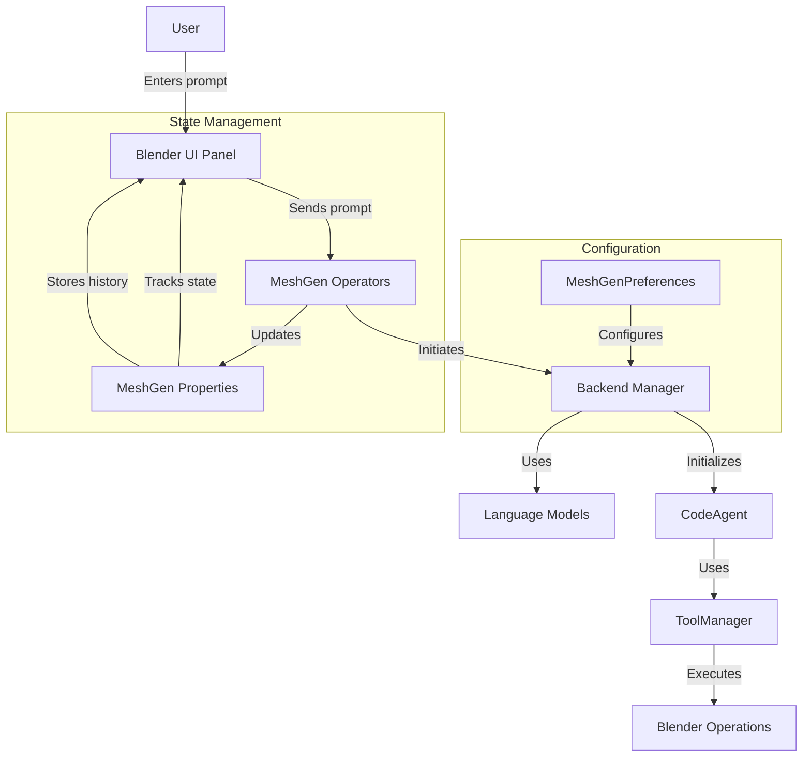
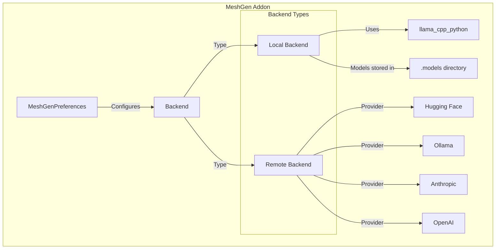
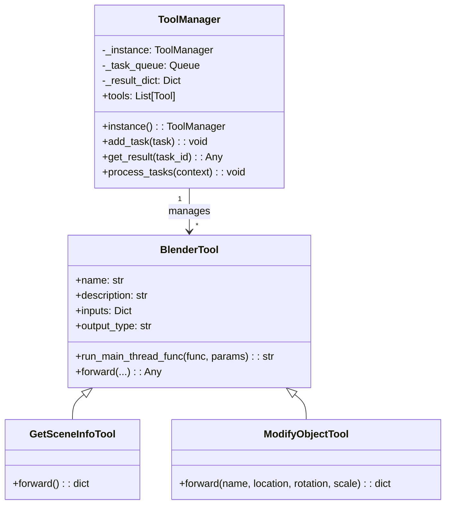
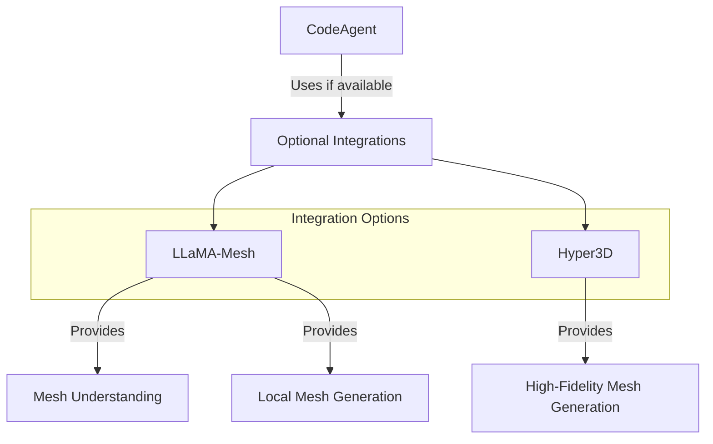
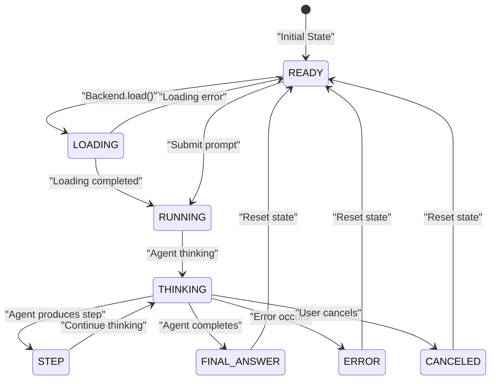
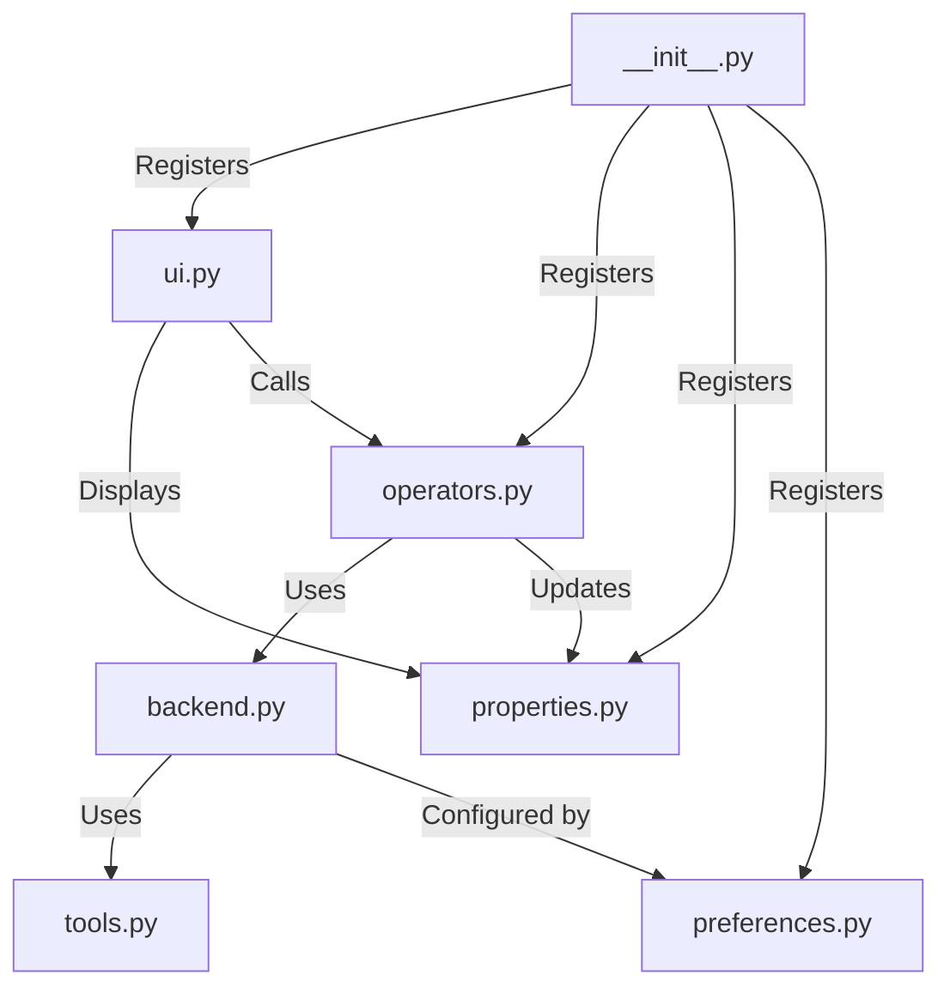

<!-- source: DeepWiki mcp.deepwiki.com · repo huggingface/meshgen · page 1 Overview · fetched 2026-10-26 -->

# Overview

Relevant source files

The following files were used as context for generating this wiki page:

- [README.md](README.md)
- [blender_manifest.toml](blender_manifest.toml)
- [docs/meshgen.gif](docs/meshgen.gif)
- [preferences.py](preferences.py)

MeshGen is a Blender addon that enables users to control Blender with natural language through AI agents. This document provides a high-level introduction to the MeshGen system architecture, core components, and how they interact to enable AI-powered 3D modeling in Blender.

For detailed installation instructions, see [Installation Guide](#2.1). For configuration options, see [Configuration Options](#2.2).

## Core Architecture

MeshGen follows a modular architecture that bridges natural language instructions with Blender operations through an AI agent system. The core components work together to process user prompts and convert them into executable Blender operations.

The user interacts with the MeshGen panel in Blender's UI, entering natural language prompts. These prompts are processed by operators that initialize the backend manager. The backend uses language models to power a CodeAgent, which interprets the prompts and uses the ToolManager to execute Blender operations.

Sources: [README.md:3-15](), [preferences.py:32-186]()

## Backend System

MeshGen supports multiple backend configurations for language model inference, offering flexibility for different user needs and hardware capabilities.

The backend system is configured through MeshGenPreferences and supports two primary types:

1. **Local Backend**: Runs models directly in Blender using llama_cpp_python, requiring at least 8GB of VRAM
2. **Remote Backend**: Connects to external LLM providers, including:
   - Hugging Face
   - Ollama (local server)
   - Anthropic (Claude models)
   - OpenAI (GPT models)

Sources: [preferences.py:32-186](), [README.md:28-94]()

## Tool Management System

The Tool Management system acts as a bridge between the AI agent and Blender's functionality, providing a structured way to execute operations in Blender's main thread.

The ToolManager provides a singleton instance that manages a collection of tools. Each tool inherits from BlenderTool and implements a forward method to execute specific Blender operations. This system ensures that Blender operations run in the main thread while allowing the AI agent to function asynchronously.

Sources: [README.md:12-14]()

## Optional Integrations

MeshGen offers optional integrations that extend its capabilities for 3D content creation:

### LLaMA-Mesh Integration

LLaMA-Mesh provides local mesh understanding and generation capabilities, allowing the system to better comprehend and manipulate 3D geometry.

### Hyper3D Integration

Hyper3D (Rodin) integration enables high-fidelity 3D mesh generation through an external API service.

When these integrations are enabled, the agent automatically gains access to their capabilities based on the context of the user's request.

Sources: [preferences.py:320-354](), [README.md:96-124]()

## Workflow and State Management

MeshGen implements a state machine to manage the progression from user input to final result, ensuring a consistent user experience.

The workflow begins in the READY state. When a user submits a prompt, the system transitions to RUNNING and then THINKING as the agent processes the request. The agent produces intermediate STEP outputs before reaching a FINAL_ANSWER or encountering an ERROR. State changes are tracked in the history, keeping users informed of the process.

Sources: [preferences.py:18-29]()

## Dependencies and Requirements

MeshGen relies on several Python packages to function properly. These dependencies are listed in the blender_manifest.toml file and include:

- llama_cpp_python for local model inference
- smolagents for AI agent functionality
- huggingface_hub for model downloading and remote inference
- Various support libraries (requests, numpy, etc.)

| Requirement | Purpose | Dependency Type |
|-------------|---------|-----------------|
| Python 3.9+ | Base language | Core |
| Blender 4.2.0+ | Host application | Core |
| llama_cpp_python | Local model inference | Optional (Local Backend) |
| CUDA-capable GPU | For GPU acceleration | Optional (Local Backend) |
| Internet connection | For remote backends and model downloads | Optional (Remote Backend) |

Sources: [blender_manifest.toml:1-100](), [README.md:17-27]()

## Technical Implementation

The MeshGen addon is structured according to Blender's addon architecture, with several key Python modules:

This modular architecture allows for separation of concerns:
- `preferences.py` contains the MeshGenPreferences class that configures the backend
- `backend.py` manages model loading and inference
- `tools.py` implements the tools that execute Blender operations
- `operators.py` contains the Blender operators that users interact with
- `ui.py` defines the user interface elements
- `properties.py` manages state and history

Sources: [preferences.py:32-362](), [blender_manifest.toml:1-25]()

## Getting Started

To start using MeshGen:

1. Install the addon from the [Latest Release](https://github.com/huggingface/meshgen/releases/latest)
2. Configure your preferred backend in Blender's Preferences panel
3. Access the MeshGen panel by pressing `N` in the 3D viewport and selecting the MeshGen tab
4. Enter a natural language prompt (e.g., "Create a snowman")
5. Click Submit to generate the model

For more detailed installation and setup instructions, see [Installation Guide](#2.1) and [Configuration Options](#2.2).

Sources: [README.md:16-27](), [README.md:126-131]()

---

