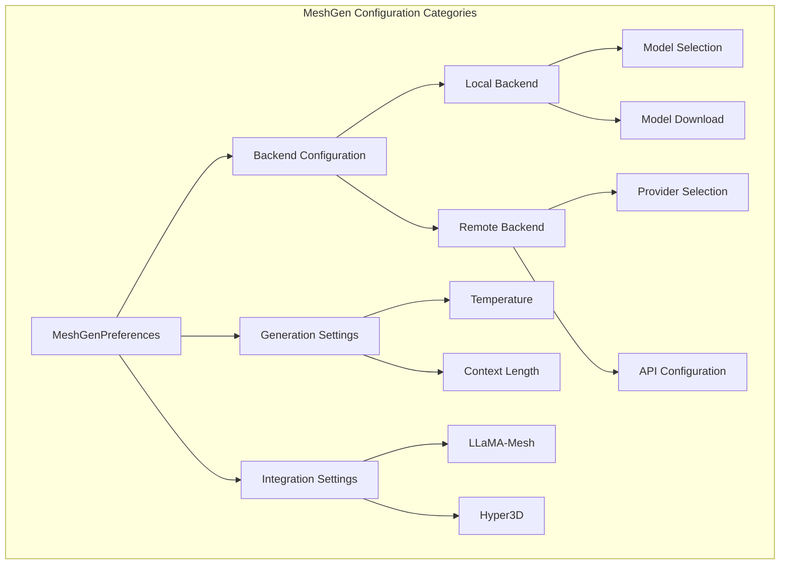
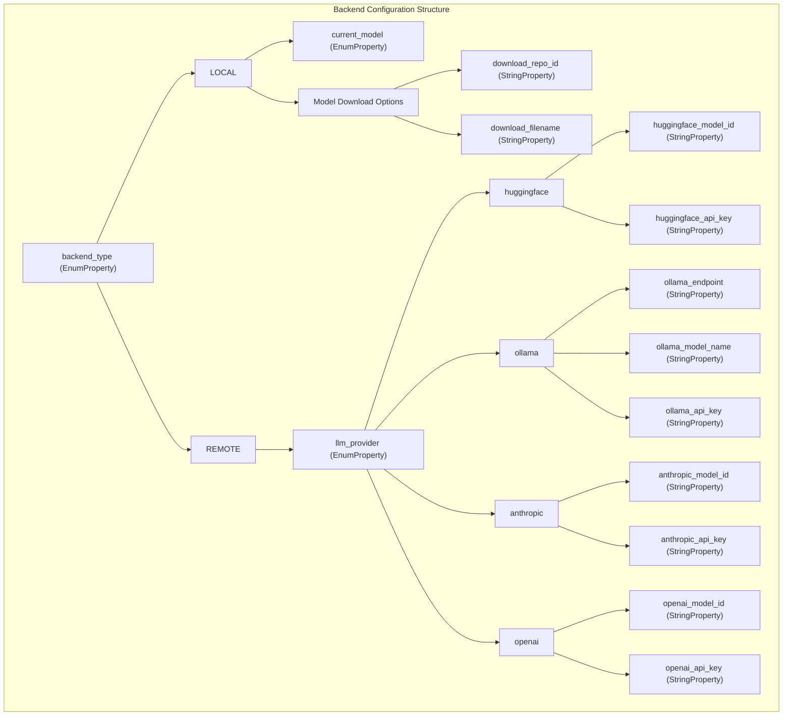
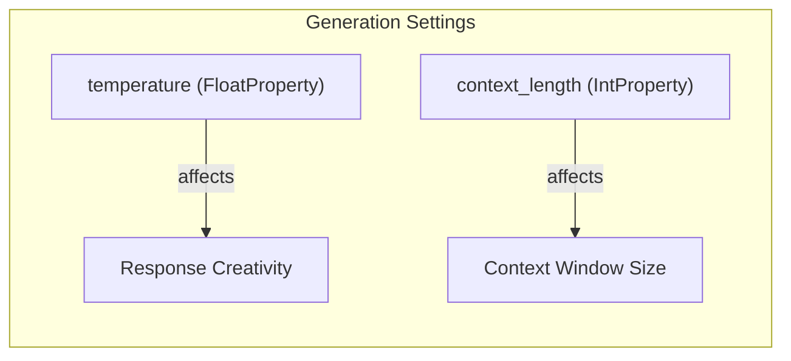
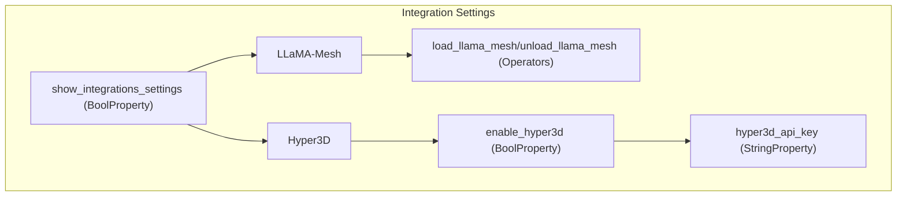
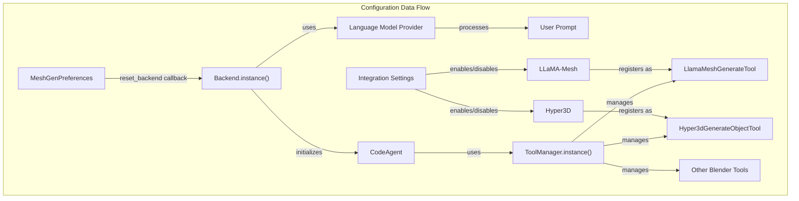
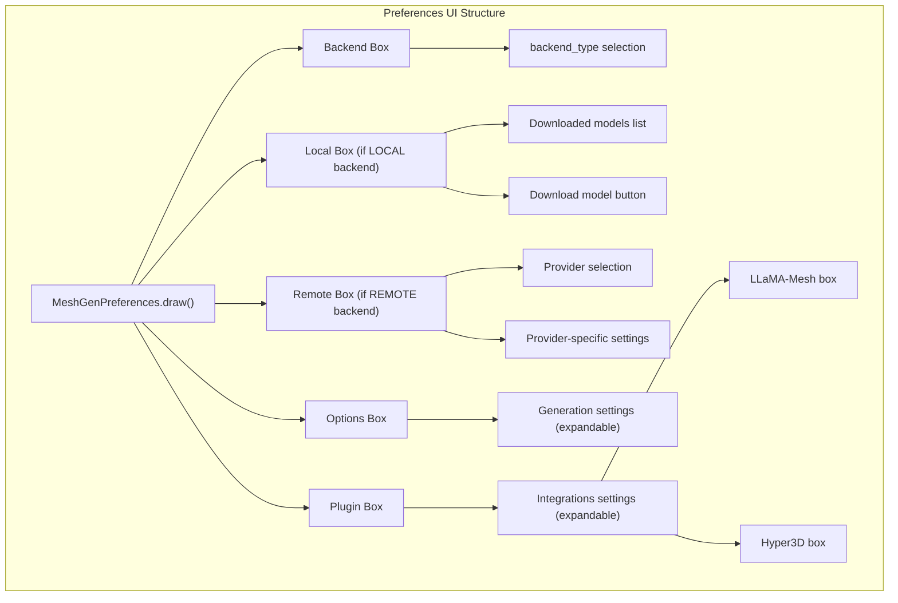

<!-- source: DeepWiki mcp.deepwiki.com · repo huggingface/meshgen · page 2.2 Configuration Options · fetched 2026-10-26 -->

# Configuration Options

Relevant source files

The following files were used as context for generating this wiki page:

- [README.md](README.md)
- [docs/meshgen.gif](docs/meshgen.gif)
- [preferences.py](preferences.py)

This page documents the various configuration options available in the MeshGen addon through its preferences panel. These settings control how MeshGen interfaces with language models, generates 3D objects, and integrates with external tools. For installation instructions, please see [Installation Guide](#2.1).

## Overview of Configuration Options

MeshGen provides a comprehensive set of configuration options that can be accessed through Blender's preferences panel. These settings are organized into three main categories:

1. **Backend Configuration** - Controls how MeshGen connects to language models
2. **Generation Settings** - Fine-tunes the behavior of the language model
3. **Integration Settings** - Manages optional third-party integrations

To access these settings:
1. Go to `Edit` → `Preferences` → `Add-ons`
2. Find and select `meshgen`
3. Expand the preference settings

Sources: [preferences.py:32-186](), [README.md:23-27]()

## Backend Configuration

The backend configuration determines how MeshGen interfaces with language models, which are the core engine for understanding and generating 3D content. MeshGen supports two main types of backends: Local and Remote.

Sources: [preferences.py:36-143](), [README.md:28-93]()

### Local Backend

The Local backend runs language models directly within Blender, providing offline capabilities at the cost of requiring significant GPU resources.

#### Requirements:
- NVIDIA GPU with at least 8GB VRAM
- CUDA version of the addon

#### Configuration Options:

| Option | Type | Description | Default |
|--------|------|-------------|---------|
| `current_model` | EnumProperty | The selected model for local inference | (Dynamically populated from available models) |
| `download_repo_id` | StringProperty | Hugging Face repository ID for model download | "bartowski/Meta-Llama-3.1-8B-Instruct-GGUF" |
| `download_filename` | StringProperty | Filename of the model to download | "Meta-Llama-3.1-8B-Instruct-Q4_K_M.gguf" |

You can download models directly through the preferences panel or manually add `.GGUF` format models to the models folder.

Sources: [preferences.py:54-69](), [preferences.py:196-227](), [README.md:28-44]()

### Remote Backend

The Remote backend connects to external language model providers through APIs, offering access to more powerful models without local resource constraints.

#### Supported Providers:

1. **Hugging Face**
   | Option | Type | Description | Default |
   |--------|------|-------------|---------|
   | `huggingface_model_id` | StringProperty | ID of the model to use | "meta-llama/Llama-3.3-70B-Instruct" |
   | `huggingface_api_key` | StringProperty | API key for authentication | "" |

2. **Ollama**
   | Option | Type | Description | Default |
   |--------|------|-------------|---------|
   | `ollama_endpoint` | StringProperty | Base URL for the Ollama server | "http://localhost:11434" |
   | `ollama_model_name` | StringProperty | Name of the model to use | "gemma3" |
   | `ollama_api_key` | StringProperty | Optional API key for private models | "" |

3. **Anthropic**
   | Option | Type | Description | Default |
   |--------|------|-------------|---------|
   | `anthropic_model_id` | StringProperty | ID of the model to use | "claude-3-5-sonnet-latest" |
   | `anthropic_api_key` | StringProperty | API key for authentication | "" |

4. **OpenAI**
   | Option | Type | Description | Default |
   |--------|------|-------------|---------|
   | `openai_model_id` | StringProperty | ID of the model to use | "gpt-4o" |
   | `openai_api_key` | StringProperty | API key for authentication | "" |

Sources: [preferences.py:70-143](), [preferences.py:228-292](), [README.md:45-94]()

## Generation Settings

These settings control how the language model generates content, affecting its creativity and performance.

| Option | Type | Description | Range | Default |
|--------|------|-------------|-------|---------|
| `temperature` | FloatProperty | Controls randomness in generation (higher = more creative, lower = more predictable) | 0.0 - 1.0 | 0.7 |
| `context_length` | IntProperty | Maximum number of tokens in the context window | 1024 - 65536 | 32768 |

Sources: [preferences.py:156-169](), [preferences.py:294-307]()

## Integration Settings

MeshGen offers optional integrations with external tools to enhance its mesh generation capabilities.

### LLaMA-Mesh Integration

LLaMA-Mesh provides local mesh understanding and generation capabilities.

#### Requirements:
- NVIDIA GPU with at least 8GB VRAM (additional 5GB VRAM required beyond the backend)
- CUDA version of the addon
- Preferably used with a Remote backend to avoid VRAM conflicts

LLaMA-Mesh is loaded on-demand through the preferences panel and can be unloaded when not needed.

### Hyper3D Integration

Hyper3D (Rodin) is an API-based service for high-fidelity 3D mesh generation.

| Option | Type | Description | Default |
|--------|------|-------------|---------|
| `enable_hyper3d` | BoolProperty | Enable Hyper3D integration | False |
| `hyper3d_api_key` | StringProperty | API key for authentication | "awesomemcp" |

Sources: [preferences.py:170-185](), [preferences.py:308-354](), [README.md:95-124]()

## Configuration Data Flow

The following diagram illustrates how configuration options flow through the MeshGen system:

Sources: [preferences.py:18-29]()

## Preferences UI Structure

The MeshGen preferences panel is organized into sections that match the configuration categories described above. The UI dynamically adjusts based on the selected backend type and provider.

Sources: [preferences.py:188-355]()

## Configuration Reset Mechanism

When configuration options change, MeshGen ensures the system properly adapts by resetting the backend and clearing state.

The `reset_backend` function ([preferences.py:18-29]()) is called whenever critical configuration options are modified. This function:

1. Gets the current backend instance
2. Resets the backend to apply new configuration
3. Resets the MeshGen properties state to "READY"
4. Clears the history
5. Redraws relevant Blender UI areas

Sources: [preferences.py:18-29]()

---

