<!-- source: DeepWiki mcp.deepwiki.com · repo huggingface/meshgen · page 3 System Architecture · fetched 2026-10-26 -->

# System Architecture

Relevant source files

The following files were used as context for generating this wiki page:

- [__init__.py](__init__.py)
- [backend.py](backend.py)
- [preferences.py](preferences.py)
- [tools.py](tools.py)

This document provides a comprehensive overview of the MeshGen addon's architecture, explaining how the various components interact to create an AI-powered 3D mesh generation system within Blender. For information about installation and setup, see [Installation and Setup](#2), and for details about specific subsystems, see the corresponding pages in [Backend System](#3.1), [Tools System](#3.2), and [State Management](#3.3).

## Core Architecture Overview

MeshGen is built as a Blender addon that integrates language models with Blender's 3D modeling capabilities. The system follows a modular architecture that separates concerns between user interface, backend model management, tool execution, and state tracking.

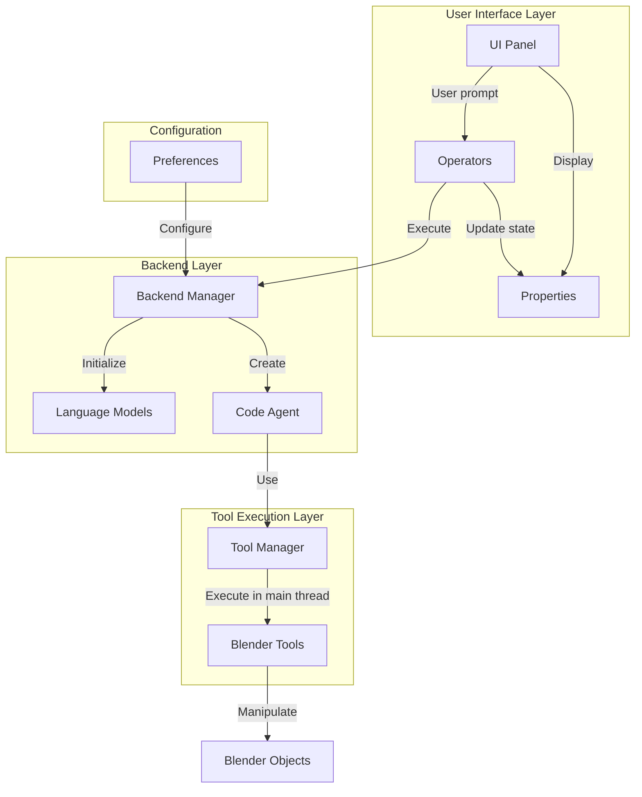

Sources: [__init__.py:33-52](), [backend.py:12-25](), [tools.py:12-90]()

## Component Relationships

The MeshGen addon consists of several key components that work together:

| Component | Purpose | Key Classes | File |
|-----------|---------|-------------|------|
| UI Layer | User interaction | UI panels, operators | ui.py, operators.py |
| Backend | Language model management | `Backend` | backend.py |
| Tool System | Blender operations execution | `ToolManager`, `BlenderTool` | tools.py |
| Configuration | User preferences | `MeshGenPreferences` | preferences.py |
| State | Tracking conversation state | `MeshGenProperties` | properties.py |

### Module Dependencies

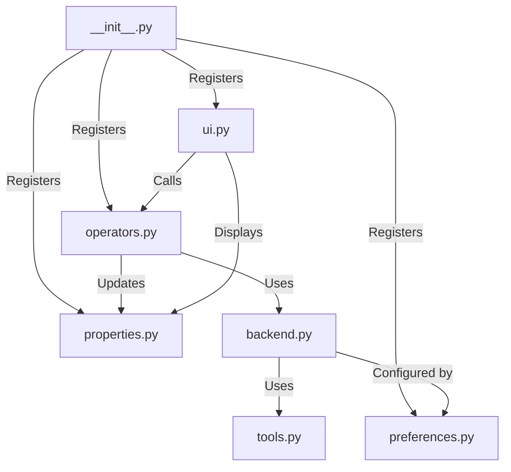

Sources: [__init__.py:1-57]()

## Backend System Architecture

The backend system is responsible for managing language models and processing user prompts through an agent.

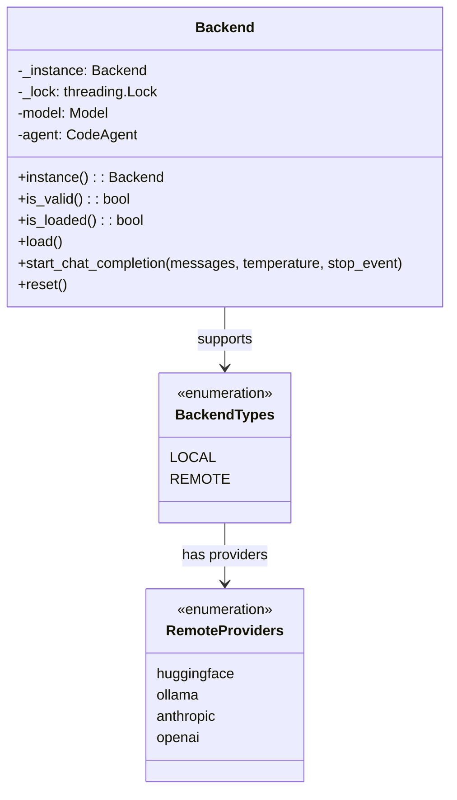

Sources: [backend.py:12-228](), [preferences.py:35-53](), [preferences.py:70-83]()

### Backend Configuration

The backend system supports two main types of backends:

1. **Local Backend**: Runs models directly within Blender using llama_cpp_python
2. **Remote Backend**: Connects to external API services

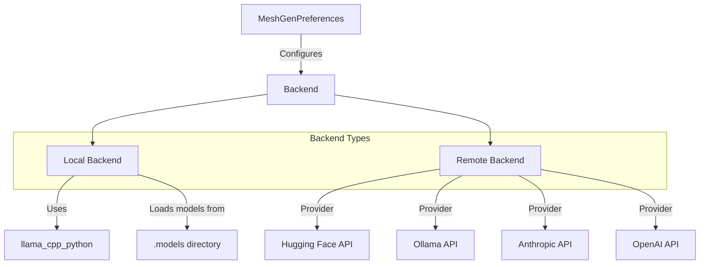

Sources: [backend.py:57-136](), [preferences.py:35-143]()

## Tool Management System

The tool management system is responsible for executing operations in Blender's main thread, ensuring thread safety while allowing the AI agent to control Blender.

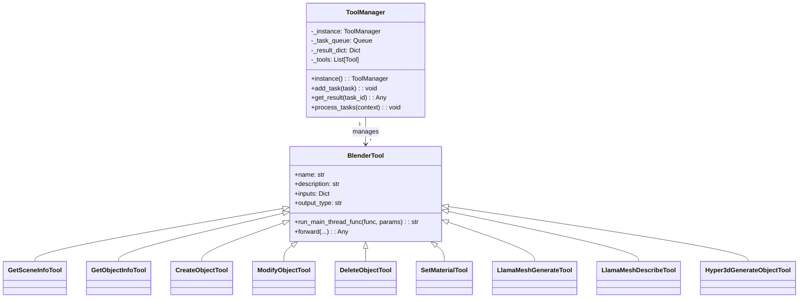

Sources: [tools.py:12-90](), [tools.py:92-112](), [tools.py:164-833]()

### Tool Execution Flow

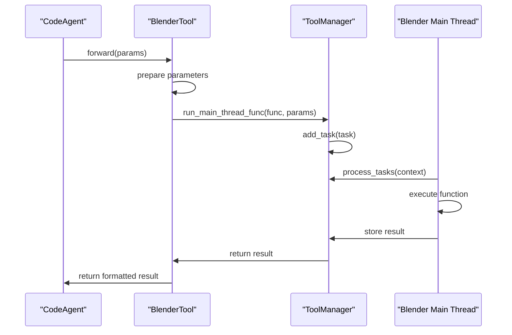

Sources: [tools.py:99-111](), [tools.py:55-64](), [tools.py:66-82]()

## Code Agent System

The CodeAgent is the bridge between natural language prompts and concrete actions in Blender, using a language model to understand user intent.

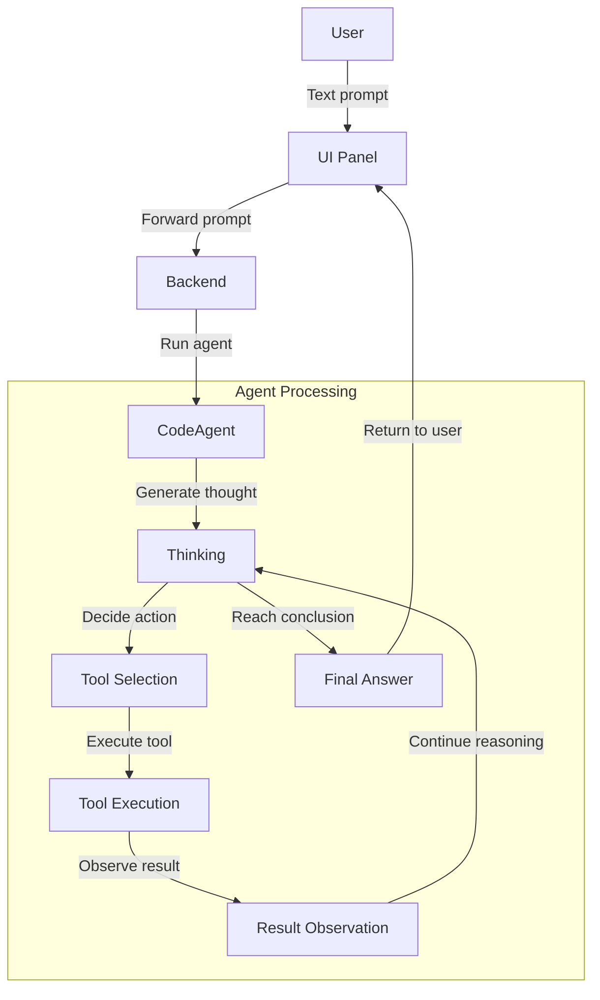

Sources: [backend.py:140-156](), [backend.py:158-179](), [backend.py:180-204]()

## State Management

MeshGen implements a state machine to track the status of user interactions and AI processing.

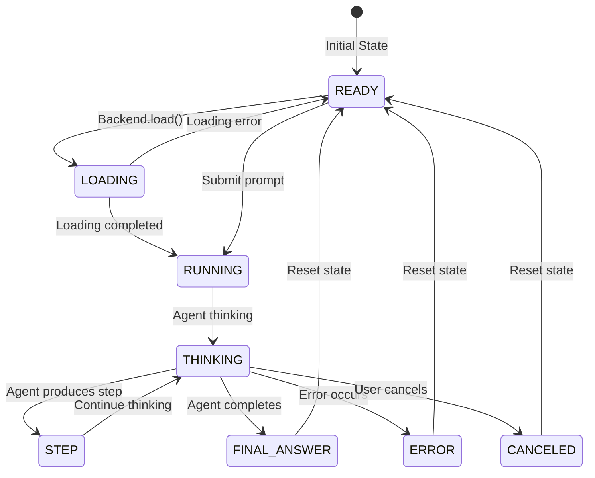

Sources: [preferences.py:18-29](), [backend.py:158-179]()

## Integration Architecture

MeshGen supports integrations with external libraries and services to enhance mesh generation capabilities.

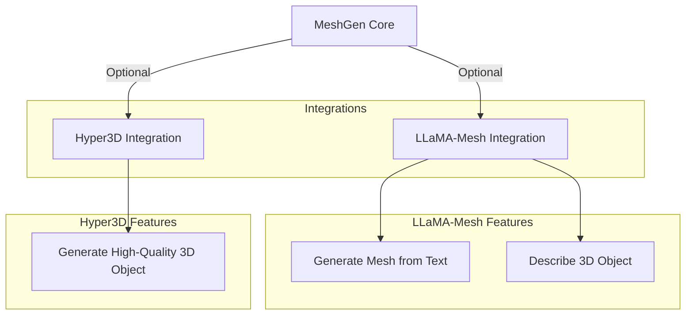

Sources: [tools.py:842-893](), [tools.py:974-1038](), [tools.py:1110-1155](), [tools.py:1158-1350](), [preferences.py:175-184]()

## Data Flow

The following diagram illustrates how data flows through the MeshGen system, from user input to 3D model creation:

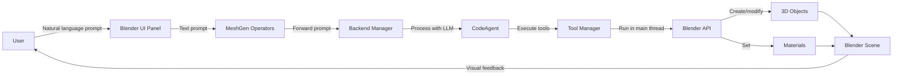

Sources: [__init__.py:33-52](), [backend.py:158-179](), [tools.py:278-408](), [tools.py:66-82]()

## System Initialization

The initialization flow for MeshGen shows how components are registered and loaded:

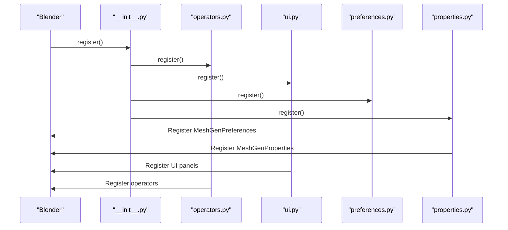

Sources: [__init__.py:34-40]()

## Conclusion

The MeshGen architecture is designed with modularity and extensibility in mind. By separating concerns between the UI, backend, and tool execution layers, the system can support multiple model backends and tool implementations while maintaining a consistent user experience.

For more detailed information about specific subsystems, see the corresponding wiki pages:
- [Backend System](#3.1) for details on language model management
- [Tools System](#3.2) for information about tool implementation and execution
- [State Management](#3.3) for details on conversation state tracking

---

