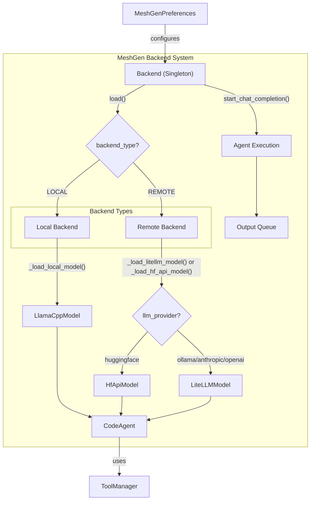
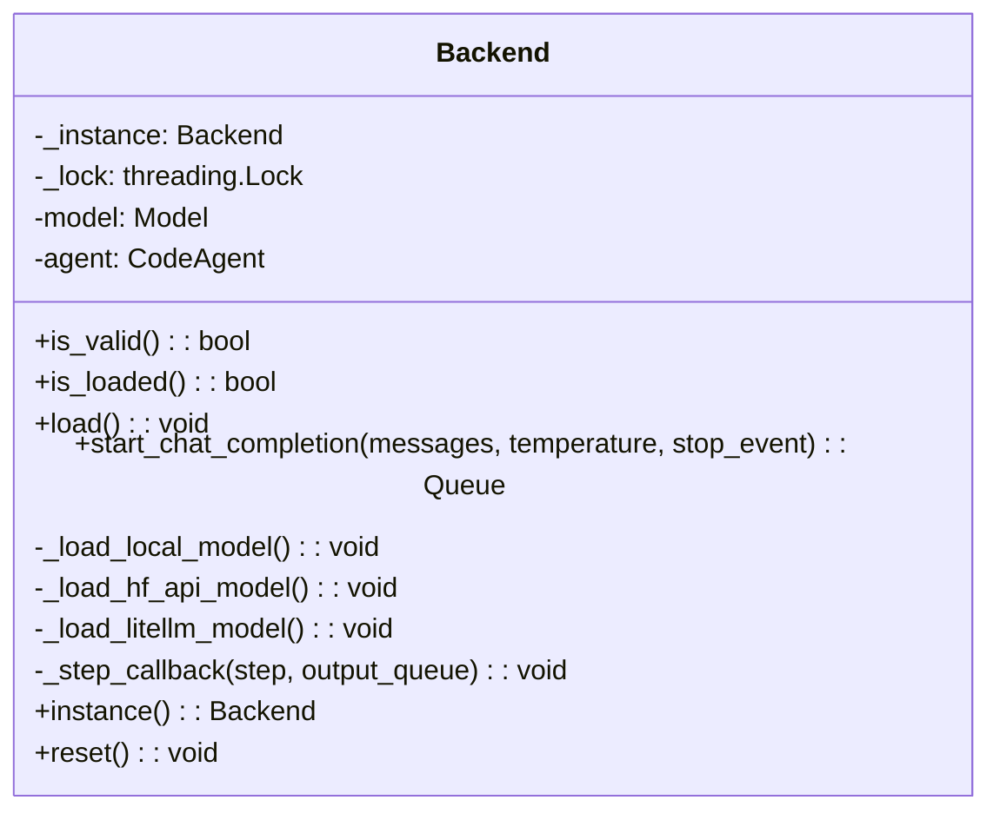
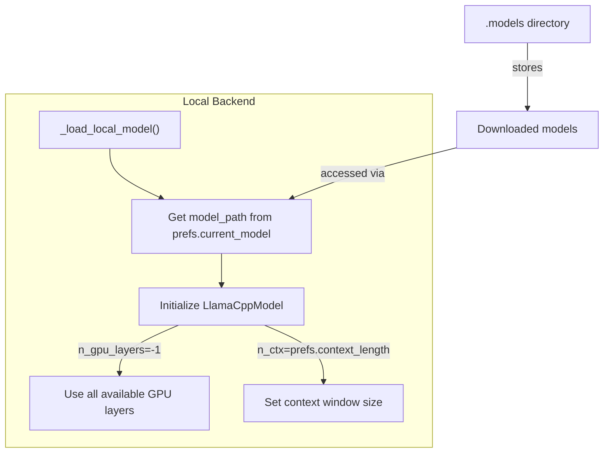
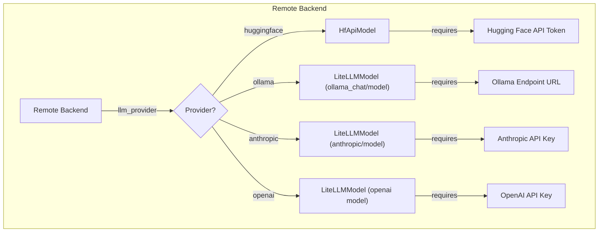
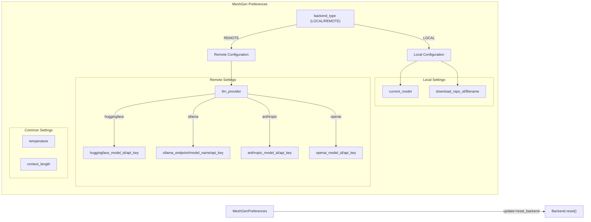
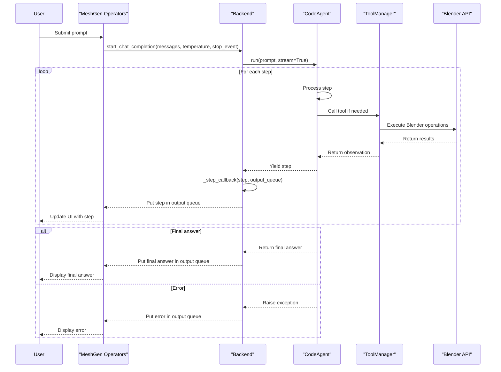
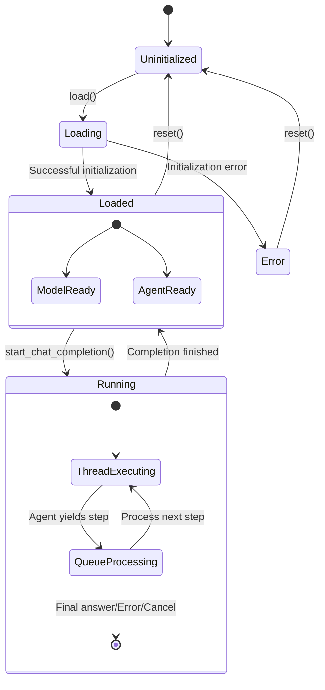

<!-- source: DeepWiki mcp.deepwiki.com · repo huggingface/meshgen · page 3.1 Backend System · fetched 2026-10-26 -->

# Backend System

Relevant source files

The following files were used as context for generating this wiki page:

- [backend.py](backend.py)
- [preferences.py](preferences.py)
- [requirements/cpu.txt](requirements/cpu.txt)
- [requirements/cuda.txt](requirements/cuda.txt)

The Backend System in MeshGen is responsible for managing the connection to AI language models that power all mesh generation functionality. It enables both local model inference (running directly in Blender) and remote API-based inference (connecting to external services). This page documents the backend architecture, its configuration options, and how it connects with the rest of the system.

For information about the tools that the backend uses to interact with Blender, see [Tools System](#3.2).

## Architecture Overview

The Backend System is built around a singleton `Backend` class that manages model loading, initialization, and inference. It supports two main backend types: Local and Remote.

*Backend System Architecture*

Sources: [backend.py:12-228](), [preferences.py:32-355]()

## Backend Class

The `Backend` class is implemented as a singleton to ensure there's only one instance managing AI models throughout the application.

*Backend Class Structure*

The `Backend` class has these key responsibilities:
- Managing model lifecycle (loading, initialization, cleanup)
- Creating and managing the CodeAgent
- Providing an interface for executing chat completions
- Processing agent execution steps and routing them to the UI

Sources: [backend.py:12-228]()

## Backend Types

### Local Backend

The Local Backend runs inference directly within Blender using the `llama_cpp_python` library, which provides efficient CPU and GPU-based inference of GGUF-format language models.

*Local Backend Implementation*

Key characteristics of the Local Backend:
- Requires downloading model files to the `.models` directory
- Utilizes GPU acceleration when available
- Configurable context length
- Recommended to have at least 8GB VRAM for optimal performance

Sources: [backend.py:57-67](), [preferences.py:54-59](), [requirements/cpu.txt:1-2](), [requirements/cuda.txt:1-2]()

### Remote Backend

The Remote Backend connects to external API services to perform inference. It supports multiple providers through direct API integration or via the LiteLLM abstraction layer.

*Remote Backend Providers*

The Remote Backend offers these provider options:

1. **Hugging Face**
   - Uses direct API integration via `HfApiModel`
   - Requires a valid API token
   - Model specified by repository ID

2. **Ollama**
   - Uses LiteLLM wrapper to connect to an Ollama server
   - Can be self-hosted (default: http://localhost:11434)
   - Supports various locally-hosted models

3. **Anthropic**
   - Uses LiteLLM wrapper to connect to Anthropic API
   - Provides access to Claude models
   - Requires an Anthropic API key

4. **OpenAI**
   - Uses LiteLLM wrapper to connect to OpenAI API
   - Provides access to GPT models
   - Requires an OpenAI API key

Sources: [backend.py:69-136](), [preferences.py:70-143](), [requirements/cpu.txt:5](), [requirements/cuda.txt:5]()

## Configuration

The MeshGen backend is configured through the addon preferences panel in Blender. Configuration is managed by the `MeshGenPreferences` class.

*Backend Configuration Flow*

Key configuration options include:

| Setting Category | Options | Description |
|-----------------|---------|-------------|
| Backend Type | LOCAL, REMOTE | Determines whether to use local or remote inference |
| Local Settings | Current Model | Selected model file for local inference |
| Remote Provider | huggingface, ollama, anthropic, openai | Selected API provider for remote inference |
| Provider Settings | API Keys, Model IDs, Endpoints | Provider-specific configuration |
| Generation Settings | Temperature | Controls randomness (0.0-1.0) |
| | Context Length | Maximum token context window (1024-65536) |

When preferences are changed, the `reset_backend` function is called, which resets the Backend instance and clears any loaded models.

Sources: [preferences.py:17-31](), [preferences.py:32-186](), [preferences.py:188-354]()

## Integration with CodeAgent

The backend creates and manages a `CodeAgent` instance that handles the execution of prompts and tool calls.

*Backend and CodeAgent Interaction*

The `CodeAgent` is initialized with:
- The selected language model
- Available tools from the `ToolManager`
- Authorized Python imports
- Logging configuration

When a prompt is processed, the backend creates a separate thread for agent execution, which allows the Blender UI to remain responsive. The agent's execution steps are processed by the `_step_callback` method and placed in a queue for consumption by the UI.

Sources: [backend.py:140-156](), [backend.py:158-201]()

## Model and Agent Lifecycle

The Backend manages the lifecycle of models and agents, ensuring proper initialization and cleanup:

*Model and Agent Lifecycle States*

The lifecycle includes:
1. **Initialization** - Loading the appropriate model based on preferences
2. **Execution** - Running the agent on a separate thread and processing results
3. **Cleanup** - Properly releasing resources when the backend is reset

The `reset` method ensures proper cleanup of model and agent resources, which is crucial when changing configuration or shutting down the addon.

Sources: [backend.py:209-227](), [preferences.py:17-31]()

## Performance Considerations

The Backend System's performance characteristics vary based on the selected backend type:

| Backend Type | Advantages | Limitations | Requirements |
|--------------|------------|-------------|--------------|
| LOCAL | - No internet required - No API costs - Full privacy | - Requires VRAM - Limited to smaller models - May be slower | - 8GB+ VRAM recommended - GPU support for acceleration |
| REMOTE (Ollama) | - Better local models - No API costs - Control over hosting | - Requires separate server - Additional setup | - Ollama server running - Sufficient system resources |
| REMOTE (API) | - Access to state-of-the-art models - No local resources needed | - Requires internet - API costs - Data leaves system | - API keys - Internet connection |

Sources: [preferences.py:196-202](), [preferences.py:235-242](), [preferences.py:250-257](), [preferences.py:265-272](), [preferences.py:280-287]()

## Integration with External Systems

The Backend System can optionally integrate with specialized AI systems for enhanced functionality:

1. **LLaMA-Mesh Integration**
   - Provides specialized mesh understanding and generation
   - Loaded separately from the main backend
   - Requires additional VRAM when used with local backend

2. **Hyper3D Integration**
   - External API for high-quality mesh generation
   - Enabled through preferences
   - Requires API key

These integrations complement the main language model capabilities with specialized 3D understanding and generation features.

Sources: [preferences.py:323-354]()

---

